## ファイル1 — 会社紹介テープ（Company Introductory Tape）

2020年4月26日初公開、2023年2月19日に一部新規演出を加えて再アップロードされたシリーズ第1話（尺：11分5秒）。すでに消滅した企業「バニースマイルズ社（BSI）」のテープ3本を、「アンソニー（Anthony）」という人物が入手・編集して公開したアーカイブ映像という体裁をとる。動画概要欄によれば、前半は1974〜1979年頃に新入社員へ配布されていた社内テープ、最後は1982年に新任の「施設管理人（Facility Caretaker）」が記録した映像と説明されている。

**小目次（ジャンプ）**

- [テープ1 — BSI新入社員向け紹介ビデオ（1974年）](#f1-t1)
- [テープ2 — 子ども向けアニメ「リトルボンのご近所」（1979年）](#f1-t2)
- [テープ3 — ブライアン・ステルズの施設調査録画（1982年10月10日）](#f1-t3)
- [ファイル1の考察](#f1-thoughts)

### テープ1 — BSI新入社員向け紹介ビデオ（1974年） {#f1-t1}

冒頭、「A CYBERFUN TECH - BUNNY SMILES INC. Restaurant 1974」と記されたロゴカードに続き、技術サポート・保守部門（役割名：施設管理人／Facility Caretaker）の新入社員に向けた明るい研修ビデオが始まる。数週間後に開店を控えたレストラン「ボンズバーガーズ（Bon's Burgers）」で子どもたちを楽しませるアニマトロニクスバンド「ショーストッパーズ（Showstoppers）」（ボン、シャ、ブーズー、バニー）の歌唱映像として、『The Sun Has Got His Hat On』『How Much is that Doggie in the Window』『Old MacDonald Had a Farm』の3曲が紹介される（3曲目の豚の鳴き声パートで、ボンが不自然に甲高い生々しい悲鳴のような音を上げる）。

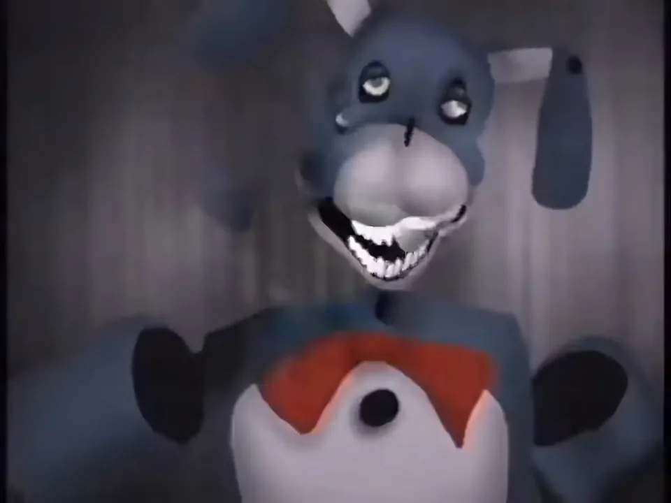

続いて日常業務として「清掃プロトコル」「ロボットのメンテナンスと修理」「BSI技術の習得」が案内され、共同創業者ジャック・ウォルテンとフェリックス・クランケンが握手する写真と共に、「BSIにとって最も大切なのはお金や評価ではなく、皆さんが素晴らしい体験をすること」という歓迎メッセージが読み上げられる。

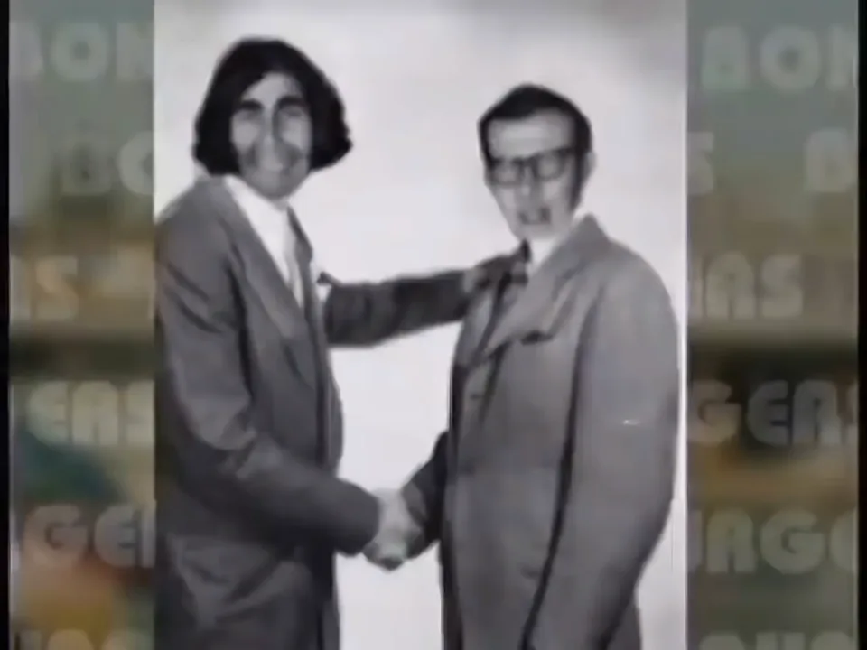

しかし「数週間後の開店に向けて夢を叶えよう」と締めくくられる直前、背景が赤く染まってボンのイラストが異様に引き伸ばされ、映像が激しくグリッチする。直後、時系列を超えて「1974年の店舗内で起きた『一連の事件』を受け、永久閉店（Closed for Good）となったボンズバーガーズの全資産・アニマトロニクス・筐体をセントジョアナの森の奥深くにある地下バンカー『K-9保管施設』へ移送・隔離する（Save, Restore, Secure!）」という不穏な案内テキストが割り込む。

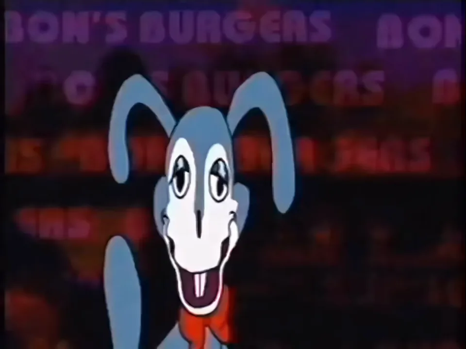

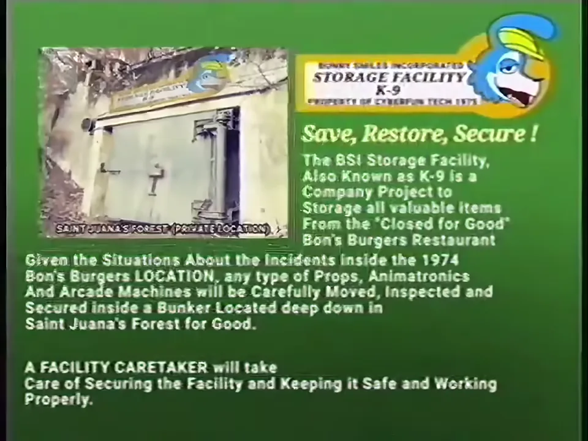

**重要な点：** テープ開始直前、激しいノイズと共に森の中の白黒のウサギ映像が一瞬挿入される（2023年再アップロード版での追加演出）。また、ナレーターが「ロボットのメンテナンスと修理（robot maintenance and repair）」と口にする瞬間だけ、リトルボンがボンの腕パーツを持つイラストと共に声が不気味に低く歪む。テープ末尾には暗闇に灰色のウサギ人形（Rocket）が現れ、逆再生音声で「You finally start to remember. That old day. They will be back for you soon, Sophie.（やっと記憶が戻り始めたね。あの遠い日のことを。もうすぐ彼らが迎えに来るよ、ソフィー）」と語りかける。

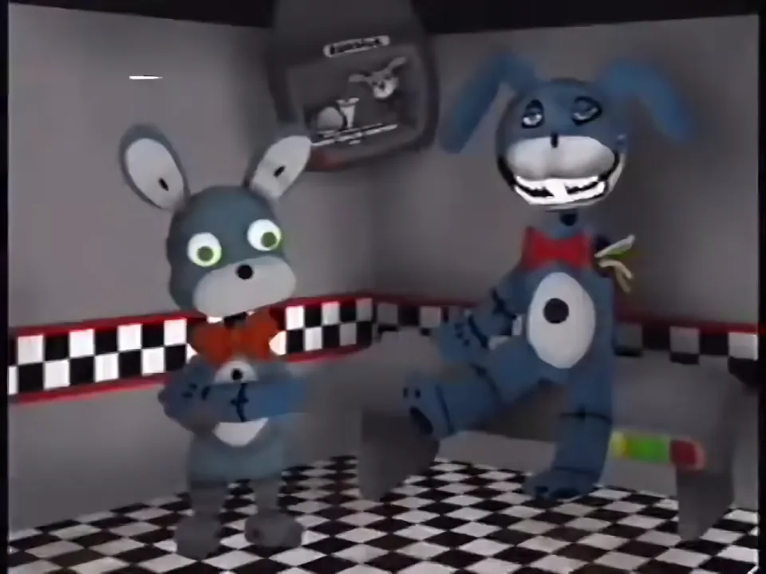

### テープ2 — 子ども向けアニメ「リトルボンのご近所」（1979年） {#f1-t2}

BSI傘下「サンライトアニメーション（Sunlight Animation）」制作の1979年の子ども向け番組『Little Bon's Neighbourhood』の一編「Bon's Super Sleepover」（脚本：Sarah Evelyn）。「Brighton 27」の番地プレートが掲げられた黄色い家で、リトルボンが友達を招いてお泊まり映画会を開く物語として始まる。招待客リストとしてシャ、ブーズー、ピエロのビリー（バニーは招待されていない）が紹介されるが、2回目の確認でナレーションが途切れ、リトルボンの目と背景が黒く塗り潰されて、ビリーの枠が不気味に歪んだジャック・ウォルテンの顔に差し替わる。

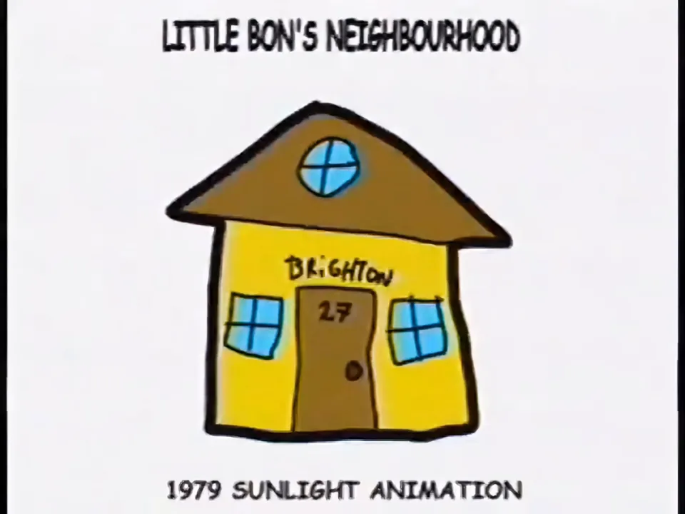

何事もなかったかのようにアニメが再開し、リトルボンが「なけなしのお金で買った面白い映画」を取り出すが、パッケージには逆さまの「Home video」という文字とジャックの顔が印刷されている。一行が視聴する「BONY™ 1978」製のテレビの横には「SOPHIE WALTEN」名義の処方薬ボトルが置かれており、画面には映画の代わりに「Let me out of here（ここから出して）」というテキストが表示されてテレビ自体が上下に引き伸ばされる。

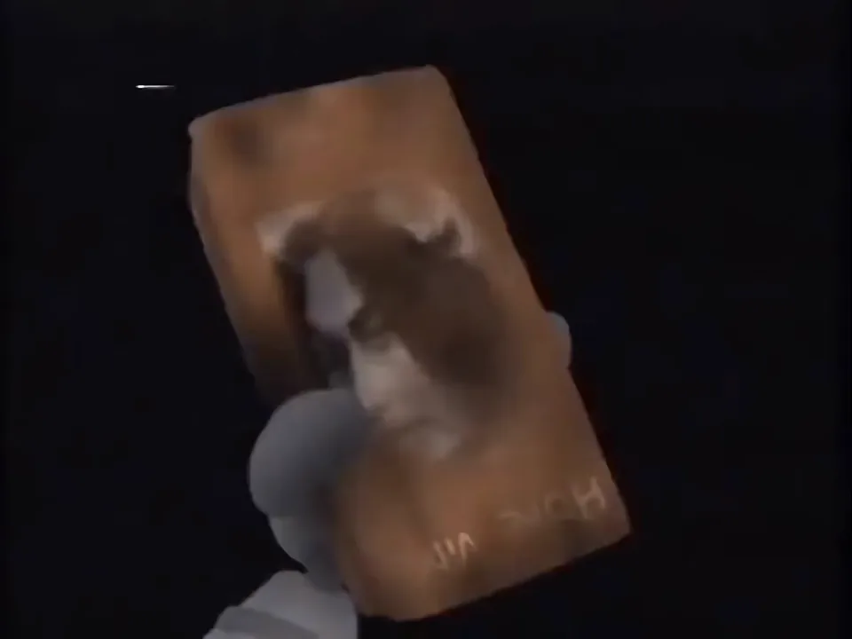

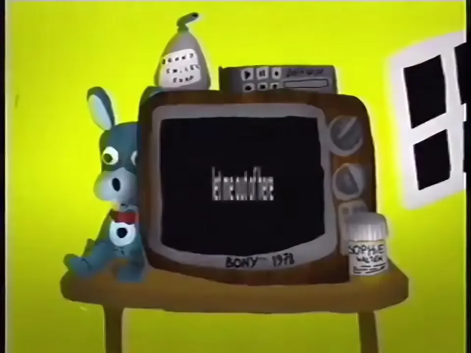

夜になり全員が寝袋で眠りについた後（リトルボンだけ「目」が描かれたピンクのアイマスクを着用）、家の奥からの物音で起きたリトルボンが暗い室内を歩き回る。ひとりでに点いたテレビにはジャック・ウォルテンの行方不明ポスター（最終目撃：1974年6月11日）が映り、目と口が不気味に蠢きながら呻き声のようなノイズを発する。

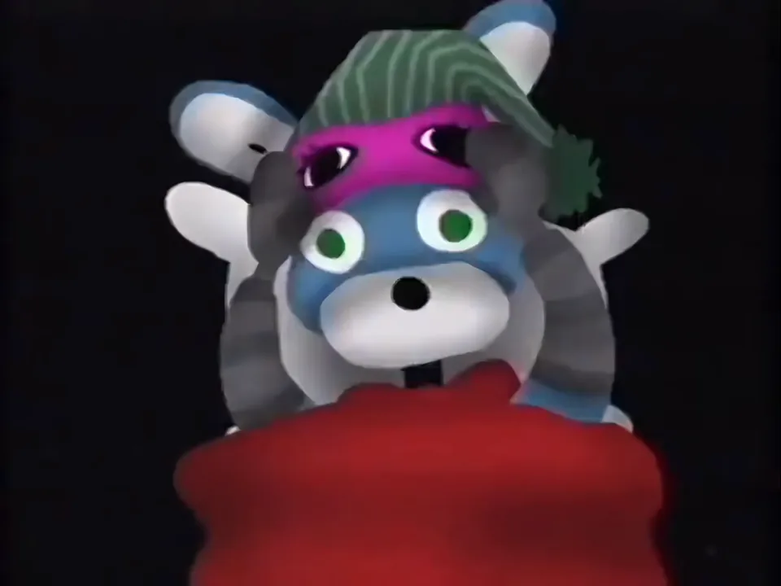

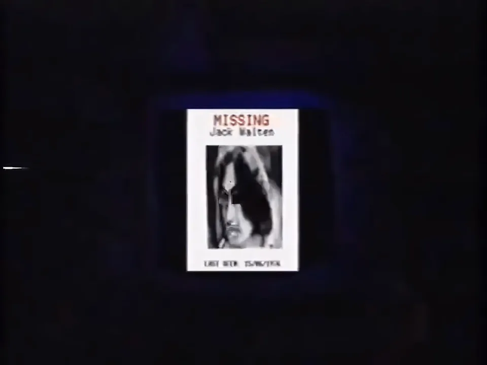

足元のタイル床でライター（「a lighter.」）を見つけたリトルボンは、3回の着火失敗ののち4回目で火を灯す。その瞬間、リトルボンの姿は「SOPHIE」の名前が見える施設管理人制服姿の女性（ソフィー・ウォルテン。Wikiによれば、名前は帽子に書かれている）へと変わり、そのすぐ背後に外装が剥がれ落ちたボロボロのボンが立ち尽くしているカットで強制終了する。

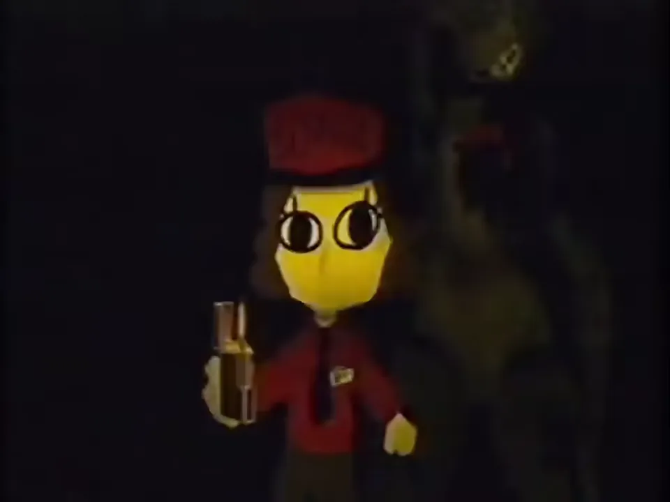

### テープ3 — ブライアン・ステルズの施設調査録画（1982年10月10日） {#f1-t3}

1982年、新任の施設管理人ブライアン・ステルズが業務記録用として撮影した車載・手持ちカメラ映像。森の中の道に20分迷いながらK-9保管施設に到着したブライアンは、上司のクリス（Chris）から「78〜79年頃から稼働していない」と聞かされており、それから約4年も経っているのでひどい悪臭がするはずだと語る。施設内部へ入ったブライアンは壁に貼られた写真群（フェリックス・クランケン、BSI関係者・家族の集合写真、エド＆モリー・ウォルテンの写真）をライトで照らしてズームし、そのたびに映像にノイズが走る。

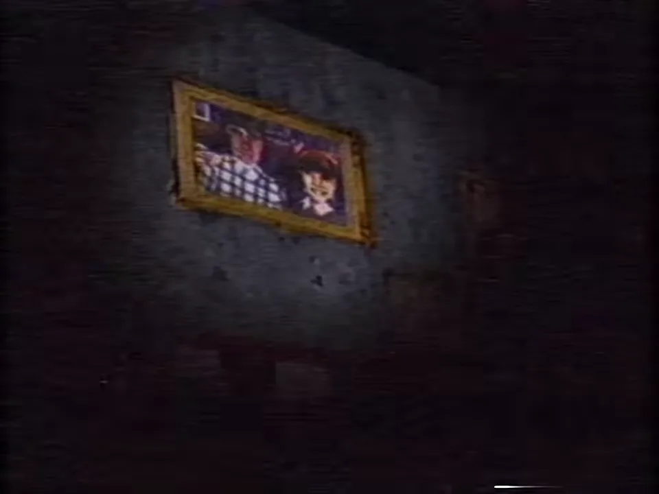

奥へ進むと「下水道のような悪臭」が漂う部屋で、外装が剥がれ内骨格が露出したボンのアニマトロニクスを発見。「移転プロジェクト（Relocate Project）に使えるかもしれない」と診断コンソールを起動し、頭部と口、右腕の順で動作テストを行う。しかし動きの鈍い左腕を確認しようとした瞬間、逆再生の笑い声が響いて映像が遮断される。画面は真っ白な背景に切り替わり、空洞だったボンの眼窩に生々しい人間の両目が浮かび上がって、どす黒い血の涙が溢れ出す。

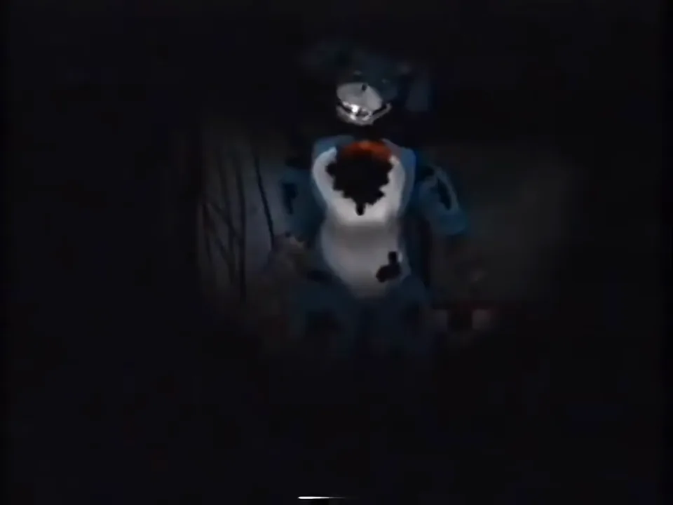

次の瞬間、カメラは夜の森を必死に逃走するブライアンの映像へ戻る。「WHAT WAS THAT THING-?（なんだあれは！？）」と叫んだ直後、鈍い破砕音と共に映像が暗転。荒い呼吸音と肉を裂くような水音の中、暗闇に2つの白い点が浮かび、ブライアンが懐中電灯を点灯すると、返り血にまみれたボンが目の前にうずくまっている。光に照らされたボンは自らの顔を隠すように右手を上げながら咆哮し、静止したフレームが歪んで「常に笑顔の歯」が反転した巨大なへの字口へと変貌する。

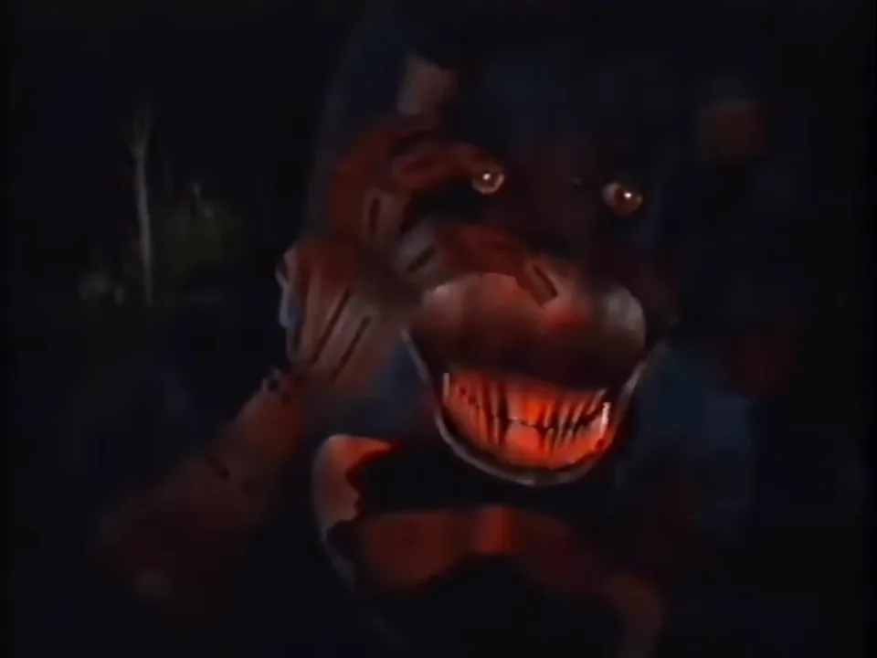

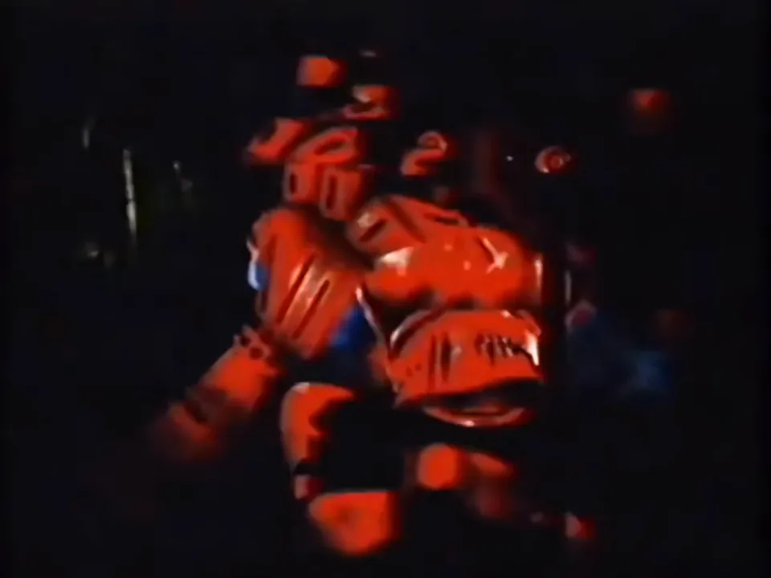

直後、CyberFun Techコンソールの3D顔認識画面（表情を変えながら変形する白い顔モデルとサイレン音）が割り込み、無音のVCRノイズの中で顔面を損壊され腕をもがれたブライアンの遺体が映し出される。画面下部には「i cant feel anything（何も感じられない）」「he thought i was her.（彼は私を彼女だと思った）」というテキストが浮かび、暗闇からブライアンのBSI社員証がフェードインする。

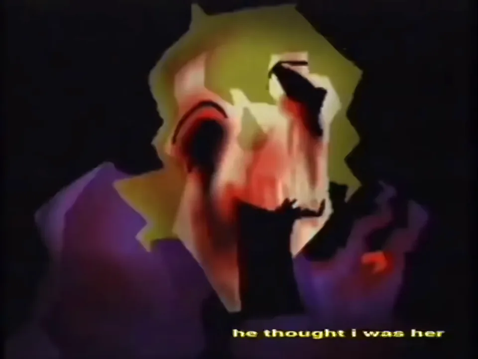

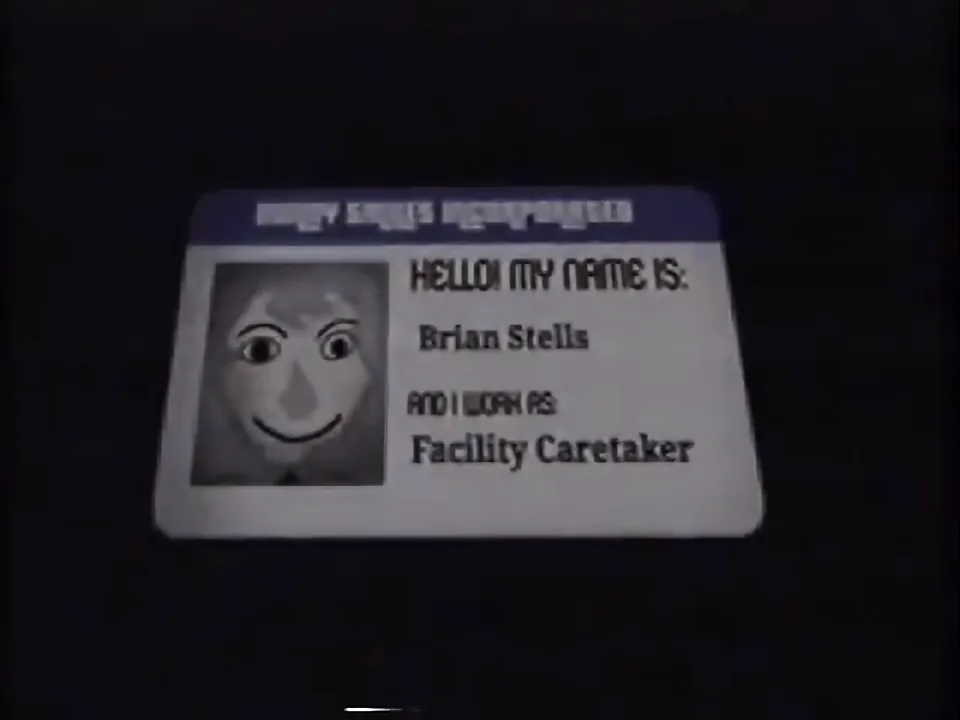

最後はドビュッシー『月の光（Clair de Lune）』が流れる中、不気味な笑みを浮かべるモノクロのジャック・ウォルテンの写真が現れ、背景が徐々に真っ白な光に満たされてジャックの姿が白の中へ溶け込むように消えていく。

### ファイル1の考察 {#f1-thoughts}

**「3本のテープ」が作る段階的侵食構造とアンソニーの枠組み：**
=> 年代の異なる3本のテープを通じて異常が現実の殺害現場へと段階的に噴出しており、テープそのものがソフィーの記憶を呼び覚ます媒介になっていることがうかがえる。
本作は「1974年の社内研修テープ」→「1979年の子ども向けアニメ」→「1982年の実録調査映像」という異なる年代・媒体の3本を繋ぐことで、最初はサブリミナル的な違和感だった異常が、徐々にテープ自体を乗っ取り、最終的に現実世界の殺害現場へと噴出する構造をとっている。また、投稿者アンソニーは単なるアーカイブ収集者として振る舞っているが、テープ1末尾の逆再生メッセージが「ソフィー」個人へ宛てられていることから、テープそのものが特定の視聴者（ソフィー）の記憶を呼び覚ます媒介として干渉を受けていると読み取れる。

**誤認殺害のメカニズムと「制服姿のソフィー」の意味（ソフィーとブライアンの切り分け）：**
=> 1982年に殺害された管理人はソフィーと誤認されたブライアンであり、テープ2末尾のソフィーの姿は、Wikiの記録で制作側が「作中で実際に起きる出来事」としている後年の場面の先取りと考えられる。
テープ3終盤で挿入される3D顔モデルの変形演出（1974年にユタ大学で制作された初期CGI映像の引用）と「he thought i was her.」の一文は、ボンがCyberFun Tech製の顔認識システムを介して対象を判別しており、その認識精度の狂いによってブライアンを「ソフィー・ウォルテン」と誤認して襲撃したことを示している。なお、1982年10月に現地へ派遣され犠牲になったのはブライアンであり、ソフィーではない（1974年の店舗にも夜間警備員は不在）。テープ2末尾の「制服を着てオイルライターを灯すソフィー」は、ブライアンではないソフィー本人のカットである。制服は炎の照り返しで赤く見えるが、Wikiによればブライアンと同じ紫のBSI制服とされる。Wikiの記録では、制作側は2024年9月17日のQ&Aでこの場面を「作中で実際に起きる出来事で、後に描かれる」としている（Fandom版。wiki.gg版は「どうやら実際に起きる」と留保付きで書いており、どちらも編集者による要約）。Wikiはまた、ソフィーが後にBSIへ入って家族の失踪を調べるとしている（Fandom版の経歴は確定した出来事として書き、wiki.gg版は「ほぼ確実」としている。制作者がそう明言した発言は、どちらにも挙げられていない）。したがってこのカットは単なる比喩ではなく、「記憶を失い小さな手がかり（ライターの火）だけを頼りに暗闇に立つソフィーのすぐ背後に、ボンが迫っている」という後年の出来事の先取りと読める。

**ボン内部の意識と「顔を隠す仕草」の異常性：** {ネタバレ:ファイル4}
=> 血の涙や顔を覆い隠す仕草は、ボンが単なる故障機械ではなく感情や人格を伴う人間の意識（霊的存在）を宿していることを示している。
ボンは単なるプログラム暴走を起こした機械ではなく、空洞の眼窩に浮かぶ人間の目、血の涙、診断テスト中の自律起動と嘲笑など、人間の意識（霊的存在）を宿した振る舞いを見せる。とりわけ襲撃直後に懐中電灯で照らされた際、右手で自分の顔を覆い隠すように咆哮する仕草には、機械にはあり得ない拒絶や感情的な反応が表れており、後のエピソードで描かれる「Bon」（灰色の存在）の人格性につながっている。

**テープに介入する「複数の意識」の交錯：** {ネタバレ:ファイル4}
=> 第1話の時点で、ボン内部の凶暴な意識・ジャックの痕跡・Rocket（エド＆モリー）という少なくとも3系統の意識が別々の目的でソフィーへ干渉している。
ファイル1の時点ですでに、異常を引き起こしている主体は単一ではない。①ブライアンをソフィーと誤認して肉体を損壊させる「ボン内部の凶暴な意識」、②テレビ画面を通じて「ここから出して（Let me out of here）」と訴え、行方不明ポスターやパッケージから視線を送り続ける「ジャック・ウォルテンの痕跡」、③テープ1末尾で「あの遠い日を思い出し始めたね」とソフィーに静かに語りかける「灰色のウサギ（Rocket＝エド＆モリー）」の少なくとも3系統の干渉が混在しており、それぞれ異なる目的でソフィーへ接近していることが読み取れる。

**1982年時点での「悪臭」の意味：** {ネタバレ:ファイル2}
=> 1982年の現場に漂っていた悪臭と稼働停止の言及は、1978年に起きたアシュリー殺害およびビリー内部への遺体遺棄の結果と一致している。
ブライアンが到着前から聞かされていた「78〜79年以降の稼働停止」と現場の「下水道のような悪臭」は、次作『ファイル2（Relocate Project）』で描かれる1978年7月の技術者アシュリー・パークス殺害およびビリー内部への遺体遺棄と符合する。第1話の何気ないセリフの中に、すでに1978年の惨劇の結果が織り込まれている。なお『ファイル2』では1978年の作業は失敗に終わったとされるが、ブライアンは1982年にも「移転プロジェクト」の名を口にしている。WikiのK-9保管施設のページは、1978年を「最初の失敗」とし、1982年にBSIが計画をもう一度進めようとしたと整理している。

**「悪臭」の由来についての補足：** {ネタバレ:Hotline}
=> 『Hotline』では1977年の時点ですでにK-9で悪臭が訴えられており、1982年の悪臭を1978年のアシュリー殺害だけに由来するとは言えない。
上の考察では、ブライアンが嗅いだ悪臭を1978年7月のアシュリー殺害と結びつけた。しかし『Hotline』では、1977年の夜勤に入った管理人デビッドが本社への通報で「あの悪臭（`that smell`）」を訴えており、アシュリー殺害より前からK-9の中に異臭があったことになる。したがって、1982年10月にブライアンが嗅いだ「下水道のような悪臭」も、ビリーの中に残されたアシュリーの遺体だけに由来するとは限らない（『Lucky You』の考察も同じ整理をしている）。

**2023年再アップロード版で強化された「白い空間（Wonderland）」の伏線：** {ネタバレ:ファイル4}
=> 2023年の再投稿版で追加された真っ白な空間の演出は、第1話の結末をファイル4で明かされる霊的境界領域「Wonderland」へ直接接続している。
2020年の初版はブライアンの社員証で幕を閉じていたが、2023年の再投稿版では「冒頭の白黒ウサギ映像」「K-9施設壁面のフェリックスおよびエド＆モリーの写真」、そして「『月の光』と共にジャックの写真が真っ白な空間へ飲み込まれて消えるラスト」が追加された。この「白一色の空間」は、テープ3中盤でボンが血の涙を流す白背景と同一の位相であり、後の『ファイル4（CyberFun Tech）』で本格的に明かされる霊的境界領域「Wonderland」へ第1話の終端を直接接続する重要な改訂となっている。

---

## ファイル2 — Relocate Project（移転プロジェクト）

2020年6月28日公開のシリーズ第2話（尺：17分55秒）。動画概要欄によれば、投稿者アンソニーがフォーラムやスレッドを通じてBSIの情報提供者たちと接触し、入手した4本の内部テープをまとめたコンパイル映像である。元BSI社員の証言として、これらは1970年代後半（1978年）に進められていた「移転プロジェクト（Relocate Project）」に関する極秘テープでごく一部の関係者しかコピーを持たず、1980年代初頭（1983年）に会社が消滅した際に関連テープはすべて「発禁・破棄（Banned and Destroyed）」されたはずの希少資料だと説明されている。

**小目次（ジャンプ）**

- [テープ1 — 移転プロジェクト説明ビデオ（1978年7月2日）](#f2-t1)
- [テープ2 — アニマトロニクス再プログラム映像（1978年8月13日）](#f2-t2)
- [テープ3 — K-9保管施設ツアーガイド（1978年7月9日）](#f2-t3)
- [テープ4 — 技術者3名による施設録画（1978年7月12〜14日）](#f2-t4)
- [ファイル2の考察](#f2-thoughts)

### テープ1 — 移転プロジェクト説明ビデオ（1978年7月2日） {#f2-t1}

冒頭、「Tape #1 created in: 07/02/1978」の字幕と「BUNNY SMILES INC. / A COMPANY BY CYBERFUN TECH 197█」（年の末尾は黒塗り）のロゴに続き、サファリ帽を被ったリトルボンが踊るBSI社員向けの社内プレゼン映像が始まる。1974年7月20日に起きたボンズバーガーズの「悲劇的な閉店（tragic closure）」から4年間にわたる「法的手続き（legal paperwork）」を終えた今、BSIが温めていたバックアップ計画——**「移転プロジェクト（The Relocate Project）」**——を正式に始動させることが宣言される。

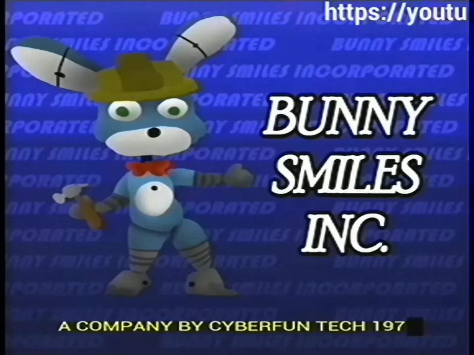

計画の骨子は、1975年に自社配送便（Bunny Smiles Shipping Service）でセントジョアナの森の「K-9保管施設」へ移送・保管していたショーストッパーズのロボット群を最新技術で再プログラム・修復し、その間に書籍・ゲーム（『BunnyFarm』パッケージ）・コミック（『Bunny Comics #27』）・ぬいぐるみ・ホームビデオなどの関連グッズ販売で収益を確保した上で、1982年オープン予定の新店舗「**NEW BON'S BURGERS!**」を開設するというもの。終盤、本来はジャックとの共同創業であるにもかかわらず、フェリックス・クランケン単独の白黒ポートレートが「**FOUNDER（創業者）**」の肩書きで掲げられ、ナレーターが「巨大な頭脳だけでなく、巨大な心（giant heart）を持った男——」とフェリックスを称え上げる。しかし「heart」の語尾で音声とBGMがプツリと途切れ、新店舗に立つフェリックスのイラストが、暗闇の中で目を虚ろに窪ませたモノクロのジャック・ウォルテンの立ち絵（および不気味に微笑む実写風の顔）へと切り替わって闇へ溶けていく。

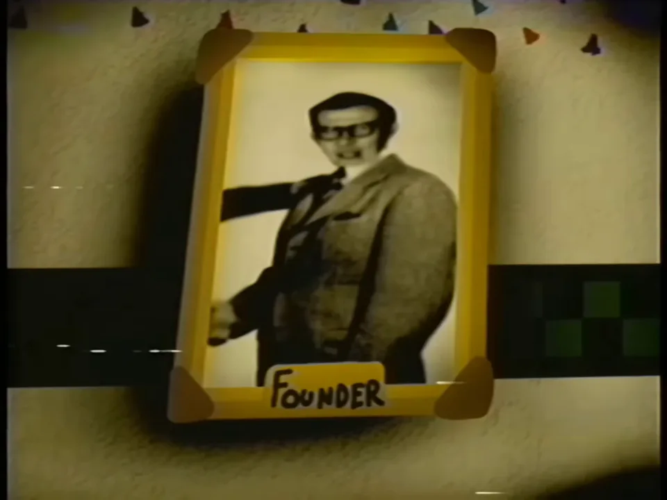

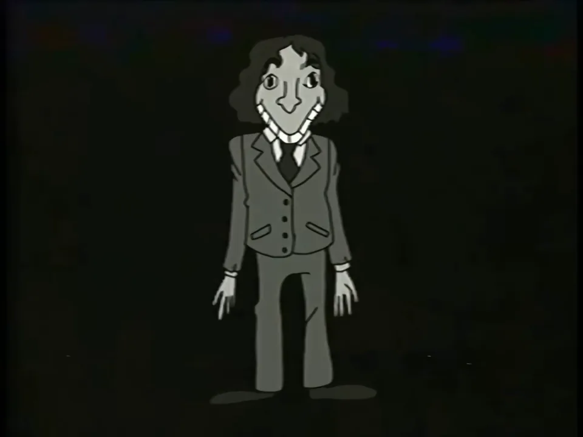

**重要な点：** 開始直後（0:29頃）の画面右上に隠し動画『Lucky You』のYouTube URL前半（`https://youtu`）が一瞬表示される。「法的手続き」の場面で映る書類キャビネットには、ジャック失踪（1974年6月11日）より後の日付である「`06/28/1974`」に「`Jack Walten`」の署名が入った開店書類フォルダ、フェリックス署名の「`Storage K-9`」「`Relocate`」フォルダ、ラベルが黒塗りされた4冊目のファイルが並び、引き出し下端には「`JACK IS STILL HERE`」と書かれたメモが見切れている。また1975年の8bit配送アニメでは画面が暗転してトラックの運転席にジャックの顔が浮かび上がり、グッズ紹介の中央下には「`The disappearance of Jack Walten VHS`」と題されたビデオテープが紛れ込んでいる。

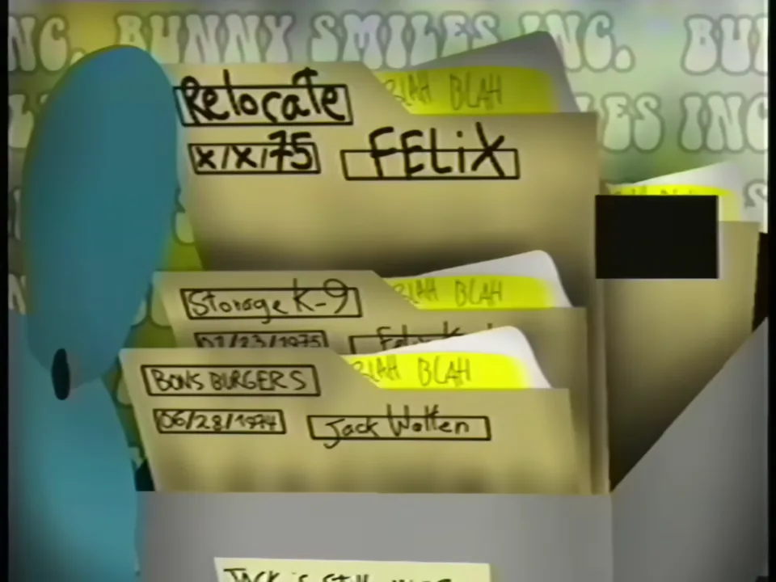

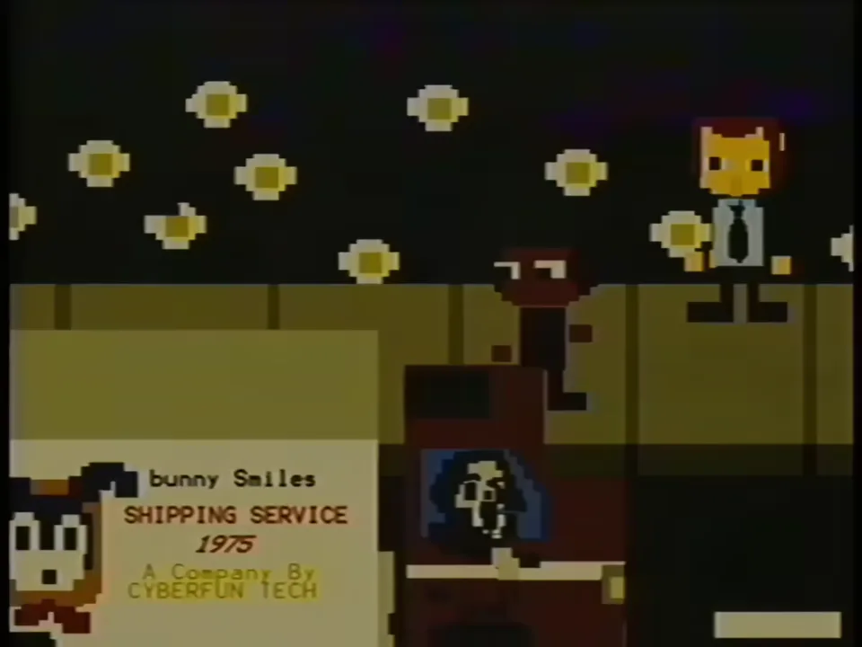

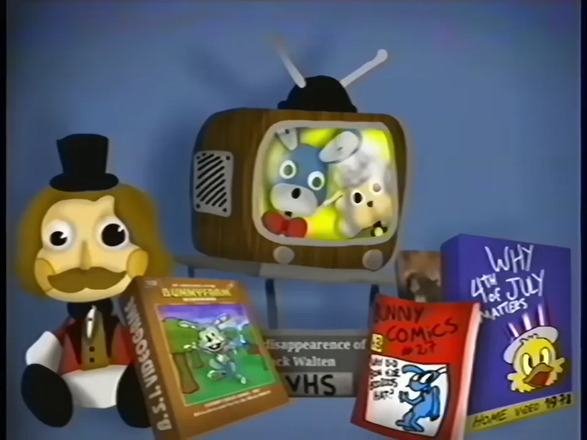

### テープ2 — アニマトロニクス再プログラム映像（1978年8月13日） {#f2-t2}

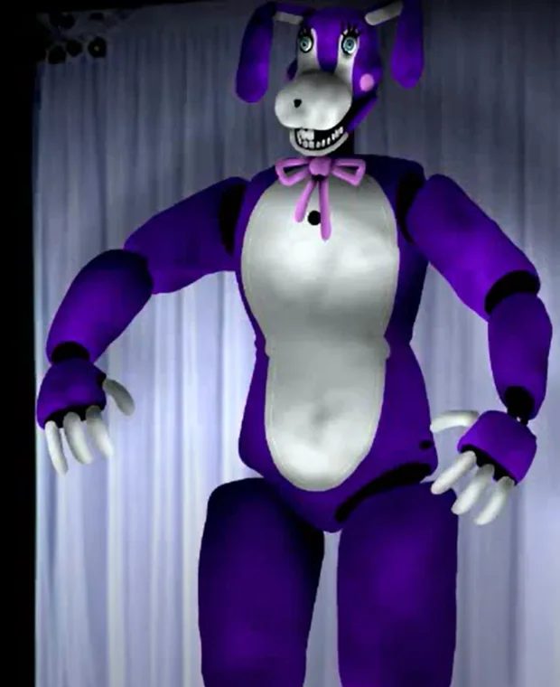

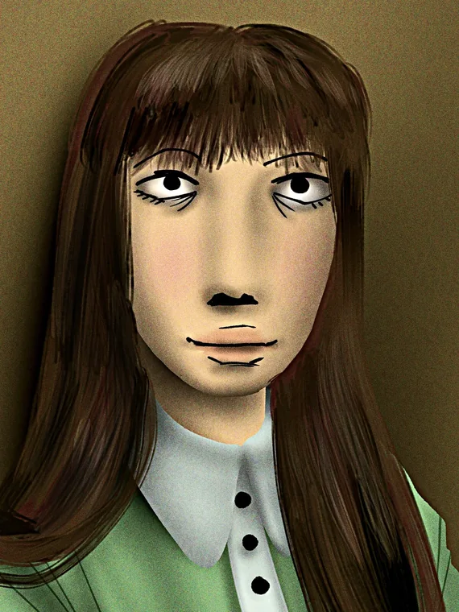

「Tape #2 created in: 08/13/1978」と記された技術検証テープ。「REPROGRAMMING PHASE "facial Expressions"」と題され、1974年製の**バニー（Banny）**をテストモデルとして、旧仕様の「口（MOUTH）の開閉」と、移転プロジェクト限定の新機能「**まばたき（BLINK）**」の動作確認が行われる。ここで画面テキストは「従業員は常に眼窩（Eye Socket）を清掃しなければならない。目の汚れはBLINK機能に支障をきたす」と注意喚起しており、後のテープ4での点検シーンへの伏線となっている。続いて「HAPPY（喜び）」「SAD（悲しみ）」「ANNOYED/BORED（退屈・苛立ち）」「SURPRISED（驚き）」の感情表現テストが行われたのち、「部屋の中で友だちを見つける」実践デモへ移行するが、背景が徐々に暗転して音楽が止まり、バニーの顔の上に、顔面や首が異様に引き伸ばされ痣だらけになった女性（BSIの主任技術者**スーザン・ウッディングス**）の顔がノイズと共に3回フラッシュする。

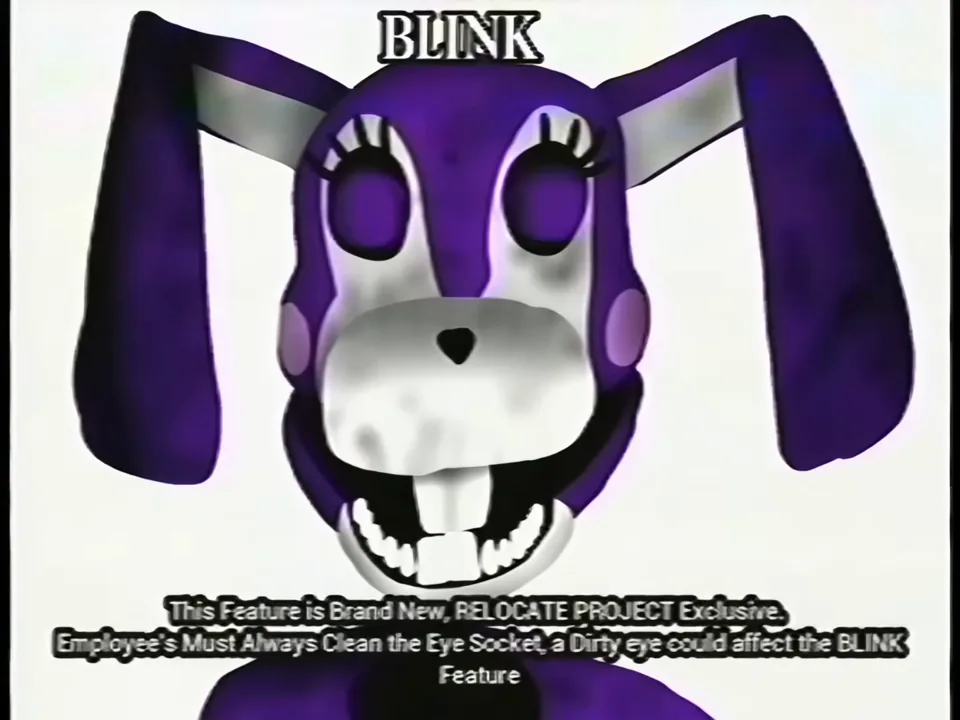

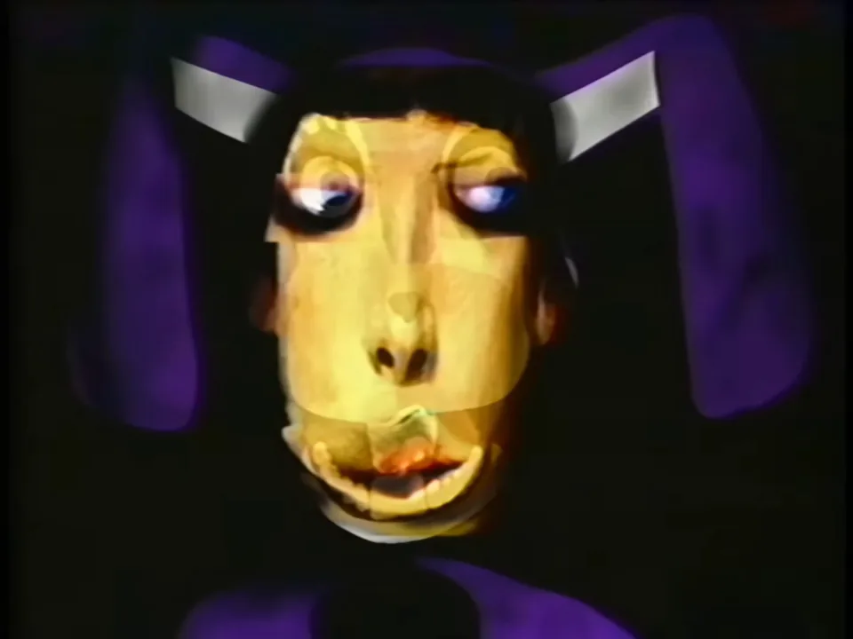

直後、映像は4方向に黒い出入口がある市松模様の部屋を見下ろす奇妙なアニメへと切り替わる。閉じ込められた紫のウサギ（バニー＝スーザン）が出口を探して歩き回る中、合成音声が淡々と「いたずらウサギは檻から出る方法を探すが、うまくいかない。ウサギは出口を探すか、せめて飼い主（owner）の注意を引こうとし続ける……ウサギは飢えている（`The rabbit is starving.`）」と繰り返し、やがてウサギは床にうずくまって黒い涙を流す。

さらに白黒の実写ウサギ狩り映像（Wikiによれば、ダストボウル期に行われた野ウサギ駆除「Jackrabbit Drive」の記録）が挿入されたのち、モーツァルト『レクイエム』より「ラクリモーサ（涙の日）」が歪んで響く暗闇の中で、顎が外れ眼窩が空洞になったバニーへとカメラがゆっくりズームインする。最後は真っ白な背景の鳥かごに閉じ込められた紫のウサギが映し出され、スーザンの魂と肉体がバニーという「檻」の中で誰にも救われないまま餓死・衰弱死に至ったことが暗示される。

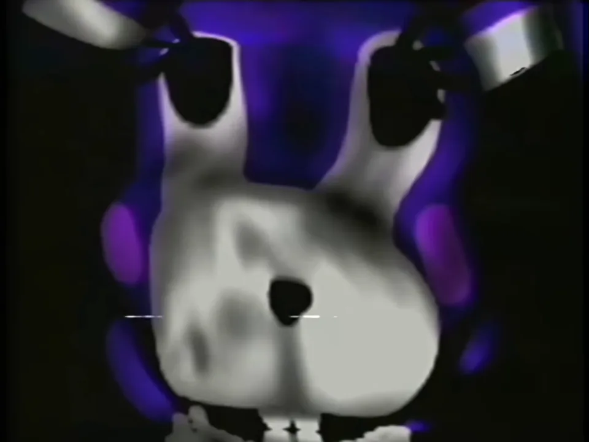

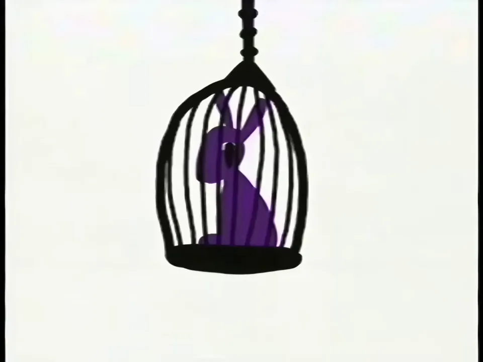

**重要な点：** パート末尾のほぼ真っ暗な画面の中に、1974年6月30日失踪と記されたスーザン・ウッディングスの行方不明ポスター（MISSING）がごくわずかな輝度で浮かび上がる（通常視聴では極めて見落としやすい）。

### テープ3 — K-9保管施設ツアーガイド（1978年7月9日） {#f2-t3}

「Tape #3 created in: 07/09/1978」。額装されたショーストッパーズの写真や『BUNNYFARM』のアーケード筐体、3Dモデルのボンを映す不穏な導入に続き、羊のキャラクター**シャ（Sha）**が案内役を務める施設管理人（Facility Caretaker）向けの研修アニメ「Technical Support」が始まる。シャはK-9保管施設に入る際の必須ルールとして、BSI指定制服の着用とBSI社員証の常時携帯、および黄色いリュックに入れる4つの携行品（ランタン・軽食・鍵・カメラ）の確認を案内する。バンカー内部の見取り図ツアーへ進むと、シャは「明かりをつけて（`Turn on the light`）」と不自然なほど執拗に4回繰り返したのち、休憩室（「清潔な環境は仕事を助け、汚れた環境は仕事を困難にする」）を経てメインホールの**3つの大型保管扉**を紹介する。1つ目は清掃用具・備品、2つ目は店舗の景品やグッズ類と説明されるが、3つ目の扉について「3つ目のドアは隠すために使われ——（`The third door is used to hide—`）」と言いかけた瞬間に音声が途切れる。

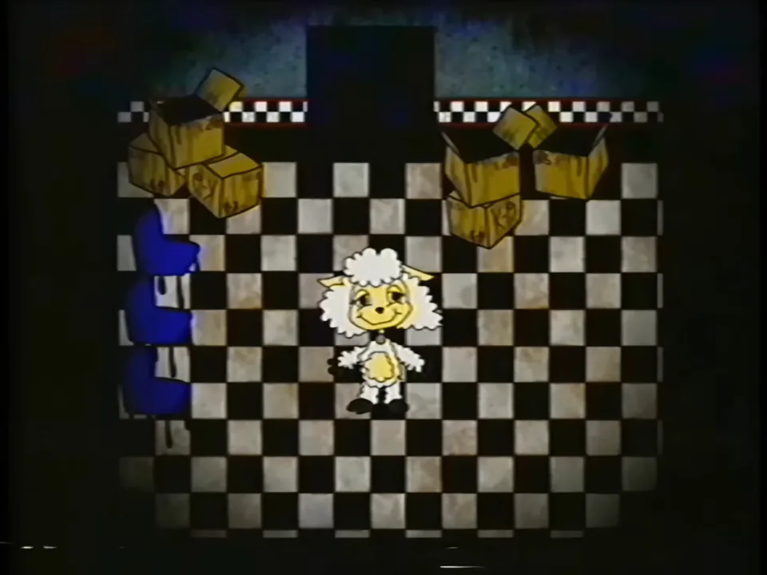

画面は真っ暗になり、数週間前から行方不明になった夫（ジャック）との再会を願って毎晩店舗を訪れていた妻**ローズマリー・ウォルテン**が、ある夜バックステージから響く「彼の居場所を知ってるよ、ロージー（`I know where he is, Rosie`）」という声を聞いた経緯が、逆再生すると聞き取れる音声で語られる。直後、何事もなかったかのように地下保管区画のツアーへ復帰したシャは「施設の技術者でない限り、ロボットたちに触れたり**ライトを当てたりしないように**」と警告するが（ファイル1でブライアンがボンを懐中電灯で照らし、咆哮される場面につながる警告）、通路を進むうちに先ほど訪れたはずの部屋へループしてしまい、「待って、この部屋はもう来た覚えがあるわ」と戸惑い始める。部屋を出ようとするシャの前に黒い人影（シャドーマン）が現れて行く手をふさぎ、映像が赤く歪む。するとシャの両目が黒い空洞へと変わり、暗闇の中で震える声で「**ソフィー、ここはどこ？（`Sophie, where am I?`）**」と娘の名を呟く。

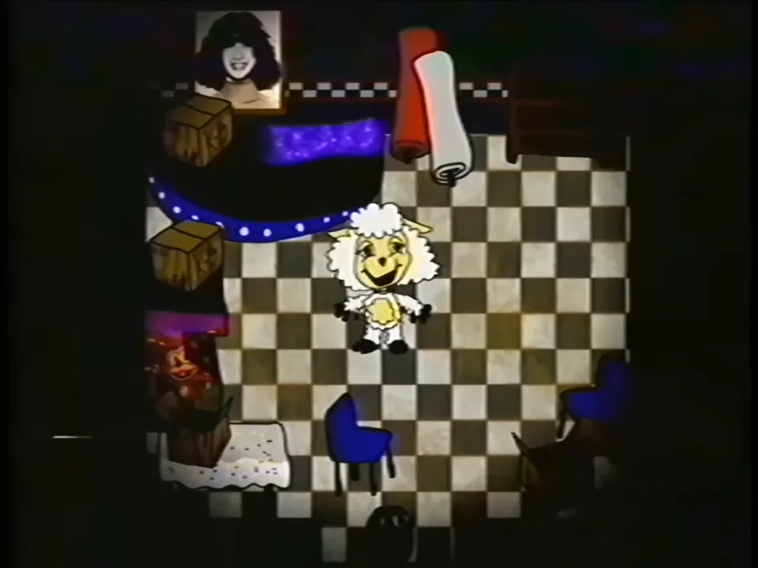

映像は1974年7月19日夜のバックステージ再現アニメへ突入する（Wikiのローズマリーのページは、この夜の出来事を、日付が変わった7月20日の午前1〜3時頃としている）。声を頼りに奥へ入ったローズマリーが見つけたのは夫ではなく「ウサギ（ボン）」だった。シャとローズマリーの姿が激しく明滅して重なり合い、ボンは途切れ途切れのテキストで「ロージー、壊れてる。直してあげる。きれいになるよ（`Rose broken. Will fix you. You will beautiful.`）」と告げる（Wikiによれば、この台詞は後に設定変更〈レトコン〉された数少ない例の一つとされる）。四肢と頭部を切断されたローズマリーの肉片を棒人間のボンが引きずってシャの機体内部へ詰め込む凄惨なアニメに続き、真っ白な空間の「**EMPLOYEES ONLY（関係者以外立入禁止）**」と書かれた戸口から、黒い影の男（シャドーマン）が返り血に染まったボンとシャを無言で見つめるカットが映し出される。最後は実写造形に近いシャのクローズアップとなり、「彼女が目覚めた時、彼女はとてもきれいだった。けれど内側では、体のあらゆる部分から血が流れ出ているように感じた」というモノローグと共に、全身血まみれで絶叫し痙攣するシャの姿がフラッシュして幕を閉じる。

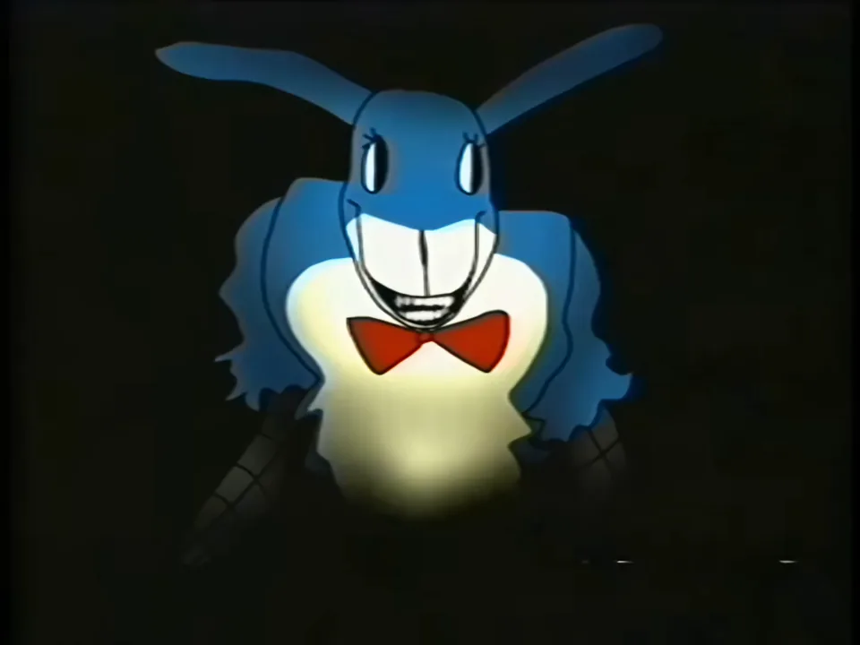

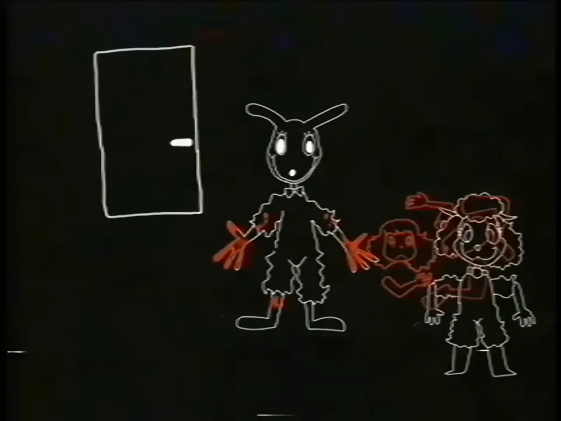

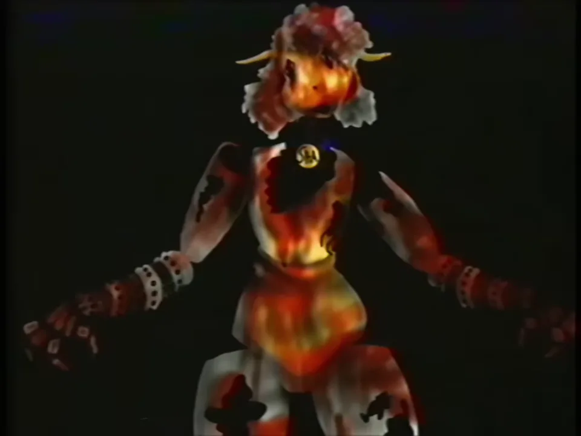

**重要な点：** 制服・社員証の確認シーンで、4年後の1982年に犠牲となる**ブライアン・ステルズ**のBSI社員証が一瞬表示される（ファイル1テープ3への接続）。携行品チェック直後の暗闇では、リトルボンの黄色いリュックからジャック・ウォルテンがせり出してくる。またパート末尾の暗闇には、ローズマリーの行方不明ポスターがかすかに映り込む（見落としやすい）。

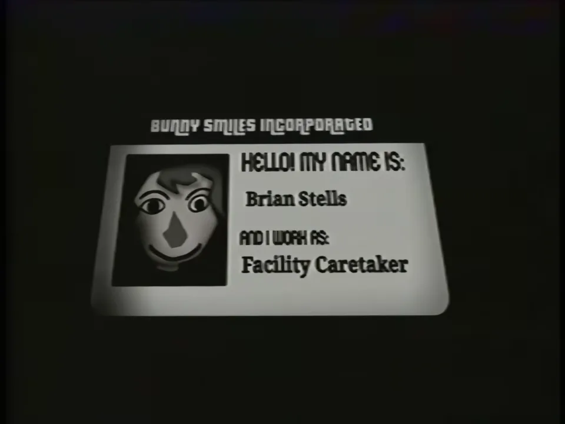

### テープ4 — 技術者3名による施設録画（1978年7月12〜14日） {#f2-t4}

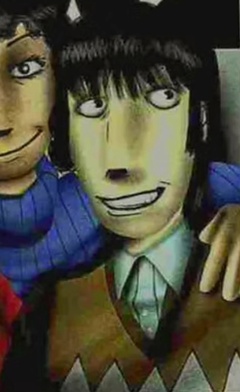

「Tape #4 created in: Unknown Date」。冒頭の説明テキストにより、1978年7月12日から14日までの3日間、移転プロジェクト用のアニマトロニクス再プログラムを行うため、BSIの技術者3名（**ヒラリー・B、アシュリー・P、ケビン・W**）が志願してK-9保管施設に泊まり込んだ際の記録映像であることが示される。初日、森の奥のバンカー入口前でヒラリーが4年前のボンズバーガーズ閉店の経緯を語る。店舗はごく短期間しか営業しておらず、当時は**夜間警備員を雇っていなかった**にもかかわらず深夜2〜3時に音楽が鳴り、照明が点いているという近隣苦情が相次いだこと、そして「**店内から大人の女性の叫び声が聞こえる**」という通報（7月19日のローズマリー殺害を示唆）から数時間後に急遽閉店したことが明かされる（最終営業日には1〜2組の家族しか入れず、ステージのカーテンは閉め切られロボットたちは一体も姿を見せなかったという）。

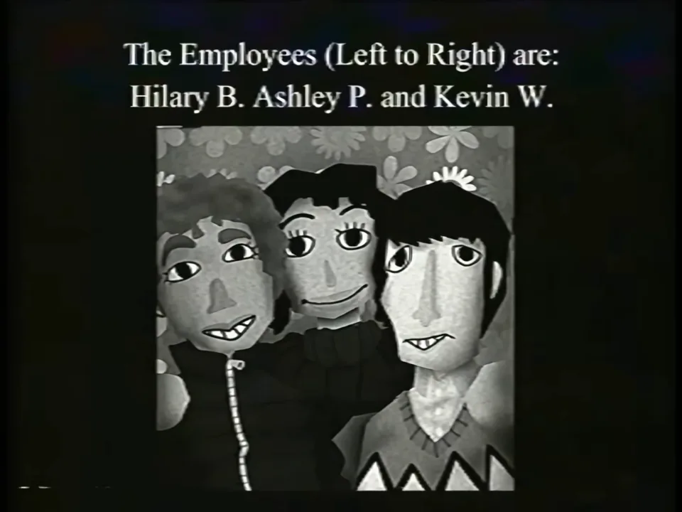

施設内での作業が始まると、損傷の激しさと金曜日までの無謀な納期に3人は難航する。劣化したボンを点検したヒラリーは、**ボンの眼窩（アイソケット）が「まるで誰かが意図的にやったかのように」ひどく破壊されており**、新機能の「まばたき（Blink）」が実装できないことを指摘する（アシュリーは閉店後に親会社CyberFun Techが不審な点を調査・改修した際に生じた破損ではないかと推測する）。夜、極寒の施設内で寝袋に入った3人の会話で、アシュリーはBSIから「**何の説明もなく渡された小さな鍵**」の存在を気にかける。最終日（7月14日）、ケビンとヒラリーは内骨格の深刻な劣化と機材・期間不足から**再プログラム作業の失敗**をカメラに報告する。しかしその夜遅く、2人が眠る間にアシュリーは「計画を救う手がかりがあるかもしれない」と単独でカメラと懐中電灯を持ち出し、小さな鍵が「**BACKDOORS**」と記された黄色い扉に合うことを突き止めて奥へと足を踏み入れる。

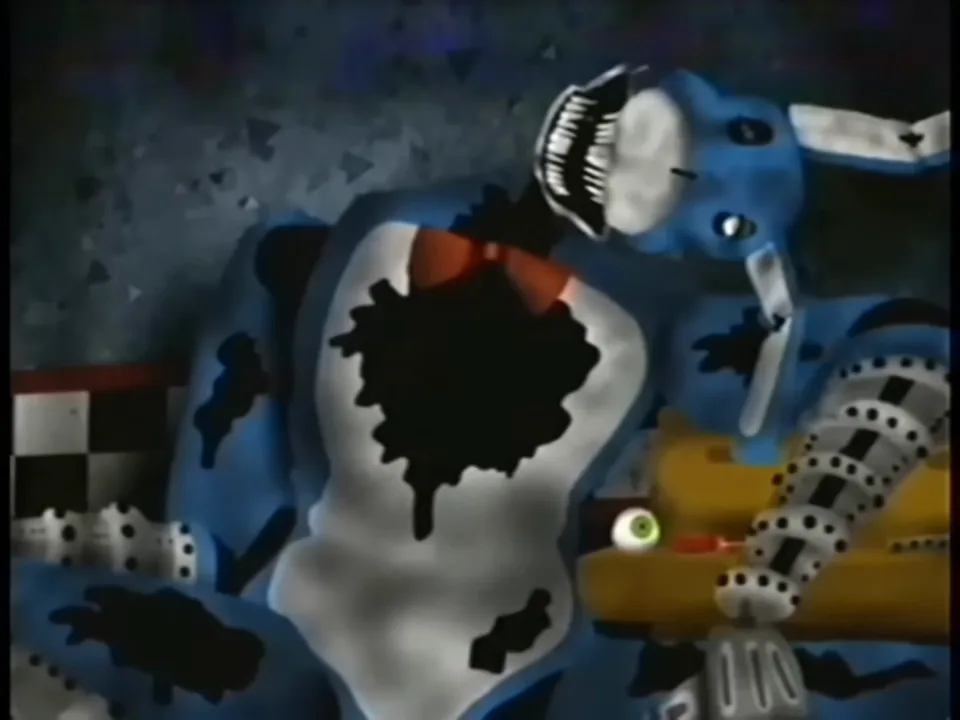

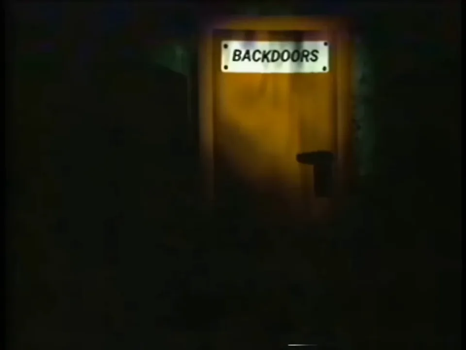

予想以上に広大な迷宮状のバックドア内部には、「SCRAPPED（廃棄）」と書かれた布を被せられた機体や予備の内骨格パーツが置かれた部屋、ブーズー・バニー・シャの予備頭部が転がる「第26（または27）号室」が続き、さらにその先の暗がりでは、**青い蝶ネクタイを付けた灰色のウサギ人形（Rocket）が壁に吊るされている**異様な光景に遭遇する（アシュリーは「ロボットなのかパペットなのかも分からないけれど、なぜ壁に吊るされているの？」と困惑する）。

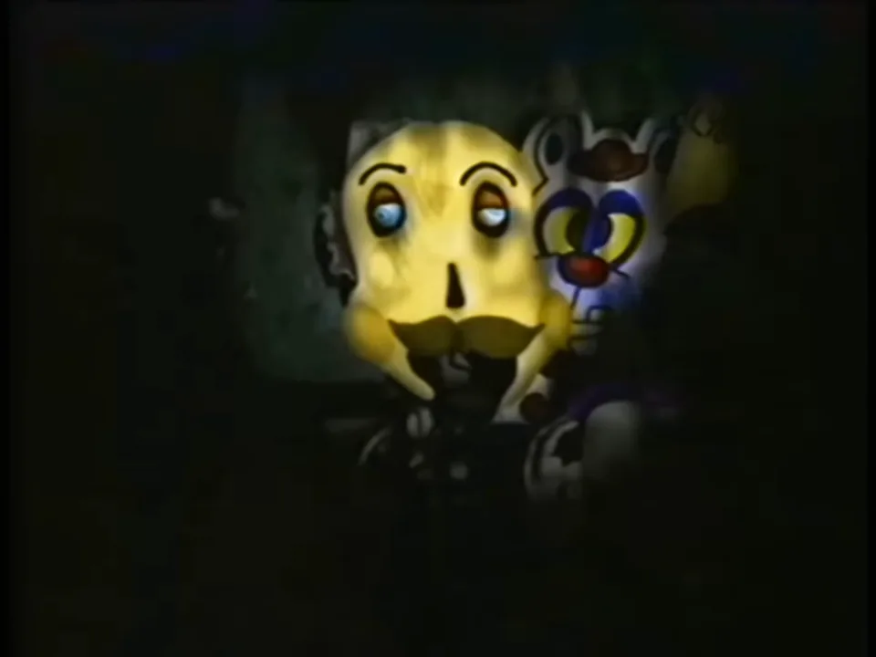

最奥の扉を開けたアシュリーは、胸部にカセットプレーヤーが組み込まれた見慣れないピエロ型アニマトロニクス——**ビリー（Billy）**——と、机の上にあった「**`06/11/7█` / `DISCARD`（破棄）**」ラベルのカセットテープを発見する。誕生日パーティー用のカスタムテープだろうと推測したアシュリーが意を決してビリーに挿入すると、陽気なバースデーソングが流れたのち突然音声が歪み、無機質な声で5人の名前——「**Jack, Susan, Charles, Rosemary, Sophie**」——が順番に読み上げられる（最後の「Sophie」だけ異なるブザー音が鳴り、直後に逆再生で「Sophie」と繰り返される）。

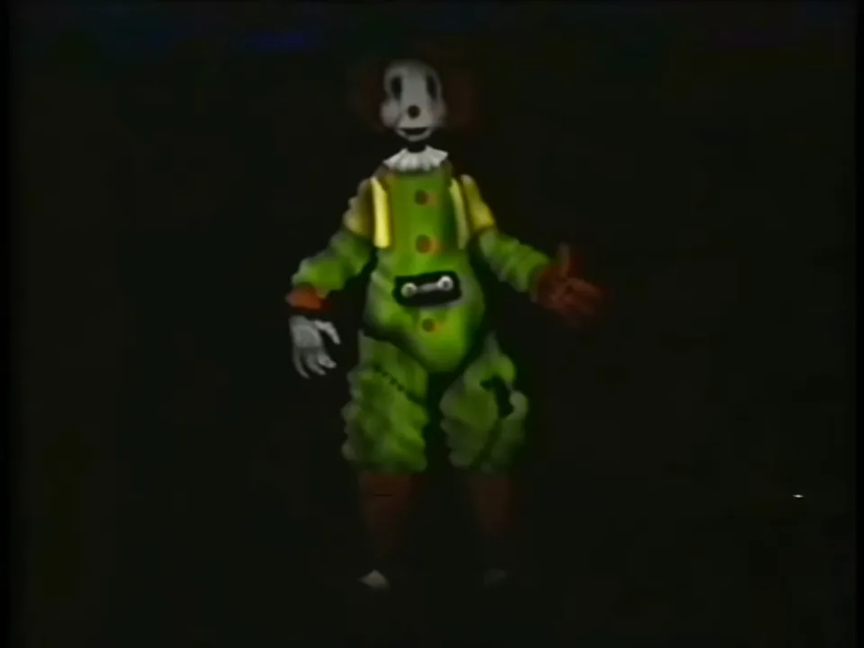

恐怖に息を呑んだアシュリーの懐中電灯が突然消え、必死に叩いて再点灯させた瞬間、目の前にボンが立ちはだかって襲いかかる。画面は技術者3人の記念写真に切り替わるが、両脇のケビンとヒラリーは黒く塗り潰され、中央に残されたアシュリーのモノクロの顔だけが上下反転した目口から大量の血を流して歪み、絶叫が響き渡る。

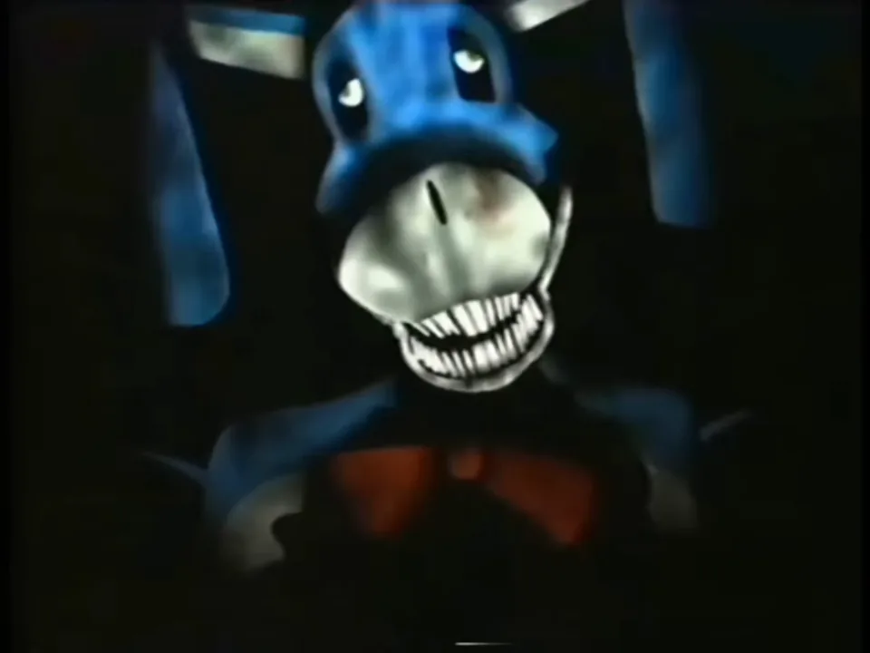

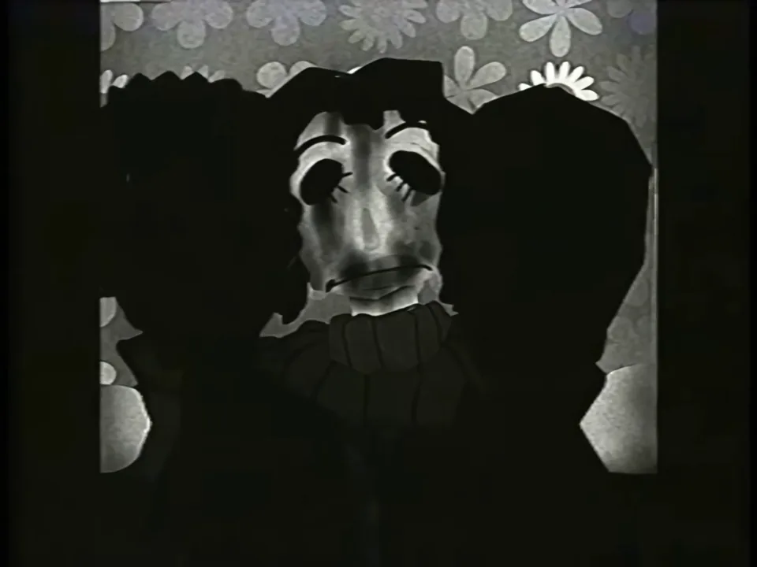

やがて暗闇に現れたビリーが「やあ！僕はビリー、おかしなピエロさ。歌を歌ってもいいかい？」とグリッチ混じりに自己紹介した直後、ボンの血まみれの機械の手がビリーの顔面マスクをゆっくりと剥がし、内部に詰め込まれたアシュリーの損壊した顔を露わにする。

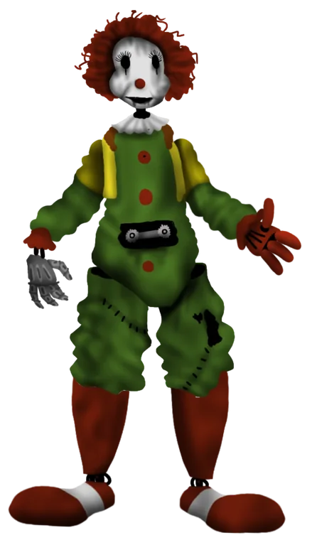

**重要な点：** ビリーが「歌を歌ってもいいかい？」と言った直後に流れる不気味な音声を逆再生すると、「`The blind fortune teller is filled with knowledge, but never with context.`（盲目の占い師は知識に満ちているが、文脈は決して持たない）」という一文になる（脚本担当Evaにより確定）。またマスクが剥がされた数秒後（17:22頃）、**わずか2フレーム（約0.07秒）だけ**画面いっぱいに白い英文テキストがサブリミナル表示され、翌朝ケビンとヒラリーはアシュリーが先に帰ったと思い込んで退去したが、実際にはアシュリーがバックドアで誰にも届かないまま叫び続けていたこと、数日後に管理人たちからバックドアからの猛烈な悪臭が報告されて施設が「追って指示があるまで（`until new advice`）」閉鎖され、移転プロジェクトが失敗に終わったこと、そして「`Ashley is still there, but she's not screaming anymore, she saw something she wasn't supposed to see, and now she's beautiful...`（アシュリーはまだそこにいるが、もう叫んでいない。見てはいけないものを見た。そして今、彼女はきれいになった……）」という顛末が記されている。直後の砂嵐の合間に隠し動画『Lucky You』のYouTube URL後半（`.be/K07tQqEDOfQ`）が一瞬表示され、エンドクレジット後には暗闇から「`Shadow Man sees me when lights go off.`（明かりが消えた時、影の男は私を見る）」の音声が流れ、最後の8bit納屋映像の右上の木々の後ろに**Showbear**が映る。

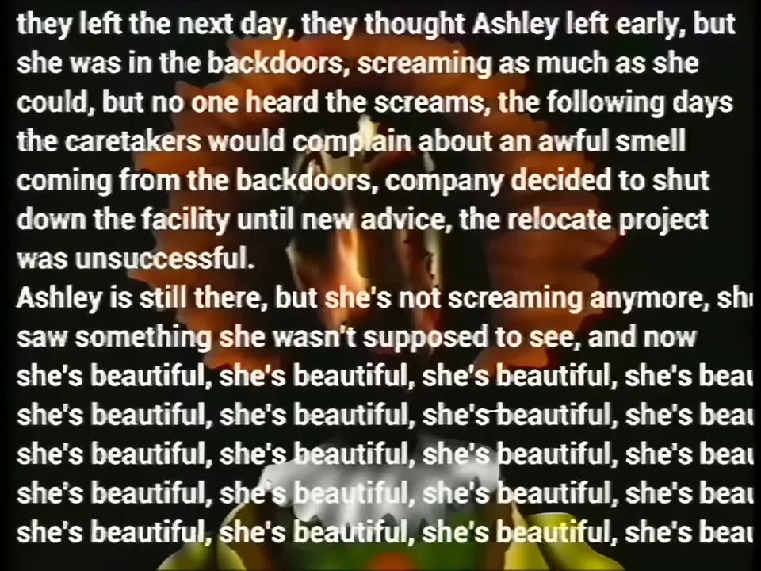

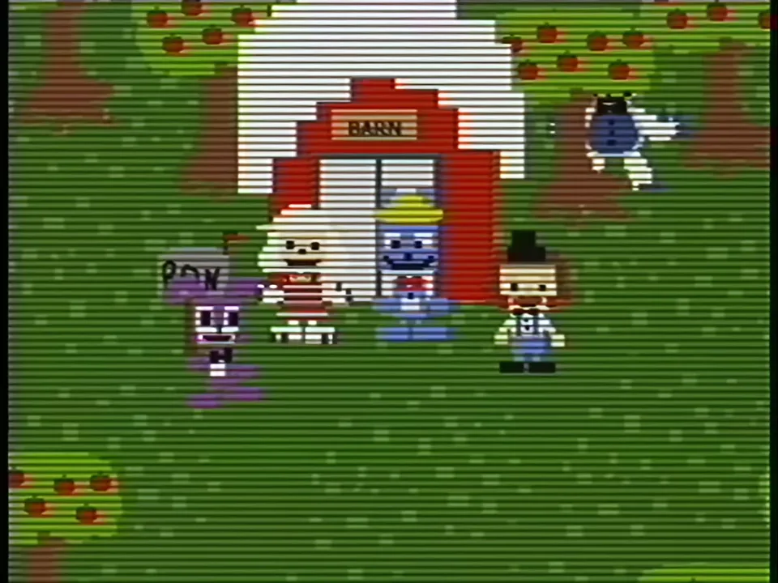

### ファイル2の考察 {#f2-thoughts}

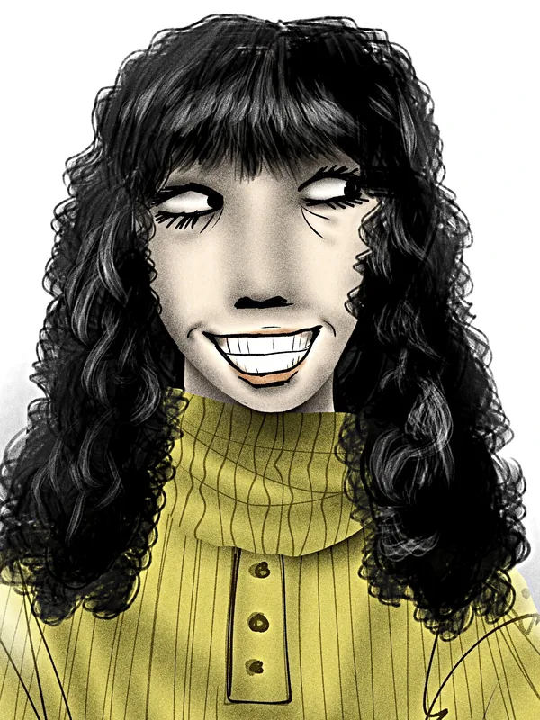

**動力源の切り分けと「06/11/7█」カセット（標的リスト）の真意：**
=> 機体を動かしているのは犠牲者の魂とボン内部の男性霊であり、カセットの5名は会社の暗殺リストではなく「美しくする」標的リストと解釈できる。
アニマトロニクス群を動かしているのは会社側のAIやプログラム暴走ではなく、「殺害され器に閉じ込められた犠牲者の魂（バニー＝スーザン、シャ＝ローズマリー、ビリー＝アシュリー）」と、「ボンに憑依した男性霊（「Bon」）の歪んだ意志」の二層構造である。ビリーのカセット（「`06/11/7█`＝ジャック失踪日である1974年6月11日を示唆」「`DISCARD`」）で読み上げられる「ジャック、スーザン、チャールズ、ローズマリー、ソフィー」の5名（Wikiによれば、ソフィーを除く4人は失踪した順）は、会社が用意した口封じの暗殺リスト（いわゆる「殺し屋Bon」説は制作陣も否定）ではなく、ボン内部の存在が「美しくする（スーツという器に閉じ込めて一つにする）」対象として執着する標的リストと解釈できる（最後のソフィーだけブザー音が異なるのは、ほかの4人と違い、ソフィーだけが失踪していないことを示すと考えられる）。

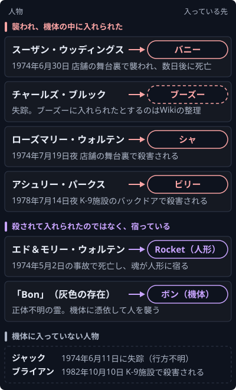 {ネタバレ:ファイル4}

**なぜフェリックスは危険なK-9での作業を進めさせたのか（動機と誤算）：** {ネタバレ:Hotline}
=> 物理的証拠さえ消せば再稼働できるという技術への無理解と、事業再建で過去の罪を帳消しにしたい現実逃避から、フェリックスは職員たちを危険なK-9へ向かわせる計画を進めたと考えられる。
- **「物理的証拠さえ消せばただの機械に戻る」という思い込み：** 1974年7月20日の閉店からK-9保管施設への移送までの間に、フェリックス自身による隠蔽・遺体処理と表面上の清掃が行われたと推測され（テープ4でヒラリーが指摘した「誰かが意図的に壊したようなボンの眼窩の損傷」とも符合する。ただし『Hotline』では、1977年の時点でK-9の管理人がすでに悪臭を訴えており、遺体がすべて処理されたとまでは言えない）、さらに技術への無理解（ファイル4でチャールズが「彼は仕組みを全く理解していない」と記した通り）も重なった結果、フェリックスは機体内部の超常現象（憑依と殺意）を把握・制御できないまま「証拠さえ消せば再稼働できる」と高を括っていたと考えられる。
- **「事業再建＝罪の上書き」という現実逃避：** 1974年5月2日の飲酒運転事故（エドとモリーの死と遺体隠蔽）という罪や6月のジャック失踪から目を背け、テープ1で単独の「FOUNDER（創業者）」として振る舞いながら「レストランを再建してすべてを元通りにすれば過去の罪も帳消しになる」という自己正当化に執着していたとみられる。それが結果として、1978年に志願した技術者3名や1982年のブライアンを危険なK-9へ向かわせることにつながったと考えられる。

**アシュリー殺害の複合要因と「きれいにする」という認知の乖離：** {ネタバレ:ファイル3}
=> アシュリー殺害の理由には、秘密区画への侵入に対する口封じとソフィーへの誤認の二つが挙げられており、人体解体を「きれいにする」と呼ぶ点に怪異の異常性が表れている。
カセットで名前を読み上げられていないアシュリー・パークスが殺害されたのは、「`BACKDOORS`」の鍵で奥の部屋に踏み込みカセットを再生してしまったこと（`"she saw something she wasn't supposed to see"`＝見てはいけない領域への侵入による口封じ）に加え、CyberFun製コンソールの不完全な顔認識によって暗所で「ソフィー・ウォルテン」と誤認された可能性も挙げられている（Wikiによれば、脚本担当のEvaは2024年に、アシュリーもブライアンと同じくソフィーと誤認されて殺されたと述べている。ただし作中の文面が挙げる理由は「見てはいけないものを見た」ことであり、どちらが正史かは不明とされている）。また、ファイル3内で響くローズマリーの悲鳴は、殺害された時の本人の悲鳴とされる（Wiki）。「首を掴まれたまま足をもがれている瞬間」の音声だとする情報もあるが、出どころは確認できていない。アニマトロニクスの機械的な怪力で人体を意図的に解体してスーツへ詰め込む行為を、ボン内部の存在は一貫して「きれいにする（make them beautiful）」と表現しており、その認知の乖離に怪異の異常性が表れている。

**「シャドーマン（影の男）＝フェリックス・クランケン」説の根拠と「Shadow Man sees me」の解釈：**
=> 現場への立ち会いと施設管理の権限からシャドーマンはフェリックスとする説が有力で（未確定）、惨状を黙認・隠蔽した保身が怪異側から傍観者として見られていると読める。
- **立ち位置・権限の一致とソフィー説の否定：** テープ3の再現シーンの通り、1974年7月19日夜のバックステージ（「EMPLOYEES ONLY」の戸口）に立ち会い、翌日に店舗を閉鎖してK-9保管施設への隔離や人員派遣を行えた人物としては、フェリックスが最も有力である。なお、1974年7月当時13歳（もうすぐ14歳）の少女であり、カセットの5人のうちただ一人失踪していないソフィーをシャドーマンとする説は、構造的にも無理があり、Wikiでも「ソフィーではないと確定している」とされている。
- **「明かりが消えた時に私を見る（`Shadow Man sees me when lights go off`）」の意味：** 海外コミュニティで一時広まった「餌を与える（`feeds me`）」は空耳であり、公式の実際のセリフは「私を見る（`sees me`）」である。シャドーマンをフェリックスとみる説に立てば、フェリックスは最初からボンと結託して殺人を企てた黒幕ではなく、「自分の罪を隠したいだけの臆病な人間」と読める（ボンを直接動かしているのはあくまで「Bon」であり、シャドーマンが操っているわけではない）。この読みでは、惨状を目撃しながら黙認し、保身のために証拠を隠し、K-9での作業を進めさせた行動が、結果としてボンの凶行に獲物と密室を与え続けたことになる。そのため、アニマトロニクス内の魂や「Bon」からは、明かりが消えた暗がりでこちらを見ているだけの「影の男（事実上の傍観者・共犯者）」として見えている、という読みである。制作側も2024年9月7日のQ&Aで、シャドーマンは「アニマトロニクスから見た、ある特定の人物の姿」だと述べている（Wiki）。

**シャドーマン＝フェリックス説のその後：** {ネタバレ:My Soul}
=> 『My Soul』で、ローズマリーが殺害された夜の未明にフェリックスが店内にいたことが判明し、この説は大きく補強された（殺害への関与の度合いは未確定）。
『My Soul』①のフェリックスへの事情聴取（1974年7月26日）で、女性の悲鳴が通報されたあとの7月20日午前4時頃に警官が Bon's Burgers 店内でフェリックスを見つけ、フェリックスが捜索令状がないことを理由に立ち入りを拒んだことが明かされた。本人は「店で寝泊まりしていた」と説明しているが、ローズマリー殺害の時間帯に近い未明に店内にいた事実は、シャドーマン＝フェリックス説を裏づける具体的な状況証拠になる。ただし、殺害への直接の関与や、店内にいた本当の目的までは明言されていない。

**「ソフィー、ここはどこ？」はいつの声か（K-9の暗闇で漏れた本音）：** {ネタバレ:ファイル5}
=> この一言は1974年の殺害当時の再現ではなく、K-9へ移されたあとのシャ（ローズマリー）が暗闇の中で娘へ漏らした声と読むと、『ファイル5』の殺害場面とも食い違わない。
テープ3（[該当の節](#f2-t3)）でシャが「ソフィー、ここはどこ？（`Sophie, where am I?`）」と呟くのは、K-9保管施設の地下保管区画を案内する途中で同じ部屋へループし、シャドーマンに行く手をふさがれて両目が黒い空洞へ変わった直後であり、映像が1974年7月19日夜のバックステージ再現へ切り替わるのはそのあとである。一方、『ファイル5』の[⑨](/file5#f5-09)〜[⑩](/file5#f5-10)で詳しく描かれた Bon's Burgers 舞台裏での殺害とシャへの詰め込みの場面には、このセリフは出てこない。呟きの場面が店舗ではなくK-9の地下をループする映像であることも踏まえると、この一言は殺害の夜の再現というより、閉業後にK-9の暗闇へ閉じ込められたシャ（ローズマリー）が、テープの時点（1978年）で、自分のいる場所も分からないまま娘へ漏らした本音と捉えるとしっくりくる。『ファイル5』⑩の結末でシャは、ボンに言わされるまま「私は幸せだ」「私は愛されている」と機械的に復唱していた。その直後の状態と並べると、言わされた言葉の裏側で、暗闇の中からずっと娘を探し続けていた痛ましさが際立つ（ただし、このセリフがいつの時点の声なのかは作中で明示されていない）。

**書類上の偽装痕跡・テープ2の日付矛盾・壁の「Rocket」が繋ぐ伏線：** {ネタバレ:ファイル4}
=> 署名や作成日の矛盾は記録の改ざんと霊的侵食を示唆し、バックドアのRocketは1974年の飲酒運転事故とK-9施設を繋ぐ伏線となっている。
- **改ざんされた記録と時系列の歪み：** テープ1の書類棚に映る「ジャック失踪後（`06/28/1974`）のジャック署名入り開店書類」や黒塗りファイルは、フェリックスによる書類偽造・共同創業者の抹消工作を示唆している。また、7月14日の惨劇のあと、数日のうちに悪臭で施設が閉鎖され、作業も失敗に終わったはずであるにもかかわらず、テープ2の作成日が約1か月後の「`08/13/1978`」となっている点は、BSI側が対外・社内向けに計画継続を装ったか、あるいは発禁・破棄されたはずのテープ自体が霊的干渉によって時系列ごと変質している可能性をうかがわせる。
- **バックドアの壁に吊るされた「Rocket」：** テープ4でアシュリーが発見した灰色のウサギ人形は、ファイル1テープ1末尾でソフィーに語りかけていた**Rocket**そのものである。なぜ子ども用の人形がK-9保管施設の極秘区画にあったのか。後の『ファイル4（CyberFun Tech）』では、1974年5月2日の飲酒運転事故のあと、フェリックスがRocketを処分できず、店舗の舞台裏に隠していたことが描かれる。その後、誰がK-9へ運び、誰が壁に吊るしたのかは、作中では明かされていない（Wikiは、閉店後にK-9へ移されたと記し、壁に吊るしたのはボンかもしれないと推測している）。バックドアのRocketは、1974年の事故とK-9保管施設をつなぐ手がかりになっている。

**物語全体の構造とソフィーへのつながり：**
=> 罪を隠すフェリックスの保身と、周囲を器へ閉じ込めようとする「Bon」の執着が店舗とK-9施設で重なり、記録はカセットの最後に呼ばれるソフィーへ向けられている。
本作は単なる殺人機械のホラーではなく、**「自分の過失と罪を直視できない人間の弱さ・保身（フェリックス）」**と、**「失った家族や近しい人々を無理やり器へ繋ぎ止めようとする執着（「Bon」 ※生前の正体を巡っては記憶・人格が変質したジャック説と第三者説の双方が議論されている）」**という二つの行動が、店舗の舞台裏とK-9保管施設という閉ざされた場所で噛み合った結果、親友同士の家族と同僚が一人ずつ奪われていく記録になっている。そしてすべてのテープと残留思念は、カセットの5人のうちただ一人失踪していないソフィー・ウォルテンへ向けられている。

**「Bon」の生前の正体をめぐる議論のその後：** {ネタバレ:ファイル5}
=> 『ファイル5』の「Bon」自身の発言により、ジャック本人とは別人物とする見方が強まっている（具体的な人物名は未確定）。
上で「ジャック説と第三者説の双方が議論されている」とした点は、『ファイル5』⑨で「Bon」が自らの過去を「引き裂かれ、繊維の最後の一本まで焼け焦げて腐っていた」と語り、自己が存在しなくなったときにローズマリーの作品が新しいアイデンティティをくれたと述べたことで、様子が変わっている。この発言は、「Bon」がもともとジャック本人ではなく、自らのアイデンティティを失った別の存在であることを示唆する。ただし、生前の具体的な人物名や、いつボンの機体に取り憑いたのかは明言されていない。

---

## Lucky You（隠し動画／Relocate Projectの補足テープ）

2020年6月27日アップロード、翌28日の『ファイル2（Relocate Project）』公開とともに視聴可能となったシリーズ初の隠し動画（限定公開・尺：4分4秒）。ファイル2の映像内に分割して隠されたYouTube URL（テープ1冒頭の「`https://youtu`」とテープ4終盤の「`.be/K07tQqEDOfQ`」）を繋ぎ合わせた視聴者だけがアクセスできる補足テープであり、全体がソフィー・ウォルテン個人へ宛てた異質なメッセージとして構成されている。動画概要欄には、1958年に同じ「動くパフォーマー」の構想を抱いた2人の大学生——ジャック・ウォルテンとフェリックス・クランケン——が16年の歳月をかけて構想を実現させたこと、そしてその間にフェリックスは「美しい女性」と結婚し、ジャックは良き夫であるだけでなく「3人の美しい子どもたちの幸せな父親」になっていたことが記されている。

**小目次（ジャンプ）**

- [年表パート](#ly-timeline)
- [語りパート（音声メッセージ）](#ly-voice)
- [テキストパート（二人目の語り手）](#ly-text)
- [Lucky Youの考察](#ly-thoughts)

### 年表パート {#ly-timeline}

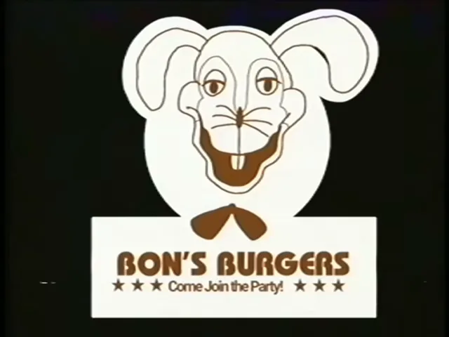

VCR特有の真っ青なブルースクリーンと数秒の黒画面を経て、暗闇から「`BON'S BURGERS / ★★★ Come Join the Party! ★★★`」と描かれたボンの顔ロゴがゆっくりと浮かび上がり、ノスタルジックに歪んだオルガン調のBGMが静かに流れ始める。続いて日付とキャプションを添えた写真・映像が時系列順にフェードしていく——まずは駐車場越しに撮られた開店当日の店舗外観「`OPENING DAY / 06/28/1974`」が映し出され、直後に黄色いカーテンのステージに立つ在りし日のボンの稼働映像が挟まれる。

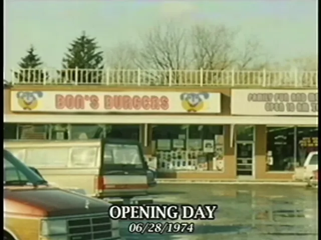

続いてソファ席に並ぶ子どもたちの記念写真「`First Birthday Party / 06/30/1974`」（スーザン・ウッディングスの行方不明ポスターに記された失踪日と同日）、暗いステージ上でスポットライトを浴びるボンの姿「`Last Shows Before Closure / 07/10/1974 - 07/19/1974`」（最終日の7月19日の夜に、ローズマリーが殺害された）、そしてボンからブーズーの稼働映像へと移る「`THANK YOU FOR THE SMILES ! / Bon's Burgers: 06/28/1974 - 07/20/1974`」（わずか約3週間での営業終了）が順番に表示される。

閉業の字幕が消えると同時にBGMがプツリと途切れ、無音のテープノイズの中で黄色く変色した「`10/31/1974`」（ハロウィン当日）の店舗外観写真が映し出される。正面の窓は木の板で厳重に打ち付けられ「`Condemned`（使用禁止／封鎖）」の札が下がっているが、板の隙間からはボンの姿がこちらを覗いている。

続いて画面上部に「`12/10/1974`」と記された森の斜面の地下バンカー入口（「`BUNNY SMILES INCORPORATED / STORAGE FACILITY K-9 / PROPERTY OF CYBERFUN TECH 1975`」の黄色い看板が掲げられた鉄扉）の外観写真へ移り、さらに「`01/23/1975`」の日付と共に、暗い保管室で外装が黒ずみ内骨格が露出したショーストッパーズ4体（左からブーズー、中央のボン、シャ、バニー）が一箇所に積み上げられた写真が映る。

しかしその後、画面が完全に暗転すると時系列を半年以上逆行するように、真っ暗な画面の下部にぽつりと「**`06/11/1974`**」（ジャック・ウォルテンが最後に目撃された失踪日）の日付だけが浮かび上がり、消えたあとも十数秒間にわたり不気味な無音の暗闇が続く。

**重要な点：** 動画概要欄のテキストは、公開時点でジャックとフェリックスの大学時代の出会い（1958年）とウォルテン家の「3人の子どもたち」の存在を初めて公式に明かした重要資料となっている。また「`01/23/1975`」の保管写真でブーズー・シャ・バニーの頭部に貼られている黄色い札には、それぞれ「`SHIPPING #11 (K-9)`」「`SHIPPING #12 (K-9)`」「`SHIPPING #13 (K-9)`」と配送管理番号が記されているほか、「`06/30/1974`」の最初の誕生日パーティー写真に写る子どもたちの1人はジェレミー・シモンズ（Jeremy Simmons）と設定されている。

### 語りパート（音声メッセージ） {#ly-voice}

長い暗闇を破り、黒背景の中央に損傷・変色したアニマトロニクスたちの頭部イラストが順番に切り替わりながら浮かび上がる（上半分が闇に溶け歯列だけが覗くボン→黒く窪んだ眼窩のシャ→虚ろな目のバニー→薄汚れたピエロのビリー→黄色く歪んだブーズー）。これと同時に、低く落ち着いた男性の合成音声（1人目の語り手）が視聴者——すなわちソフィー・ウォルテン——へ静かに語りかけ始める。「見たものにひどく混乱しているだろうね。怖がらないで、私の小さなうさぎちゃん（`my little bunny`）。答えはいずれ与えられる。だが、今持っている断片だけでこのパズルを解こうとしないで。これはほんの始まりに過ぎないのだから」。

続く「これから壊れた人々、美しい人々の物語を語ろう（`a story of broken people. Beautiful people.`）」という一節では、金網の奥に白いウサギたちが押し込められたウサギ小屋の実写風映像が映し出され、「彼は彼らにしてしまったことをとても後悔しているが、もうどうすることもできない。それを覚えておいて（`He is so sorry about what he did to them, but there is nothing he can do. Remember that.`）」という言葉に合わせて、アニメ調で描かれたK-9保管施設の外観イラストが表示される。

一度暗転したのち、同じ声は一定の抑揚で「**`Safety in pills, Sophie.`（薬の中に安全があるよ、ソフィー）**」というフレーズを機械的に繰り返し始める（回数は12回とみられる）。その反復の合間には激しいブロックノイズと共に、夜の森を逃げ惑い「`WHAT WAS THAT THING-?`」と叫ぶブライアン・ステルズの最期（ファイル1テープ3）と、暗闇からボンの顔が迫り出し絶叫が響くアシュリー・パークスの最期（ファイル2テープ4）がフラッシュバックのように挿入される。

さらに黒画面の奥からまず白い輪郭だけが浮かび上がり、続けて黄色い目や帽子・蝶ネクタイの細部がフェードインして**Showbear**のカートゥーン調イラストが無言で正面を見つめた直後、真っ白な背景の「**`SOPHIE WALTEN`**」名義の処方薬ボトルへと切り替わるが、さらにもう一度「`Safety in—`」と言いかけた瞬間に音声が暴力的に断ち切られる。

**重要な点：** 1人目の語り手の声は、『ファイル2』テープ4でアシュリーがビリーに挿入した「`06/11/7█`」カセットで5人の名前を読み上げていた声と同じものとみられている（Wikiによれば、脚本担当のEvaが「この語り手は『Lucky You』の外でも話している」という趣旨の発言をしている）。年表パート末尾の「`06/11/1974`」とカセットのラベルの日付は、同じ1974年6月11日を指すとみられる。また、ここで挿入されるShowbearの立ち絵は、『ファイル2』テープ4の第26（または27）号室に置かれていた書き割りパネルと同じカートゥーン調のデザインである（Wikiの台本にも、この部屋に「Showbearの切り抜きパネル」があると記されている）。

### テキストパート（二人目の語り手） {#ly-text}

1人目の声を押し潰すように、Al Bowllyの1931年の楽曲『**Heartaches**』が耳をつんざく大音量と激しい歪み・音割れを伴って鳴り響く。ここからは音声による語りが消え、画面中央に浮かぶ大文字の英文テキストによって「2人目の語り手」が介入を始める。背景には『ファイル2』で描かれた4体のアニマトロニクス映像が順番に映し出される——まずはK-9の壁際にもたれかかる破損したボンの上で「`OH, CAN'T YOU SEE?`／`I MADE THEM BEAUTIFUL`／`I DON'T KNOW HOW`（ああ、わからないのか？／私が彼らを美しくした／どうやってかはわからない）」、続いて暗闇で口を開閉するシャの上で「`I DIDN'T EVEN MEAN TO`／`BUT I DID.`／`THEY TRY TO TALK TO US`（そうするつもりさえなかったのに／でもやってしまった／彼らは私たちに話しかけようとしている）」と表示される。

さらに野ウサギの群れが走る白黒記録映像に重ねられた破損状態のバニーの上で「`THROUGH ANALOG`／`THEY WILL BE HEARD`／`THIS IS THEIR CRY FOR HELP`（アナログを通じて／彼らの声は届くだろう／これは彼らの助けを求める叫びだ）」、そして暗闇で身体を揺らしカセットを再生するビリーの上で「`BESIDES, THEY WANT US TO KNOW`／`WHAT HAPPENED THAT YEAR`／`BUT WE MUST BE PATIENT.`（それに、彼らは私たちに知ってほしがっている／あの年に何が起きたのかを／だが私たちは忍耐強くなければならない）」と綴られる。

次の瞬間、画面は真っ白な背景に切り替わり、外装を完全に剥ぎ取られた「`CYBER FUN`」刻印入りのアニマトロニクス内骨格が現れる。ここからテキストの色が白から**鮮血のような赤**へ一変し、「`LOOK`（見て）」の合図と共に、むき出しの内骨格が音楽に合わせて不気味に首を傾げながら両腕と胴体を左右に揺らし始める。赤い文字は陶酔したように「`THEY ARE FILLED WITH LIFE`（彼らは生命に満ちている）」「`THEY DANCE TO THE MUSIC`（音楽に合わせて踊り）」「`THEY LAUGH AND SING ALONG`（笑い、共に歌う）」「`THEY'RE PERFECT.`（彼らは完璧だ）」「`THEY ARE BEAUTIFUL`（彼らは美しい）」と讃え続け、最後の「`THEY ARE BEAUTIFUL`」で白かった背景が薄暗く黄ばんだ陰影へと沈み込み、『Heartaches』の歌声もくぐもって途切れる。

直後の黒画面に、再び白い文字で「**`THEY WILL SEE YOU SOON, SOPHIE.`（彼らはもうすぐあなたに会うだろう、ソフィー）**」という一文だけが浮かび上がって消える。最後の約11秒間は真っ暗なテープノイズの画面のまま、陽気でどこか狂気じみた高音のメロディ（サントラ曲名『They'll See You Soon, Sophie』／『Oh, Can't You See?』）が鳴り響いてテープが終了する。

**重要な点：** 白背景で踊り出す「`CYBER FUN`」刻印の内骨格は、茶色いまつ毛付きの眼球、垂れた耳パーツの配置、そして『ファイル2』テープ3末尾と酷似した揺れ方から**シャ（＝ローズマリー）の内骨格**と特定されている。またラストの黒画面で流れる陽気な高速メロディは、『ファイル2』最終盤（8bitの納屋とShowbearの場面）で不気味に逆再生されていた音楽を**正再生（順再生）・高速化**したものであり、本編エンディングと隠し動画の終幕が表裏一体の対になっている。

### Lucky Youの考察 {#ly-thoughts}

**「二人の語り手」の対立構造とそれぞれの正体候補：** {ネタバレ:ファイル4}
=> 忘却による安全を説く音声と、器に宿る美や助けを求める叫びを示すテキストが対立しており、正体はジャック・フェリックス・「Bon」など複数の説がある。
- **1人目の語り手（音声メッセージ／「忘却と待機」を促す側）：** 「`06/11/1974`（ジャック失踪日）」の直後に話し始め、ソフィーを「私の小さなうさぎちゃん（`my little bunny`）」と親密に呼ぶ点から**ジャック・ウォルテン（父親）説**が有力視される一方、「彼は彼らにしたことをとても後悔しているが、もうどうすることもできない（`there is nothing he can do`）」という一節が『ファイル4（CyberFun Tech）』でフェリックス自身が1974年5月2日の飲酒運転事故について語る言葉と一致することや、薬の服用（記憶の封印）を勧めている点から、**フェリックス・クランケンが素性を伏せて三人称で語っている説**も根強い（なお、Wikiでは、この声は「Bon」ではないことが確定済みとされている。『ファイル2』の考察ではカセットの名前を「Bon」が執着する標的と読んでいるが、この声が同じカセットを読み上げているのなら、読み上げる声の主と「Bon」は別ということになる）。このほかWikiでは、語りの終わりに姿が映るShowbear（設定変更後はMr. Snow）を1人目の語り手とみる説も挙げられている。
- **2人目の語り手（画面テキスト／1人目を遮断して介入する側）：** 言いかけの「`Safety in—`」を大音量の『Heartaches』で断ち切り、「彼らを美しくした（`I MADE THEM BEAUTIFUL`）」「彼らはもうすぐあなたに会うだろう」とソフィーとの再会を予告する点や、『ファイル4』以降の「Bon」の語り口（「`Look.`」と単独で呼びかけて新たな生を讃える構文）との類似から、最も直感的な候補は**「Bon」（灰色の存在）**である。ただし「そうするつもりさえなかった（`I DIDN'T EVEN MEAN TO`）」という悔恨めいた言葉は、スーザン襲撃の計画性・自己正当化と食い違うため、シリーズ脚本・「Bon」声優のEvaは個人的見解として**2人目の語り手こそフェリックス本人ではないか**とする説を挙げているほか、ボンの機体内部に封じられ制御権を持たない「同乗者」としてのジャックの意識と見る仮説も存在する。

**ソフィーの処方薬と「Safety in pills, Sophie」が持つ二面性：** {ネタバレ:ファイル3}
=> 「薬の中に安全がある」という反復は、真実に近づいた者たちの死を踏まえた保護の警告とも、過去の罪を封じる隠蔽とも読める二面性を持つ。
ソフィー・ウォルテンが記憶を抑える処方薬を服用している事実は、『ファイル1』テープ2のテレビ横のボトルに続き本作で繰り返し示される。音声が「`Safety in pills, Sophie.`」と繰り返す合間に、K-9保管施設を訪れて真実の一端に触れ（あるいはソフィーと誤認され）命を落としたブライアンとアシュリーの最期がフラッシュバックする構成は、「今ある断片だけでパズルを解こうとすれば彼らと同じく殺される＝薬で記憶を閉ざしている方が安全だ」という保護的な警告と読める。その一方で、フェリックスが1974年の一連の事件や自らの過失からソフィーの目を逸らさせるために薬を与えたとする見方もあり、忘却が「ソフィーを守る盾」なのか「真実を葬る枷」なのかという両義性が物語の緊張感を生んでいる（なお、ソフィーが服薬を始めた直接の理由は作中では未解明であり、『ファイル3』で本人は「理由はあるが考えたくない」と語っている。Wikiによれば、作者のMartinは公式Discordで、服薬は5月2日の事故が理由ではないと述べている。ただしWikiは、この発言は「事故による喪失の傷を和らげるためではない」という意味にとどまり、誰かが意図的に忘れさせている可能性までは否定していない、とも注記している）。

**Showbearの演出と後のエピソードとの役割のねじれ（Mr. Snow説）：** {ネタバレ:ファイル3}
=> 薬のボトル直前に現れるShowbearは「記憶の抑圧」に結びつくが、次作『BunnyFarm』では「記憶の喚起」を担っており、Mr. Snowへの設定変更によるねじれが指摘されている。
『ファイル2』のK-9施設内の書き割りパネルやエンディングの納屋シーンで姿を見せていた白い熊**Showbear**は、本作でも他のアニマトロニクスのような破損や流血を伴わない異質な存在として登場し、暗闇から白い輪郭が浮かび上がった直後にソフィーの処方薬ボトルへと切り替わる。しかし、本作での登場が「薬を飲み続けろ（＝思い出すな）」という警告と結びついているのに対し、次作『ファイル3（BunnyFarm）』でのShowbearは逆にソフィーへ過去の事件を「**思い出させる**」導き手として振る舞っており、行動原理が真っ向から矛盾する。その後Showbearというキャラクター自体が制作上の都合でシリーズから退場（レトコン）となった経緯もあり、Wiki等では本作の語り手や役割が別存在である**Mr. Snow**へ引き継がれた可能性（年表パートの「`12/10/1974`」という日付自体が後にMr. Snow関連のティーザーで再利用されている点を含む）が指摘されている。

**Mr. Snow のその後の登場：** {ネタバレ:ファイル5}
=> Mr. Snow は『ファイル5』で、ジャックがソフィーへ残した白い熊のぬいぐるみとして本編に登場した。
上で「Mr. Snow へ引き継がれた可能性」として触れた Mr. Snow は、『ファイル5』⑥で、1974年6月11日の朝にジャックがソフィーの枕元へ置いていった白い熊のぬいぐるみとして本編に正式に登場している。⑧の Wonderland の場面にも現れる。ただし、Showbear の役割を実際に引き継いだのかどうかは、『ファイル5』でも示されていない。

**年表パートに潜む「日付の矛盾」と逆行する「06/11/1974」の空白：**
=> 1974年12月の施設写真に「1975」の看板が映る年号のズレや、時系列を逆行して出る「06/11/1974」の暗転が、公式記録の綻びとジャック失踪の重さを示している。
- **「12/10/1974」の写真に映る「1975」看板の矛盾：** 年表パートのK-9保管施設外観写真は上部に「`12/10/1974`」と記されているにもかかわらず、入口上の看板には「`PROPERTY OF CYBERFUN TECH 1975`」と記されている（『ファイル2』テープ1でも、K-9への移送は1975年とされていた）。制作上の年号ミス、1975年の本格運用開始に先立つ事前設置、あるいはテープ自体の改ざん・ソフィーの混濁した記憶の反映など複数の解釈が議論されており、『ファイル2』で見られた「ジャック失踪後（`06/28/1974`）のジャック署名書類」と並んでBSIの記録の危うさを示している。
- **すべてを塗り潰す「06/11/1974」の黒画面：** 年表は開店（`06/28/1974`）から閉業（`07/20/1974`）、店舗封鎖（`10/31/1974`）、K-9保管（`01/23/1975`）へと順当に時間を進めるが、最後だけ時間を半年以上巻き戻し、写真すら存在しない真っ暗な画面に「`06/11/1974`」（ジャック・ウォルテン失踪日）だけを提示して十数秒間沈黙する。開店の前からすでにジャックの失踪が起きていたことを、映像のない暗転で示している。

**1975年1月の配送タグ（「SHIPPING #11〜13」）と保管施設の「悪臭」の時系列：** {ネタバレ:Hotline}
=> 『ファイル2』と本作の範囲では1978年7月まで腐敗臭の記録が見当たらないが、のちの『Hotline』では1977年の時点で悪臭が訴えられている。移送前に遺体がすべて処理されていたとは言えず、1982年の悪臭をアシュリーの遺体だけに結びつけることもできない。
「`01/23/1975`」の写真では、ブーズー・シャ・バニーの頭部に「`SHIPPING #11 (K-9)`」「`#12 (K-9)`」「`#13 (K-9)`」という黄色い配送管理タグが貼られた状態で一箇所に積み上げられている。この時点から1978年7月にヒラリーら技術者3名が泊まり込むまでの間、K-9保管施設のメイン区画から腐敗臭がしたという記録は、『ファイル2』と本作の範囲には見当たらない（『ファイル2』テープ4でも悪臭が問題化するのはアシュリー失踪の数日後からである）。このことからは、1974年7月の閉店からK-9移送までの間に、機体内部に詰め込まれていたスーザンやローズマリーの遺体が何者か（『ファイル2』の考察では、フェリックス自身と推測している）によって物理的に除去・隠蔽されていた可能性も考えられた。ただし、のちの『Hotline』では、1977年の夜勤に入った管理人デビッドがすでに「あの悪臭（`that smell`）」を訴えており、アシュリー殺害より前からK-9内部に異臭があったことになる。したがって、遺体がすべて処理されていたとは言えず、1982年10月にブライアンが嗅いだ「下水道のような悪臭」（『ファイル1』テープ3）も、1978年7月に殺害されビリー内部へ放置されたアシュリー・パークスの遺体だけに由来するとは限らない。

**『Heartaches』と「アナログを通じた叫び」、タイトル『Lucky You』の意味：**
=> 忘却を連想させる『Heartaches』と「アナログを通じた助けを求める叫び」が重なり、この隠し動画は魂たちの救難信号であると同時に、真実を知ったソフィーらへの皮肉な題名と読める。
後半で爆音と共に歪んで流れるAl Bowllyの『Heartaches』（1931年）は、認知症による記憶崩壊を描いたThe Caretakerの連作アルバム『Everywhere at the End of Time』のオープニング曲としても広く知られており、薬によって過去を忘却しているソフィーの状態と重なる。その中で語られる「`THEY TRY TO TALK TO US / THROUGH ANALOG / THIS IS THEIR CRY FOR HELP`（彼らはアナログを通じて私たちに話しかけようとしている／これは彼らの助けを求める叫びだ）」という一節は、前2作の社内テープになぜ不自然な映像や逆再生音声が混入していたのかという**シリーズ全体のメタ構造（VHSなどのアナログ媒体を介した犠牲者の魂の干渉）**を初めて言葉にした箇所である。同時に、赤い文字と共にむき出しのシャの内骨格（ローズマリー）を踊らせて「生命に満ちている」「完璧で美しい」と讃え、最後に『ファイル2』終盤の逆再生曲を正再生に戻して「もうすぐ会える」と結ぶ展開は、分割URLを繋ぎ合わせてこの隠し動画に辿り着いた視聴者や宛先のソフィーに対する「真実を見つけてしまうなんて幸運だね（＝Lucky You）」という皮肉な呼びかけになっている。

---

## ファイル3 — BunnyFarm（テープ3／ゲーム記録）

2021年3月19日公開のシリーズ第3話（尺：58分56秒）。前2作では名前を呼ばれるか、一瞬姿を見せるだけだった**ソフィー・ウォルテン**本人が初めて視点人物として本格登場し、1982年10月にミシガン州ブライトンのホテル地下室へ試験設置された未発売アーケードゲーム『**BunnyFarm**』のプレイ録画を通じて、薬で封じられていた1974年の記憶と一家の惨劇が段階的に呼び覚まされていく長編エピソードである。

**小目次（ジャンプ）**

- [この動画の「外枠」構造（入れ子）](#f3-frame)
- [録画1（1982年10月15日）— 導入とビリーのミニゲーム](#f3-rec1)
- [録画2①（1982年10月16日）— バニーのミニゲームとスーザンの最期](#f3-banny)
- [録画2② — リンダ・トンプソンの日記（1964年〜1974年）](#f3-linda)
- [録画2③ — ブーズーのミニゲームとチャールズの最期（1974年7月14日）](#f3-boozoo)
- [録画2④ — シャのミニゲームとローズマリーの最期（1974年7月19日）](#f3-sha)
- [録画2終盤 — 井戸のShowbearと1974年5月2日の記憶・終幕](#f3-well-may2)
- [ファイル3の考察](#f3-thoughts)

### この動画の「外枠」構造（入れ子） {#f3-frame}

動画概要欄に記された投稿者**アンソニー**の説明（`Tape 3`）によれば、『BunnyFarm』は1980年代にBSIが制作したものの一般発売には至らなかったビデオゲームであり、このテープは1982年10月に少数のベータテスト筐体がブライトン市内へ試験配布された際の記録映像である。筐体には発売可否をBSI技術者が審査できるよう、ゲーム画面とプレイヤーの音声をすべて自動録画する機構が備わっていた。本映像は**エントフェルント・ホテル（Entfernt Hotel）**へ送られた筐体に残されていたおそらく唯一の現存フッテージだが、データが激しく破損していたため、アンソニーが友人の協力を得て何週間もかけてつなぎ合わせたものとされる（なおWikiの「Tapes」ページによれば、後年の補足設定ではこの2日分のテープは地元のカフェの遺失物置き場で発見されたものとされている）。

- **第1層：アンソニーが復元・公開した「テープ3」（現実世界のアーカイブ枠）** — 破損したベータテスト筐体の録画データを復元し、注釈付きで公開している外枠。
- **第2層：ソフィーとジェニーによる2日間のプレイ音声（1982年10月15日・16日）** — エントフェルント・ホテルの地下室に設置された筐体を前に、そこに暮らしているとみられる**ソフィー・ウォルテン**（22歳・1960年生まれ）と恋人**ジェニー・レターソン**（26歳・1956年生まれ）が交わす会話と、翌夜ソフィーが一人で続ける独白。
- **第3層：ゲーム『BunnyFarm』内部に侵食する1964年〜1978年の記録** — 子ども向けの牧場ミニゲーム集という体裁の裏で、第三者による改ざん・霊的干渉を思わせるグリッチや実写風映像、音声ログ、日記、電話音声が次々と再生され、1974年の連続失踪と自動車事故の真相をソフィーへ突きつけていく層。

### 録画1（1982年10月15日）— 導入とビリーのミニゲーム {#f3-rec1}

冒頭、「`BUNNY SMILES INCORPORATED / TECHNICAL SUPPORT`」のタイトルカードに続き、暗闇に浮かぶソフィーの肖像の背後で、これまでの社内テープの断片（K-9保管施設の案内、セントジョアナの森、ジャックとフェリックスの握手写真、ブライアンの社員証、処方薬ボトル、破損した機体群など）が激しいグリッチと共に高速フラッシュする。直後に「`Sophie Walten / 22 years old (born 1960)`」と「`Jenny Letterson / 26 years old (born 1956)`」の人物紹介が表示され、「`FOOTAGE FROM: October 15th, 1982`」の字幕と共に1日目の録画が始まる。この日付は、『ファイル1』テープ3で施設管理人ブライアン・ステルズがK-9保管施設へ向かい殺害された1982年10月10日のわずか**5日後**にあたる。

ビリーを添えた「`BUNNYSMILESGAMES / CYBERFUN Tech - 1982`」ロゴと「`BETA TESTER / GOLDEN TICKET`」画面を経て、『BUNNYFARM』（`Bunny Smiles Games 1975 - 1982`）のタイトル画面が立ち上がる。ジェニーは「最近この建物の地下室に設置されたばかりで、管理人（janitor）からすごく高価で繊細な機械だから気をつけるよう言われた」と話しつつ、自分が先に遊んだセーブ枠とは別に最初から遊んでみてと勧める。セーブ選択画面の右列には「`_E08JENNY`」のほか、「`_BSI28019`」「`_BSITESTE`」「`_STARLA00`」「`_JANITOR9`」「`_0082CHRI`」といった意味深な既存データが並んでいる。ソフィーは空き枠の3番目に自分の名前を入力しようとするが、「**`SOAPIE`**」と打ち間違えたまま戻れなくなり確定させてしまう。

ゲーム本編が始まると、ボンズバーガーズの店内で毎年恒例の「フルーツ・フェスティバル」の準備を忘れていたショーストッパーズたちが、カバの**ピート（Pete the Hippo）**から果物を分けてもらう代わりに牧場の仕事を手伝うという導入カットシーンが流れる。会話の背後では白い棒人間風の客たちが不自然にフェードイン・アウトを繰り返し、終盤にはシャの台詞の直後にピエロの**ビリー**が唐突に割り込んで「`BILLY`」と名乗り（バニーが「`WHAT`」と困惑する）、さらにピートが「さあついておいで！」と退場して暗転する直前（4:04頃のごく一瞬）、**左奥にある「`EMPLOYEES ONLY`」扉のすぐ手前（扉に描かれたリトルボンの顔の左半分に重なる位置）に、半透明の黒い丸頭の人影（シャドーマン）がうっすらと浮かび上がる**など、最初から不穏な乱れが混じる。こうした画面を見たソフィーは、ゲームの絵柄になぜか強い既視感（`something about it that seems really familiar to me`）を覚えると口にする。

見下ろし型の牧場マップ（オーバーワールド）へ出ると、ジェニーは操作方法を教えながら「このゲームはすごく未完成で、前に遊んだ時も気味の悪いグリッチが何度も出てクラッシュした」「BSIという会社名、ここ数週間ちょっとした噂になってるけど知らない？」と切り出す。ソフィーが「BSI……前に聞いたことがある気がする」と首を傾げると、ジェニーは2つの噂を語る。1つは**数日前に近くの森へ車を走らせたまま行方不明になった新人社員「ブライアン」**の件、もう1つはこの辺りで都市伝説になっている**若い女性社員「アシュリー」が会社の古いバンカー内で死亡し、遺体が見つかっていない（密かに葬られたとも、今も施設内にいるとも囁かれている）**という話である。ソフィーは「子どもを森に近づけないための作り話みたい」と受け流しつつ、牧場中央にある記念碑を読む。碑文によれば、ボビー・ザ・ヒッポ（`Bobbie the Hippo`）は町の最初の所有者で、世界一の納屋を作ると約束した。生没年の欄には「`Older year - Other Year`」とある。ソフィーはジェニーお気に入りのシャを「退屈そう」と素通りして、ピエロのビリーのミニゲームを選ぶ。

ところがビリーに話しかけた途端、「`FUN FACT:`」のロード画面が途中で固まり、ビリーのドット絵が何重にも重なって歪み始める。ソフィーが「バニースマイルズって名前がどうしても頭から離れない。いろんな記憶が蘇りそうなのに、はっきり思い出せない」と呟いたところで、ジェニーは仕上げなければならないレポートがあると言って部屋を出ていき、地下室にはソフィーだけが残される。直後、暗闇に悲しげな表情のビリーの実写風アニマトロニクスが浮かび上がり、歪んだ女性の声がかすかに響いたのち、誕生日パーティーの準備を手伝うミニゲームが始まる。

ボンが店内に置かれたプレゼント箱を拾うたびに、客席の画面中央に別の映像が重なり、破損したシャ、ボン、そして**Showbear**の姿が一瞬ずつフラッシュする。続く2部屋目のゲームコーナーでは左側にメリーゴーランドや**Rocket**の乗り物が置かれており、他の遊具が次々と消えていく中でRocketの乗り物だけが最後まで消えずに残る。さらに階段を下りた紫色の地下室で巨大な機械を相手に三目並べ（Tic-Tac-Toe）に勝利すると、盤面の記号が消える。同じ地下室で青と白のプレゼント箱が現れ、ボンが機械の前に戻ると、盤面に**アシュリー・パークス**の顔が映し出される。ジェニーが先ほど噂話で名を挙げた女性の顔は、白黒に歪み、口が大きく開いている。

逆再生の『ハッピーバースデー』が不気味に流れるなか、店内のステージに赤黒い乱れが重なる。画面が牧場マップへ切り替わってからもしばらく乱れが続く。画面が元の色に戻ると、ソフィーは灰色のウサギ人形**Rocket**に近づく。ボンとRocketのスプライトが重なると画面が暗転し、1日目の録画が途切れる。

**重要な点：** 冒頭0:40頃、ソフィーの肖像の左下に隠し動画『**Guilty**』の限定公開URL前半（`https://youtu.be/h`）がほんの一瞬だけ表示される（後半は動画最終盤の57:52頃に出現）。また1日目の牧場マップをよく見ると、柵の奥や木陰に**Showbear**や**Rocket**がすでに紛れ込んでおり、セーブデータの「`_0082CHRI`」には「CHRI」、「`_JANITOR9`」には管理人を意味する「JANITOR」の綴りが含まれている。

### 録画2①（1982年10月16日）— バニーのミニゲームとスーザンの最期 {#f3-banny}

暗闇にうっすらとRocketの顔が浮かび上がる中、「`FOOTAGE FROM: October 16th, 1982`」の字幕で翌夜の録画が始まる。タイトル画面では不穏なBGM（公式サントラ曲名『Sounds of Surprise』）が鳴り響き、高音でモールス信号が聞こえる（Wikiによれば、この信号はSOSを表す）。ジェニーは「昨日のグリッチ、まるで何かのメッセージを伝えようとしているみたいだったというの？ ゲームが呪われてるとでも思う？」「もう遅いし明日の朝一緒にやろうよ」と気遣うが、ソフィーは一人で続けることを選び、ジェニーに「おやすみ」と告げて見送る。ソフィーは「進行データが消えていませんように。あのピエロのステージにはもう二度と入りたくないから」と零しつつ昨夜のセーブ枠「`_SOAPIE00`」を選ぶが、画面上部に「`UNKNOWN ERROR CODE: 0722`」と表示され、不機嫌に口角を下げた3Dのボン頭部を背景に「`OH NO! "Bnnyfrm.ppx" のファイルデータが高い確率で破損しているか、第三者によって改ざん・差し替えられています。直ちに電源プラグを抜くことを推奨します`」という長文の警告が現れる。さらに続行を問う選択肢では「`YES`」が赤く染まり、「`NO`」の文字が一瞬だけ**白黒の人間の両目**へと変化するが、ソフィーは「グリッチが起きたこのセーブをもっと掘り下げるべき気がする」と語って「`YES`」を選択する。

再開した牧場では、納屋前の郵便受けを調べると真っ赤な森を背景にした3枚の案内ポスター（「`CARROTS!`」「`INTERACT!`」「`NEVER FORGET! THE MOST IMPORTANT THING IS THAT YOU ARE HAVING FUN!!!`」）が表示される。さらにソフィーが中央の「ボビー・ザ・ヒッポ」の記念碑の前を通り過ぎた瞬間、サブリミナルのようにごく短時間だけ碑文が差し替わり、「**彼はその日、2人の子どもの面倒を見ると約束し、両親にはすべて大丈夫だと伝えた。ソフィー、あなたのことをうまく思い出せないのは悲しいけれど、もうすぐずっと一緒にいられるよ :) ／ R.I.P. 愛らしい2人の赤い子どもたち ／ 1962年5月15日 - 1974年5月2日 ／ 1965年8月22日 - 1974年5月2日**」というメッセージがフラッシュする。

ソフィーが牧場南東のバニーに話しかけると、「`Hippo House`」のロード画面が開く。白い豚の群れの前に立つバニーが「ピートが飼っている“馬”たちに餌をあげて！」と頼むため、見ていた**ソフィー**自身が思わず「**あれは豚でしょ（`those are pigs`）**」と冷静にツッコミを入れる。続く導入カットシーンでは、屋根窓が両目のように見える赤い納屋（`BARN`）の前でバニーが牧場の景色に感激し、挨拶に現れた馬の**ホリー（Holly the Horse）**を見るなり顔を真っ赤に染めて「**うわあ、かわいい馬の女の子！（`Woah, pretty horse girl!`）**」と見惚れる。16分04秒ごろ、ホリーの背後では、画面左端のリンゴの木陰から**実写風のアニマトロニクスのボン**が無言でこちらを覗き見している。ホリーは「檻の中の動物たちは繊細だから、**言われるまで絶対に檻を開けないでね**」と釘を刺し、同行していたアニメ絵のボンが返事をしかけるが、バニーはその言葉を遮って「私、豚が大好き！ ここで檻を開けたら面白いと思わない？ ……うん、今開けちゃおっと！」と勝手に檻を開放してしまう。紫色の3Dの豚3匹が「ヒッポ・ハウス」の中へ逃げ込むカットでは家の端に一瞬だけ血まみれのスーザンの顔が映り込む。16分37秒ごろ、ホリーが再び映ると、先ほど左の木陰にいたボンが今度は画面右端のリンゴの木の陰からのぞいている。ホリーが叱りつけ、アニメ絵のボンが「おバカなウサギめ（`dumb bunny`）」と頭を抱えた直後、ゲーム開始直前の納屋の左側に**麦わら帽子を被った白い人影が現れ、ジャック・ウォルテンの行方不明ポスターを貼り付ける**不気味なカットが挟まる。

ヒッポ・ハウスの室内に入ると、奥の壁には施錠された3つの扉（`1`＝青、`2`＝緑、`3`＝赤）が並び、左下のサイドテーブルにはランプと並んで**処方薬のボトル**が置かれている。ソフィーは「もういくつかエラーに気づき始めてる」と呟きながら、部屋の右上にあるフライドチキンのバケツを使って、ソファで居眠りする**ジョニー・ザ・ヒッポ（Johnny the Hippo）**を起こし（「`oh shit it worked`」）、ジョニーが席を離れたあと、ソファの下にあった**青い鍵**を入手する。青い鍵で`1`番の扉を開けた先は、真っ暗な市松模様の廊下になっており、暗闇の奥に佇む黒い人影に接触した瞬間、激しいグリッチノイズと共にリビングへと強制送還される。戻された室内では異変が起きており、テーブルを挟んで座る2匹のカバの子どもたちは動きを止めて**両目が黒い空洞**に変わり、ジョニーとチキンは消滅し、左下の薬ボトルも断面がずれたように破損している。さらにバニーのスプライトが虚ろに目を回す表情へと変わって荒い呼吸音が重なり、右上の壁の肖像が**フェリックス・クランケンの写真**に変わり、その左下、テレビの右脇の床に**赤い鍵**が落ちている（なお**緑の鍵は最後まで存在せず、中央の`2`番の扉は一度も開けられないままスキップされる**）。赤い鍵で`3`番の扉へ入ると、豚の1匹がベルトコンベアに阻まれた小部屋（右端にフェリックスの写真の断片が貼り付いている）へ出て、コンベアを止めるための5枠スライドパズル（ショーストッパーズ4体＋ビリー）が始まるが、パズルの黒い隙間からは灰色のウサギ（**Rocket**）がじっとこちらを覗いている。ここでソフィーは「エラーが無作為ではなく、キャラクターに接触した時にだけ意図を持って起きている。何か、あるいは誰かが私に話しかけ、何かをさせようとしているみたいだ」と言葉にする。

パズルを完成させた途端、血まみれのバニーが一瞬フラッシュし、真っ暗な画面に白文字で「`Susan Woodings`」と表示されたのち、BSIの主任技術者**スーザン・ウッディングス**本人による「**BSIテクニカルサポート音声ログ第3番（1974年6月30日）**」が全文再生される。以下はその音声の全文翻訳である。

> 「BSIテクニカルサポート音声ログ第3番、1974年6月30日。ジェレミーの誕生日パーティーが1時間前に終わって、私は残って従業員たちの片付けを手伝うことにした。今週は、ええと……奇妙な一週間だった。特にオープンの件ね。ウォルテンさんが数週間前に行方不明になったというのに店をオープンさせたなんて、やっぱり変だと思う。彼が無事だといいけれど。今日ローズマリーが店に来て、彼を見かけなかったか私たちに尋ねていた。すごく心配だわ。フェリックスもひどく気にかけて心配しているみたい。……とにかく、誕生日パーティーの話ね。すべて計画通りに進んだわ。このレストランで初めての誕生日パーティーだったけれど、かなりうまくいったと思う！ ただ、ステージとオーディオ・アニマトロニクスにいくつか不規則な挙動が見られた。技術者として、そしてそもそもあのアニマトロニクスたちを基本的に作り上げた人間としては、そういう違和感には気づきやすかったの。**特にボンね。何かがおかしかった。手足がちゃんと思った通りに動いていなくて、硬直して奇妙に見えたの——主に彼の右腕が**。あと数分かけて彼をバックステージへ運んで、すべて問題ないか確かめてみるつもり。残っているのは私だけ。クリスは何時間も前に帰ったし、**フェリックスは姿さえ見せなかった**。終わったら店を閉めて帰るわ。きっと時間はかからないはず——（末尾が途切れながら反復）」

この音声ログの最中、暗闇の中央には語りに呼応するように映像が順番に浮かび上がる——①スーザン自身のカラー肖像写真 → ②ウォルテン氏の失踪に触れる箇所で**不気味に微笑むモノクロのジャック・ウォルテン** → ③ボンズバーガーズのステージ → ④バニーの機体 → ⑤右腕の異常を語る箇所で**暗がりから見下ろすボンの機体** → ⑥単独点検へ向かう結びの箇所で「**`EMPLOYEES ONLY`（関係者以外立入禁止）**」と書かれたバックステージ扉の写真が表示され、録音の末尾がノイズで反復すると同時に扉の映像が毒々しい緑色へと歪んで暗転する。

続くバックステージの惨劇は、**プレイヤーの操作対象が途中で「被害者（スーザン）」から「加害者（ボン）」へと強制的に切り替わる二段階の8bitパート**として描かれる。
- **第1フェーズ（スーザン操作・点検と襲撃）：** スペアの頭部パーツが並ぶ赤黒い市松模様のバックステージに、**スーザンの実写の顔写真を貼り付けた紫色のスプライト**が出現し、ソフィー自身が彼女を操作する。右下で点検用の**レンチ**を拾い上げ、青い8bitのボンの左隣に並ぶと、**画面いっぱいに実写造形の巨大なボンが背後から覆いかぶさるように出現**し、耳をつんざく咆哮と激しい白黒グリッチの中で牙を剥いて襲いかかる（目と口を黒塗りバーで隠されたスーザンの顔が一瞬フラッシュする）。直後の暗闇には、**黄色く変色し縦に引き伸ばされたスーザンの苦悶の顔**が浮かび上がり、その両目が真っ赤に充血したかと思うと、上から**バニーの白いマスクが重なって被さり、バニーの眼窩からスーザンの充血した人間の眼球が剥き出しで覗く**カットへと変化する。
- **第2フェーズ（ボン操作・生きたままの詰め込み）：** 一度暗転したのち、同じ赤黒いバックステージが再開するが、**今度はソフィーが8bitのボン自身を操作させられる**。中央の白い**プレゼント箱**を拾うと、壁際にぐったりと座り込み**首が不自然な角度に折れ曲がった白黒のスーザン**の姿が大きく映し出され、画面左下に「**私はまだ生きている／でも動けない／息をするのも苦しいし／お腹のあたりが変な感じがする（`i am still alive / but i cant move / and im having trouble breathing / and my stomach feels weird`）**」という痛ましい独白テキストが浮かび上がる。ソフィーがボンを動かしてその「プレゼント箱」を右側のバニーの機体へ押し込むと、バニーの瞳孔が見開かれて荒い人間の呼吸音が鳴り響く。その直後、陽気なファンファーレと共に「**`LEVEL COMPLETED!! / great job SOAPIE!! / YOU JUST MADE SUSAN BEAUTIFUL!!!!`（レベルクリア！！ よくやったねソフィー！！ 君はたった今スーザンを美しくしたよ！！！！）**」という皮肉な祝福画面がスライドインし、最後に**紫色のバニーの頭部が絶叫ノイズと共に少しずつ白く崩れ、その下から縦に引き伸ばされた白黒のスーザンの素顔が露わになって**パートが終わる。

牧場マップへ戻るとBGMは異様にスローダウンしており、先ほどまでいたバニー、ビリー、ピート、動物たちの姿が消え、バニーの家の扉には**スーザン・ウッディングスの「`MISSING`」ポスター**が貼り出されている。ソフィーは動揺しながら「今の、すごく混乱するし怖かったけど、明らかに何かの出来事を語られていた」と振り返り、ここで自らの記憶障害について初めて口を開く——「**薬のせいで、10代の頃や子どもの頃の記憶がたくさん抜け落ちている。飲み始めたのには理由があるんだけど……本当に考えたくない**」。

### 録画2② — リンダ・トンプソンの日記（1964年〜1974年） {#f3-linda}

バニーのミニゲームを終えたソフィーが再び納屋前の郵便受けを調べると、案内ポスターに続いて**リンダ・トンプソンの日記**が開く。表紙では「`Linda Kranken`」の姓が赤ペンで塗り潰され、その下に赤字で「`THOMPSON`」、さらに下に黒字で「`do not Touch`」とある。ウサギの絵を背景に、手書きの日記の合間に黒塗りのページが映り、10年間にわたるフェリックス・クランケンの転落が時系列で浮かび上がる。
- **1964年10月30日：** 最近フェリックスの様子がおかしく飲酒量が増えている。午前4時に泣きながら帰宅し、ひどく不安定でストレスを抱えている。どうしたらいいかわからない。
- **1965年8月23日：** 先週フェリックスと同居を始めた。**昨日（8月22日）、ジャックとローズに3人目の子どもとなる女の子が生まれ、「モリー・ウォルテン」と名付けられた**。ジャックとフェリックスはレストラン構想に興味を示した企業「**CyberFun Tech**」へ企画を持ち込んでいる。
- **1970年12月26日：** クリスマスは素敵だった。彼らがエドとモリーのために灰色のウサギの人形を作り、モリーがそれを「**Rocket**」と名付けた。フェリックスは昨日も大量に飲んだ。彼は良い人だがこの問題に向き合おうとせず、悪化する一方なのに変わろうとしない。
- **1973年1月3日：** さらに悪化している。プロジェクトに没頭するあまり、自分自身と私をどれだけ傷つけているか気づいていない。飲むためだけに出歩き、**倉庫に泊まり込んでただ酒を飲んでいることさえある**。耳を貸してくれない。
- **日付なし（大半が黒塗り）：** 「どうしたらいいかわからない！（`I DON'T KNOW WHAT TO DO!`）」「怖い」という言葉が大きく映る。続く文の途中には黒塗りがある。
- **1974年5月2日（別れの手紙）：** 「親愛なるフェリックスへ。あなたがこれを読む頃、私は家にいないはず。先週あなたに言われた言葉には深く傷ついたけれど、それで目が覚めた。私たちの関係は健全ではないし、最初からそうだったと思う。あなたがジャックたちと倉庫にいる今朝のうちにブライトンを発ち、あなたがこれを読む頃にはもう**ハリケーン（Hurricane）**に着いているでしょう。**今日あなたがジャックの頼み事（確か学校のパーティー関係だったかしら）で忙しいのは知っているけれど**、時間がある時にそこへ行って。私はまだやり直せるうちに自分の人生を築き直すから、あなたもそうして。愛しているわ、さようなら。——リンダ」。そして手紙の右下には、赤ペンで震えるような字の追記「**ごめんよ、リンダ。本当にごめん（`i am sorry, Linda. i am so sorry.`）**」が残されている。

### 録画2③ — ブーズーのミニゲームとチャールズの最期（1974年7月14日） {#f3-boozoo}

「これ、私が読んじゃいけないものだわ」と日記を閉じた直後、牧場からは郵便受けとホリーの姿も消え、BGMが完全に途絶えて足音だけが響くようになる（さらに屋外トイレの扉には、乗用車の横に立つ2体の赤い人影が描かれている）。ソフィーが風車の近くにいる団長（リングマスター）風の男性キャラクター**ブーズー（Boozoo）**に話しかけると、風船とプレゼントが並ぶ屋外パーティーテーブルの横でブーズーが微笑む「**`Lily's Birthday`（リリーの誕生日）**」のタイトル画面が開く（Wikiによれば、リリー・ブルックは**チャールズ・ブルック**の幼い娘とされる）。続く真っ赤な背景の導入パートで、ブーズーは「やあ友よ、リリーの誕生日のパーティーゲームの準備を手伝いに来てくれたのかな？」と語りかけるが、その途中でブーズーの立ち絵と音声が2度にわたって不自然に途切れ、真っ赤な背景の中に口髭を蓄えた男性——**チャールズ・ブルック**——の顔写真（および左端に縦長に引き伸ばされた顔）が一瞬ずつフラッシュする。

画面が切り替わると、歪んだバースデーソングがループする真っ暗なパーティー会場の8bitマップとなり、中央のテーブルには誕生日ケーキが置かれている。暗闇の中には灰色の人間の顔が貼り付いた小さな白い子どもたちのスプライトが何人も立ち尽くしており、話しかけるとグリッチ音と共に**文字化けしたテキストと白黒に歪んだ顔が収まった破損メッセージウィンドウ**が表示される。これを見たソフィーは「やっぱりこれ、プレイヤーに何かを伝えようとしている人間——もしかすると幽霊に関係している気がする。画面に出てくる人たちが死んだかのように見せているから」と推測する。さらに会場上部のステージカーテンを調べると、ボンのすぐ隣に黒い人影（**シャドーマン**）が一瞬だけ立ち現れて画面が暗転し、不気味なオルゴール音の中で実写風のボンがかすかに明滅したのち、右下に立つブーズーへ接触した瞬間にブーズーが**人間の顔を持つ赤い人影**へと変貌する。直後、真っ赤な画面にアニメ絵のブーズーが飛び出して「さあ前へ出て！（`Step right up...`）」とゲーム開始を宣言する（移行の瞬間、1フレームだけ生のプログラムコード画面がフラッシュする）。

第1ゲーム「**`MEMORIZE!`（神経衰弱）**」では、開始直後に4×3のカード12枚が一瞬だけ表向きで開示される。**黄色い背景のブーズーが4枚**あり、シャ・ビリー・バニー・ボンは各2枚ずつ並んでいる。ソフィーはシャやビリーのペアを揃えていくが（「`Well done!`」「`Ohhh dear...`」）、途中で同じブーズーのカードを2枚めくっても不正解ブザーが鳴るなどの不具合が混じる。続いてソフィーが**下段左から2番目の「`???`」カード**を何度もクリックすると、画面が黒く明滅する。やがてそのカードが縦に裂けて、**赤黒い背景の前で口を大きく開けて引き伸ばされた白黒の顔**が現れる。その時点で、ほかに裏向きのカードが4枚残っている。するとブーズーは何事もなかったかのように勝利を祝福し、第2ゲームへと進行させる。

第2ゲーム「**`SPOT THE DIFFERENCES!`（間違い探し）**」は全4問で構成され、問題が進むごとに1974年の事件の核心へと侵食していく。
- **第1問（リンゴの木の前に立つピート）：** 雲・花・リンゴなど一見通常の絵柄だが、正解するたびにブーズーの祝福ボイスが不自然に重なって再生される。
- **第2問（雪の森でプレゼントを持つボン）：** 右側の画像の左奥、雪木立の隙間に**ジャック・ウォルテンらしき真っ黒な人影**が紛れ込んでいる。
- **第3問（マイクとおもちゃに囲まれたビリー）：** 灰色の車は左右どちらの画像にもある。右側の画像ではビリーが左手に持つ青い人形が**真っ黒に変色**し（ソフィー自身はこの黒い人形を見落とす）、手前に並ぶ**笑顔の緑の人形2体が、顔をしかめた赤い人形2体**へと変わっている。ソフィーが2体の赤い人形をクリックした瞬間、すべてのBGMと音声がプツリと消滅する。
- **第4問（赤い納屋の前に並ぶチャールズ）：** 無音のまま切り替わった画面には、水色の背景で口髭を蓄えた**チャールズ・ブルックの生前の肖像写真（左）**と、**顔面全体が血まみれに損壊したチャールズの写真（右）**が並べて提示される。動揺したソフィーが損壊した顔を連打すると、正解音と不正解ブザーが狂ったように重なり、一瞬だけ第3問のビリーの絵が右枠にグリッチで割り込む。

直後、間違い探しの画面に**アニマトロニクスのブーズー**が重なり、続いて背景が暗闇に変わる。ブーズーが歪んだ声でゲームクリアを告げて「**さあ、賞品の時間だ（`time for the prizes`）**」と言い放つと同時に、**ブーズーの頭部の上にチャールズ・ブルックの生前の顔写真がぴたりと重なり合い**、機体が消えた後もチャールズの顔だけが一瞬暗闇に取り残される。

場面は再び先ほどの暗い8bitのパーティー会場へ戻るが、中央テーブルの上は誕生日ケーキから**白いプレゼント箱**へと置き換わっており（左奥の暗がりへ白いウサギのような影が立ち去っていく）、**ソフィーが操作するキャラクターも「顔を失った8bitのブーズー」へと変化している**。その顔のないブーズーでプレゼント箱を開けた瞬間、荘厳で不気味なオルガンの和音が鳴り響き、暗闇に浮かんだ**2つの目玉**がたちまち**両目を抉られたように引き伸ばされ歯を剥き出しにした白黒のチャールズの顔**へと膨張する。同時に歪んだ音声（公式字幕）が次第に音量を上げながら「**`MISSING - 07-14-74`**（1974年7月14日行方不明）」と繰り返し叫ぶ。

続いて画面は**血筋が垂れ両目が黒い空洞になったブーズーのマスク**へと切り替わり、パニックに陥った人間の荒い息遣いと近づく足音、そして息を呑む声が暗闇に響く。一度の暗転を挟んだ次の瞬間、その血まみれのブーズーのマスクの内側に**真っ赤に充血した人間の両目と生々しい人間の歯列**がぎっしりと詰まった姿で浮かび上がり、音声が絶叫するように「`MISSING`」と繰り返す。やがてブーズーのマスクの外殻だけが闇へ溶け消えて**充血した眼球と歯列だけが宙に残り**、最後に**両目が潰れて溶け歪んだカラーのチャールズの肖像**が画面いっぱいに映し出される中、くぐもった声（公式字幕）が「**自分の顔が思い出せない（`I don't remember my face`）**」と呟いてミニゲームが幕を閉じる。

再び戻った牧場マップからはブーズーとパーティー会場のテーブルが跡形もなく消え失せ、風音だけが響く荒涼とした空間へと一変している。フォークとナイフの看板には**チャールズ・ブルックの「`MISSING`」ポスター**が、木にはスーザンのポスターが貼り出され、屋外トイレの扉にはRocketの絵が浮かぶ。ボンがカバの記念碑の前を通ると、その上の画面端に、顔が縦に歪んだブライアン・ステルズに似た人影が一瞬見える。ソフィーは足を止め、「少しずつ意味がわかってきた……ここに出てくるのは全部、**私が小さい頃に知っていた人たちの顔だ**。知っていたはずなのに、脳がなぜか彼らや、彼らに起きたことを忘れてしまっている。もう生きているとは思えないし、決して穏やかな死に方でもなかったはず。これ以上深入りするのが正しい選択かはわからないけれど、好奇心に抗えない」と決意を固める。

### 録画2④ — シャのミニゲームとローズマリーの最期（1974年7月19日） {#f3-sha}

ソフィーが羊の**シャ（Sha）**のミニゲームへ踏み込むと、真っ赤な空の下、両目が黒い空洞になったシャが森の木陰から現れ、紫色のシャの実写風頭部を背景に10からのカウントダウンが刻まれたのち、「`SEEK!!!`（探せ！！！）」の合図でかくれんぼが始まる。見下ろしマップには道路を挟んで家・小屋・森が並び、3か所の調査ポイントを開くと実写加工された風景写真（左上の木陰に**Showbear**が潜む森、草むらに歪んだ顔が紛れ込む庭、窓の外から**シャドーマン**が覗き「`ST JUANA`」の札がある鶏舎）が表示される。森や庭を調べると、写真の上に「`Nothing to see here!`」という文字が出る。マップ右上には「`E`」と「`M`」の墓標が並ぶ。森から戻るとそこに2体の赤い人影が見え、庭から戻ると墓標の間に**Rocket**がいる。「`HIDE!!!`（隠れろ！！！）」に移ったあともRocketは同じ場所にいる。

ソフィーが森の木陰に隠れると、暗闇の中から損傷したシャのアニマトロニクスが一歩ずつ近づいてきて、歪んだ声で「ソフィー、私はまだあなたにとってきれい？」と問いかける。次の瞬間、シャの顔の内側に母**ローズマリー・ウォルテン**の白黒の顔が重なり、震える声（公式字幕）で「**あ、あなたを知ってるわ（`I-I... I know you`）**」と呟いた直後、赤い枠に囲まれた「`EMPLOYEES ONLY`」扉の写真に切り替わって「**彼の居場所を知ってるよ、ロージー（`I know where He is, Rosie`）**」「**ついてきて（`follow me`）**」という誘い文句が表示される。

カウントダウンと共に女性（ローズマリー）の凄惨な断末魔の悲鳴が鳴り響いたのち、バラバラに解体されたシャのパーツと口元を黒塗りされたローズマリーの顔、「`HOLD UP THERE!! YOU CAN'T ENTER THIS LEVEL YET!! FIRST YOU HAVE TO [黒塗り]`」という警告文が重なる画面が表示され、歪んだ音声（公式字幕）が「**`MISSING: Rosemary Walten LAST SEEN: 07-19-1974`**（行方不明：ローズマリー・ウォルテン／最終目撃：1974年7月19日）」と読み上げる。続いて全身血まみれで痙攣するシャが映し出され、さらにこれまでに登場した4人（ブーズー／チャールズ、ビリー／アシュリー、シャ／ローズマリー、バニー／スーザン）のカットが激しく明滅した末、ゲームはタイトル画面へ戻る。赤い題字の下で白黒のボンが黒い涙を流し、そのボンの隣には**2人の赤い子どもたち**が無言で並び立っている。

### 録画2終盤 — 井戸のShowbearと1974年5月2日の記憶・終幕 {#f3-well-may2}

タイトル画面が消えると、屋根に人間の両目がついた不気味な井戸が現れ、底から白い熊**Showbear**がゆっくりとせり上がってくる。Showbearは画面上部のテキストで「**ようこそ、私の魔法の記憶の泉へ（`welcome to my magic fountain of memories`）**」「**さあ前へ出て、あなたの最も抑圧された体験へと足を踏み入れ、私の魔法に驚くがいい（`step right up and enter your most repressed experiences and get ready to be amazed by my magic`）**」「**思い出の小道を旅しようじゃないか。さあ教えてくれ、あなたが思い出したいものは何だい？**」と語りかける。続いて開いたお絵描き画面（「`FUNNY MAIL PAGE!! WRITE SOMETHING NICE FOR BON!`」）で、黄色い鉛筆が赤字で「`WHO ARE YOU?`（お前は誰だ）」と最後まで書く。いったん井戸の映像を挟んで白紙に戻り、今度は**2人の子どもを表す赤い棒人間**を横に並べて描く。

井戸が真っ赤な血の色に染まった直後、画面には「**`05 - 02 - 1974`**（1974年5月2日）」の日付と共にセピア色の一軒家の写真が映し出され、ソフィーは「**待って、あれは私の前の家だと思う**」と息を呑む。暗い背景に大きなドット絵の灰色のウサギが映り、その右に赤い押しボタン式電話機が現れる。画面が電話機だけになると、「`may 2nd 1974 15:23`」の時刻表示と共に**ジャック・ウォルテンからフェリックスへの電話**が再生される——今夜エドとモリーの学校の春パーティーがあるが、ジャック自身は工房（workshop）に残って書類仕事を片付ける必要があり、妻ローズマリーも**ソフィーを歯医者に連れて行く**ため迎えに行けないこと、そこで夕方5時に2人を乗せて会場へ送り、夜9時（ローズが帰宅している時刻）に家へ送り届けてほしいという頼み事だった。フェリックスは一瞬ためらいながらも「ああ、もちろんできるよ」と引き受け、ジャックは「本当に助かる、命の恩人だよフェリックス」と礼を言う。この通話を聞いたソフィーは激しく動揺し、「深呼吸しなきゃ……思ったよりずっと深いところに来てしまった。**何が起きているかわかった。この顔、全部わかる。全員知ってる**」と口にする。

「`you must find them, Sophie`（彼らを見つけなければ、ソフィー）」と記された暗い迷路を進むと、1974年5月2日開催の「`BRIGHTON HIGH SPRING PARTY!`」のチラシや地面に落ちた白い仮面が見つかり、その先では2体の赤い人影が乗用車の周囲をぐるぐると回っている。場面は同日17時20分の子ども部屋へ切り替わり、学校パーティーへ出かける準備をする兄妹の姿を見て、ソフィーはついに「**あれはエドとモリーだ（`that's Edd and Molly`）**」と弟妹の名を口にする。モリーは古いウサギ人形**Rocket**を見つけて抱き上げ、迎えに来た「フェリックスおじさん（`Uncle Felix`）」の銀色の車（Wikiによればロールス・ロイス・シルヴァーシャドウ）に乗って夕暮れの道路を出発する。

しかし時刻が「`21:37`」となった夜の学校会場（BGMとして『Masquerade』がくぐもって響く）では、Rocketが「`follow`」と導く先で8bitのボンが壁をすり抜けて2人の赤い子どもたちへと姿を変え、エドとモリーが「夜の学校ってすごく不気味だね。それにしてもフェリックスおじさんはどこにいるんだろう？」と探している。その頃フェリックスは会場内のバーカウンターの前に立っている。子どもたちがそこは飲酒スペースだと指摘すると、フェリックスは「大丈夫、ちょっとめまいがするだけだ。もう遅いしパパとママが心配するから帰ろう」と言い訳して、夜「`21:53`」の帰路でハンドルを握る。

真っ暗な夜道をヘッドライトだけが激しく蛇行する車内で、道に迷いスピードを上げていくフェリックスに対し、エドとモリーは不安そうに問いかける——「フェリックスおじさん、お酒を飲んだの？ 先生がお酒はよくないって言ってたよ」「いやいや、少しめまいがするだけだ、大したことじゃない」「お家に帰りたい」「スピードを出しすぎじゃない？」「早く家に送り届けようとしているだけだ！」「ごめんね、気分が悪くてただベッドで横になりたいんだ……」。その末尾に突然「**全部お前のせいだ（`It's all your fault`）**」という文字列が画面右下に何行も並ぶ。文字が消えたあともしばらくヘッドライトに照らされた夜道だけが映り、やがてクラクションとタイヤのスキール音、そして激しい衝突音と共に画面が暗転する。続いて白い画面にゲームの失敗演出を模した「**`OH NO! YOU GOT THE BAD ENDING!`（なんてこと！ バッドエンディングになっちゃった！）**」という見出しが現れる。背景が赤に変わり、「納屋の仕事を時間内に終えられなかったね！！」という定型文がたちまち「**車をぶつけたな！ お前があの子たちを殺したんだ！！（`you crashed the car! You killed them!!`）**」へと書き換わって、歪み血に染まったフェリックスの顔や黒い眼窩の白い顔と共に絶叫が響き渡る。

場面は夜の森に切り替わり、2本の木の十字架（「`E`」と「`M`」の墓標）の前で血に汚れた**Rocket**が正面を向いて地面に座っている。右上から姿を現したShowbearは静かに事後を語る——「**あの子たちはあの夜、家に帰らなかった**」「**彼（フェリックス）はあの子たちをここに埋めた。あまりにも怖かったからだ**」「**けれどあの子たちは、やがて脱出する方法を見つけた**」。その言葉の通り、2つの墓からエドとモリーの赤い霊が立ち上がって中央のRocketの中へと吸い込まれるように重なり合い、オペラ歌手アメリタ・ガリ＝クルチの歌う『**Home! Sweet Home!（埴生の宿）**』（歌唱者はWikiによる）が静かに流れる中、魂を宿したRocketが自力でゆっくりと立ち上がる。

直後、再び赤い電話機が映し出され、帰宅予定の夜9時から3時間が経過した深夜（0時頃）、**ジャック・ウォルテンがフェリックスへかけた鬼気迫る電話**が再生される——「フェリックス、今すぐ電話に出ろ。エドとモリーを家に連れて帰るよう頼んでから3時間も経つんだぞ。うちの子どもたちに何が起きた？ 何かあったのなら絶対に言わなきゃだめだ。一晩中お前に電話をかけ続け、知り合い全員にも連絡して探しているんだ。一体どうなっているんだ！？ たった一つ簡単な頼み事をしただけだろう、あの子たちがどこにいるのか教えろ！」。言葉が重なるにつれ、電話機の右側の暗闇から白黒のジャックの顔がぬっと浮かび上がる。通話が途切れると、黒画面にShowbearからの最後の言葉が浮かぶ——「**だが、それだけじゃないだろう？（`But that's not all, is it?`）**」「**まだ、思い出すのを忘れていることがあるはずだ（`There's still something you forgot to remember`）**」「**彼らがあなたを待っているよ、ソフィー（`They've been waiting for you, Sophie`）**」。

最終盤、8bitのボン（ソフィー）は蝋燭に照らされた暗い小部屋へと入る。奥にはバニー、ブーズー、シャ、ビリーが並んでおり、近づくとバニー・ブーズー・シャがそれぞれ白黒の顔を一瞬フラッシュさせ、ビリーは無言で部屋から立ち去る。さらに右奥へ進むと、暗闇の中から青いウサギ**ボン**のアニマトロニクスが姿を現してソフィーの目の前へと歩み寄る。次の瞬間、画面は血に染まった白黒のボンのクローズアップへと切り替わり、『**Daisy Bell（デイジー・ベル／二人乗り自転車）**』の合成音声版（Wikiによれば、世界で初めて歌ったコンピュータとされるIBM 7094による1961年の録音）がボンの口の動きに合わせて不気味に流れ始める。さらに赤黒く染まった実写風のボンが激しく痙攣しながら両手で自らの顔面を掻きむしるように覆い、その合間にエドとモリーの顔がノイズと共にフラッシュする。

嵐のようなノイズがピタリと止むと、真っ白な空間に置かれた椅子の上に**Rocket**がちょこんと座っており、その左右にエドとモリーの白黒の目鼻立ちが浮かび上がって静かにこちらを見つめる。その白い画面が暗転した直後、エンドクレジット（BGM：『Masquerade』）が始まるほんの一瞬前に画面右上へ謎の文字列が表示され、最後に1974年表記のBSIロゴが映って59分近い記録映像が幕を閉じる。

**重要な点：** 真っ白な空間のRocketが消えた直後（57:52頃）の画面右上に「`DTYwsiz09I`」という文字列が一瞬だけ表示される。これを冒頭0:40頃の「`https://youtu.be/h`」と繋ぎ合わせると、限定公開の隠し動画『**Guilty**』（`https://youtu.be/hDTYwsiz09I`）へ到達できる仕組みになっている。

### ファイル3の考察 {#f3-thoughts}

**「ベータ筐体の録画」という三層メタ構造と現実性（幻覚説の否定）：**
=> ジェニーの先行体験や改ざん警告、後年のアンソニーによる映像復元が揃い、ゲーム内の怪異はソフィーの幻覚ではなく記録媒体への干渉だと裏付けられている。
ソフィーが記憶を抑える処方薬を服用しているため、一見するとゲーム内の異様な映像は彼女の罪悪感やトラウマが見せた幻覚のようにも見える。しかし本作は外枠を固めてその解釈を退けている。①恋人ジェニーも以前に同じ筐体をプレイして「気味の悪いグリッチや奇妙な映像」を目撃していること、②2日目のロード時にシステム自体が「`"Bnnyfrm.ppx"` が第三者によって改ざん・差し替えられた可能性が高い（`UNKNOWN ERROR CODE: 0722`）」と警告を出していること、③セーブ一覧に他のテストプレイヤーやホテル管理人、BSI関係者らしき記録が残っていること、そして④数十年後に第三者であるアンソニーがその録画データを物理的に復元して公開しており、視聴者も同じ映像を見ていることである。前作の隠し動画『Lucky You』で語られた「**アナログを通じて彼らの声は届く（`THROUGH ANALOG / THEY WILL BE HEARD`）**」という法則が、VHSテープだけでなく業務用アーケード筐体へも広がり、ソフィー本人を待ち受ける記憶喚起の仕組みになっている。

**打ち間違い「SOAPIE」とゲーム空間の侵食：**
=> 自分の名前を正しく打てない導入から始まり、進むにつれて陽気なゲームUIが反転し、ソフィーに喪失と加害の追体験を強いる演出になっている。
冒頭でソフィーが自分の名前を「`SOAPIE`」と打ち間違えたまま修正できずに始まる導入は、単なる小ネタにとどまらず、服薬によって「自分がウォルテン家の誰なのか」という自己認識が損なわれている状態を映している。その「`SOAPIE`」の名は、バニーのミニゲーム終盤でボンがスーザンをスーツへ詰め込んだ直後に「**`great job SOAPIE!! YOU JUST MADE SUSAN BEAUTIFUL!!!!`**」と祝福する画面で再利用され、さらに5月2日の自動車事故の場面でも「**`OH NO! YOU GOT THE BAD ENDING! / you crashed the car! You killed them!!`**」と子ども向けゲームのクリア／ゲームオーバー演出に事件の記憶が流し込まれる。あわせて牧場のオーバーワールド自体も、進行に応じて陽気なBGMを失って風の音だけになり、スーザンやチャールズの行方不明ポスターや、数日前に犠牲になったばかりのブライアン・ステルズらしき歪んだスプライトまでが出現するなど、1974年から1982年現在に至る死の連鎖がゲーム空間へ次々と入り込んでいく。

**スーザン・ウッディングス音声ログ第3番と「二段階のバックステージ」：** {ネタバレ:ファイル4}
=> 1974年6月30日の肉声ログと「スーザン操作→ボン操作」の二段階演出により、開店直後の店舗状況・ボンの右腕の異常・生きたままの封印が示された。
バニーのミニゲーム終盤で全文再生される「BSIテクニカルサポート音声ログ第3番（1974年6月30日）」は、事件初期のタイムラインを確定させる重要な一次証言である。ここから、①共同創業者ジャックが6月11日に失踪したにもかかわらずフェリックスが6月28日の開店を進めたこと、②ローズマリーがこの時点ですでに夫を探して店舗を訪ね歩いていたこと、③開店後初の誕生日パーティー当日であるにもかかわらず**フェリックスが店に姿を見せなかった**こと、そして④機体を設計・製作した主任技術者スーザンの目から見て、ステージ上の**ボンの四肢（とりわけ右腕）が硬直して不自然な動きを見せていた**ことが分かる（すでにボンの内部に「何か」が宿り、単独点検へ誘い込む兆候だったとも読める）。続く8bit再現パートでは、第1フェーズでソフィー自身にレンチを持ったスーザンを操作させてボンの奇襲を体験させながら、第2フェーズでは一転して**ソフィーにボン自身を操作させ、首が折れて麻痺しながらも「まだ生きているが動けない、息が苦しい」と訴えるスーザンの身体をバニーへ詰め込ませた上で「`YOU JUST MADE SUSAN BEAUTIFUL!!!!`」と表示する**。動けないまま、まだ息のある状態で機体内部へ閉じ込められたというこの描写は、『ファイル2』テープ2の「ウサギは飢えている」という比喩と、後の『ファイル4（CyberFun Tech）』⑧・⑫で描かれる「最初の犠牲者（The First）」の経緯へつながっている（なお`1`番の扉の先の真っ暗な市松模様の廊下が『ファイル2』テープ2の「飢えたウサギ」の部屋を思わせることや、ヒッポ・ハウス内で緑の鍵だけが存在せず中央の`2`番扉が最後まで開けられないままスキップされる欠落構造や、ホリーを見て赤面するバニーの描写も、スーザン個人の人物像や封印された記憶の空白をうかがわせる細部になっている）。

**チャールズ・ブルック（`MISSING - 07-14-74`）の断片と「自分の顔が思い出せない」の意味：** {ネタバレ:ファイル4}
=> それまでカセットの3番目の名前でしかなかったチャールズに、失踪日（7月14日）・娘リリーを示唆する舞台・顔面損壊と自己喪失という輪郭が初めて与えられた。
『ファイル2』でビリーのカセットが読み上げた5人の名前のうち、唯一素性も死因も謎に包まれていた「チャールズ」について、本作のブーズーのパートは初めて具体的な情報をもたらした。まず「**`Lily's Birthday`（リリーの誕生日）**」というミニゲーム題名（Wikiによればリリー・ブルックはチャールズの幼い娘）によって父親としての背景がほのめかされ、終盤の「**`MISSING - 07-14-74`**」という音声によって、スーザン失踪（6月30日）の2週間後・**ローズマリーの最終目撃日（7月19日）の5日前**に失踪していた時系列が確定する。ミニゲーム内部でも、神経衰弱でブーズーの絵柄だけが2組ある配置や、間違い探し第2問のジャックの黒い影、第3問の顔をしかめた2体の赤い人形（5月2日の事故を連想させる）、さらに暗い会場のステージ脇に立つシャドーマンなど、チャールズ個人の死とウォルテン家の事件が重ね合わされている。最大の特徴は「賞品の時間だ」の後に描かれる損傷の性質である。首を折られながらも顔立ちを保っていたスーザンとは対照的に、チャールズは両目を抉られ顔面を原形をとどめないほど破壊された末にブーズーへ詰め込まれており（マスクの内側に充血した眼球と歯列だけが覗くカット）、その肉体的損壊が霊となった後の「**自分の顔が思い出せない（`I don't remember my face`）**」という自己像の喪失へと直結している。これは薬で知人たちの顔を忘れていたソフィーの記憶喪失とも重なっており、後に『ファイル4』で明かされる「1970年からBSIのコンピュータ・スーパーバイザーを務め、スーザンと共に実機テストを担った親友・同僚」という生前の姿を知ることで落差がいっそう際立つ。

**ビリー（アシュリー）とシャ（ローズマリー）を結ぶ「カセットの名簿」の回収：**
=> ビリーとシャのミニゲームが前後の外枠を閉じることで、『ファイル2』のカセットで呼ばれた犠牲者たちとアシュリーが一体となってソフィーへ記憶を託す構図が見える。
1日目のビリーのミニゲームは、ジェニーが直前に語った「古いバンカーで死んだ女性社員アシュリーの都市伝説」が事実（1978年7月のK-9施設バックドア事件）であることを最初に裏づける導入となり、4番目に位置するシャのミニゲームは「彼の居場所を知ってるよ、ロージー」という誘い文句と最終目撃日**1974年7月19日**、そして断末魔の悲鳴（Wikiによればローズマリー殺害時の実際の音声とされる）によって、ソフィーが被害者を自分の母だと気づくきっかけになる。シャのパート直後にチャールズ・アシュリー・ローズマリー・スーザンの4人全員が連続フラッシュする演出は、『ファイル2』の「`06/11/7█`」カセットで名前を呼ばれたスーザン・チャールズ・ローズマリーに、名簿にないアシュリーが加わり、同じ事件の被害者群として名簿の最後に呼ばれたソフィー（5人のうちただ一人失踪していない）へ記憶を伝えようとしていることを示している。

**1974年5月2日の飲酒運転事故とRocketへの憑依：** {ネタバレ:ファイル4}
=> 1974年5月2日、リンダに去られた夜にフェリックスが飲酒運転でエドとモリーを死なせ、セントジョアナの森に埋めたことが、後に続く事件の起点と読める。
リンダ・トンプソンの日記（1964〜1974年）と井戸の記憶パートが噛み合うことで、5月2日の経緯が時系列でつながる。5月2日の朝、長年の飲酒問題に限界を迎えたリンダが別れの手紙を残してハリケーンへ去り、その同じ日の午後3時23分にジャックが工房の書類仕事と**ソフィーの歯科通院（＝ソフィーだけが車に乗らず生き延びた理由）**のためにエドとモリーの送迎をフェリックスへ頼んだ。精神的に追い詰められていたフェリックスは学校パーティー会場のバーで酒を飲み、午後9時53分の帰路でスピードを出して衝突事故を起こし、ジャックの怒りを恐れるあまり2人の遺体を道路脇のセントジョアナの森へ埋めて隠蔽した。しかし1970年のクリスマスに作られたウサギ人形**Rocket**へ2人の赤い霊が入り込んで立ち上がったことで、「魂はアニマトロニクスだけでなく人形という器にも宿る」という作中ルールが提示される。また約束から3時間後の深夜にジャックがかけた電話は、隠し動画『Guilty』でのフェリックス自身の録音告白、さらには『ファイル4』で描かれる翌5月3日午前0時23分にジャックがフェリックス宅へ押しかけた場面（「もしお前があの子たちに何かしたなら、俺はお前を殺してやる」）・同日朝の崖の場面（飛び降りようとして踏みとどまる）・5月5日の告白（事故は伝えたが、遺体を埋めたことは伏せた）へ直接つながっている。

**井戸の導き手Showbearの特異性と設定変更（Mr. Snow説）：**
=> 流血や破損なく記憶を解放するShowbearは他の機体霊と別格に描かれたが、前作『Lucky You』とは役割がねじれ、Mr. Snowへの継承説がWiki等で議論されている。
井戸の底から現れる白い熊**Showbear**は、ショーストッパーズの正規メンバーではなく、他のアニマトロニクスのような肉片や血液の描写も持たないまま、フェリックスの秘密（森への遺体遺棄）やエドとモリーのRocket憑依までを俯瞰的に把握してソフィーを記憶の核心へと導く。前作『Lucky You』では「薬の中に安全がある（＝思い出すな）」という1人目の語り手の直後にShowbearと処方薬ボトルが映されていたため、本作で逆に「最も抑圧された体験へ踏み入れろ（＝思い出せ）」と促す振る舞いには役割のねじれが見られる。その後、Showbearの原案者（ThunderingStatic）を巡る制作上の事情からShowbearというキャラクターデザイン自体はシリーズから退場（レトコン）となった（いずれもWikiによる）が、物語上の「ソフィーに過去を見せる導き手」という役割そのものは消滅しておらず、Wiki等では後続展開における**Mr. Snow**（あるいは「盲目の占い師」のような存在）がその役割を引き継いでいる可能性が議論されている。

**Mr. Snow のその後の登場：** {ネタバレ:ファイル5}
=> Mr. Snow は『ファイル5』で、ジャックがソフィーへ残した白い熊のぬいぐるみとして本編に登場した。
上で役割を引き継ぐ可能性に触れた Mr. Snow は、『ファイル5』⑥で、1974年6月11日の朝にジャックがソフィーの枕元へ置いていった白い熊のぬいぐるみとして本編に正式に登場している。⑧の Wonderland の場面にも現れる。ただし、「ソフィーに過去を見せる導き手」の役割を実際に引き継いだのかどうかは、『ファイル5』でも示されていない。

**終幕のボンと『Daisy Bell』、他の霊たちとの違い：** {ネタバレ:ファイル4}
=> その場に留まるか立ち去るほかの犠牲者に対し、ボンだけがソフィーの前に歩み出て『Daisy Bell』を歌った後に苦悶しており、目的の違いが表れている。
Showbearが「まだ思い出すのを忘れていることがある」「彼らがあなたを待っている」と告げた後の蝋燭の部屋では、バニー・ブーズー・シャはその場に留まるだけで襲いかからず、ビリーに至っては自ら部屋を立ち去る。つまり彼らの目的は、ソフィーに「自分たちと1974年の出来事を思い出させること」で達成されている。それに対し、最奥からただ1体だけ歩み出てくる**ボン**は、世界初のコンピュータ合成歌唱として知られるIBM 7094版『**Daisy Bell（二人乗り自転車）**』（「デイジー、返事を聞かせておくれ、君への愛で半分狂いそうだ……」という求愛と二人乗りの歌）を血まみれの姿で歌い上げたのち、エドとモリーの顔がフラッシュする中で自らの頭を抱えて激しく悶え苦しみ、その直後に真っ白な空間（『ファイル4』で**Wonderland**と呼ばれる霊的境界領域）の椅子に座るRocketとエドとモリーの顔へと切り替わる。機械と人間の意識が混線したような『Daisy Bell』の選曲と、幼い兄妹のフラッシュに頭を抱えるボンの錯乱は、ボンの内部にいる存在（ジャック失踪との関わりや、『ファイル4』で描かれる「Bon」（灰色の存在）の思惑）が他の被害者霊とは異なる動機で生き残りのソフィーを待ち構えていることを示している。

---

## Guilty（隠し動画／BunnyFarmの補足テープ）

2020年10月16日アップロード、2021年3月19日の『ファイル3（BunnyFarm）』公開とともに視聴可能となったシリーズ2番目の隠し動画（限定公開・尺：7分3秒／YouTube表記は7分4秒）。『ファイル3』本編の映像内に分割して隠されたYouTube URL（冒頭0:40頃のソフィー肖像左下の「`https://youtu.be/h`」と、終盤57:52頃の白い空間のRocket直後に右上へ出る「`DTYwsiz09I`」）を繋ぎ合わせた視聴者だけが辿り着ける補足テープ（`https://youtu.be/hDTYwsiz09I`）である。BSIのアーカイブ映像という体裁のもと、共同創業者**フェリックス・クランケン**による1967年・1972年・1974年の3本の音声録音が時系列順に収められており、希望に満ちた創業期から1974年5月2日の飲酒運転事故と遺体隠蔽の本人告白に至る崩壊の軌跡が描かれる。

**小目次（ジャンプ）**

- [動画の概要欄（翻訳）](#guilty-desc)
- [録音1：会社の挨拶 — 1967年4月15日](#guilty-rec1)
- [録音2：12月のメッセージ — 1972年12月10日](#guilty-rec2)
- [録音3：ギルティ（罪） — 1974年5月2日](#guilty-rec3)
- [Guiltyの考察](#guilty-thoughts)

### 動画の概要欄（翻訳） {#guilty-desc}

> 「エドワード・ウォルテン、モリー・ウォルテンを追悼して：  
> エド（12歳）とモリー（9歳）は1974年5月2日木曜日、致命的な自動車事故で亡くなった。春を祝う学校主催のパーティーから帰る途中だった。父親のジャック・ウォルテン（父であり夫）は仕事のため子どもたちを祝賀会に連れて行けず、ジャックの友人が代わりに連れて行った。帰路、ジャックの友人は問題のある状態（飲酒）で運転しており、セントジョアナの森の隣の道路付近で車を衝突させ、エドとモリーの命を即座に奪った。忘れないよ、私たちの小さな天使たち、私たちの小さな赤い子どもたち（`our little red children`）。」

**重要な点：** 概要欄ではエドを「12歳」、モリーを「9歳」と記しているが、『ファイル3（BunnyFarm）』の記念碑プレートに記された生年月日（エド：1962年5月15日、モリー：1965年8月22日）から算出すると、1974年5月2日時点の満年齢は**11歳と8歳**（エドは12歳の誕生日の13日前）にあたる（Wikiでも概要欄側の年齢誤記として注記されている）。また末尾の「私たちの小さな赤い子どもたち」という呼びかけは、『BunnyFarm』本編や本動画の録音3に繰り返し現れる「2人の赤い子どもたち」の図像と直接対応している。

### 録音1：会社の挨拶 — 1967年4月15日 {#guilty-rec1}

冒頭、約8秒間の黒い画面とVHSテープの唸り音ののち、星空を背景に青い歯車が回転しながら**リトルボン**の横顔ロゴが現れる。向かって左半分がアニメ調の顔、右半分が歯車の目とアンテナを備えた機械骨格という半機械構造のデザインで、その右側から「`BUNNY SMILES INC`」の文字と黄色の斜体「`Archive`」がスライドインする。しかし直後の0:17頃、ロゴ全体が緑色の波状に激しく乱れ、歪んだ女性の絶叫（Wikiによれば**ローズマリー・ウォルテン**の悲鳴音声）が一瞬響き渡って暗転する。

続いて黒背景の中央に白いタイトルカード「**`COMPANY GREETING / 04.15.1967`**」が表示され、眼鏡をかけて屈託なく微笑む若き日の**フェリックス・クランケン**のモノクロ写真が浮かび上がる。フェリックスは新しく加わった社員たちへ明るく語りかける。

> 「こんにちは！ フェリックス・クランケンです。皆さんを会社にお迎えできて嬉しいです！ 友人のジャックも私も、皆さんと一緒に働けるのをとても楽しみにしています。ここバニースマイルズでは、夢を叶えるのに必要なのは『希望』だけだと信じています。私たちと一緒にその夢を叶えてみませんか？ 素晴らしい！ 今のところ私たちのチームはそれほど大きくありませんし、予算も同じです。でもね、私たちには希望がある。私の考えでは、それが何より大切なことなのです！」

語りの後半（0:38〜0:48）には、ハンバーガー・ストロー付きのドリンクカップ・蝶ネクタイを着けて笑う初期デザイン風のウサギが描かれたモノクロのロゴカード「`thank you for being a part of the / BUNNY SMILES COMPANY`」が映し出される。

**重要な点：** 1967年時点の社名ロゴは「Bunny Smiles Incorporated（BSI）」ではなく「**`BUNNY SMILES COMPANY`**」表記であり、文字のすぐ下にあるはずの年号部分が**黒い矩形で伏せられている**。またこのロゴカード自体は、『ファイル1』テープ1でリトルボンがボンを修理する場面の左上モニターにも小さく映り込んでいたものである。フェリックス自身も冒頭で「友人のジャックも私も（`Me and my friend Jack`）」と対等な相棒としてジャックの名を挙げている。

### 録音2：12月のメッセージ — 1972年12月10日 {#guilty-rec2}

2本目の白いタイトルカード「**`DECEMBER MESSAGE / 12.10.1972`**」ののち、約5年8か月の歳月を経てやや落ち着いた表情になった**フェリックス・クランケン**（スーツとネクタイ姿）のモノクロ写真が浮かび上がる。フェリックスはBSI社員へ年末の挨拶と事業拡大への誇りを語りかける。

> 「ご挨拶申し上げます！ フェリックスです。献身的なBSI社員の皆さんへ、ささやかな年末のご挨拶を送りたくて録音しました。皆さんが素敵なクリスマスと素晴らしい大晦日を過ごされることを願っています！ 数か月後にまた皆さんにお会いできるのを楽しみにしています。私たちがここまで来られたなんて本当に信じられない、もう何もかもが。サイバーファンテックとの契約に、ボンズバーガーズの計画。まったく信じられないよ。まさか**私が……私たちが（`I… WE`）**ここまで来られるとは思ってもみなかった。私は私たち全員を誇りに思っています。皆さんも誇りに思うべきです！ 来年また皆さんに会えるのを心から楽しみにしています。」

語りに合わせて画面は順番に切り替わる——まず雲と虹のアーチをあしらったモノクロの「**`CYBERFUN TECH`**」ロゴ（1:20〜1:24）、続いて幕の間からボンのシルエットが覗くモノクロのBon's Burgers開店予告ポスター「**`Coming Soon!`**」（1:23〜1:28）、そして最後にステージの幕の前で口を開けて微笑む**ブーズー（Boozoo）**のアニマトロニクス映像（1:31〜1:37）が映し出される。

**重要な点：** 開店予告ポスターの下部には「`BRAND NEW REVOLUTIONARY ENTERTAINMENT!`」「`BON and the rest of the SHOWSTOPPERS will soon be performing for all Brighton to see! Come Join the Party!`」という宣伝文句と共に、店舗住所「**`8262 Cross St. Brighton, MI`**」が記されている。一方でフェリックスの語りには、1967年の録音1とは異なる微妙な変化が生じている——ここでは共同創業者である**ジャックの名前が一度も出てこず**、「まさか私が……（`I never thought I…`）」と言いかけた直後に慌てて「私たちが（`WE`）」と言い直している。また『ファイル3』のリンダの日記と照合すると、1972年末はフェリックスが仕事と飲酒に溺れて家庭を顧みなくなっていた時期にあたり、録音上の晴れやかな語り口と私生活の荒廃の落差が際立つ。

### 録音3：ギルティ（罪） — 1974年5月2日 {#guilty-rec3}

3本目のタイトルカード（1:45〜1:57）は録音1・2とまったく同じ白いカード形式に日付「**`05.02.1974`**」を添えているが、**表題の「`GUILTY`」だけが太い黒線で検閲・黒塗りされている**（ただし黒線の上下に文字の端がわずかに覗いており、`GUILTY` と判読できる）。同時に公式英語字幕（1:52〜1:54）には「**`After the car crash.`（車の衝突事故の後）**」という状況説明が表示される。

約14秒間の重い無音（テープノイズのみ）ののち、2:10頃からThe Ink Spots ft. Ella Fitzgeraldの1944年の楽曲『**Into Each Life Some Rain Must Fall**（誰の人生にも少しの雨は降る）』がくぐもって流れ始める。直後、強いモノクロコントラストの中に、髪が額へ乱れかかり目を見開いて愕然とした**フェリックス・クランケン**の顔写真（2:11〜2:33）が浮かび上がる。フェリックスは何度も咳き込み、言葉に詰まりながらポータブルレコーダーへ向かって告白を始める。

> 「よし、えっと……ああ、やらかした。こういうのを使うのはずいぶん久しぶりだ。前回これを使ったのは運転中だった……同じ状態で。やらかした。俺には問題があるんだ。」

フェリックスの写真が闇へ消えたのち、2:46〜2:58には車のヘッドライトに照らされた**夜の急カーブ道路**（ガードレールと左カーブを示す矢印標識が並ぶ事故現場直前の光景）のモノクロ写真が浮かび上がる。

> 「それに、えっと、この問題はずっと前からあって、初めて酔っぱらった時のことすら思い出せない。大抵のことは覚えていないんだ。だからたぶん、このレコーダーをいつも持ち歩いてるんだ。だからたぶん、そもそも今これを録音してるんだ。だって分かってるから——明日になったら、これは全部ただの悪夢だと思うだろうって。エドとモリーは大丈夫なんだって。」

長い暗闇が途切れ、3:35〜3:51には漆黒の画面中央に**手をつないだ2人の赤い子どもたち**（エドとモリーの象徴）が浮かび上がる。

> 「でも……大丈夫じゃない。いいか？ 大丈夫じゃないんだ。あの子たちはまだ子どもだった。それに、ジャック……ああ神様、ジャックに何て言えばいい？ あいつは打ちのめされるだろう。だから埋めたんだ。ジャックがあの子たちに何が起きたか見る、その想像だけで……ジャックはこれまでで最高の親友だ。あいつにそんな思いは絶対にさせたくない。だから事故が起きた時、俺はただ……パニックになって、森に埋めたんだ。」

4:20〜4:37には、車のヘッドライトに照らし出された夜の**セントジョアナの森（Saint Juana's Forest）**の林縁写真が浮かび上がる。

> 「セントジョアナ。セントジョアナの森だ、道路の隣の森。事故が起きた道路の。どこに埋めたかすら……どこに埋めたかすら思い出せないんだ！」

約11秒間の息詰まる沈黙ののち、4:55〜5:03には『ファイル1』にも登場した**Bon's Burgers**の店舗外観写真が映し出され、フェリックスは自身に言い聞かせるように言葉を絞り出して録音を終える。

> 「神様、完全に終わった（`I'm so fucked`）。これからどうすればいい？ レストランは来月オープンするんだ。……大丈夫。大丈夫。お前は平気だ。全部うまくいく。」

フェリックスの声と『Into Each Life Some Rain Must Fall』が途切れて約12秒の暗闇を挟んだ5:22、画面いっぱいの至近距離に青い蝶ネクタイを着けた灰色のウサギ人形**Rocket（ロケット）**が無言で現れる。5:30頃からHenry Hall & the Gleneagles Hotel Bandの1931年の楽曲『**Home (When Shadows Fall)**（家へ——影が落ちる時）』が静かに流れ始め、カメラはRocketの顔からゆっくりと後ろへ引いて全身を映し出す。Rocketは何も語らず正面を見つめたまま6:35頃に暗闇へ溶けて消え、約25秒間の黒画面とテープの唸り音を残して動画は終了する。

**重要な点：** 告白の背後に流れる『Into Each Life Some Rain Must Fall』は作中設定でフェリックスの愛聴曲とされている（Wiki）。また終幕でRocketに重ねられる『Home (When Shadows Fall)』は、『ファイル3』でエドとモリーの霊がRocketへ宿る場面の『Home! Sweet Home!（埴生の宿）』と明確な対をなしている。

### Guiltyの考察 {#guilty-thoughts}

**3本の録音に表れるフェリックスの語りの変化：**
=> 1967年・1972年・1974年の3本を順に聞くと、ジャックと並んで希望を語っていたフェリックスが、事業の拡大を誇る語りを経て、遺体を埋めた告白と現実逃避に至る過程が読み取れる。
本作は、同じフェリックス・クランケンの録音を1967年、1972年、1974年の順に並べており、続けて聞くと語りの変化を比べられる構成をとっている。1967年の録音1では、冒頭の挨拶の中で「友人のジャックも私も（`Me and my friend Jack`）」とジャックの名を挙げ、チームも予算も大きくないが「希望」があると語っていた。ところが約5年8か月後の1972年（録音2）では、CyberFun Techとの契約やBon's Burgersの計画を挙げてここまで来られたことを誇る一方、ジャックの名は一度も出てこず、「まさか私が……私たちが（`I… WE`）」と、「私が」と言いかけてから「私たちが」に言い直している。『ファイル3』のリンダの日記と照合すると、1972年末はフェリックスが仕事と飲酒に溺れて家庭を顧みなくなっていた時期にあたる。そして1974年5月2日（録音3）は、エドとモリーへの謝罪や自首の話ではなく、「レストランは来月オープンするんだ。……大丈夫。大丈夫。お前は平気だ。全部うまくいく。」と自分に言い聞かせる言葉で終わっており、自己正当化と現実逃避で録音を締めくくっていると読める。BSIのアーカイブという体裁の約7分の映像に、同じ人物の語りが変わっていく過程が収められている。

**『BunnyFarm』の隠し動画としての役割とアーカイブの体裁：**
=> 『BunnyFarm』でゲームの演出として示された5月2日の事故と埋葬は、本人の告白によって作中の出来事と確定し、アーカイブ自体が告発として編集されたとも読める（後者は推測）。
『ファイル3（BunnyFarm）』で5月2日の事故と森への埋葬が描かれた際、それは処方薬を服用するソフィーが、アーケードゲーム内のグリッチとShowbearの導きを通じて体験する映像であった。『ファイル3』の公開とともに視聴可能になった隠し動画『Guilty』には、事故のあとに録音されたフェリックス本人の告白が収められており（公式英語字幕に「`After the car crash.`」とある）、エドとモリーの死とセントジョアナの森への遺体隠蔽が、幻覚や比喩ではなく、作中で実際に起きた出来事であると確定する。なお、録音3のタイトルカードは社員向けの挨拶2本と同じ白いカード形式をとっているが、中身はフェリックス個人の告白であり、表題は「`GUILTY`」（罪）と付けられたうえで黒塗りされている。冒頭では「`BUNNY SMILES INC`」と「`Archive`」のロゴが激しく乱れ、歪んだ女性の絶叫が入る（Wikiによればローズマリー・ウォルテンの悲鳴）。これらを合わせると、このアーカイブは単なる社内記録ではなく、フェリックスの罪を示すための告発（あるいは犠牲者たちの怨念による干渉）として編集されたものとも読めるが、これは推測である。

**飲酒運転の前例とレコーダーの意味（記憶と忘却）：**
=> 同じ状態での運転は以前にも少なくとも一度あり、酒で記憶をなくすフェリックスと、薬で1974年を忘れていたソフィーが対になっている。
録音3の「前回これを使ったのは運転中だった……同じ状態で（`Last time I used this I was driving- in the same conditions`）」という発言から、5月2日の飲酒運転は一度きりではなく、以前にも少なくとも一度、同じ状態で運転しながらレコーダーを使っていたことが分かる。続けてフェリックスは、この問題はずっと前からあって大抵のことは覚えていないと話し、「だからたぶん、このレコーダーをいつも持ち歩いてるんだ」と述べている。この日の録音についても、「明日になったら、これは全部ただの悪夢だと思うだろう」と分かっているから録音しているのだと説明しており、実際に同じ録音の中で「どこに埋めたかすら思い出せないんだ！（`I can't even remember where i buried them`）」と言っている。酒で記憶をなくすフェリックスと、処方薬によって1974年の惨劇を忘れていたソフィー・ウォルテンは対になっており、この録音も、シリーズで繰り返し扱われる「記憶と忘却」という主題に沿っている。

**告白に重なる曲と、Rocketが映る約73秒：**
=> 告白に重なる曲は皮肉に聞こえ、続いて約73秒映るRocketと「家」を歌う曲は、家に帰れなかったエドとモリーを思わせ、フェリックスの「全部うまくいく」を否定しているように読める。
告白のあいだ流れている『Into Each Life Some Rain Must Fall』（誰の人生にも少しの雨は降る）は、Wikiによれば作中設定でフェリックスの愛聴曲とされる。2人の子どもを死なせて森へ埋めた直後の告白に、不運を「少しの雨」にたとえる曲が重なるため、皮肉に聞こえる。フェリックスが「全部うまくいく」と自分に言い聞かせて録音を終えると、声と曲が途切れ、約12秒の暗闇を挟んで画面いっぱいにRocketが現れる。Rocketは5:22から6:35頃まで約73秒映っており、5:30頃からはHenry Hall & the Gleneagles Hotel Bandの『Home (When Shadows Fall)』（家へ——影が落ちる時）が流れ、カメラは顔のアップからゆっくりと引いていく。そのあいだRocketは何も語らず、正面を見つめている。『ファイル3』の井戸パートでは、Showbearが「あの子たちはあの夜、家に帰らなかった」と告げたあと、エドとモリーの霊がRocketへ宿り、『Home! Sweet Home!（埴生の宿）』が流れていた。その場面を踏まえると、「家」を歌う曲とともに映るRocketは家に帰れなかったエドとモリーを思わせ、黙って正面を見つめる姿は、フェリックスの「全部うまくいく」という現実逃避を否定する無言の告発と読める。

**5月2日の告白と『ファイル4』の時系列、ロゴの年号と「箱」の仮説：** {ネタバレ:Lacrimosa}
=> 隠蔽の選択が『ファイル4』の翌日以降へつながり、ロゴ年号は「1962」と判明する一方、Wikiの「箱」仮説は作中の台詞や制作側発言と食い違う。
「レストランは来月オープンするんだ」という発言のとおり、事故（1974年5月2日）はBon's Burgersの開店（6月28日）を翌月に控えた時期に起きている（作中のサイト「Find Jack Walten」の記事によれば、当初は6月1日に開く予定だった）。フェリックスが隠蔽を選んだことが、その後の破局の起点になったと考えられる。『ファイル4（CyberFun Tech）』では、この録音のあとの出来事が描かれている。翌5月3日午前0時23分にジャックがフェリックス宅へ押しかけて「もしお前があの子たちに何かしたなら、俺はお前を殺してやる」と言い、同日朝（8時56分と表示される場面）にはフェリックスが森の崖からモリーのリュックと靴の片方を川へ捨て、崖の縁で飛び降りようとするが踏みとどまる。川の名前は、翌5月4日の捜索を描く隠し動画『Lacrimosa』で、靴の映る川辺に「`Clearhill River, MI`」（クリアヒルリバー）と表示される。5月5日には事故の事実だけを伝えて遺体埋葬を伏せ、5月13日の時点では、処分できなかったRocketをバックステージへ持ち込んでいる。なお、録音1の「`BUNNY SMILES COMPANY`」ロゴカードで黒塗りされていた年号は、『ファイル4』で伏せ字なしに再登場して「**`1962`**」と判明しており、1967年の挨拶より前から会社構想が動いていたとも考えられる。またWikiには、支援者向けの動画でフェリックスがジャックに口止めする「箱（The Box）」の中身を、本作に出てくるレコーダーの録音とみるファンの仮説も載っている。ただし、本作には録音を保管していたと言える台詞がなく、録音3では「こういうのを使うのはずいぶん久しぶりだ」と述べている。Wikiによれば、シリーズの脚本と声を担当するEvaも、箱はフェリックスのものではないと述べ、この動画を正史として受け取るべきではないとも述べており、仮説の前提とは食い違う。

---

## souvenir（ティーザー動画）

2023年9月13日に公式YouTubeチャンネルで公開された36秒（YouTube表記は37秒）のティーザー動画。動画の概要欄には「`a small thing to ease the patience`（待っている間のささやかなもの）」とだけ記されている。『ファイル3（BunnyFarm）』の公開（2021年3月19日）から約2年6か月ぶりの本編関連映像であり、暗い施設内で紐に吊るされたり置かれたりした6種類の品々と、最後に赤ちゃん人形を紐に結びつける**ボン**の姿が映し出される。全編を通じて『**Days of Wine and Roses**（酒とバラの日々）』が流れている。

**小目次（ジャンプ）**

- [映像の内容](#souvenir-content)
- [映像に登場するオブジェクトとその象徴](#souvenir-objects)
- [考察ポイント](#souvenir-points)
- [シリーズ全体における位置づけ](#souvenir-position)

### 映像の内容 {#souvenir-content}

冒頭の約2秒間の暗闇のあと、0:03頃からカメラが左から右へゆっくりと動く。背景には汚れた壁面、白黒の市松模様の帯、下部の暗い緑色の塗装が映っている。

まず0:03〜0:07にかけて、白い紐で幾重にも巻き付けられ、天井から吊り下げられた**茶色のビール瓶2本**が映る。

約2秒間の暗転（0:08〜0:09）のあと、0:10〜0:12には、瓶の右側へ横向きに置かれた**汚れたBon's Burgersの看板**が映る。この看板は紐で吊るされておらず、ボンの顔・赤い蝶ネクタイ・星印の下に「`BON'S BURGERS`」「`"Come Join the party!"`」「`Open Monday to Sunday : 9 AM to 10 PM`」の文字が読める。

カメラがさらに右へ動くと、0:13〜0:17には赤い柄のパイプレンチとドライバーなどの**工具類**が白い紐で束ねられて天井から吊り下げられている。続いて0:17〜0:22にかけて、汚れた**両腕のない白い彫像**（ミロのヴィーナス風の立像）が立っており、その手前で赤と紫（ライラック色）の**花束**が白い紙に包まれ、黒い紐で茎を縛られて逆さに吊り下げられている。

約1秒間の暗転（0:23）を挟んだ0:24〜0:34には、白い服を着た金髪短髪の**赤ちゃん人形**（Wikiでは「Baby Doll」と呼ばれる）が白い紐で天井から吊り下げられている場面へ移る。0:24〜0:28にかけて、破損した**ボン**が画面右側に姿を見せ、両の機械の手で人形を紐に結びつけたあと、後ろへ下がって暗闇へ消える。ボンが離れたあとも、赤ちゃん人形は0:34頃まで約6秒間にわたり紐に吊られたまま静かに揺れ続け、暗転して0:36（YouTube表記0:37）で映像が終わる。

**重要な点：** 看板に書かれているのは「`BON'S BURGERS`」と営業時間であり、特定の個人名は記されていない。また、6種類の品物のうち看板と彫像は紐で吊るされず置かれており、映像内でボンが実際に手を触れているのは最後の赤ちゃん人形だけである。

### 映像に登場するオブジェクトとその象徴 {#souvenir-objects}

並んでいる6種類の品物は、それぞれの特徴からシリーズの登場人物を表していると読める。以下はWikiやファンの間で挙げられている見方である。

- **茶色のビール瓶2本（フェリックス・クランケン）** — 飲酒問題と1974年5月2日の飲酒運転事故を起こしたフェリックスを表すとみられる。
- **汚れたBon's Burgersの看板（ジャック・ウォルテン説）** — Wikiではレストランの共同創業者であるジャックを指すとみる説が挙げられている。ただし看板に描かれているのはボンの顔と店名・営業時間であり、ジャック個人の名前は書かれていない。
- **工具類（スーザン・ウッディングス）** — アニマトロニクスの設計・整備を担った主任技術者であり、『ファイル3』のミニゲームでもレンチを手にしていたことから、スーザンを表すとみられる。
- **両腕のない彫像（チャールズ・ブルック説）** — Wikiではチャールズを表すとされ、四肢の欠損との関連を挙げる見方もある。ただし、本作の映像内に彫像とチャールズを直接結びつける描写はない。
- **赤と紫の花束（ローズマリー・ウォルテン）** — 名前（Rose＝バラ）との結びつきに加え、Wikiによれば作中サイト「RosemarysArtRoom」に掲載された絵「Black and White」の花と一致するとされている。
- **白い服の赤ちゃん人形（未確定・複数説）** — 誰を指すのかは確定していない。Wikiの『Souvenir』および『Baby Doll』のページでは、人形（Rocket）と結びつく**エドとモリー**や、ビリーがすでにアシュリーの器になっていることからボンが次に狙う**ソフィー・ウォルテン**とする説が挙げられている。このほか、作中サイト「Find Jack Walten」の行方不明ページとの関連からチャールズの幼い娘**リリー**（またはチャールズ自身）を表す説や、退場したShowbearに代わる存在とみる説も並んでいる。

### 考察ポイント {#souvenir-points}

**ボンが品物を吊るす行動の意味：**
=> 終盤にボンが赤ちゃん人形を紐に結びつけて下がる場面から、他の品々もボンが並べて保管していると読めるが、動機は映像内で明かされていない。
映像の終盤（0:24〜0:28）で、破損したボンが白い服の赤ちゃん人形を両手で紐に結びつけ、後ろへ下がる姿が直接映っている。この場面から、前半に映ったビール瓶や工具、花束などもボン自身の手で吊るされたとみられる。タイトルの「`souvenir`」と合わせると、ボンが関係者や犠牲者にまつわる品を集めて保管しているように読めるが、その行動が相手への執着によるものなのか、罪悪感や支配欲の表れなのかは映像内では語られていない。

**『Days of Wine and Roses』の選曲：**
=> アルコール依存症を題材にした1962年の映画主題歌が流れており、フェリックスの飲酒問題や相次ぐ突然の死と結びつける見方があるが、制作側の意図は明言されていない。
全編で流れる『Days of Wine and Roses（酒とバラの日々）』は、ヘンリー・マンシーニ作曲による同名の1962年映画（アルコール依存症とその影響を扱った作品）の主題歌である。冒頭にビール瓶2本が映る点や、フェリックスの飲酒問題と重なることから、関連づけて読む見方がある。またWikiによれば、映画の題の元になった詩『Vitae Summa Brevis』は人生の短さを歌っており、相次ぐ突然の死と結びつける見方もある。ただし、制作側がどこまで意図して重ねたかは明言されていない。

**K-9保管施設の役割の変化：**
=> 壁の模様から舞台はK-9保管施設とみられ、機体の保管場所が、ボンが品物を並べて過ごす空間にもなっていることがうかがえる。
背景の汚れた壁、白黒の市松模様の帯、下部の暗い緑色の塗装は、『ファイル1』や『ファイル2』に映ったK-9保管施設の壁面と一致している。閉店後にショーストッパーズが隔離された施設の中で、ボンが動き回り、品物を紐に結びつけている姿が描かれたことから、K-9施設が単なる倉庫ではなく、ボンが品物を並べて過ごす場所になっていることがうかがえる。

**タイトル「souvenir」と赤ちゃん人形の扱い：**
=> フランス語で「記念品」「思い出」を意味する題名に対し、ボンが手を触れているのは赤ちゃん人形だけであり、他の品物とは別の位置づけにあると読める。
「`souvenir`」はフランス語で「記念品」「思い出」を指す。画面に並ぶ6種類の品物のうち、ボンが映像の中で実際に手をかけて紐に結びつけているのは最後の赤ちゃん人形だけであり、ボンが下がったあとも約6秒間（0:28〜0:34）その姿だけが映され続ける。他の5点が過去の人物や出来事に結びつく品と読めるのに対し、映像の最後で吊るされる赤ちゃん人形は、まだ決着がついていない対象や今後の展開に関わる要素を示しているとも読める。

### シリーズ全体における位置づけ {#souvenir-position}

本作は『ファイル3（BunnyFarm）』（2021年3月19日）の公開から約2年6か月を経て公開されたティーザー動画であり、長期休止のあと本編関連の映像が再び動き出したことを知らせる一本となった。概要欄の「`a small thing to ease the patience`（待っている間のささやかなもの）」という記述のとおり、物語を直接進める本編ではなく、K-9保管施設にいるボンの様子と6種類の品物を短い尺で提示する構成をとっている。なお、Wikiによれば、公開日の9月13日は作中設定でソフィー・ウォルテンの誕生日（1960年9月13日）と一致している。公開から約2か月後の2023年11月11日にはミニエピソード『Spectacle』が公開され、翌2024年2月9日の『ファイル4（CyberFun Tech）』へとつながった。

---

## Spectacle（ミニエピソード）

2023年11月11日にWaltenewsチャリティ配信のために制作・公開された4分11秒のミニエピソード。地元テレビ局Local 57のレポーター、クリスティン・マーシャルが閉鎖・立入禁止となったBon's Burgersの前から、店の短い営業期間と一連の失踪事件を報じるニュース番組の形式をとっている。動画の概要欄では、作中設定としてアンソニーが「友人ジョシュアがデトロイトの古いテレビ倉庫から入手してメールで送ってくれたニュースレポート」と説明しており、あわせて第4集（『ファイル4』）のテープが激しく破損して修復中である旨も記されている。

**小目次（ジャンプ）**

- [映像の内容](#spectacle-content)
- [考察ポイント](#spectacle-points)
- [シリーズ全体における位置づけ](#spectacle-position)

### 映像の内容 {#spectacle-content}

**導入とレポーターの解説（0:00〜0:49）：** 冒頭に「`LOCAL 57`」のロゴが表示されたあと（0:00〜0:05）、0:06頃から目元にぼかしが入ったレポーター、**クリスティン・マーシャル**が夜間のBon's Burgers前からリポートを始める（「マーヴィン、ありがとう。クリスティン・マーシャルが『Eyewitness at 9』へお届けします」）。背後には立入禁止の柵とLocal 57の中継車が映っている。クリスティンは、ブライトン地域の小規模な娯楽施設として誕生日パーティーなどに使われた同店が「4か月前の夏頃に初めて開店し、1か月も経たないうちに永久に閉店した」と述べる。

**母親のインタビューとアーカイブ映像（0:49〜1:32）：** 0:50頃からは、ある母親（概要欄のクレジットは「`Interview 1`」）へのインタビュー音声が流れる。彼女は「数か月前に息子が誕生日を祝うためにそこへ行った」と語り、その数か月後に「幽霊が出る」といった噂が広がったものの、自分はその種の話を信じておらず感じのよい店だと思っていた、と振り返る。この間、画面には「`FOOTAGE COURTESY OF LBB DISTRIBUTION`」のクレジット付きで開店告知（「`OPENING JUNE 28TH 1974`」「`8262 Cross St., Brighton, MI`」）や、机に向かう**フェリックス・クランケン**のCM映像が流れる。さらにステージ上の**ショーストッパーズ**（シャ・ボン）とビリー、屋外看板（「`BON'S BURGERS`」「`"Come Join the party!"`」）、親会社**バニースマイルズ社**（`Bunny Smiles Incorporated`）のロゴも次々と差し込まれる。

**デレク・コリンズ主任刑事のインタビュー（1:32〜2:04）：** 続いてクリスティンは、開店直後から親会社バニースマイルズ社に結びつく一連の失踪が相次いだと述べ、顔全体にぼかしが入ったブライトン警察署の主任刑事**デレク・コリンズ**（テロップ表記：`Dereck Collins / Brighton PD Chief Detective`）へのインタビューへ移る。デレクは「その夏に計6件の行方不明届が出された」と述べ、共同創業者**ジャック・ウォルテン**の失踪が「転換点（`breaking point`）」だったと語る。その2週間だけで少なくとも10回は現場へ足を運んだといい、そのあとに従業員の行方不明届がさらに3件出されたと続ける。最後にデレクは、現実の失踪事件を「見世物（`spectacle`）」のように扱っているLocal 57の報道姿勢に対して「不快だ（`disheartening`）」と述べ、それ以上のコメントを断って打ち切る。インタビューの途中には、ブーズーやシャのCM映像と店舗の見取り図も挿入される。

**都市伝説と7月19日夜の出来事、立入禁止後の状況（2:05〜3:29）：** 2:05頃からは営業当時の店舗外観、ステージ上に並ぶ**ボン**と**シャ**のカラー写真、夜間の暗い店舗や看板の映像が映し出される。クリスティンは、行方不明の従業員が店に取り憑いているという都市伝説に加え、閉店時間を過ぎた深夜に大音量の音楽が聞こえる、真夜中に車のアラームやライトがついたままになるといった近隣の報告を紹介する。さらに2:27頃には、**7月19日の夜**の午前2時〜3時頃に成人女性の甲高い悲鳴が聞こえたという証言を取り上げ、警察が駆けつけて店内に踏み込んだものの誰もいなかったと伝える。その数日後（`A few days later`）に店は表向き「予算上の理由（`budget reasons`）」で閉業したと報じられるが（『ファイル2』テープ4でヒラリーが語る「通報から数時間後に閉店」とは食い違う）、噂ではその悲鳴は同じ日の朝に失踪した**ローズマリー・ウォルテン**のものだとささやかれているという。画面にはパンフレットや新聞風の切り抜き、夜のパトカーの映像に続き、**ローズマリー・ウォルテン**の行方不明ポスター（`MISSING / ROSEMARY P. WALTEN`、年齢40歳・1934年4月20日生・最終目撃「1974年7月19日朝」）が大きく映し出される（2:57〜3:01）。その後、建物は使用禁止（`condemned`）となり噂のせいで買い手がつかず不法侵入や破壊行為が続いていると報じられ、暗がりの中に**スーザン・ウッディングス**の行方不明ポスター（`HAVE YOU SEEN THIS WOMAN?`、3:12〜3:17）などが映る。

**結末の異変（3:29〜4:11）：** 3:29頃、クリスティンが「Bon's Burgersの不気味な存在感（`the disturbing presence of Bon's Burgers`）」と語った直後に映像が突然停止し、白黒の強いコントラストで反転したような静止画のまま約8.5秒間（3:29〜3:38）固まる。音声には「助けて、誰か（`help... someone...`）」とくぐもった助けを求める声が重なる。3:38〜3:39に通常の画面が一瞬戻ったあと、3:39〜3:40に暗闇の中から**ローズマリー・ウォルテン**の歪んだ顔が一瞬現れる。続いて3:40〜3:56の約15.5秒間、先ほど映ったステージ上の**ボン**と**シャ**の写真が激しく歪んだ高コントラストで再登場し、シャの顔の位置にローズマリーの顔が重なっている。3:56頃には背後の歪んだ音楽が途切れ、白い背景いっぱいにローズマリーの歪んだ顔が大写しになり（約14.5秒間）、4:00頃から右下に小さく「`I'm still here`（私はまだここにいる）」の文字が現れたまま4:11で映像が終わる。

**重要な点：** デレク・コリンズは夏の6件の失踪に加え、ジャックの失踪後に従業員の行方不明届がさらに3件出されたと具体的な内訳を語っている。また、7月19日深夜2時〜3時頃の女性の悲鳴と、最終目撃が「1974年7月19日朝」と記されたローズマリーの行方不明ポスターが続けて提示されており、終盤（3:40〜3:56）に歪んだ姿で再登場するボンとシャの写真は、中盤（2:09）で映ったカラー写真と同一のカットである。

### 考察ポイント {#spectacle-points}

**時系列の手がかり：**
=> 4か月前の夏頃に開店したという発言と建物が使用禁止になっている状況から、この報道は1974年11月または12月に収録されたと推定される。
クリスティンは「4か月前の夏頃に初めて開店し、1か月も経たないうちに永久に閉店した」と述べている。開店日（1974年6月28日、映像内の告知にも記載）から4か月後は1974年10月末〜11月頃にあたり、さらに映像の時点で店舗がすでに使用禁止（`condemned`）になっている。『Lucky You』で店舗が「Condemned」の札を下げて封鎖されていた日付が1974年10月31日であることを踏まえると、このニュースレポートの収録・放送は1974年11月または12月頃と推定される。

**「I'm still here」の顔の正体：**
=> 終盤の顔と「I'm still here」の発信元はジャックではなく、Wikiによれば制作陣（Eva）の言及によりローズマリー・ウォルテンと確認されている。
前髪が見えにくい構図や歪んだ表情から、終盤に画面いっぱいに現れる顔をジャック・ウォルテンとみる向きもあった。ただしWikiによれば、シリーズの制作陣（Eva）がジャックではなくローズマリー・ウォルテンであると明言している。映像内でも直前の3:39にローズマリーの歪んだ顔が暗闇から現れ、続く3:40〜3:56にはシャの顔の位置へ同じ顔が重ねられているため、「`I'm still here`（私はまだここにいる）」の発信元はローズマリーと読める。

**タイトル「Spectacle」の二重の意味：**
=> 失踪事件を「見世物」にする報道姿勢への批判であると同時に、閉鎖後も噂や不法侵入が集まる店舗自体の状態にも重なっている。
インタビューの終盤、デレク・コリンズは現実の失踪事件を怪談と結びつけるLocal 57の取材を「見世物（`spectacle`）」と呼んで批判し、コメントを打ち切っている。一方で、閉鎖されたBon's Burgers自体も都市伝説の舞台として噂を呼び、不法侵入や破壊行為が絶えない場所になっている。題名の「`Spectacle`」は、事件を興味本位に扱う報道への批判と、閉鎖後の店舗が恐怖の見世物になっている状況の双方に重なると読める。

**ローズマリーの存在とシャの関係：**
=> 中盤のステージ写真にローズマリーの顔が重なり「I'm still here」が続く構成は、シャとの結びつきと店内に留まり続ける存在を思わせるが、シリーズ全体と合わせて読む必要がある。
3:40〜3:56に再登場するステージ写真では、中盤（2:09）と同じボンとシャのカットのうえに、シャの顔の位置へローズマリーの顔が重ねられ、その直後に「`I'm still here`（私はまだここにいる）」の文字が続く。この演出は、『ファイル2』や『ファイル3』で描かれてきたローズマリーとシャの結びつきや、彼女がいまも店内に留まり続けている状況と重なって見える。ただし、この映像単体の演出だけで憑依の仕組みまで断定するのではなく、本編各話の描写と合わせて読むのが妥当である。

**Local 57の元ネタ：**
=> 放送局名「LOCAL 57」は、アナログホラー作品『Local 58』を意識した名称とみられている。
Wikiのトリビアでは、作中の地元テレビ局「`LOCAL 57`」という名称が、Kris Straub制作のアナログホラーシリーズ『Local 58』へのオマージュである可能性が挙げられている。なおWikiによれば、制作者のMartin Wallsはシリーズ構想時に『Local 58』などのアナログホラー作品から影響を受けたとされているが、本作の局名について公式に明言された記録は確認できていない。

**1974年夏の6件の失踪と7月19日夜の証言：**
=> 刑事の証言した計6件とジャック後の従業員3件という内訳は、エドとモリーからローズマリーまでの失踪順と一致し、7月19日夜の悲鳴はローズマリー殺害の時刻とも整合する。
デレク・コリンズが挙げた「その夏に計6件の行方不明届」という数と、共同創業者ジャック・ウォルテンの失踪のあとに従業員の行方不明届がさらに3件続いたという内訳は、エドとモリー（5月2日）、ジャック（6月11日）、その後のスーザン（6月30日）・チャールズ（7月14日）・ローズマリー（7月19日）という6人の失踪を指すとみられる。さらにニュース内で、7月19日夜の午前2時〜3時頃に店内から成人女性の悲鳴が聞こえ、警察が踏み込んだときには誰もいなかったと報じられている点は、『ファイル2』や『ファイル3』で描かれた7月19日夜のバックステージでのローズマリー殺害（Wikiでは7月20日午前1〜3時頃とされる）とも整合する。

**7月19日夜の証言と、のちの捜査記録との食い違い：** {ネタバレ:My Soul}
=> 『My Soul』の事情聴取では悲鳴の時刻と警官が着いたときの店内の様子が本作の報道と食い違っており、どちらが正しいかは作中で示されていない。
本作の報道は、7月19日夜の午前2時〜3時頃に店内から悲鳴が聞こえ、警察が踏み込むと誰もいなかったと伝えている。一方、『My Soul』①のフェリックスへの事情聴取では、午前1時〜2時頃にクロス通り方面で女性の悲鳴が通報され、午前4時頃に警官が店内でフェリックスを見つけたが、フェリックスは捜索令状がないことを理由に立ち入りを拒んだとされている。悲鳴の時刻も、警官が着いたときの店内の様子も食い違っており、報道が伏せたのか、原作の中で設定が変わったのかは明かされていない。

### シリーズ全体における位置づけ {#spectacle-position}

本作は『souvenir』（2023年9月13日）の約2か月後にあたる2023年11月11日に、Waltenewsのチャリティ配信企画として公開されたミニエピソードであり、約3か月後の2024年2月9日に公開された『ファイル4（CyberFun Tech）』へとつながる一本となった。これまでの本編が社内テープやゲーム記録といった内部資料の形式をとってきたのに対し、本作は地元テレビ局のニュース報道という外部の視点からBon's Burgers事件を扱っており、事件の世間的な受け止められ方や警察の捜査状況（デレク・コリンズ主任刑事の証言）、7月19日夜の目撃証言が初めて提示された。なお、Wikiによれば、作中の実写映像の多くはストック映像サイト（Pond5）の素材が用いられている。

---

## ファイル4 — CyberFun Tech

2024年2月9日公開（尺：36分18秒）。シーズン1Bの本編第4話であり、CyberFun Tech Collection（3部作）のパート1にあたる。動画の概要欄では、作中設定としてアンソニーが、ボウリング場「Starley's」に残されていた「`Walten`」と記されたロッカーの金庫（暗証番号「`722`」）から23本のテープを見つけ、友人たちと修復・編集した3部作の第1集と説明している。主な時系列は1970年10月〜1974年7月1日で、CyberFun Tech 社とバニースマイルズ社（BSI）の提携、5月2日の事故直後のフェリックスとジャックの動き、そしてスーザン・ウッディングスの襲撃と Wonderland での会話が描かれる。

**小目次（ジャンプ）**

- [① オープニング（1974年5月2日 スクールダンス）](#f4-01)
- [② チャールズ・ブルックのノート（1970年10月10日）](#f4-02)
- [③ Showstoppersのパフォーマンスとコンセプトアート解説](#f4-03)
- [④ BSI Consoleに関する2枚のノート](#f4-04)
- [⑤ WALKAROUND TEST（1974年1月21日）— Banny](#f4-05)
- [⑥ FACIAL TRACKING（1974年3月7日）— Sha](#f4-06)
- [⑦ 1974年5月13日テスト — Rocket事件](#f4-07)
- [⑧ THE FIRST（1974年6月30日）— スーザン襲撃](#f4-08)
- [⑨ 1974年5月3日 午前0時23分 — ジャックがフェリックスの家へ](#f4-09)
- [⑩ 1974年5月3日 午前8時56分 — フェリックスの森・崖の場面](#f4-10)
- [⑪ 1974年5月5日 — フェリックスの告白（自宅）](#f4-11)
- [⑫ 1974年7月1日 午前1時36分 — Wonderlandの会話](#f4-12)
- [ファイル4の考察](#f4-thoughts)
- [Wikiから得られる補足情報・トリビア](#f4-trivia)
- [主要ポイントまとめ](#f4-summary)

### ① オープニング（1974年5月2日 スクールダンス）

黒い背景を風船が落ちていく場面から始まり、テープが巻き戻ると1974年5月2日のスクールダンスの夜へ移る。赤いプラスチックカップと学校の廊下、暗がりから現れる**エドワード・ウォルテン**と**モリー・ウォルテン**、そして Rocket が入ったモリーのバックパックが映される。エドが「ほら、モリー。行こう（`Come on, Molly. Let's go.`）」と声をかけ、「`Brighton Community School SPRING PARTY EVENT`」の横断幕が掛かる体育館へ入る。エドは「こっち！」「ほら、あそこにいるよ……」と指差し、入口に「`ADULT ZONE No children allowed.`（大人ゾーン 子供立入禁止）」の掲示がある奥の部屋でテーブルに突っ伏して酒を飲んでいる**フェリックス・クランケン**のもとへ2人で向かう。画面は白くフェードし、白い霧と草原・柵の広がる **Wonderland** が一瞬映る（0:00〜1:40）。

続いて「`BUNNY SMILES INC. DISTRIBUTION / A CYBERFUN TECH COMPANY / 1974`」のロゴと、1962年の年号が入った「`BUNNY SMILES COMPANY / 1962`」ロゴ、Bon's Burgers の店舗外観、激しく動くボン、CyberFun Tech の虹のロゴが立て続けに流れる（1:44〜2:06）。

直後にテープが急巻き戻しされ、Wonderland 内に停まるフェリックスの車や、ジャック・ウォルテンの行方不明ポスターを見るソフィー・ウォルテンの姿、暗い部屋でショーストッパーズの等身大パネルの前に座る赤ちゃん人形（『souvenir』と同じ人形）と「`CYBERFUN TECH`」の文字が挟まれる。

早送りで戻ると画面に「`VIDEO MENU`」が表示され、4つの選択肢（`bons_burgers_promo` / `cyberfun_programming_demo` / `sha_joint_movement` / `bsi_cleaning_procedure`）から先頭の `bons_burgers_promo` が選ばれる（2:07〜2:45）。

### ② チャールズ・ブルックのノート（1970年10月10日）

メニュー選択後、BSI社員ノート（`BSI Employee Notebook`）が開かれ、**チャールズ・ブルック**による1970年10月10日付（`10. 10. 1970`）の手書きメモが映し出される（2:50〜3:02）。

> 「やあ！『無名のBunny Smilesレストラン』のコンピュータ・スーパーバイザーとして正式に雇われたよ（自分でもいくつか名前を考えてるんだけどね）。彼らとはもう長い付き合いで、家族みたいなもんだ！スーザンと一緒に何年も彼らの仕事を手伝ってきた、CyberFun Tech以前からね！ウォルテンたちとクランケンたちに会えたのはすごく楽しかった！働き始めるのが楽しみだ！未来は明るい」`[P. 27:12]` — `C.B.`

### ③ Showstoppersのパフォーマンスとコンセプトアート解説

3:05頃から Bon's Burgers のプロモーション映像へ移る。『All I See is You』とともに幕が開き、「`THE SHOWSTOPPERS`」の文字と各キャラクターの歌唱映像・カートゥーン映像が順に流れる。

- **ブーズー（`BOOZOO`）**：『Tiptoe Through the Tulips』（Sweet Tuesday カバー版）を歌い、庭に立つ小型ブーズーの映像が入る。
- **バニー（`BANNY`）**：『Drift Away』を歌い、子どもたちの映像に続いて花畑を跳ねるカートゥーン版バニーが映る。
- **シャ（`SHA`）**：『Sweet Music』を歌い、花の背景にカートゥーン版シャが映る。途中で映像が乱れ、客席とバックステージの扉が一瞬差し込まれる。
- **ボン（`BON`）**：『I Can't Feel Anything』を歌うが、カートゥーン映像が出るべき森の背景の上に赤い四角の検閲が掛かり、直後に「Bon」（灰色の存在）の姿と顔が一瞬映る。

5:25頃から「`CBF-72`」と記されたメカ頭部が映り、解説キャラクターの **CyberTelly** が現れる。CyberTelly は「美しいだろう？ これはCyberFun Techが作った最初期のメカモデルの一つだ……Bon's Burgersの魔法に命を吹き込むためのね！」と紹介し、ショーストッパーズ誕生の経緯を案内する。

「`CONCEPT ART`」のパートでは、BSIアート部門による初期スケッチとともに**ローズマリー・ウォルテン**の写真が映る。CyberTelly は「ローズマリー・ウォルテン——（ジャック・ウォルテンの名が遮断される）の愛する妻であり、詩や演劇への深い情熱を持つ優れたアーティストです！ 最終デザインを担当したのが彼女なのです！」と紹介する。1974年4月30日付の音声で、ローズマリー本人が「それぞれのキャラクターがどんな見た目になるか、最初からかなり明確にイメージできていたと思います。若い世代に親しんでもらえるようにしたかったし……それでいて、覚えやすいシンプルさも大切にしたかったんです」と語る（6:47〜7:25）。

続く「`ANIMATRONICS`」のパートでは、**スーザン・ウッディングス**が「Bunny Smilesは元々、アニマトロニクスの設計図を作ってもらうためにCyberFunに依頼したんです。でも、私たち全員がそのアイデアにのめり込んでしまって、結局BSIと完全に提携することになりました」と語り、「私はスーザン・ウッディングス、BSIのリードテクニカル・エンジニアです——！」と名乗った直後にテープが乱れ、複数の肩書きが連続表示される。未完成のアニマトロニクス頭部が並ぶ作業室の映像で、スーザンは歩行機能や観客との交流機能を追加したと説明するが、途中で音楽が途絶え、8:22頃には、並んだシャとボンの頭部のあいだ、作業台の向こうから「Bon」の頭がせり上がり、目のあたりまで顔をのぞかせる（Wikiによれば、数フレームでスーザンに隠れる）（7:33〜8:30）。

8:35頃、歪んだスーザンの顔の横に、CyberFun Tech 側の責任者 **Norman Pooltrick** からフェリックス・クランケン宛ての手紙が上下反転で表示される。文面には「スーザン・ウッディングスが1週間行方不明になっている」「貴社で何が起きているのか多くの疑問と疑念を抱いており、両社の評判を傷つけている」「手がかりがあれば至急返信してほしい」と記されている。

その後、青い画面にボンが一瞬映ったあと、「`C.T. Console`」の解説へ移り、スーザンが「オーディオ・アニマトロニクスの全情報とコードが格納されている場所」「特定の人物や場所を認識することもできます」と説明する（8:35〜9:12）。

### ④ BSI Consoleに関する2枚のノート

9:14〜9:25にかけて、チャールズ（`By C.B.`）による BSI Console に関する2枚の手書きノートが映し出される。

- **1枚目（`THE BSI CONSOLE`）**：BSIコンソールによって Bon's Burgers のロボットがより生き生きと振る舞えるようになり、野心的で革新的な仕組みだと評価している。「スーザンは全く期待を裏切らなかった。実に見事で繊細な仕事だ。ジャックは魅了されていた、こんなものは見たことがないと！ フェリックスは感動と恐怖の両方を抱いていた、彼は仕組みを全く理解していない」と記されている。
- **2枚目（`WALKAROUND TEST (WEEK 1-2)`）**：
  - 第1週：バニーがテーブルを倒したため部屋認識機能を再調整。ボンのテストは良好で**ソフィーをすぐに認識した**（`recognized Sophie right away!`）。次はシャ。ブーズーの手品はややぎこちないが概ね良好。
  - 第2週：バニーを修理し計画どおり成功（前回の件でマスクが破損）。ボンのウォークアラウンドテストは予想以上に良好だったがマスクが破損し、金曜日までに新しいものを作る必要がある（作業場に予備があるはず）。

### ⑤ WALKAROUND TEST（1974年1月21日）— Banny

「`WHAT IS THE CYBERFUN CONSOLE?`」のイラストとタイトルに続き、1974年1月21日付の移動テスト（`Test 203, Movement`）の記録が流れる（9:55〜11:28）。画面はコンソールのレーダー表示（`USER: BANNY1`）となり、スーザンとチャールズの会話音声が入る。スーザンは部屋に置いたテーブル・箱・椅子を避けて2人のところまで歩いてくる手順を説明し、チャールズはノートを取りながら見守る。途中まで順調に進んだバニーだが、テーブルに近づきすぎて衝突・転倒し、スーザンが「テーブルに気をつけろって言っただろ！（`I told you to watch for the table man!`）」と声を上げ、テストはエラー停止（`ERROR.STUCK`）となる。2人はジャックが左の引き出しに置いたレンチを探して修理に移る。

### ⑥ FACIAL TRACKING（1974年3月7日）— Sha

11:34頃、顔追跡機能のイラストとともに「`"FACIAL TRACKING" / 03/07/1974`」のタイトルが表示され、シャ（`USER: SHA.1`）を用いたテストが始まる（11:34〜14:12）。開始前、遅れているフェリックスの居場所を話題にするうち、スーザンは「リンダから電話があった」「どうせ町のどこかで飲んでいるのだろう」と語る。チャールズが「ジャックやローズは知っているのか」と尋ねると、スーザンは「知らない、リンダも話していないと思う」と答え、チャールズは「クリスでさえ依存症のことを知っているのに、2人に伝えるべきだ」と驚くが、スーザンはまず仕事に集中しようと切り替える。

続けてスーザンは「ノーマンから顔追跡機能のテストを始めるよう言われた」と説明する。チャールズが「ジャックがエドとモリーを連れてきたときに認識できたはずだ」と返すと、スーザンは「一部の顔の検出に問題があるから再テストをする」と説明し、チャールズは「ああ、ソフィーとやったテストのことか」と納得する。合間にスーザンがチャールズの娘リリーの近況を尋ね、チャールズは「週末は母親のところに行っている」と答える。テストでは、シャが2人のもとへ歩み寄って目・鼻・口と輪郭を順に照合し、スーザンとチャールズの顔をともに正常認識して終了する。直後の14:07頃、フェリックス宅の室内とレコードの針飛び音が一瞬挟まれ、暗がりにモリーの姿が映る。

### ⑦ 1974年5月13日テスト — Rocket事件

日付「`05/13/1974`」とともにコンソール（`USER: BOOZOO_1`）が起動する（14:19〜16:50）。音声ではチャールズが「飲酒運転で事故を起こしたのか！？」と驚き、スーザンが「声を落として、葬儀は数週間前（`some weeks ago`）に家族だけで済んだ」と制する（事故は5月2日で、この日はその11日後にあたる）。チャールズはジャックの様子を気遣い、「フェリックスの話は嘘じゃないか」と疑念を口にする。スーザンも「でたらめだと思う、もっとひどい何かが起きたはずだ」と同意したうえで、「フェリックスがあの不気味な人形（Rocket）をここに隠して、ジャックやローズには言うなと言った」「もうこの件には関わりたくない」と語る。2人は居心地の悪さからバックステージを離れ、別の部屋のゲーム機点検へ向かう（14:19〜15:30）。

2人が去ったあと、レーダー画面上で **Rocket** がひとりでに動き出してブーズーへ近づくと、顔追跡機能が自動起動する（15:35〜16:35）。

人形の顔を照合できずに処理が乱れ、画面下部に「`NO FACES FOUND*`」の文字とともに**エドとモリーの歪んだ2つの顔**が並んで映し出される。さらに逆再生音声（Wikiによれば逆再生すると「誰かいる？ 置いていかないで。助けて、迷子になった（`Is anyone there? Don't leave me. Help, I'm lost.`）」と聞こえる）とともに赤い背景の歪んだ顔が現れ、画面が暗転する。

### ⑧ THE FIRST（1974年6月30日）— スーザン襲撃

上下反転の「`THE FIRST`」と「`06/30/1974`」の日付カード（16:56〜17:00）に続き、コンソールのレーダー上で白い人影（「Bon」）がボンの機体へ近づいて中に入る様子が映る（17:03〜17:46）。

直後にスーザンが入室し、『ファイル3』で聞かれたのと同じ6月30日の音声ログを録音しながらバックステージを単独で点検する。棚から工具箱が落ちる音に気を取られて振り向いた瞬間（棚の陰から「Bon」が覗いている）、暗闇から**ボン**がスーザンへ迫り、頭部をつかんで首を折り、動けなくなった彼女の顔面を傷つける（17:55〜20:25）。ボンは動かなくなったスーザンの体を引きずって画面外へ運び去り、血に染まった両手を合わせて静かに見下ろす（BGMは Memphis Slim『Bye Bye Blues』）。

### ⑨ 1974年5月3日 午前0時23分 — ジャックがフェリックスの家へ

「`MAY 3RD, 1974 12:23 AM`」の字幕とともに、事故の直後の深夜、取り乱した**ジャック・ウォルテン**が車を走らせてフェリックスの家へ乗りつける（20:27〜22:25）。玄関のドアを激しく叩いて「開けろ！」「頼むからドアを開けてくれ（`please open the door`）」と怒号と懇願を繰り返したジャックは、やがて窓から暗い室内を覗き込み、「お前がそこにいるのは分かってる（`I know you're here.`）」と告げたうえで、「フェリックス、もしお前があの子たちに何かしたなら、俺はお前を殺してやる（`Felix, if you did anything to those kids... I will fucking kill you.`）」と言い放つ。窓を叩き叫び続けるジャックの姿が砂嵐に飲まれて場面が終わる。

### ⑩ 1974年5月3日 午前8時56分 — フェリックスの森・崖の場面

「`MAY 3RD, 1974 8:56 AM`」の字幕に続き、セントジョアナの森で木の十字架が立つ**2つの墓の隣に掘られた3つ目の穴**の中に、血まみれのシャツを着たフェリックスが Rocket とともに座り込んでいる（22:35〜23:25）。途中、事故直後の車内（後部座席のモリーと、クラクションに突っ伏すフェリックス）の映像が一瞬挟まれる。やがて穴から這い上がったフェリックスは、Rocket とモリーのリュック、靴の片方を抱えて森の崖へ歩き、証拠を隠すようにリュックと靴を川へ投げ捨てる（23:30〜24:25）。

続いてフェリックスは崖の縁まで歩み出て目を閉じ、飛び降りようとする。しかし直前に車のクラクション音とノイズが響き渡り、フェリックスは怯えて踏みとどまると、Rocket の隣で膝をついてうなだれる（24:30〜25:10）。

### ⑪ 1974年5月5日 — フェリックスの告白（自宅）

事故から3日後の5月5日、自宅で録音するフェリックスの独白が流れる（25:15〜27:55）。「5月5日……事故から3日後。先週からずっと眠れていない」「ようやくオフィスで2人に何があったか話した。人生で一番長い1時間だった」「2人とも今では俺を憎んでいる」「あの子たちがまだあそこに埋められたままだという事実が毎晩俺を苦しめる」と語る。さらに「ローズマリーが人形のことを聞いてきた。学校に置き忘れたと言ったが、あれは嘘だ」「あの人形をどうすればいいか分からない。どこへ行ってもそこにいて、どうしても処分できない」と打ち明ける。

27:15頃、ドアをノックする音が響き、扉の向こうから「フェリックスおじさん？（`uncle felix?`）」とモリーの声が聞こえる。フェリックスがドアを開けると、床の上には **Rocket** がぽつんと座っていた。

フェリックスは「頼む、やめてくれ……本当にごめん（`please make it stop... I'm so sorry`）」と泣き崩れ、画面いっぱいにエドとモリーの歪んだ顔が現れる。

### ⑫ 1974年7月1日 午前1時36分 — Wonderlandの会話

「`JULY 1ST, 1974 1:36 AM`」の字幕のあと、バックステージで**ボン**が動かなくなったスーザンを**バニー**の機体へ押し込む場面（BGMは歪んだ『美しく青きドナウ』）と、白い空間 **Wonderland** での会話が並行して描かれる（28:08〜36:18）。現場を見つめていた Rocket に気づいたボン（「Bon」）が「シーッ（`shhh`）」と制すると、Rocket の目の中からエドとモリーの瞳が覗く。

Wonderland の草原に赤い霊体として現れたモリーは「彼が彼女を傷つけた」「彼女を見つけて助けなきゃ」と訴え、渋るエドを説得して2人でスーザンを探しに向かう（29:15〜29:50）。

一方、霧の中で「助けて、ここがどこなのか分からない」とさまようスーザンの霊体の前に、口笛を吹きながら**「Bon」（灰色の存在）**が現れる（30:10〜32:25）。「Bon」は白い文字で次のように語りかける。

- ここは「Wonderland」であり、あなたの新しい家である。
- 「死んだのか」という問いに対し、「まだだ、少なくとも心臓はまだ動いている（`not yet, at least / your heart is still beating`）」「向こう（現実）ではゆっくり窒息しつつあるが、ここは安全だ」「魂は体ほどすぐには消えない、経験から知っている」と答える。
- 「私はあなたをよく知っている」「あなたが物を直すのが好きだと知っている、私もそうだ。私にあなたを直させてくれないか（`wouldn't you like me to fix you?`）」と持ちかける。

戸惑うスーザンへ、「Bon」はリボンの掛かった緑の箱を差し出す。中には**バニーのマスク**が入っていた（32:35〜32:50）。「Bon」はそれを「やがてあなたの新しい体になる贈り物（`a wonderful gift that will eventually become your new body`）」「繭から孵る美しい蝶のように」と説明し、「話を聞く必要はないが、ほかにどんな選択肢がある？（`what other choice do you have`）」「怖かったのは私も同じだ」「オムレツを作るには卵を割らなければならない（`you can't make an omelette`）」と告げる。

直後、「Bon」の姿が血まみれのアニマトロニクス・ボンへ切り替わり、スーザンの手からバニーのマスクを掴み取る（33:55〜34:05）。

続いて、スーザンの意識はバニーの機体の内側で目を覚まし、目穴の奥から暗い部屋を通り過ぎる黒い人影を見る（34:25）。

Wonderland の柵の向こうで「Bon」が姿を消した直後にエドとモリーが到着するが、すでに2人とも消えたあとだった（34:35〜34:50）。モリーが「彼女は大丈夫かな」と案じるのに対し、エドは「分からない、待つしかないよ」「ほら、モリー（`come on, Molly`）」と声をかけ、2人は手をつないで白い地平へ歩いていく。Vera Lynn『We'll Meet Again』とともにスタッフロールが流れ、最後に「`TO BE CONTINUED IN PART 2`」の文字が表示されて終わる（35:10〜36:18）。

**重要な点：** ⑧の襲撃から⑫の詰め込みまでのあいだ、スーザンは即死しておらず、「Bon」の言葉どおり現実ではバニーの機体内でゆっくり窒息しながら一時的に意識を保っていたことが、⑫の会話と目穴からの主観視点によって直接描かれている。また、冒頭のエドの台詞「`Come on, Molly`」が、終盤の Wonderland でもそのまま繰り返されている。

### ファイル4の考察 {#f4-thoughts}

**「Bon」（灰色の存在）と機体ボンの分離：**
=> レーダー上で白い人影が機体へ入る描写やWonderlandでの並行対話から、「Bon」（灰色の存在）はアニマトロニクス本体とは別の存在と分かる。
⑧の冒頭（17:03〜17:46）では、BSIコンソールのレーダー画面上で白い霊体の人影がボンの機体へ近づいて中に入り、その直後にボンがスーザンを襲撃している。また③の作業室や⑧の棚の陰でも、機体ボンとは別に「Bon」が姿を現しており、⑫では現実側で機体ボンがスーザンをバニーへ詰め込むのと並行して、Wonderland 側で灰色の人型の「Bon」がスーザンと対話している。さらに「Bon」自身が「魂は体ほどすぐには消えない、経験から知っている」「怖かったのは私も同じだ」と語っていることから、機体ボンを動かしている主体は、過去に何らかの形で死と Wonderland を経験した別個の霊的存在であると読める。

**Wonderlandの仕組みと「器」への定着：**
=> 「Bon」の台詞とバニーのマスクを渡す描写から、本作では魂が生き残るために器へ結びつけられる仕組みが示されているが、その誘導が善意か独善かは作中で明言されていない。
⑫で「Bon」は、心臓がまだ動いており現実で窒息しつつあるスーザンの霊体に対し、バニーのマスクを「やがてあなたの新しい体になる贈り物」と呼んで差し出し、「ほかにどんな選択肢がある？」と迫っている。その直後にスーザンがバニーの内側で目を覚ましていることから、Wonderland は生死の境目にある魂が集まる領域であり、そこで器（アニマトロニクス）へ結びつくことで魂が定着する仕組みになっていることがうかがえる。一方で、「Bon」は「オムレツを作るには卵を割らなければならない」と襲撃を正当化しつつ、エドとモリーが駆けつける前にスーザンをバニーへ送り込んでおり、被害者の救済ではなく独自の目的で「直す」行為を進めていると読める。

**顔追跡テストの難航と『ファイル1』へのつながり：**
=> 3月7日のテストで「一部の顔の検出に問題がある」としてソフィーの件が挙げられており、『ファイル1』でボンがブライアンをソフィーと誤認した伏線として読める。
④の第1週のノートではボンが「ソフィーをすぐに認識した」と記されている一方、⑥（1974年3月7日）の会話では、スーザンが「一部の顔の検出に問題があるから再テストをする」と説明し、チャールズが「ああ、ソフィーとやったテストのことか」と応じている。Wiki でも指摘されているとおり、コンソール側の顔認識、とりわけソフィー周辺の識別に不安定さが残っていた描写は、『ファイル1』の終盤でボンがブライアン・ステルズをソフィーと誤認して襲った出来事へつながる伏線と読める。

**Rocketの自律移動とコンソール表示：**
=> 人形であるRocketの接近をコンソールが感知し「NO FACES FOUND*」とともにエドとモリーの顔を映したことから、霊的存在がBSIの機械システムへ干渉しうることが直接示されている。
⑦（1974年5月13日）では、スーザンとチャールズが去ったあとに Rocket がひとりでにブーズーへ近づき、顔追跡機能が自動起動して「`NO FACES FOUND*`」とともにエドとモリーの歪んだ顔が表示された。さらに⑧の冒頭でも、白い霊体（「Bon」）がレーダー上に映り込んでいる（Wiki では『Lacrimosa』でのスーザンの霊も同様にレーダーへ映ると整理されている）。これらの描写から、作中では霊的存在や魂の宿った人形が物理的なセンサーや画面表示に干渉しうることがうかがえる。

**チャールズのノート「P. 27:12」とノーマンの手紙：**
=> 1970年のノート末尾の聖句参照は後の悲劇への皮肉として読め、③に反転挿入されたノーマンの手紙は、外部の提携企業からもBSIの異常が疑われていた根拠になる。
②のチャールズのノート（1970年10月10日）末尾にある「`P. 27:12`」は、Wiki によれば旧約聖書『箴言』27章12節（「賢い者は災いを見て身を隠すが、浅はかな者は進んで行って罰を受ける」）を指すとみられている。本人が「未来は明るい」と書いた直後に添えられているため、のちに自身も犠牲になる展開に対する皮肉として読む見方がある。また③の終盤に上下反転で差し込まれた Norman Pooltrick の手紙では、スーザンが行方不明になって1週間経った時点で CyberFun Tech 側がフェリックスへ不信感を伝えている。BSI 内部だけでなく、提携先からも失踪への疑義が正式に向けられていたことが分かる。

**5月3日〜5日のフェリックスの行動と循環する冒頭・終盤：**
=> 脅迫・崖での躊躇・Rocketを処分できない独白が連続し、冒頭と終盤でエドの同じ台詞が繰り返されることで、5月2日の夜を発端とする構図が示されている。
⑨〜⑪では、5月3日午前0時23分にジャックが「もしお前があの子たちに何かしたなら、俺はお前を殺してやる」と詰め寄った直後、同日朝にフェリックスが2つの墓の横に3つ目の穴を掘って座り込み、証拠を川へ捨てたうえで崖から飛び降りようとして踏みとどまり、さらに5月5日には事故だけを伝えて埋葬と Rocket の所在を隠した経緯が連続で描かれている。『Guilty』の録音3だけでは見えにくかった隠蔽と自滅のあいだで揺れる様子、そして Rocket に宿る2人の気配に追い詰められていく過程が具体化されている。また、①のスクールダンスでエドが発した「`Come on, Molly`」が⑫の Wonderland の終幕でもそのまま繰り返されており、一連の惨劇の起点となった5月2日の夜へ視点を戻す循環的な構成になっている。

### Wikiから得られる補足情報・トリビア

- **3部作への分割（制作背景）：** Wikiによれば、本作は当初約20分の短いエピソードの予定だったが、制作を進めるうちに約1時間40分の長尺へ膨らんだため、「CyberFun Tech Collection」の3部作（『CyberFun Tech』『Faces of Grief』『Behind the Smiles』）へ分割された。
- **VHSに存在しないメニュー画面：** ①の `VIDEO MENU` のような選択画面は本来 VHS テープの仕様には存在せず、テープ映像に異質な演出を混ぜる狙いとみられている。
- **「Bon」のフレーム単位の出没：** Wikiによれば、本作では初期エピソードにおけるジャック・ウォルテンのように、「Bon」（灰色の存在）が③の作業室（8:22頃）や⑧の工具箱が落ちる場面の棚の陰など、随所に一瞬ずつ姿を見せている。
- **カットされた場面と音声の差し替え：** Wikiによれば、⑩でフェリックスが崖で崩れ落ちたあと、テレビの前で TIME 誌と酒グラスを並べて座り Rocket が異変を見せる場面が当初予定されていたが本編からはカットされた。また、終盤の『We'll Meet Again』は当初「Bon」の声優（Eva）が歌う予定だったが、録音を忘れたため Vera Lynn の原曲（スロー版）が使われたという。
- **『ファイル2』との技術設定の差：** 『ファイル2』ではまばたき機能が新機能として言及されていたが、本作では開店前のテスト段階でバニーや `CBF-72` がすでにまばたきをしている。
- **公式サウンドトラック収録曲：** Wikiによれば、本編で使用された楽曲のうち、冒頭の風船場面は『Introduction to 1B』、スクールダンス場面は『Dépendance et perte』、⑧の襲撃後は Memphis Slim『Bye Bye Blues』、⑫の詰め込み場面は『美しく青きドナウ』の歪んだ編曲『Arts & Crafts』、エンディングは『We'll Meet Again』のスロー版『Together at Last』として公式サウンドトラックに収録されている。

### 主要ポイントまとめ

1. **スーザン・ウッディングス襲撃と詰め込みの確定描写**：1974年6月30日にバックステージでボンに襲われ、翌7月1日午前1時36分にまだ息がある状態でバニーの機体へ詰め込まれる過程が描かれた。
2. **「Bon」（灰色の存在）の独立性**：機体ボンへ入り込む描写や Wonderland での会話から、アニマトロニクス本体とは別個の存在として行動していることが示された。
3. **Wonderland と「器」の仕組み**：生死の境にある魂が Wonderland へ至り、「Bon」の誘導でアニマトロニクスという器へ結びつけられる構図が初めて具体的に語られた。
4. **エド・モリーと Rocket の干渉**：5月13日のテストで Rocket が自律的に動き、BSIコンソールに「`NO FACES FOUND*`」と2人の顔を表示させた。
5. **事故直後のフェリックスの行動（5月3日〜5日）**：ジャックからの直接の脅迫、森の3つ目の穴と崖での自殺未遂、遺体埋葬と Rocket の所在を伏せた告白という時系列が補完された。
6. **BSI と CyberFun Tech の関係**：チャールズのノートやノーマンの手紙により、両社の提携関係と、スーザン失踪1週間後に外部企業からフェリックスへ疑義が向けられていた事実が判明した。

---

## Lacrimosa（隠し動画／CyberFun Techの補足テープ）

2024年2月1日アップロード、同年2月9日の『ファイル4（CyberFun Tech）』公開とともに視聴可能となったシリーズ3番目の隠し動画（限定公開・尺：7分23秒、`https://youtu.be/QJmCtO3szd8`）。『ファイル4』の本編映像内に分割して隠されたURL断片をつなぎ合わせることで到達できる補足テープである。1974年5月4日のブライトン市警によるクリアヒルリバーの捜索から始まり、CyberFun Console（C.T. Console）と顔追跡機能の解説、チャールズ・ブルックの留守番電話を背景にしたスーザン・ウッディングス詰め込みの場面、そしてバニーの機体内で目を覚ましたスーザンが暗い部屋を徘徊し、Wonderland へ通じる光の扉の前へ至るまでが描かれる。

**小目次（ジャンプ）**

- [動画の概要欄（翻訳）](#lacrimosa-desc)
- [パート1：クリアヒルリバーの捜索（1974年5月4日 午前2時33分）](#lacrimosa-river)
- [パート2：C.T. Consoleと顔追跡の解説](#lacrimosa-console)
- [パート3：チャールズの留守電とバニーへの詰め込み](#lacrimosa-susan)
- [パート4：Wonderlandのレーダーとバニーの徘徊](#lacrimosa-banny)
- [Lacrimosaの考察](#lacrimosa-thoughts)
- [拡張版（Extended Cut）の追加場面](#lacrimosa-extended)
- [Wikiから得られる補足情報・トリビア](#lacrimosa-trivia)

### 動画の概要欄（翻訳） {#lacrimosa-desc}

> 「報告書 90892　1974年5月4日 — ブライトン市警察署  
> 作成：フランク・デイヴィス（`Frank Davis`）  
> フェリックス・アーチャー・クランケン（`Felix Archer Kranken`）は、5月3日の朝に警察署へ現れたと報告されている。割れた眼鏡をかけ、汚れた青いズボンと、泥と血にまみれた黄色のドレスシャツを着ていた。私が連絡を受けた時点で彼はすでに身柄を拘束されており、数時間かけて事情を聴いたところ、同日のそれより早い時間帯にジャック・ウォルテン氏から届け出のあった件について重要な情報が得られた。ウォルテン氏の年少の子ども2人、エドとモリー・ウォルテンは前夜にクランケンとともに行方不明になっていた。フェリックスのアリバイによれば、車の衝突事故のあと約20分間意識を失っており、目が覚めたときには子どもたちは逃げ出していたという。」
>
> クレジット：`Charles Brook - Kyle DeNigris`

**重要な点：** この警察報告書により、フェリックスのミドルネームが **アーチャー（`Archer`）** であること、ジャックが5月3日の早い時間帯にすでに警察へ届け出ていたこと、さらにフェリックスが5月3日朝に泥と血のついた姿で警察署へ出頭し「事故後に約20分気絶し、目覚めると子どもたちが逃げ出していた」と虚偽の説明をしていたことが公式テキストとして明かされている。

### パート1：クリアヒルリバーの捜索（1974年5月4日 午前2時33分） {#lacrimosa-river}

冒頭、警察無線のやり取りが聞こえる暗がりから始まり、0:12頃に夜の川辺を懐中電灯が照らし出す。画面右上には地名「**`Clearhill River, MI`**（ミシガン州クリアヒルリバー）」と日時「**`May 4th, 1974 02:33 AM`**」が表示され、複数の警察官がライトを頼りに水際を捜索している（0:12〜0:29）。

0:30〜0:35、暗い水面の下に**子どもの靴の片方**が沈んでいるカットが映し出され、激しいグリッチとともに別のテープ映像へ切り替わる。

### パート2：C.T. Consoleと顔追跡の解説 {#lacrimosa-console}

0:36頃、『ファイル4』⑤でも登場したイラストカード「`WHAT IS THE CYBERFUN CONSOLE?`（`CyberFun Tech 1974`）」が表示され（技術者がピエロのビリーの頭部の中を覗き込んでいる）、続いて机の上に置かれた実物のデータディスク「**`CYBERFUN C.T. Console`**」の映像が映る（0:36〜0:51）。

0:54〜2:01にかけて、解説キャラクターの **CyberTelly** が画面上の英文テキストと音声で `C.T. Console` の仕組みを4画面にわたって説明する。

- **基本構造（0:54〜1:17）**：`C.T. Console` は Bon's Burgers のアニマトロニクスに関する重要情報をすべて収めたデータディスクであり、動作パターンと客との交流プログラムを格納している。代表的な機能が店内を自由に歩ける「`WALKAROUND FEATURE`（ウォークアラウンド機能）」である。
- **マップ追跡（1:21〜1:35）**：安全プロトコルとして、ロボットが周囲の環境を把握し、転倒や物・客への衝突を避けるための簡易レーダー機能「**`MAP TRACKING`**」を備えている（画面原文では `IT'S` や `COSTUMERS` と表記されている）。
- **音声記録と視点再生（1:36〜2:01）**：マップ追跡機能は安全確認のため音声も録音しており、機体からコンソールディスクを取り外せば、技術者は**アニマトロニクス視点の記録**を確認できる。記録にエラーやプログラム不良があった場合は「**チャールズ・ブルック（`CHARLES BROOK`）**に連絡すること」と案内される。しかしチャールズの名が読み上げられた瞬間、BGMが途絶えて不自然なノック音が響き、暗転後の2:12頃、闇の中に歪んだ人の顔が一瞬浮かぶ。

2:15頃からは「`FACIAL TRACKING`」のアニメーションカード（ロボットが正面の人物の顔をスキャンし、無地の顔からチャールズ・ブルックの顔へ切り替わる）が流れ、再び CyberTelly が顔追跡機能を説明する（2:15〜3:01）。

- **機能の概要（2:27〜2:40）**：CyberFun Tech で最も高度な技術であり、客席の特定の人物（誕生日の子どもなど）を識別できる。
- **プロファイル登録と誤認識の欠陥（2:42〜3:00）**：技術者が対象者のプロファイル（顔・氏名・追加情報）をコンソールへ書き込むことで、顔の特徴から本人を検出する。ただし画面上の解説は「**この技術はまだ少し不完全であり、コンソールが検出できる組み合わせの数には限りがあるため、ある人物が別の誰かと容易に誤認されうる（`a person could easily be mistaken by someone else`）**」と明記している。この説明のあいだ、背景ではノック音が何度も鳴り響き、文字の背後から青白い歪んだ顔が徐々に浮かび上がってくる。

### パート3：チャールズの留守電とバニーへの詰め込み {#lacrimosa-susan}

3:01頃、解説が途中で断ち切られ、暗いバックステージの映像へ切り替わる。背景には、行方不明になったスーザンを探す**チャールズ・ブルック**の留守番電話の音声が流れる（3:01〜3:38）。

> 「もしもし、ええと、連絡を入れているのは……同僚の、いや友人のスーザンが数日姿を見せていないんだ。家族にも連絡したが、あちらにも連絡がないそうだ。何かあったんじゃないかと、みんな本当に心配している。どうやら30日にはここにいたらしい……よく分からない、その日は体調不良で休んでいたから。頼む、何か情報があれば電話してくれ……頼む。」

映像では、壁にスーザン・ウッディングス（3:03〜3:06）やジャック・ウォルテン（3:21）の白黒の肖像が掛かるバックステージで、頭部のない**バニー**の胴体に**スーザン**の体が押し込まれた状態で座り込んでいる。作業台の上には外されたバニーの頭部が置かれている（3:09）。

続いて、背後に立つ**ボン**がバニーの頭部を手に取り、わずかに動くスーザンの頭の上から強引に押し込んで被せる（3:15〜3:34）。

直後の3:36〜3:39、暗い棚の隙間から**「Bon」（灰色の存在）**の顔が覗き込み、3:42〜3:46には白黒の「Bon」の顔が画面いっぱいに現れて暗転する。

### パート4：Wonderlandのレーダーとバニーの徘徊 {#lacrimosa-banny}

3:48〜4:05、『ファイル4』で使われていたバックステージのレーダー画面が映るが、床は **Wonderland** の黄色い草原に置き換わり、周囲も白く染まっている。画面中央に黒い人型の顔の輪郭が現れ、その内側にバニーの顔が重なる。

4:09〜4:27には、顔追跡システムのUI上で目・鼻・口が**上下反転**したまま組み合わさり、やがて上下逆さまになった黄色いスーザンの顔が闇に浮かぶ。

4:30頃、暗い市松模様の床に倒れたバニーの頭部にスーザンの顔が一瞬重なり、首が横に折れ曲がった状態のバニーが荒い呼吸音とともにゆっくりと起き上がる（4:30〜5:18）。以降、重い呼吸音と時折響くノック音の中、首の傾いたバニーは Bon's Burgers に似た暗い無人の部屋をいくつも歩いていく（5:21〜6:14、途中では自分の紫色の足元を見下ろす主観視点も入る）。6:21頃には胸と首元が血に染まったバニーの姿が挟まれる。

6:24〜6:42、暗い部屋の中央に置かれた**ブラウン管テレビ**の前へ出たバニーは、砂嵐の合間に部屋の隅や人影（Wiki ではシャドーマンと整理されている）がちらつく画面を見つめる。続いて別の部屋の戸口を覗くと、暗い入口の左端からボンの顔が一瞬覗いて姿を消す（6:46）。

7:03頃、歪んだ声で「**森の奥へ行かなければ。急いで、ついてきて！（`We must go deep into the forest. Hurry, follow me!`）**」と響き、暗い空間の正面に **Wonderland の白い霧と草原へ通じる縦長の光の扉**が開く（7:12〜7:20）。バニーが戸惑うように立ち止まった直後の7:21〜7:23、画面左端からボンの体と腕が現れ、映像はそのまま途切れて終わる。

**重要な点：** 2:42〜3:00の顔追跡解説で「組み合わせに限りがあるため別人へ容易に誤認されうる」と作中で初めて明文化された点に加え、3:48以降のレーダー床の変質と上下反転したスーザンの顔、そして終盤の光の扉によって、『ファイル4』⑫で描かれたスーザンの詰め込みからバニーとしての目覚めまでが連続した映像として補完されている。

### Lacrimosaの考察 {#lacrimosa-thoughts}

**警察報告書が示す5月3日〜4日の動きとフェリックスの偽証：**
=> 概要欄の警察報告書とパート1の捜索映像により、5月3日朝にフェリックスが警察へ虚偽のアリバイを述べ、翌4日にクリアヒルリバーで靴が見つかった時系列が補完されている。
『ファイル4』⑩（5月3日朝）でフェリックスが森の崖からモリーのリュックと靴の片方を投げ捨てた直後、本作の概要欄（1974年5月4日付の警察報告書90892号）では、フェリックスが5月3日朝に泥と血のついた姿でブライトン市警へ出頭し、「事故のあと約20分意識を失い、目覚めると子どもたちが逃げ出していた」と語っていたことが示されている。ジャックは同日のそれより早い時間帯にすでに警察へ届け出ており、翌5月4日午前2時33分の捜索でクリアヒルリバーから靴が見つかったことで、フェリックスの隠蔽工作が警察の捜査線と噛み合い始めていた流れが分かる。

**C.T. Consoleの仕様説明と「顔認識の誤認」の明文化：**
=> パート2で顔追跡の誤認しやすさが仕様上の欠陥として明記されており、『ファイル1』のブライアンや『ファイル2』のアシュリーがソフィーと誤認された根拠が補強されている。
パート2で CyberTelly は、`C.T. Console` がマップ追跡・音声録音・アニマトロニクス視点の記録機能を持つことを説明したうえで、顔追跡については「検出できる組み合わせに限りがあるため、ある人物が別の誰かと容易に誤認されうる」と述べている。『ファイル4』⑥でソフィーの顔検出に問題があった会話と合わせると、1982年にブライアンが「`he thought i was her.`」と残して殺害された出来事（『ファイル1』）や、アシュリーも誤認されたとする制作側の言及（『ファイル2』考察参照）に対する技術的な裏づけになっている。また、コンソールにエラーが出た際の連絡先としてチャールズ・ブルックの名が挙げられた直後にBGMが止まりノック音が響く演出は、のちにチャールズ自身も失踪する展開への伏線と読める。

**チャールズの留守電とスーザン詰め込みの時系列：**
=> チャールズの留守電が「数日姿を見せていない」と語っている点から、音声は6月30日より後の録音であり、詰め込み場面と数日後の捜索音声が重ねられていると読める。
パート3で流れるチャールズの留守番電話では、「スーザンが数日姿を見せていない」「30日にはここにいたらしいが、その日は体調不良で休んでいた」と語られている。一方、『ファイル4』⑫では7月1日午前1時36分に詰め込みが描かれているため、本作のパート3は、スーザンがバニーへ押し込まれる場面に、数日後に彼女の行方を探すチャールズの音声を重ねた構成になっている。また、6月30日にチャールズが病欠していた事実により、なぜその夜スーザンが1人でバックステージの点検に残り襲われたのかという経緯も補完されている。

**Wonderland仕様のレーダーと上下反転したスーザンの顔：**
=> レーダーの床がWonderlandの草原へ変わり、スーザンの顔が上下反転して照合される演出は、彼女の死とバニーの機体への定着を視覚的に表していると読める。
パート4冒頭（3:48〜4:05）では、『ファイル4』で実空間のマップとして使われていたレーダーの床が Wonderland の草原に変わり、黒い顔の輪郭の内側にバニーが重なる。続いて4:09〜4:27では、顔追跡UIがスーザンの目・鼻・口を上下反転した向きで組み立てている。Wiki でも指摘されているとおり、この上下反転はスーザンがすでに死亡し霊体となった状態を示していると読め、直後にバニーの機体内で起き上がる描写へつながっている。

**バニーの徘徊空間とテレビの黒い人影：**
=> 同じ部屋が連なる暗い空間をバニーが徘徊する場面は、現実の店舗かWonderland内部かが明示されておらず、テレビに映る人影も正体は確定していない。
パート4で首の傾いたバニーが歩き回る市松模様の部屋は Bon's Burgers に似ているが、同じ構造の暗い部屋が延々と続き、正面に Wonderland への光の扉が開く点から、現実のバックステージそのものなのか Wonderland 内の心象空間なのかは作中で明言されていない（Wiki でもどちらかは不明と整理されている）。また、途中で現れるブラウン管テレビには暗い部屋の隅と黒い人影が映る。Wiki ではこの人影や随所のノック音をシャドーマンと整理しているが、作中で正体は名指しされていない。

**終盤の声とWonderlandへ開く扉、題名『Lacrimosa』の意味：**
=> 終盤の「森の奥へ」という声と光の扉は、何者かがスーザンを外へ導こうとした場面とも読めるが、ボンの出現で遮られており、題名は『ファイル2』の「飢えたウサギ」場面ともつながっている。
終盤（7:03〜7:23）では、「森の奥へ行かなければ。急いで、ついてきて！」という声とともに Wonderland へ通じる光の扉が開くが、バニーが踏み出す前に左端からボンが現れて映像が途切れる。Wiki によればこの音声はアニメ映画『バンビ』からの引用であり、エドとモリーなど別の存在がスーザンへ出口を示そうとしたところをボン（あるいは「Bon」）に遮られたとする読みがある（ただし声の主は作中で明示されていない）。また題名の『Lacrimosa（涙の日）』はモーツァルト『レクイエム』の楽章名であり、Wiki でも指摘されているとおり、『ファイル2』の「ウサギは飢えている（The Rabbit is Starving）」の場面の直後に流れた曲と一致しているため、バニーに閉じ込められたスーザンの境遇を『ファイル2』と結びつける題名になっている。

**拡張版（Extended Cut）に映る「顔を覆うボン」と「Bon」の距離：**
=> 本編未収録の場面を含む拡張版では、頭部を押し込んだ直後に棚の陰から「Bon」が覗き、続いてボン自身が片手で顔を覆っており、『ファイル1』などの仕草と重なる。
公式Discordで公開された拡張版（本編ではカットされた別バージョン）では、パート3に相当する詰め込み場面が大幅に長く描かれている。ボンがスーザンの頭へバニーの頭部を押し込んだ直後、棚の陰から「Bon」（灰色の存在）が覗き込み、続くカットでアニマトロニクス・ボン自身が片手（右手）で自分の顔を覆っている。手で顔を覆う仕草は、『ファイル1』テープ3（ブライアン襲撃直後に右手で顔を覆う場面）や『ファイル3』終盤（『Daisy Bell』の場面で両手で顔を掴む場面）とも共通している。本編からは削られたボツカットにあたるため正史としての扱いは慎重に見る必要があるが、機体ボンと「Bon」（灰色の存在）が別々に動く描写や、機体側が見せる反応を考えるうえで手がかりになる。

### 拡張版（Extended Cut）の追加場面 {#lacrimosa-extended}

公式 Discord サーバーで公開された VHS フィルターなしの HD 拡張版（尺：2分35秒、本編の未公開・ボツカットにあたる別編集版）では、パート3（スーザンの詰め込み前後）が本編より詳しく描かれている。本編には入っていない主な追加場面は次のとおりである。

- **床に倒れるスーザンとラジオ（0:00〜0:17）**：冒頭、バニーへ詰め込まれる前の状態として、暗い市松模様の床に仰向けに倒れ、顔面が大きく損傷したスーザンが静止状態で映し出される（0:00〜0:13）。続いて『ファイル4』⑧・⑫にも登場したバックステージの棚の上のラジオ（背後の壁にカートゥーン調のボンとビリーが描かれている）が映る（0:14〜0:17）。

- **引き画のバニーと作業台からの頭部持ち上げ（0:18〜0:47）**：本編でも使われた頭部のないバニーとスーザンのカットに続き、壁のスーザンの肖像や段ボール箱まで収めた引き画（0:26〜0:31）が入る。その後、血まみれのボンの両手が作業台からバニーの頭部を掴み上げ（0:32〜0:43）、わずかに目を動かすスーザンのクローズアップ（0:44〜0:47）が挟まれる。
- **口元に指を当てるボン（0:48〜1:05）**：ジャック・ウォルテンの肖像が掛かる壁を背に、ボンはバニーの頭部をスーザンの前で掲げて見せたあと、血の付いた指を口元へ当てて「シーッ」と制する仕草を見せる（0:58〜1:00）。

- **頭部の押し込みと大量の出血（1:06〜1:15）**：ボンがスーザンの頭を直接掴み、バニーの頭部を上から押し込む過程が連続で描かれ、マスクの隙間と白い胸元から大量の血が流れ落ちる。

- **棚の陰の「Bon」と、顔を覆うボン（1:16〜1:31）**：棚の隙間から「Bon」（灰色の存在）の顔が覗き込んだ直後（1:16〜1:19）、本編ではカットされた場面として、ボンが片手で自分の顔を覆うカット（1:20〜1:31）が入る。その後、1:32〜2:35の約1分間は暗い画面のまま波音のような環境音だけが続いて終わる。

### Wikiから得られる補足情報・トリビア {#lacrimosa-trivia}

- **題名と『ファイル2』の楽曲の対応：** Wiki によれば、『Lacrimosa』はモーツァルトの遺作『レクイエム ニ短調』の一節（ラテン語で「涙に暮れる日」の意）に由来し、『ファイル2（Relocate Project）』でバニーが映る「ウサギは飢えている」場面の直後に使われていた楽曲でもある。
- **終盤音声の出典：** Wiki によれば、終盤の「`We must go deep into the forest. Hurry, follow me!`」という台詞はディズニーのアニメ映画『バンビ』から引用されている。
- **カットされた歩行シーン：** Wiki によれば、脚本担当の Eva が言及していたボンの歩行シーンは、動きが不自然に見えたため本編からカットされ、約10か月後に別途公開された。

---

## Bon's Burgers - "Quality" Ad (1974)（ミニエピソード）

2024年6月19日公開のミニエピソード／CM短編（YouTube 上のUTC記録は6月20日・現在は限定公開・尺：54秒、`https://youtu.be/NAIzoFVU6Zs`）。チャールズ役などの Kyle DeNigris が開催した誕生日チャリティ配信「Birthday Bash」の寄付目標達成に合わせて公開された。フェリックス・クランケン自身が「Bon's Burgers の CEO」として出演・ナレーションを務め、1974年当時の店舗・料理・ゲーム筐体・ショーストッパーズを宣伝するテレビCM風の構成になっている。

**小目次（ジャンプ）**

- [動画の概要欄・位置づけ](#qa-desc)
- [パート1：牧場・メニュー映像とフェリックスの挨拶（0:00〜0:28）](#qa-intro)
- [パート2：RABBITFARM筐体とショーストッパーズの紹介（0:29〜0:47）](#qa-tour)
- [パート3：エンディングのイラストカード（0:48〜0:54）](#qa-ending)
- [Quality Adの考察](#qa-thoughts)
- [Wikiから得られる補足情報・トリビア](#qa-trivia)

### 動画の概要欄・位置づけ {#qa-desc}

> 「フェリックス・クランケン役として Connor Bates が出演！（`Ft. Connor Bates as Felix Kranken!`）」  
> 付記：公式支援先（`ko-fi.com/thewaltenfiles`）へのリンク。

**重要な点：** 本作は前任の Coker Easler の降板後、**Connor Bates** がフェリックス・クランケン役を務めた最初の公式動画である。Wiki によれば、当初はエピソード5『Faces of Grief』の一場面として制作されたティーザーで、すでに公開済みであることから本編からは外されたとされている（一部関係者からはエピソード6用の場面だったとの言及もある）。ただし完成した『ファイル5』では、1974年6月29日の場面でこのCMがテレビに流れる。現在は公式チャンネル上で限定公開となっている。

### パート1：牧場・メニュー映像とフェリックスの挨拶（0:00〜0:28） {#qa-intro}

冒頭0:01〜0:05、穏やかなカントリー調の音楽を背景に、牧場で草を食む牛の群れが映る。画面下部には「**`© Bunny Smiles Incorporated - CyberFun Tech 1974 ALL RIGHTS RESERVED`**」のコピーライトが記されている。

0:06〜0:11、赤白のギンガムチェックのテーブルに置かれたハンバーガー、リトルボンの小さなフィギュア、`BON'S BURGERS "Come join the party!"` と印刷された紙コップが映り、奥のステージでショーストッパーズが演奏している。ここで「**品質。高品質な食事、高品質なエンターテインメント、高品質な楽しさ（`Quality. Quality food, quality entertainment, quality fun.`）**」というナレーションが入る。

0:12〜0:25、風車と野原を描いたショーストッパーズの壁画（『ファイル4』タイトルカードと同じ絵柄）の横からスーツ姿の**フェリックス・クランケン**が歩み出て、自分がナレーターであることを明かす。

> 「こんにちは、Bon's Burgers の CEO、フェリックス・クランケンです。Bon's Burgers ファミリーとともに、リヴィングストン郡で最高の食事体験をご家族へ届けるため、誇りを持って調和しながら取り組んできました。（`Hi, I'm Felix Kranken, CEO of Bon's Burgers, and together with the Bon's Burgers family, we've pridefully worked in harmony to bring your family the best dining experience in Livingston County...`）」

0:21〜0:25のクローズアップでは、フェリックスが眼鏡を押し上げながら大きく口を開けた笑顔を見せる（0:23頃には画面右上に撮影用のブームマイクが一瞬映り込む）。0:25から画面下部に店舗情報「**`BON'S BURGERS / 8262 Cross St. - Brighton, MI / CALL 227-1634-SMILES TODAY!`**」が表示され、0:26に赤いフィルム焼け風の切り替わりを挟んで、アーチ状のファサードを持つ Bon's Burgers の店舗外観（`FAST FOOD AND FAMILY FUN / OPEN 11A TO 10P`）へ移る（0:27〜0:28）。

### パート2：RABBITFARM筐体とショーストッパーズの紹介（0:29〜0:47） {#qa-tour}

0:29〜0:35、壁の上部に「`DONT FORGET TO SMILE!`」と書かれた店内セットをフェリックスが歩きながら、「最も美味しい食事、最高のビデオゲーム筐体、そして子どもたちが望む最高の機械仕掛けのエンターテインメント」と宣伝する。フェリックスが通り過ぎる左端には、モノクロ画面にウサギのドット絵が映る赤いアーケード筐体「**`RABBITFARM`**」が置かれ、その横に実物の**バニー**が立っている（0:29〜0:31）。続いてフェリックスは**シャ**の隣へ歩み寄り、腕に触れながら語りかける（0:32〜0:35）。

0:36〜0:39、**シャ**がカメラへ向かって右目をウインクするクローズアップへ切り替わり、左奥には**ブーズー**が控えている。右後ろの壁にはBSI関係者の集合写真（K-9保管施設でも見られたものと同じ写真）が額装されている。画面下部に「**`ALL NEW INTERACTIVE SHOW featuring THE SHOWSTOPPERS`**」と表示され、フェリックスが「今やあなたも Bon's Burgers ファミリーの一員になれます（`Now you can be a part of the Bon's Burgers family!`）」と語る。

0:40〜0:47、場面は店内の**ボン**とフェリックスのツーショットへ移る。ここで映るボンは他の機体より外装が黒ずんで汚れており、赤い蝶ネクタイではなく**濃紺の蝶ネクタイ**を身に着けている。フェリックスが「**正しいやり方で……いや、Bon's Burgers のやり方で、ご家族をひとつにしましょう（`Let us bring your family together the right way. No, the Bon's Burgers way.`）**」と締めくくるあいだ、カメラはボンへゆっくりとズームインし続ける。

0:45〜0:47、フェリックスが画面の右端へ外れていき、右手を前へ差し出した姿勢のボンの顔と歯だけが画面いっぱいに迫る。

### パート3：エンディングのイラストカード（0:48〜0:54） {#qa-ending}

0:48〜0:52、トウモロコシ迷路（コーンメイズ）と井戸を背にして肩を並べるカートゥーン調の**ボン**と**シャ**のイラストカードが表示されて映像は終わる。上部には「**`BON'S BURGERS`**」「`Fast Food and Family Fun!`」、下部には「**`8262 Cross St. / Open 11A to 10P / CALL 227-1634-SMILES TODAY!`**」、さらに最下部には極小の文字で「**`ARTWORK BY ROSEMARY WALTEN`**」と記されている。

### Quality Adの考察 {#qa-thoughts}

**フェリックスの肩書「CEO」とジャック不在のCM構成：**
=> 1974年当時のCMでフェリックス自身が「Bon's BurgersのCEO」と名乗り、共同創業者ジャックの名が一切出ない点から、ジャック失踪後の制作・放送とみられる。
本作のフェリックスは、自らの肩書を「Bon's Burgers の CEO」と名乗る一方で、共同創業者であるジャック・ウォルテンの名前を一度も口にしていない。1974年6月11日にジャックが失踪したあと、同年6月28日に単独体制で店を開いた経緯と整合しており、CMの制作・放送時期がジャック失踪後であることを裏づけている。また、0:21〜0:25で見せる口を大きく開けた笑顔や、0:46〜0:47で右手を前へ差し出すボンの姿勢について、Wiki ではジャック・ウォルテンの笑顔や創業者写真のポーズとの類似が指摘されている。

**壁画の表情と、ボンの汚れ・濃い色の蝶ネクタイ：**
=> 壁画のバニーとブーズーがしかめ面に見え、終盤のボンも他の機体より汚れて濃い蝶ネクタイを着けているなど、明るいCMの中に不穏な違和感が混ぜられている。
冒頭の壁画（0:17〜0:20）では、バニーとブーズーの表情が口角の下がったしかめ面のように描かれており、Wiki ではこのCMの時点でスーザンやチャールズがすでに犠牲になっていた可能性を示唆する見方が挙げられている。ただし『ファイル5』ではこのCMが1974年6月29日、つまりスーザンが襲われる前日に放送されており、この見方は本編の時系列と合わない。さらに終盤（0:40〜0:47）のボンは、直前に映ったバニーやシャと比べて外装の汚れが目立ち、蝶ネクタイの色も通常の赤ではなく濃紺になっている。「ご家族をひとつにしましょう」というフェリックスの台詞に重ねて、フェリックスを画面外へ押し出すようにボンの顔へ寄り続ける演出は、表向きの陽気なCMの裏にある異様さを浮かび上がらせている。

**「RABBITFARM」筐体と『BunnyFarm』の前身：**
=> バニーの隣に置かれた赤い筐体「RABBITFARM」は、『ファイル3』のアーケードゲーム『BunnyFarm』の初期版・プロトタイプにあたる存在とみられる。
0:29〜0:31にバニーの横へ置かれている赤いゲーム筐体には「`RABBITFARM`」と記されており、小さなモノクロ画面にウサギのドット絵が映っている。1982年にソフィーがホテルの地下室で遊んだ『BunnyFarm』（『ファイル3』）のベータ筐体とは外観も名称も異なっており、1974年の開店当時から店内に初期バージョン・開発段階のアーケード筐体が置かれていた設定が示されている。

**エンディングカードの「トウモロコシ迷路・井戸」とローズマリーのクレジット：**
=> 末尾カードの背景は『ファイル3』で5月2日の事故が語られた迷路と井戸に酷似しており、「ARTWORK BY ROSEMARY WALTEN」表記と合わせて皮肉な構図になっている。
0:48〜0:52のエンディングカードでは、ボンとシャの背後にトウモロコシ畑と井戸が描かれている。この風景は、『ファイル3（BunnyFarm）』で1974年5月2日の飲酒事故とエド・モリーの埋葬が明かされた井戸・迷路の場面とほぼ同じ構図である。さらにカード最下部には「`ARTWORK BY ROSEMARY WALTEN`」とローズマリーの名がクレジットされており、子ども2人を失い夫も行方不明となったウォルテン家の絵が、フェリックス主導の「家族の楽しみ」を謳うCMの締めくくりに使われ続けていた皮肉な状況が読み取れる。

### Wikiから得られる補足情報・トリビア {#qa-trivia}

- **チャリティ配信とフェリックス声優の交代：** Wiki によれば、本作は2024年6月19日の Kyle DeNigris による誕生日チャリティ配信「Birthday Bash」の寄付目標達成で公開され、前任の Coker Easler に代わって Connor Bates がフェリックス役を務めた最初の公式作品となった。
- **リトルボンのフィギュア：** 0:06〜0:11でハンバーガーと紙コップのあいだに置かれているリトルボンの小さなフィギュアは、のちに Makeship から実際に商品化された（2025年8月発売）アイテムと同じデザインである。
- **ブームマイクの映り込みとボンの顔の重ね演出：** Wiki によれば、0:23頃の画面右上に撮影用ブームマイクが一瞬映り込んでおり、0:45〜0:47のボンのクローズアップでは顔の上にうっすら何か（「Bon」ではないかとみられている）が重ねられているという指摘がある。
- **壁画の使い回しと構図上のミス：** 冒頭の壁画は『ファイル4（CyberFun Tech）』のタイトルカードに使われたものと同じである。また0:29〜0:35でフェリックスが壁画とバニーの横を歩く場面では、壁画のキャラクターの脚の位置に対してフェリックスとバニーの背丈が極端に低く見える構図上のズレがあることが Wiki で触れられている。

---

## Hotline（ミニエピソード）

2025年6月26日公開のミニエピソード（尺：10分28秒、`https://youtu.be/oBAEu--KkEU`）。チャールズ・ブルック役などを務める Kyle DeNigris のチャリティ配信（The Trevor Project 向け）に合わせて制作された本編関連の短編であり、1977年6月20日付のBSI夏期案内テープから始まる。K-9保管施設に新設された緊急ホットラインの紹介に続いて、施設管理人デビッド・ゴンザレスが深夜の館内で異変と悪臭を訴えながら本社のマイクへ通報し、ブーズーやチャールズの霊、「Bon」の襲撃を振り切って森へ逃げ延びるまでが描かれる。

**小目次（ジャンプ）**

- [動画の概要欄（翻訳）](#hotline-desc)
- [パート1：BSI夏期案内テープとホットライン紹介（1977年6月20日）](#hotline-tape)
- [パート2：K-9施設内の手持ちカメラ映像](#hotline-footage)
- [パート3：デビッド・ゴンザレスのホットライン通話](#hotline-call)
- [パート4：ブーズーと吊るされた人形、「Bon」の襲撃と脱出](#hotline-escape)
- [パート5：床に残されたカメラの記録](#hotline-camera)
- [Hotlineの考察](#hotline-thoughts)
- [Wikiから得られる補足情報・トリビア](#hotline-trivia)

### 動画の概要欄（翻訳） {#hotline-desc}

> 「やあ、ミステリーソルバーのみんな。友達のダニ（`Dani`）とミシガンへハイキングに戻ったときにこれを見つけたんだ。信じられないかもしれないけど、テープ1とテープ2を見つけたのとまったく同じ場所に置かれていたんだよ？ 変だよな。（追伸：ダニが言うには、どうやら3分14秒から動画の終わりまで画面が真っ白になるエラーがあるらしい、ごめん。直しようがないみたいだ。）」  
> — アンソニー（`Anthony`）
>
> 主なクレジット：`BSI tape instructor - CoralineHecc`／`David Gonzalez - Kyle DeNigris`／`Hotline Assistant - CherryVie`／`Example Employee - Cal Moloney`／`Mike from Home Offices - Martin Paredes`／`Animation - Martin Paredes and CoralineHecc`／`Cartoon Bon & "Bon" drawing - EVA`  
> 付記：Kyle のチャリティ配信のために制作されたミニエピソード（The Trevor Project 向けに4,600ドル以上を集めたことへの謝辞）。

**重要な点：** 概要欄では、アンソニーと友人ダニがミシガンでテープ1・2とまったく同じ場所から本テープを拾ったこと、そして**「3分14秒から動画の最後まで白い画面になる」**と述べている。実際の動画では、ちょうどその3分14秒からデビッド・ゴンザレスのホットライン通話とK-9内の怪異が始まる。

### パート1：BSI夏期案内テープとホットライン紹介（1977年6月20日） {#hotline-tape}

冒頭0:02〜0:03、青いVHS起動画面に「**`BUNNY SMILES INC. / "HOTLINE" / D1ALPALSVIDEO / 6/20/1977`**」と表示される。続いて黄色いヘルメットを被ったリトルボンのロゴ「`BUNNY SMILES INCORPORATED`」（0:08〜0:19）が流れ、BSIの女性インストラクターによる社内向け案内が始まる。

- **夏期休暇の挨拶とK-9管理人への労い（0:22〜0:50）**：インストラクターは新旧のBSI社員へ夏期休暇の挨拶とボーナス（ギフトバスケットの映像）を伝え、続いてK-9保管施設の管理人たちへ向けた案内に移る。画面には管理人服を着たリトルボンが立つK-9の入口（0:40）、落書きの残るロビーと丸いハンドルの付いた大型の金庫扉（0:44）、そして `FALLOUT SHELTER`（核シェルター）の標識の横に並んだビリーとバニー（0:48）が映し出される。

- **BSI緊急ホットラインの紹介と通報例（0:52〜1:27）**：「広くて埃っぽい施設の管理は大変だから」という前置きとともに、館内各所に設置されたウサギ耳付きの青い緊急電話機「**`BUNNY SMILES HOTLINE`**（緊急専用・利用時間 `AVAILABLE 10P TO 10A`＝午後10時〜午前10時）」が紹介される。電話番号は「**`(313) 229-8742`**」と表示され、理想的な通報例が流れる（1:11〜1:27）。紫の制服を着た男性社員が「通常のメンテナンス中に脚を怪我してすごく痛い、失血死しなければいいけど」と電話すると、女性オペレーターが即座に「問題ありません、すぐに誰かを向かわせます」と応じる内容になっている。

- **トレーニング箱の案内と締めくくり（1:28〜1:54）**：通常業務で困った場合はロビーの「`TRAINING`」と書かれた箱を参照するよう案内される（1:32）。続いて、朽ちて胸部が裂けたボンの隣で CyberTelly の着ぐるみが手を振る映像（1:36〜1:44）に重なり、インストラクターは「成長し続ける会社のルーツを守る皆さんの努力に感謝します。うんぬんかんぬん（`Blah blah blah.`）」と投げやりな口調を挟む。最後はボンの顔のアップ（1:48）に「安全に気をつけて、管理しながらお大事に（`Stay safe and take care while you care-take`）」と結んで暗転する。

### パート2：K-9施設内の手持ちカメラ映像 {#hotline-footage}

1:55〜3:13、案内テープから一転し、彩度の落ちた白黒に近い手持ちカメラ映像へ切り替わる。撮影者はK-9内部の大型金庫扉（1:56〜2:00）や落書きのある `Closet` の扉（2:04）、暗い廊下（2:08〜2:12）を順に映していく。

2:16〜2:32、カメラは暗い通路に佇む**ボン**へゆっくりと寄っていく。胸部の外装が大きく裂け、内骨格が露出した状態がアップで映り、2:36の灰色のノイズを挟んで、2:40〜2:44には縫い目のある青い顔と片目のクローズアップが映し出される。

続いて2:48には、市松模様の床にうずくまる**シャ**の姿が映る。2:56〜3:12、撮影者が暗い廊下の角へカメラを向けたところで不穏な気配と物音が響き、3:12〜3:13の灰色の画面を挟んで3:14の切り替わりへ至る。

### パート3：デビッド・ゴンザレスのホットライン通話 {#hotline-call}

3:14、概要欄で「ここから白い画面になる」と記されたちょうどその時点から、紫色のBSI制服を着た施設管理人**デビッド・ゴンザレス**がK-9ロビーの青いホットライン電話機で通報する第三者視点の映像に切り替わる（3:14〜6:08）。自動音声と保留音楽ののち、3:52に**本社のマイク（`Mike from Home Offices`）**が軽い調子で応答する。

- **異変と「悪臭」の訴え（3:52〜4:40）**：デビッドは「ここにいて安全だと思えない（`I don't feel safe here`）」「誰かに見られている気がする（`I feel watched`）」と訴え、さらに「**誓って、ここにいるのは自分だけじゃない。変な物音を聞いたし、あの悪臭も（`I've heard weird stuff and that smell`）**」と口にし、誰か迎えを寄越してほしいと頼む。しかしマイクは「いつもの社員の怖がり（`usual employee fright`）」と笑い飛ばし、「緊急事態ってほどじゃないだろ？」と取り合わない。
- **残留の強要と背後からの覗き込み（4:41〜5:38）**：マイクはメモを確認する素振りを見せたうえで、「シフトは朝10時までだから落ち着いて一晩過ごせ」と突っぱねる。その通話中の**4:56〜5:01**、デビッドの背後にある暗い廊下の戸口の左端から、**チャールズ・ブルックの青白い顔**が市松模様のライン沿いにじっと覗き込み、やがて引っ込む。

- **ギフトカードの懐柔と解雇の示唆（5:02〜6:08）**：デビッドが「頼むからここから出してくれ」と懇願すると、マイクは「BSI関連グッズの5ドル分のギフトカードを付けるから」と持ちかけ、断られると「**ボスは信頼できる社員かどうかにはかなり厳しい。今ここを離れたら解雇せざるを得ない（`if you leave, I'm going to have to let you go`）**」と脅して「朝10時までいろ」と言い残し、5:38に一方的に通話を切る。デビッドが立ち尽くした直後の5:48〜5:52、暗い廊下の奥の右端に青白い人影が浮かび上がり、6:08には外れたままぶら下がる青い受話器が映る。

### パート4：ブーズーと吊るされた人形、「Bon」の襲撃と脱出 {#hotline-escape}

6:12、童謡『It's Raining, It's Pouring』の録音が響く中、デビッドは暗い廊下へ足を踏み入れる。6:20〜6:44、正面の通路に朽ちた**ブーズー**が直立しているのを目の当たりにし、デビッドは息を呑んで後ずさる。

6:56〜7:00、逃げ戻る途中の廊下で天井を見上げると、『souvenir』に登場したのと同じ**赤ちゃん人形**（6:56）と**花束**（7:00）が紐で天井から吊るされている。

7:04〜7:32、ロビー側へ戻ったデビッドは大型の金庫扉の方から響く物音に気づき（7:20）、持っていた手持ちカメラ（`BAUER` 製の8ミリ／ビデオカメラ）を構えて金庫室を撮影し始める（7:32〜7:48）。すると7:52〜7:56、**カメラのファインダー越しにチャールズ・ブルックの霊体が目の前に現れ**、口を動かして何かを伝えようとするが言葉は聞き取れない。

8:04〜8:25、隣の暗い戸口から歪んだ笑い声が聞こえ、長身の朽ちた**ボン**が裂けた胸部を見せたままゆっくりと迫ってくる（8:08〜8:24）。8:24.5〜8:25.0、迫ったボンが一瞬で白いスーツに黒いネクタイ姿の**「Bon」（灰色の存在）**へ切り替わり、大きく口を開けて画面いっぱいに襲いかかる。

デビッドはカメラを床に取り落とし（8:26）、背後に迫るボンと「Bon」を振り切って大型の金庫扉を抜け（8:27〜8:29、8:29にはデビッドのすぐ背後に「Bon」の顔が迫っている）、Bon's Burgers のポスターが貼られた通路を全力で駆け抜ける。8:32〜9:25、K-9の破損した金網フェンス（`STORAGE FACILITY K-9` の看板）を飛び出したデビッドは、`Welcome to Saint Juana's Forest Reserve`（セントジョアナ森林保護区）の看板（8:56〜9:04）を過ぎ、胸を押さえながら夜の道路をよろめき歩いていく（9:08〜9:24）。

### パート5：床に残されたカメラの記録 {#hotline-camera}

9:28〜10:28、映像はK-9の床に取り残されたデビッドのカメラの視点へ戻る。静まり返った床の映像の上端から、9:46〜9:53にかけて**チャールズ・ブルックの血まみれの頭部**が上下逆さまの向きでゆっくりと画面内へ降りてくる。

直後の9:54〜9:55、暗闇の中に**スーザン・ウッディングス**（左）と**チャールズ・ブルック**（右）の白黒の顔が並んで浮かび上がる。

9:56〜10:02の灰色の画面に続き、10:03〜10:15には灰色の霧の奥から、**バニーの黒いシルエットの上にスーザンの青白い顔が乗った姿**がゆっくりとカメラへ歩み寄ってくる。

10:16〜10:17の暗転を経て、10:18〜10:27はノイズの走る白黒映像で**赤ちゃん人形**の顔が画面いっぱいに映し出される。童謡の続きが流れるなか、左を向いていた人形の目が10:23頃にゆっくりと正面の視聴者側へ動き、右下には「**`See You Soon`**（またすぐ会おう）」の文字がかすかに浮かんで動画は終わる。

### Hotlineの考察 {#hotline-thoughts}

**概要欄の「3分14秒からの白い画面」とテープの出どころ：**
=> 概要欄でアンソニーとダニが「3分14秒以降は白い画面になる」と記しており、デビッドの通報以降が現実側の復元者には見えない構成になっている。
概要欄では、アンソニーと友人ダニがミシガンでテープ1・2と同じ場所からこのテープを拾ったこと、そして「3分14秒以降は白い画面になって直せない」と説明している。実際の動画で3分14秒は、パート2の手持ちカメラ映像が途切れてデビッド・ゴンザレスの通報場面へ切り替わるちょうどその瞬間である。つまり現実側の投稿者であるアンソニーとダニには案内テープと前半の映像しか見えず、K-9で起きた怪異そのものは視聴者にだけ可視化されている形になる。

**1977年時点で語られる「悪臭」とK-9保管施設の時系列：**
=> 1977年頃の通話でデビッドがすでに「悪臭」を訴えており、K-9施設内の異臭は1978年のアシュリー殺害以前から続いていたことが示されている。
『ファイル2』では1978年7月のアシュリー殺害のあとに施設内がひどい悪臭で閉鎖されたと説明されていたが、本作では1977年6月20日以降の夏期シフトに入ったデビッドが、通報の中で「変な物音を聞いたし、あの悪臭も（`that smell`）」とはっきり言及している。1974年に Bon's Burgers で犠牲になったスーザン（バニー）、チャールズ（ブーズー）、ローズマリー（シャ）を収めた機体がすでにK-9へ移送されていたことを踏まえると、1978年の移転プロジェクト以前からK-9内部に腐臭が漂っていた時系列が本作で補完された形になる。なお、通話そのものに日付の表示はなく、1977年とする映像内の根拠は冒頭テープの日付「`6/20/1977`」である。

**ホットラインの建て前と本社マイクの対応：**
=> 案内テープは「緊急時にすぐ人を送る」と謳う一方、実際の通報では本社のマイクがギフトカードや解雇の示唆で残留を迫っており、BSIの管理体制の杜撰さが表れている。
パート1の案内テープは「緊急時は電話一本ですぐに助けを向かわせる」と強調しているが、パート3で実際に電話に出た本社のマイクは、デビッドの訴えを「いつもの怖がり」と片づけ、5ドル分のグッズ用ギフトカードで懐柔しようとしたうえ、最後は「ボスは信頼できる社員かどうかには厳しい」と解雇をちらつかせて朝10時までの残留を強いた。パート1末尾でインストラクター自身が「`Blah blah blah.`」と投げやりに読み上げていた点も含め、1977年当時のBSIがK-9の危険を軽視し、管理人を現場へ放置していた体質がうかがえる。

**『souvenir』との接続（吊るされた人形・花束）と終盤の「See You Soon」：**
=> K-9の天井には『souvenir』と同じ赤ちゃん人形と花束が吊るされており、両作のモチーフが直接つながっている。終盤の「See You Soon」は『souvenir』にはなく、『Lucky You』の文言に近い。
パート4の6:56〜7:00で天井から吊るされていた赤ちゃん人形と花束は、『souvenir』でボン（機体）とともに登場した品と一致している。終盤（10:18〜10:27）にも同じ人形がクローズアップされる。一方、童謡『It's Raining, It's Pouring』と「`See You Soon`」の文字列は『souvenir』には出てこない（近い文言は、『Lucky You』終盤の「`THEY WILL SEE YOU SOON, SOPHIE.`」にある）。これらの品が具体的に誰の記憶や遺品を指すのかは本作でも明かされていないが、K-9内部の怪異と『souvenir』の映像が同じ系譜にあることを示す演出になっている。

**ボンから「Bon」への変貌と、デビッドの生還：**
=> 襲撃の瞬間に機体ボンが白いスーツ姿の「Bon」へ切り替わって現れており、デビッドは両者の襲撃を受けながらK-9から生還した初めての管理人として描かれている。
8:24〜8:25の襲撃では、暗い戸口から迫った朽ちたボンが一瞬で白いスーツ・黒ネクタイ姿の「Bon」（灰色の存在）へ切り替わり、8:29の逃走場面でも金庫扉から飛び出したデビッドのすぐ背後に「Bon」が迫っている。機体としてのボンと霊的な「Bon」が同一の襲撃場面で重ねて描かれた点に加え、1978年のアシュリーや1982年のブライアンが命を落としたのに対し、デビッドはカメラを落としたものの森の道路まで逃げ切って生還した点が特徴的である。また、カメラが館内に残されたことで、パート5の残置映像が記録される展開につながっている。

**チャールズとスーザンの出没が示すK-9内の霊的状況：**
=> 通話中の覗き込みやカメラ越しの出現、終盤のバニーのシルエットにより、1977年のK-9にはボンだけでなくチャールズとスーザンの霊も留まっていることが描かれている。
本作では、通話中の4:56〜5:01に戸口から覗き込む顔、7:52〜7:56にカメラ越しに何かを訴えかける姿、9:46〜9:53に床のカメラの上端から逆さまに降りてくる頭部と、チャールズ・ブルックの霊体が繰り返し現れる。さらに9:54〜9:55のスーザンとチャールズの並んだ白黒の顔、10:03〜10:15の灰色の空間から歩み寄るバニーのシルエットとスーザンの顔によって、1977年時点でK-9に保管された機体群とともに犠牲者たちの霊が館内に留まっている状況が示されている。なお、チャールズがデビッドを脅かそうとしたのか助けや警告を伝えようとしたのかは作中で明示されていない。

### Wikiから得られる補足情報・トリビア {#hotline-trivia}

- **チャリティ配信向けの制作背景：** 動画概要欄および Wiki によれば、本作はチャールズ役・デビッド役の Kyle DeNigris が開催した The Trevor Project 向けのチャリティ配信のために制作され、4,600ドル以上の寄付が集まった。
- **時代錯誤のギフトバスケット：** Wiki によれば、パート1冒頭（0:32）のボーナス用ギフトバスケットには、1977年には存在しない2006年発売のDVDや2002年発売の飲料ボトル（Propel）が映り込んでいる。
- **ボンのポスターと壁の落書き：** パート1の金庫室やパート4の廊下に貼られたボンのポスターは Bonfilms/Rollins によるアートワークであり、冒頭の青画面にある「`D1ALPALSVIDEO`」の綴りと同様に、金庫扉の横の落書きにも「`D1AL`」の文字が見える。
- **終盤の逆再生音声：** Wiki によれば、終盤10:03〜10:15にバニーの姿で現れるスーザンの場面では、「`I need help`（助けて）」や逆再生の「`I'm watching you`（見ているぞ）」と聞き取れる音声が含まれていると整理されている。
- **扉の連続性の演出：** Wiki でも触れられているとおり、8:28〜8:29にデビッドが大型の金庫扉をくぐり抜けた直後、背後の扉がいつの間にか閉じた状態に切り替わるカットが入っている。

---

## ファイル5 — Faces of Grief

2026年7月31日公開（YouTube 上のUTC記録は8月1日・尺：1時間20分03秒、`https://youtu.be/hROQOKB2IvE`）。シーズン1Bの本編第5話であり、「CyberFun Tech Collection」3部作のパート2にあたる。これまでの「発掘されたVHSテープ」というファウンド・フッテージ形式から一歩離れ、**ローズマリー・ウォルテン**を中心とするウォルテン家の人間ドラマを映画的に描く構成となっている。エドとモリーの葬儀（1974年5月7日）から、ジャックの失踪（6月11日）、ローズマリーの精神的な消耗を経て、7月19日夜〜20日未明にボンによって殺害されシャへ詰め込まれるまでが、悲嘆のプロセス（否認・怒り・取引・抑うつ、そして歪められた結末『FACES OF BLISS』）に沿って描かれる。

**小目次（ジャンプ）**

- [動画の概要欄（翻訳）](#f5-desc)
- [① オープニング — 葬儀と人形アニメ『FACES OF GRIEF』（1974年5月7日〜8日）](#f5-01)
- [② 否認（Denial）— 1週間後の自宅と空の子ども部屋（1974年5月12日）](#f5-02)
- [③ 怒り（Anger）— オオカミへの殺意（1974年5月16日）](#f5-03)
- [④ 取引（Bargaining）— ジャックとソフィーの対話、自責のアニメ（1974年5月21日）](#f5-04)
- [⑤ 抑うつ（Depression）前半 — 警察署での報告と店舗前の喫煙（1974年5月5日・5月22日）](#f5-05)
- [⑥ ジャックの出発と最後の電話、失踪後の崩壊（1974年6月11日〜7月4日）](#f5-06)
- [⑦ クリスとの対話と悪夢（1974年7月17日）](#f5-07)
- [⑧ 屋根裏の口論と入水・Wonderland（1974年7月19日）](#f5-08)
- [⑨ 留置場からの誘導と舞台裏での対話（1974年7月19日夜〜20日未明）](#f5-09)
- [⑩ 『FACES OF BLISS』— 殺害・シャへの詰め込みと結末](#f5-10)
- [ファイル5の考察](#f5-thoughts)
- [Wikiから得られる補足情報・トリビア](#f5-trivia)
- [主要ポイントまとめ](#f5-summary)

### 動画の概要欄（翻訳） {#f5-desc}

> テープ5：  
> 「**ローズマリー・ピオニー・ウォルテン**（`Rosemary Peony Walten`、1934年4月20日生）は、ミシガン州ブライトン出身のアーティスト、映像作家、作曲家だった。ブライトン公立芸術大学で学んだのち、地元で広く親しまれる芸術作品の制作に生涯を捧げた。1960年代には『The Dancing Sheep』『Crescendo』をはじめとする多数の短編映画を制作し、1970年代には夫ジャック・ウォルテンと友人フェリックス・クランケンとともにBSIへ参加して、地元バーガー店『Bon's Burgers』に登場するキャラクターたちの創作とデザインを手がけた。ローズには愛に満ちた3人の子どもと献身的な夫がいた。彼女はブライトン・コミュニティ教会の熱心な信徒でもあり、夫と数多くのチャリティ行事を主催して自作の美術品を寄付していた。1974年7月19日、ローズマリーは姿を消した。彼女が見つかることはなかった。」
>
> サウンドトラック：`Jacob Woodson (@jwoodsonmusic)`／共同脚本：`Eva C. (aka Bravvyy)`

**重要な点：** 概要欄により、ローズマリーの旧姓を含むフルネームが **ローズマリー・ピオニー・ウォルテン**（1934年4月20日生）であること、BSI参加以前から短編映像作家（代表作『The Dancing Sheep』など）として活動していた経歴が明かされている。

### ① オープニング — 葬儀と人形アニメ『FACES OF GRIEF』（1974年5月7日〜8日） {#f5-01}

冒頭、新約聖書『コリントの信徒への手紙一』15章42〜44節（「死者の復活もこれと同じです……自然の命の体が蒔かれて、霊の体が復活するのです。自然の命の体があるのですから、霊の体もあるわけです（`If there is a natural body, there is also a spiritual body.`）」）が牧師 **ジュリアン・メイン（`Julian Main`）** によって朗読される（0:00〜0:44）。腕のない女性像に続き、「`In Loving Memory of EDWARD WALTEN (1962-1974) / MOLLY WALTEN (1965-1974)`」の字幕と、1974年5月7日のブライトン・コミュニティ教会での葬儀の模様が白黒映像で映し出される（0:45〜2:00）。

聖母子像の両脇にモリーとエドの写真が並び、生前のモリー（段ボールの車と Rocket）やクリスマスにバットマン人形を開けるエドの断片映像を経て、「塵は塵に、灰は灰に。父と子と聖霊の名において、アーメン」の祈りで葬儀が閉じられる。

2:12〜3:40、カセットテープが回り始め、ローズマリーが自宅のアトリエ（アートルーム）で自作しているストップモーション人形アニメ「**`FACES OF GRIEF`**」の映像へ移る。

黄色いミニチュアの家と母羊・3匹の子羊・顔の隠された父羊を使い、ローズマリーは「むかしむかし、3人の子どもを心から愛し、決して傷つけることのない母羊がいました」と語りかける。撮影を終えた彼女は暗がりの中でミニチュアを見つめ、明かりを消す。

3:49〜4:47（**1974年5月8日**）、ジャック、ソフィー、ローズマリーの3人はフェアビュー墓地にあるエドとモリーの共同墓碑（「`EDWARD WALTEN MAY 15TH 1962 - MAY 2ND 1974`」「`MOLLY WALTEN AUGUST 22ND 1965 - MAY 2ND 1974`」）へ墓参りに訪れる。ローズマリーが1輪のバラを供える姿に重なり、テープの語りは「ある日、母羊は無責任なオオカミ（`the BIG BAD WOLF`）に子どもたちを預け、大切な2人の天使を奪われてしまった。こんなに張り裂けそうな出来事に、どう向き合えばいいのだろう？」と囁く。

### ② 否認（Denial）— 1週間後の自宅と空の子ども部屋（1974年5月12日） {#f5-02}

4:48、マネキンの手とともに第1段階「**`Denial.`（否認）**」のタイトルカードが現れ、5月12日のウォルテン家（`Brighton 27`）へ移る（4:48〜7:35）。

リビングでテレビを見つめるジャックの横で絵を描いていたローズマリーは、窓の外に「学校行事のためにフェリックスがエドとモリーを迎えに来る光景」を幻視する（5:12〜5:24）。

続いてアトリエの人形アニメが再開され、赤い風船に囲まれた母羊が「子どもたちを最後に見てから1週間が経ったけれど、本当にいなくなってしまったとは信じられない」と語りながら階段を上り、一番上の子ども（ソフィー）の部屋の扉を開ける（5:48〜6:48）。

「取り戻す方法がきっとあるはず」とテープが途切れたあと、現実のローズマリーがエドとモリーの寝室を覗き込む（7:00〜7:35）。暗がりの中でベッドに2人の長い影が幻視され、ローズマリーの姿に一瞬（1フレーム）シャの映像が重なるが、明かりをつけるとそこには主を失った2台のベッドだけが残っている。

### ③ 怒り（Anger）— オオカミへの殺意（1974年5月16日） {#f5-03}

7:36、血しぶきと腕の「**`Anger.`（怒り）**」のカードに続き、5月16日の場面が始まる（7:36〜10:23）。

ジャックが車で外出したあと、ローズマリーはアトリエで人形アニメの続きを撮影する。花畑で遊ぶ2匹の子羊の前に青いスーツ姿の「大きな悪いオオカミ（フェリックスの暗喩）」が現れて手を差し出すと、子羊たちの首が不自然にねじ曲がる（8:24〜8:54）。

2つの棺が並ぶ場面でローズマリーは「オオカミが憎い、みんな憎んでいる。母羊にとって世界のすべてだったものを殺したから」と語り、棺を開くと歪んだエドが母親を呼ぶ。

水辺を羽ばたく天使姿の2人のカットを経て、雲になったエドとモリーが見下ろす花畑で、母羊はオオカミを笑い声の効果音とともに何度も突き刺して殺害する（9:36〜10:06）。

現実へ戻ると、作業机に突っ伏して意識を失っているローズマリーを、帰宅したジャックが戸惑いながら見つめている（10:12〜10:23）。

### ④ 取引（Bargaining）— ジャックとソフィーの対話、自責のアニメ（1974年5月21日） {#f5-04}

10:24、「**`Bargaining.`（取引）**」のカードが入り、5月21日の場面へ移る（10:24〜17:31）。

帰宅したジャックがローズマリーを呼ぶと、リビングにいたソフィーが「ママはいつもアートルームにいる」と答える。ジャックが胸の内を尋ねると、ソフィーは「エドとモリーがいなくなったと分かっているのに何も感じられない、ただ出かけているだけのように思えてしまう。自分はひどい人間なのか」と打ち明ける（11:04〜11:42）。ジャックは「感情は自分で操れない、君は悪い子じゃない」と優しく否定する。

さらにソフィーは「ママと2人きりでいると寂しくて怖い。ママはもう昔のママじゃないみたいだ」と訴え、明日も置いていかないでほしいと頼む（12:13〜12:48）。ジャックは「ママは病気なんだ、悲しみ（Grief）は生きることも起きることも考えることさえ苦しくする病だ」「パパは強いから大丈夫、君とママを守らなければならない」と言い聞かせる。ソフィーは涙で滲んだ自作の絵——**死んだ野ウサギを手にしたジャックと背景の鹿の絵（「`TAKE CARE - SOPHIE`」と赤鉛筆で記されている）**——を差し出し、ジャックは内心揺れながらも「素晴らしい」と褒めて立ち去る（13:55〜14:30）。

14:36〜16:35、アトリエで再び人形アニメが始まる。バラに囲まれた道を歩きながら、ローズマリーは「もし全部わたしのせいだったら？ あの子たちのそばにいてあげられていたら……」と自責を口にする。母羊の前には「**`SPRING EVENT 1974`**」の横断幕と「**`ADULT ZONE — No Bodies Found`**（大人ゾーン・遺体未発見）」の立て札が掲げられたトンネルが現れ、空からはボンが見下ろしている（15:00〜15:18）。

血痕の続くトンネルの奥で大破した車と青い花畑のベビーカーを見つけた母羊は、血まみれのウサギのぬいぐるみを目にして「**もしわたしがオオカミだったら？（`What if I'm the wolf?`）**」と問いかける（15:36〜16:15）。

直後にエドの頭部を付けたメカが襲いかかり、赤い画面に歪んだエドとモリーが浮かんで警官の「川に落ちた（`They fell into the river.`）」という声が反響する（16:20〜16:35）。

過呼吸になってアトリエを飛び出したローズマリーは、書斎から物が壊れる音を聞き、床に**真っ二つに破られ涙で濡れたソフィーの絵**が落ちているのを見つける。扉の向こうでは、書斎に引きこもったジャックが物に当たり散らしている（16:36〜17:16）。ローズマリーが明かりを消した瞬間、闇の中で彼女の姿は**シャ**へと変貌し、「もうすべてが闇だ（`Now it's all darkness.`）」と呟く（17:18〜17:24）。

### ⑤ 抑うつ（Depression）前半 — 警察署での報告と店舗前の喫煙（1974年5月5日・5月22日） {#f5-05}

17:32、「**`Depression`（抑うつ）**」のカードが入り、まず**1974年5月5日**へ遡る白黒の回想場面が挟まれる（17:32〜19:00）。

ブライトン市警の**デレク・コリンズ刑事（`Detective Dereck Collins`）**は、フェリックスの通報から約1日半後に森から川辺へ捜索範囲を広げ、**モリーのリュックサックと片方の靴**を発見したと報告する。

刑事は「これによりクランケン氏の証言は証拠と一致する。子どもたちはパニック状態で闇へ走り、川へ落ちた可能性が高く、生存は絶望的だ」と告げたうえで、検察局からの確認として「**フェリックス・クランケンを告訴する意思はあるか？**」と尋ねる。ジャックは短く「**いいえ（`No.`）**」と答える。

19:01〜22:19（**1974年5月22日**）、夜の Bon's Burgers 駐車場でジャックとローズマリーが煙草を分け合って吸っている。ジャックは開店準備が順調だと話し、「家が静かすぎる、この痛みはいつか消えるのか」と尋ねるローズマリーへ「乗り越えなければならない上り坂だ。君と僕、それにソフィーの3人で耐え抜こう」と励ます。

ジャックが昔モリーが失くしたワニの人形「マニー（`Manny`）」のせいで家族全員が眠れなかった思い出を語り、「あのことがなければ Rocket も生まれなかった。悪い状況からでも良いものは作れる、幸せな記憶を永遠に抱きしめよう」と笑うと、ローズマリーは久しぶりに穏やかな笑顔を見せる（20:54〜21:48）。

### ⑥ ジャックの出発と最後の電話、失踪後の崩壊（1974年6月11日〜7月4日） {#f5-06}

- **1974年6月11日 — ジャックの出発（22:20〜25:39）**：朝、ジャックは空になったエドとモリーの部屋を覗き「おはよう、エド。おはよう、モリー」と声をかけて明かりを消す。次にソフィーの部屋へ入り、白い熊のぬいぐるみ **Mr. Snow** を枕元へ置いて「さよなら、ソフィー」と別れを告げる（ソフィーは寝たふりをしてぬいぐるみを抱きしめる）。

ビジネスバッグを持ったジャックは玄関で「ちょっとした用事を片づけてくる、7時頃には戻る」と告げる。不安がるローズマリーが「行かないで」と引き止めるが、ジャックは「前に進まなければ、また普通に生き始める時だ」と約束して家を出ていく。そのまま2日間、玄関先で待ち続けるローズマリーに赤く歪んだ肖像が重なる。

- **1974年6月13日 — ジャックからの最後の電話（25:40〜27:50）**：2日後、鳴り響いた電話に出ると、相手は激しく怯え息を切らした**ジャック**だった。「怖いんだ……君の声を聞く必要があった（`I'm scared... I needed to hear your voice.`）」「ああ、神様……本当にごめん、ローズマリー」「ソフィーを愛してる……君を愛してる（`I love Sophie and I... I love you.`）」とだけ告げ、必死に呼び止めるローズマリーを残して電話は切れる。廊下の陰ではソフィーがその通話を密かに聞いていた。

- **1974年6月19日 — 行方不明ポスターの貼付（27:51〜28:39）**：ローズマリーとソフィーは無言のまま町中の電柱へジャックの行方不明ポスターを貼って歩く。その様子を遠くから「Bon」が監視している。

- **1974年6月29日 — ピアノと絵画、CMによる発作（28:40〜30:57）**：テレビがガリバーズ・ナイトクラブ火災のニュースを流す中、ローズマリーはピアノの同じ鍵盤を単調に叩き続け、画面には彼女が描いた4枚の陰惨な絵画（顔の影になったジャック、傷だらけのフェリックスと顎の伸びたエド・モリー、赤い歯のジャック、血まみれのボンと「`They fell into the river`」の文字）が次々とフラッシュする。隣の部屋のテレビからフェリックス出演の **`Quality` CM** が流れ始めると、映像と音声が赤く歪み、ショーストッパーズのコンセプトアートが引っ掻き傷に覆われ、ローズマリーは再びシャへと変貌する。

- **1974年7月4日 — 独立記念日の告白とアトリエ破壊（30:58〜33:47）**：テレビで『Little Bon's Neighbourhood』の7月4日特番が流れる中、ウォルテン家の壁一面はジャックの行方不明ポスターで埋め尽くされている。寝ているふりをするソフィーの横で、ローズマリーは「ごめんねソフィー、私が殺したの。ジャックもエドもモリーも……ママは殺人者よ（`Your mother is a killer, Sophie.`）」「また生きていると感じたい、あなたに幸せになってほしい」と涙ながらに謝罪する。

直後にアトリエの電話が鳴り、ハウェル（`Howell`）に住む姉妹の**ローラ・ピオニー（`Laura Peony`）**から「しばらくソフィーを預かろうか」と申し出を受けるが、ローズマリーは激昂して電話機を叩き壊し、人形アニメのセットやミニチュアの家を次々と破壊する。

### ⑦ クリスとの対話と悪夢（1974年7月17日） {#f5-07}

33:48〜34:43、7月17日の朝、テレビのニュースが「**スーザン・ウッディングス**および7月14日に行方不明となった**チャールズ・ブルック**（いずれもBSIの技術者）の失踪」と、北2番通り周辺での深夜のクラシック音楽や車の警報音、そして Bon's Burgers が7月末までに閉店する噂を報じている。ソフィーは赤い電話機の下に「今日は出かける、キッチンに食べ物がある、愛してる」という書き置きを見つける。

34:44〜38:34、Bon's Burgers の客席に座り込んでいたローズマリーのもとへ、BSI社員の**クリス・エステリノ（`Chris Esterino`）**が歩み寄る。クリスは「フェリックスがあなたを解雇するなんて知らなかった」「ここ1週間ずっと店に来て騒ぎになっていると、クランケン氏が**接近禁止命令（`restraining order`）**の申請を口にしている」と打ち明けつつ、「あなたは悪い母親じゃない、セラピーなど助けを借りるべきだ」と親身に寄り添う。

ローズマリーは「助けを受ける資格なんてない、これは私の責任だ」と拒絶し、夜ごと憑かれたように描き続けている血まみれの絵画群（エドとモリーを轢くフェリックスの車、血に染まった Rocket、頭部が破裂したり溶けた頭蓋骨になったフェリックスの肖像など、すべて `RW` の署名入り）を見せる（37:06〜37:46）。「私を悪い母親だと言って！」と泣き叫ぶローズマリーに、クリスは静かに「あなたは悪い母親じゃありません、ウォルテン夫人」と返して肩に手を置く。

38:35〜39:50、過去の記憶の音声——若いローズマリーが「ソフィーは『リンゴ（`Ringo`）』と名付けたがったけど、お店の名前には『ボン（`Bon the Dancing Hare`）』の方が合うと思って」と語り、若いジャックが「蝶ネクタイがいい、きっとみんな気に入るよ」と応じるやり取り——が流れる中、現在のローズマリーはステージへ上がって白い幕を開き、**ボン**の手を取って静かに踊りながら目を閉じる。

39:51〜43:14、続いてローズマリーは赤い空の下の狩猟場を舞台にした悪夢を見る。母羊の姿になった彼女が銃声と犬の鳴き声を追うと、頭を撃たれた鹿と弾痕だらけの熊のそばにライフルを持ったジャックが立っている。追いついたローズマリーに、ジャックは「神が俺たち2人を試している」「今までの自分の姿を許してほしい、**俺のことは忘れてくれ。もう少しだけ踏ん張ってくれ**」と告げ、目を離した隙に糸で吊るされた野ウサギ（マリオネット）へ姿を変える（41:27〜42:15）。

悪夢から覚めたローズマリーに、眠れないソフィーが「階下で『キャロル・バーネット・ショー』を一緒に見よう」と声をかけるが、ローズマリーは答えず再び目を閉じてしまう。

### ⑧ 屋根裏の口論と入水・Wonderland（1974年7月19日） {#f5-08}

43:15〜48:24（**1974年7月19日**）、屋根裏部屋から聞こえる音楽に導かれたローズマリーは、ソフィーが15年前のこの日——**ジャックとローズマリーの15回目の結婚記念日**——に撮影された結婚式のホームムービー『Happily Ever After』を映写しているのを見つける（背後では再び「Bon」が監視している）。

若き日の幸せな自分を見たローズマリーは次第に耐えられなくなり「消して！」と叫ぶが、ソフィーは「映画を見ているときだけ安心できる」「エドもモリーもパパもいなくなって、ママも変わってしまって、もう誰も私と一緒にいてくれない」と涙ながらに訴える。さらにソフィーは「`HAPPY FAMILY`」のテープを握りしめ、「**ずっと天使と話しているの。彼なら私たちを、ママを助けられるって言っていた。本当なんだ、実際に会ったの（`I've been talking to an angel. He says he can help us... I've met him.`）**」と打ち明ける（46:45〜47:05）。激昂してテープを奪おうとしたローズマリーをソフィーが突き放した拍子に映写機が倒れ、若き日の花嫁姿の静止画の上にローズマリーの暗い影が落ちる。怯えて後ずさる娘を見たローズマリーは、自分が「大きな悪いオオカミ」になってしまったと悟り、「ごめんなさい」と泣き崩れて家を飛び出す。

48:36〜51:53、夜のセントジョアナ森林保護区（`Saint Juana's Forest Reserve`）へ迷い込んだローズマリーは、川辺で自らの命を絶とうと入水する。すると水底から伸びた白い手が彼女を **Wonderland** へ引きずり込む（50:00〜50:36）。

背の高い黒い羊の姿となった彼女は、ソフィーの服を着た案山子やブランコに乗った Mr. Snow、そして大破した車の前に立つ**エドとモリー**と再会する（50:48〜51:53）。

涙ながらに謝るローズマリーを抱きしめ、エドは「**ママはここにいちゃいけない。ママのせいじゃないよ、ママはいいお母さんだ。幸せな人生を生きる資格がある（`You shouldn't be here. It's not your fault, you're a good mother. You deserve a good life.`）**」と告げる。

51:54〜55:35、次の瞬間、ローズマリーは水を吐き出して現実の川辺へ引き戻される。ソフィーの通報を受けて約2時間捜索していた**デレク・コリンズ刑事**が彼女を川から救い上げたのである。自己嫌悪に陥ったローズマリーは「どうして死なせてくれなかったの！」と刑事の首を掴むがやがて手を離し、保護のため警察署へ連行される。

署内では、ソフィーを数時間後に叔母（ローラ）が引き取りに来ること、そしてウォルテン家の凄惨な荒れ具合が警官同士で報告される。デレク刑事は「規定なんだ、本当に助けたいと思っている。ここからは上向くだけだ」と言い残し、ロペス巡査（`Officer Lopez`）に監視を頼んで一時席を外す。

### ⑨ 留置場からの誘導と舞台裏での対話（1974年7月19日夜〜20日未明） {#f5-09}

55:36〜59:20、刑事が去った直後、警察署のラジオからフェリックスの `Quality` CM が歪んで流れ始め、天井の照明が破裂して署内が闇に沈む。暗がりの中に白いタキシード姿の**「Bon」**が現れ、「**また現実に裏切られたのかい、いとしい人よ？（`Has reality failed you once again, my dear?`）**」と問いかける（56:13〜56:35）。

照明が戻ると留置場の扉はいつの間にか開いており、1羽の野ウサギに導かれるまま、ローズマリーは雨の夜道を歩いて Bon's Burgers へ辿り着く。

59:21〜1:01:45、店内の客席へ入ったローズマリーの前に、**チャールズ・ブルックとスーザン・ウッディングスの霊**が一瞬姿を現して消える（59:50）。

ステージの照明が勝手につき、幕が開いて両脇にブーズーとバニーが立つ中、暗闇の中央ステージから **Rocket** を手にした**ボン**が姿を現し、「**彼がどこにいるか知ってるよ、ロージー！ ついてきて（`I know where he is, Rosie! Follow me-`）**」と誘う（1:00:00〜1:00:45）。ローズマリーは「`STORAGE & SUPPLY TUNNEL`」「`SLIDE HERE for magic!`」の扉を抜けて舞台裏の保管室へ足を踏み入れる（1:01:07〜1:01:09頃、通路を進む彼女の背後・画面右下隅に黒い人影＝シャドーマンが立っている）。

1:01:46〜1:11:51、保管室で「おやすみエド、おやすみモリー、愛してる」という録音音声が流れる中、ボンはモリーの人形 **Rocket** をローズマリーへ手渡す（1:02:12〜1:02:45）。ここから約10分間にわたる、ボン（「Bon」）とローズマリーの対話が展開される。

- **「キャンバス」と「Bon」の自己定義（1:03:10〜1:06:55）**：ボンは「思考や心、そして『自己（self）』の制御を失うのは恐ろしい感覚だ」と語り、「私は自分自身を修正した。私は美しい」と言い切る。さらに「お前は誰だ」と問うローズマリーへ、**「私もお前と同じキャンバスだ。お前のキャンバスは壊れて腐り、落書きだらけだ。私のもかつては引き裂かれ、繊維の最後の一本まで焼け焦げて腐っていた（`Torn apart. Burnt to the last fiber. Rotting.`）」**と明かす。どうやってそこから逃れたのかと尋ねられると、**「自分自身を新しく作り直した。真っ白な白紙（blank slate）になれると気づいたんだ。過去はただの悪夢に過ぎない。大事なのは今の私だけだ——私はボン、野ウサギのボンだ！（`I am Bon! Bon the Hare!`） 私の『自己』が存在しなくなったとき、私にアイデンティティを与えてくれたのはお前の作品なんだ」**と告げる。

- **「全員Wonderlandにいる」とRocketの覚醒（1:07:00〜1:11:51）**：「家族も仕事も人生も剥ぎ取られ、私はもう何者でもない」と嘆くローズマリーに、ボンは「私が直してあげる（`I can fix you!`）」と迫る。彼がどこにいるのかと問い詰めるローズマリーに対し、ボンは「**みんな一緒に Wonderland にいるんだよ！ 子どもたちに聞いてみよう（`We are all up in Wonderland, together! Why don't we ask the kids?`）**」と言い放ち、「モリー！ エド！ お母さんが心配しているぞ！」と呼びかけると、抱かれた Rocket が反応して動き出す（1:08:25〜1:08:50）。

ボンは「あの子たちはまだ生きている。終わりの先へ進み、新しい命と新しい至福（`New BLISS`）を見つけたんだ」と説き、「私はまだ生きている、あの子たちとは違う」と戸惑うローズマリーへ「**すでに内側が死んでいるのに、生きていることに何の意味がある？（`What good is living, when you're already dead.`）**」と囁く。長い沈黙の末に笑い出し、やがて嗚咽へ変わったローズマリーをボンは不器用に抱きしめ、「直すと約束する。目を閉じて、もっと良い物語を聞かせてあげよう」と言って金属の爪を彼女の顔へ伸ばす。

### ⑩ 『FACES OF BLISS』— 殺害・シャへの詰め込みと結末 {#f5-10}

1:11:52〜1:14:22、切り裂かれた野ウサギの絵画（Jean-Baptiste Oudry 作『A Hare and a Leg of Lamb』）の上に、ローズマリーの題名『FACES OF GRIEF』を乗っ取る形で「**`FACES OF BLISS`（至福の顔） / `A film by [空欄]`**」のタイトルカードが表示される。

ボンは独自の童話を語り始める——「むかしむかし、失くしたものを探して枯れた農場を何日も堂々巡りする1匹の羊がいた。疲れ果てて願いの井戸へコインを投げたとき、彼女は1羽のウサギに出会った。ウサギは痛みも悲しみも恥もない新しい家へ案内すると約束したが、そこへ至るのは容易ではない。羊は理解しなければならない——**美は痛みである（`BEAUTY IS PAIN.`）**」。井戸の前で人間の姿の「Bon」が母羊へ手を差し出し、ウサギがボンへと変貌して襲いかかる。

1:14:23〜1:16:35、羊農場に立つローズマリーの写真が瞳をカメラへ向け、目と口から血が流れ出してシャの歪んだ顔へ切り替わる。

冒頭の葬儀で読まれた「自然の命の体があるなら、霊の体もある」「父と子と聖霊の名において、アーメン」という聖句と祈りが重なる中、フラッシュカットの連続とともにボンはローズマリーの四肢と頭部を切断して殺害する。「羊は申し出を受け入れ、彼とともに Wonderland へ加わった」という語りに続き、Wonderland の空から両腕のない白い天使姿のローズマリーが現れる（1:16:24）。

1:16:48〜1:18:30、バニーとブーズーが見守る暗い舞台裏で、**シャ**の機体へ詰め込まれたローズマリーが椅子に座らされている。

寄り添うボンが一つずつ言葉を言い聞かせると、シャは機械的な声でそれを復唱する（1:17:24〜1:18:24）。

- ボン：「もう誰も君を傷つけられない（`Nobody can hurt you now.`）」→ シャ：「もう誰も私を傷つけられない」
- ボン：「君は美しい（`You are beautiful!`）」→ シャ：「私は美しい」
- ボン：「君は幸せだ（`You are happy.`）」→ シャ：「私は幸せだ」
- ボン：「君は愛されている（`You are loved.`）」→ シャ：「私は愛されている」
- ボン：「君を愛している（`I love you.`）」→ シャ：「**あなたが私を愛している（`You love me.`）**」

1:18:45〜1:20:03、雨の駅ホームの柱に貼られた**ローズマリーの行方不明ポスター**を背景にエンドクレジットが流れ（末尾には『FACES OF BLISS』の絵画出典と「本動画に本物のグロ映像およびAIは使用していない」旨の注記）、本作は幕を閉じる。

### ファイル5の考察 {#f5-thoughts}

**「悲嘆の5段階」の構造と『FACES OF BLISS』による乗っ取り：**
=> ローズマリーが「否認・怒り・取引・抑うつ」を辿り、本来の第5段階「受容（Acceptance）」の代わりにボンが作品を『FACES OF BLISS』へ乗っ取る構造になっている。
本作はキューブラー＝ロスの「悲嘆の5段階」を明示的な章立て（`Denial.`／`Anger.`／`Bargaining.`／`Depression`）として採用しており、ローズマリーは自作の人形アニメ『FACES OF GRIEF』を通じて喪失と向き合い続けている。しかし第5段階にあたる「受容（Acceptance）」のタイトルカードは現れず、代わりにボンが彼女の映画を「`FACES OF BLISS`（至福の顔）」へ書き換えて殺害と詰め込みへ導く。また、冒頭の葬儀で読まれた『コリントの信徒への手紙一』の「自然の命の体と霊の体」という聖句が殺害場面でそのまま反復されており、キリスト教的な復活の祈りが、ボンによる「肉体を壊して器へ移す行為」へ転用される構成になっている。

**ジャックの「強がり」と6月11日〜13日の失踪の経緯：**
=> ジャックは「悲しみに動じない強い父」を演じながら限界を抱えており、6月11日に「7時に戻る」と出たあと、6月13日の電話では極度の恐怖を訴えて消息を絶っている。
5月21日の会話でジャックは、ソフィーに「パパは強いから傷ついていない」と強がりつつ、実際には書斎に引きこもって物に当たり散らしており（床には真っ二つに破られたソフィーの絵が落ちていた）、6月11日の朝にも空の子ども部屋へ「おはよう」と声をかけている。そのうえで「ちょっとした用事、7時頃には戻る」と家を出て2日後の6月13日に電話を掛け、「怖いんだ」「ああ、神様、本当にごめん」と怯えながら愛を伝えて通話を切っている。従来は「6月11日に失踪」という日付だけが知られていたが、本作により6月13日時点ではまだ電話を掛けられる状態で生存していた可能性と、彼が何らかの異常な事態に直面して戻れなくなった経緯が新たに浮かび上がっている。

**5月5日の警察対応と、フェリックスを告訴しなかったジャックの判断：**
=> 警察がモリーの遺留品を川で回収したことでフェリックスの偽証が通り、ジャックが告訴を断った結果、事件は法的追及を免れた。
『Lacrimosa』概要欄の5月4日付警察報告書と本作の5月5日の場面（⑤）をつなぐと、フェリックスが崖から川へ投げ捨てたリュックと靴が警察に回収されたことで、彼の「子どもたちがパニックで逃げて川に落ちた」という虚偽の証言が「証拠と一致する」と認定されてしまった流れがはっきり分かる。さらにデレク・コリンズ刑事から告訴の意思を問われた際、ジャックが「いいえ」と断ったことで、フェリックスは刑事責任を問われないままBSIと店舗の運営を続け、7月17日にはローズマリーを解雇し接近禁止命令まで検討する立場に至っている。なお、⑤でデレク刑事が語る「フェリックスが警察署へ来てから約1日半後（`about one day and 12 hours`）」は5月4日の夜にあたり、『Lacrimosa』の川の捜索の表示（5月4日午前2時33分）とは半日以上ずれている。

**「Bon」の過去に関する発言（「焼け焦げたキャンバス」と自己の再構築）：**
=> 舞台裏でボンは「かつての自分は引き裂かれ焼け焦げていたが、ローズマリーのデザインによって『Bon』という新たな自己を得た」と語っており、正体を巡る重要な手がかりになる。
⑨の対話（1:05:10〜1:06:55）で、ボン（「Bon」）は自らの過去について「引き裂かれ、繊維の最後の一本まで焼け焦げて腐っていた（`Torn apart. Burnt to the last fiber. Rotting.`）」「自分の『自己』が存在しなくなったとき、ローズマリーの作品が新しいアイデンティティをくれた」と述べている。この発言は、「Bon」が元々ジャック・ウォルテン本人ではなく、過去に凄惨な死や喪失を経て自らのアイデンティティを捨てた別の存在であり、ローズマリーが設計したキャラクター「ボン」を自らの新しい名前と器として取り込んだことを示唆する内容になっている（ただし具体的な生前の人物名までは本作でも明言されていない）。

**ソフィーが語る「天使」と、「Bon」（白い男）の接触：**
=> 7月19日にソフィーが語った「天使」は、6月19日・7月19日に親子を監視していた白い姿の「Bon」を指している可能性が高いと考えられる。
⑧の屋根裏の口論（46:45〜47:05）で、ソフィーは「ずっと天使と話しているの。彼なら私たちを、ママを助けられるって言っていた。本当なんだ、実際に会ったの」と打ち明けている。作中でその「天使」の正体は名指しされていないが、ソフィーが相手を単数の男性（`He`）として語り、母を助けられると伝えられている点は、⑨の舞台裏でローズマリーへ「私が直してあげる（`I can fix you!`）」と持ちかける「Bon」の語り口と重なる。さらに、⑥の6月19日（27:51〜28:39）と⑧の7月19日の屋根裏の場面では、実際に「Bon」がローズマリーとソフィーのそばで2人を監視している。これらの描写を踏まえると、白い姿で現れて母を助けられると語る「Bon」を、ソフィーが「天使」と受け止めていた可能性が高いと考えられる（Wikiの「Bon」のページでも、6月19日の尾行のあとに「Bon」が天使を装ってソフィーへ接触し始めたことが示唆されていると整理されている）。なお、6月11日にジャックが枕元へ残した白い熊のぬいぐるみ Mr. Snow も7月19日の Wonderland のブランコに現れるが、ソフィーの語る「天使」とは別の要素として切り分けて見るのが自然である。

**エドの言葉とボンの誘惑の対比（Wonderlandの2つの顔）：**
=> Wonderlandでエドは「ママはここにいちゃいけない」と拒んだのに対し、ボンは「みんなWonderlandにいる」と死へ誘っており、両者の意図が真っ向から対立している。
⑧の川での入水場面（51:37〜51:53）では、Wonderland で再会したエドが「ママはここにいちゃいけない、いいお母さんだ、幸せな人生を生きる資格がある」とローズマリーを現実側へ押し戻すように語っている。これに対し、⑨の舞台裏（1:08:09〜1:10:15）でボンは Rocket を利用してエドとモリーの存在をローズマリーへ突きつけ、「もう内側が死んでいるなら生きている意味はない」と彼女を絶望へ追い込んで殺害した。同じ Wonderland や子どもたちの存在を前にしながら、子どもたち自身は母の生還を望み、ボンだけがそれを「救済（至福）」として殺害の口実に使っている対照が際立っている。

**『ファイル2』のローズマリー殺害場面との接続と、ラストの「You love me.」：**
=> 留置場からの誘導・舞台裏のシャドーマン・シャへの詰め込みによって『ファイル2』の断片が詳細化され、末尾の「You love me.」はシャの意識が完全に同化していない違和感を示す。
『ファイル2』テープ3では、ローズマリーが夫を探して閉店後の店へ入り「彼がどこにいるか知っている」という声に誘われて殺害される概要が描かれていたが、本作⑨〜⑩では警察署からの脱出、客席のスーザンとチャールズの霊、背後に立つシャドーマン、そして約10分間の心理的な懐柔の末の殺害として経緯が全面的に掘り下げられた。また終幕（1:17:30〜1:18:24）で、ボンが言わせた言葉をすべて復唱していたシャが、最後の「君を愛している（`I love you.`）」に対してだけ「私はあなたを愛している」ではなく「**あなたが私を愛している（`You love me.`）**」と返しており、完全にボンの言いなりになったわけではない距離感が残されている。

**『ファイル2』の「ソフィー、ここはどこ？」が本作の殺害場面に出てこない点：**
=> 『ファイル2』テープ3のあの一言は殺害当時の再現ではなく、のちにK-9の暗闇へ移されたシャ（ローズマリー）が娘へ漏らした素の声と読めば、両作のセリフの食い違いは時系列の上でも矛盾なく整理できる。
『ファイル2』のテープ3（[該当の節](/file2#f2-t3)）では、両目が黒い空洞へ変わったシャが暗闇の中で「ソフィー、ここはどこ？（`Sophie, where am I?`）」と娘の名を呟くが、本作⑨〜⑩の殺害と詰め込みの場面にこのセリフは出てこない。あの一言が発せられるのは、店舗の舞台裏ではなくK-9保管施設の地下保管区画をループする場面である。そこで、あれを1974年7月の殺害当時の再現ではなく、閉業後にK-9の暗闇へ移されたシャ（ローズマリー）が娘に向けて漏らした素の声と解釈すれば、本作の殺害場面（1974年7月19日夜〜20日未明）よりあとの出来事として並び、『ファイル2』と本作のセリフの食い違いは時系列の上でも矛盾しない。⑩でボンに言わされるまま「私は幸せだ」と機械的に復唱する姿と、K-9の暗闇で居場所も分からないまま娘を呼び続ける姿は、同じシャの表と裏として対になっている（ただし、あのセリフがいつの時点の声なのかは作中で明示されていない）。

### Wikiから得られる補足情報・トリビア {#f5-trivia}

- **制作体制と公開背景：** Wiki によれば、本作は2026年7月23日に制作が完了し、同年7月31日に英語・スペイン語・ポルトガル語の公式字幕付きでプレミア公開された。従来のファウンド・フッテージ形式から映画的な演出へ舵を切った構成になっている。
- **『FACES OF BLISS』の絵画と注記：** 1:11:52のタイトルカードに使われた野ウサギの絵は18世紀フランスの画家 Jean-Baptiste Oudry の絵画『A Hare and a Leg of Lamb』である。キャスト・スタッフコメンタリー（Wiki 記録）によれば、スタッフ自身も当初は本物の死骸写真だと思い込んでいたほどリアルだったため、エンドクレジット末尾に絵画の出典と「本物のグロ映像・AIは未使用」の注記が入れられた。
- **シャの1フレーム挿入とマネキンの手：** コメンタリー（Wiki 記録）によれば、②でローズマリーが子ども部屋を覗く際にシャの姿が重なるカットは当初10フレームあったが、目立ちすぎるという Kyle DeNigris の提案で1フレームへ短縮された。また、ローズマリーの手がマネキン人形のように見える箇所は、制作初期の試行錯誤で人形パーツを混ぜて撮影した名残だという。
- **6月11日のジャックのスーツの色：** 従来の行方不明ポスター（Find Jack Walten 等）では最後に目撃された際の服装が「暗い赤のスーツ（Dark Red Suit）」とされていたが、⑥の6月11日の場面ではジャックは暗い色のスーツを着ており、Wiki でも設定との差異として注記されている。
- **ローズマリーと『Little Bon's Neighbourhood』：** ⑥の7月4日のテレビ画面（31:00頃）には「`"Little Bon's Neighbourhood" is brought to you by Rosemary P. Walten`」というクレジットが一瞬映り込んでおり、番組の美術・企画への関与が示されている。
- **関連する隠し動画『My Soul』：** 本作に連動するシリーズ4番目の隠し動画で、ローズマリー失踪後の捜査と彼女の日記を扱っている。内容は[『My Soul』の章](/my-soul)にまとめている。
- **『ファイル4』の「数週間前」との食い違い：** 『ファイル4』⑦（1974年5月13日）でスーザンは葬儀を「数週間前（`some weeks ago`）」と語るが、本作では葬儀は5月7日で、その6日前にあたる。原作の中で時系列が噛み合っていない。

### 主要ポイントまとめ {#f5-summary}

1. **ローズマリーの経歴と「悲嘆の5段階」**：1934年4月20日生の芸術家・映像作家ローズマリー・ピオニー・ウォルテンが、葬儀後の5月〜7月にかけて「否認・怒り・取引・抑うつ」を辿りながら壊れていく過程が描かれた。
2. **5月5日の警察報告と不起訴**：デレク・コリンズ刑事が川で見つかったモリーのリュックと靴を返却し、フェリックスの虚偽説明が「証拠と一致」と処理されたうえ、ジャックが告訴を断った事実が判明した。
3. **ジャックの出発（6月11日）と最後の電話（6月13日）**：朝にソフィーへ Mr. Snow を残して外出したジャックは、2日後の6月13日に極度に怯えた声でローズマリーへ最後の電話を掛けていた。
4. **クリスの人柄とフェリックスの対応**：7月17日にBSI社員クリス・エステリノがローズマリーを気遣う一方、フェリックスは彼女を解雇したうえ接近禁止命令まで検討していたことが判明した。
5. **入水・Wonderlandでの再会と警察からの誘導**：7月19日の結婚15周年にソフィーと衝突したローズマリーは川へ入水し、Wonderland でエドから「生きる資格がある」と告げられた直後に刑事へ救助されるが、その夜、留置場からボンに Bon's Burgers へ誘導された。
6. **「Bon」の過去の発言とローズマリー殺害・シャへの定着**：ボンは「焼け焦げたキャンバスからローズマリーの作品で自己を作り直した」と語り、Rocket で子どもたちの存在を示して彼女を追い詰めた末に殺害・解体してシャへ詰め込んだ。

---

## My Soul（隠し動画／ファイル5の補足テープ）

**基本情報：** 2026年7月31日視聴解禁（限定公開アップロード日は2026年7月24日）／再生時間 18分21秒／『ファイル5 — Faces of Grief』本編内に散りばめられたURLから辿り着くシリーズ4番目の隠し動画。公式動画：[My Soul（YouTube）](https://www.youtube.com/watch?v=bb-_4L-1h18)

**位置づけ：** 1974年7月19日夜のローズマリー失踪を受けたブライトン市警の捜査記録（ケース番号 `009389 "THE B.S.I. DISAPPEARENCES"`）を軸に、フェリックスとソフィーへの事情聴取、1955年〜1974年にわたるローズマリーの日記『My Soul』、留置場の監視カメラ乗っ取り映像、証拠品の変質、そして1982年のソフィーの場面までを収めた長編の補足テープ。

**小目次（ジャンプ）**

- [動画概要欄の記録](#mysoul-desc)
- [① フェリックス・クランケンへの事情聴取（1974年7月26日）](#mysoul-felix)
- [② ソフィー・ウォルテンへの聞き取りと家宅捜索（1974年7月）](#mysoul-sophie)
- [③ ローズマリーの日記『My Soul』前半（1955年〜1970年）](#mysoul-journal-happy)
- [④ ローズマリーの日記『My Soul』後半（1974年5月〜7月）](#mysoul-journal-1974)
- [⑤ デレク刑事の捜査記録と監視カメラ乗っ取り・変質するポスター（1974年7月〜8月）](#mysoul-cctv)
- [⑥ 結びの場面（1982年）](#mysoul-1982)
- [My Soulの考察](#mysoul-thoughts)
- [Wikiから得られる補足情報・トリビア](#mysoul-trivia)

### 動画概要欄の記録 {#mysoul-desc}

動画概要欄には、ローズマリー失踪から2日後の1974年7月21日付でデレク・コリンズ刑事が残した所見が記されている。

> `"In the art room we found multiple art pieces depicting violent illustrations of Mr. Kranken, Edd, Molly and the rest of the family. In the desk there was a single blank script page for Rose's film that only read 'Chapter 5: Acceptance´. The page was unfinished"`  
> `Detective Dereck Collins, July 21st 1974.`

- **訳**：「アトリエから、クランケン氏、エド、モリー、その他の家族を暴力的に描いた多数の絵画が見つかった。机の中にはローズの映画の白紙の脚本ページが1枚だけあり、『第5章：受容（`Chapter 5: Acceptance`）』とだけ記されていた。そのページは未完だった」——デレク・コリンズ刑事、1974年7月21日。

### ① フェリックス・クランケンへの事情聴取（1974年7月26日） {#mysoul-felix}

0:00〜0:15、薄暗い舞台裏の「`EMPLOYEES ONLY`」の扉とその右脇に立つ人影が浮かび上がる中、ブライトン市警のデレク・コリンズ刑事とフェリックス・クランケンのやり取りが始まる。

0:16〜0:22、ミシガン州警察の紋章とともに「`POLICE DEPARTMENT. CITY OF BRIGHTON, MICHIGAN / ARCHIVAL FILE / CASE 009389 "THE B.S.I. DISAPPEARENCES" / JULY 1974 / LEAD DETECTIVE: DERECK COLLINS / TOWN SHERIFF: FRANK DAVIS`」の事件ファイル画面が表示される。

0:23〜3:59、1974年7月26日付のフェリックスへの事情聴取記録（`INTERVIEWED / FELIX KRANKEN / RELATION: B.S.I. FOUNDER, BON'S BURGERS MANAGER / JULY 26`）が再生される。

デレク刑事は「7月19日夜にローズマリーが留置場から脱走した直後、**午前1時〜2時頃にクロス通り（`Cross St.`）方面で女性の悲鳴が聞こえたという通報が複数あった**」と切り出し、周辺捜索の末に **7月20日午前4時頃に Bon's Burgers 店内にいたフェリックス** を見つけた経緯を追及する（0:52〜1:29）。さらに刑事は、フェリックスが捜索令状がないことを理由に警官の立ち入りを拒んだことを「同僚の捜索を妨害する行為だ」と強く責める（1:35〜1:56）。

フェリックスは「私たち（`we`）は家族向けの健全な事業であり、警察に騒ぎを起こされたくなかった」とかわしつつ、再度問い詰められると「最近はつらいことが続いていて、**店で寝泊まりしていた（`I was sleeping there.`）**」と弁明する（1:57〜2:45）。刑事が「ローズマリーは友人だろう」と問うとフェリックスは「他の皆と同じく大切な存在だ」と返すが、刑事はすかさず「スーザン・ウッディングス、チャールズ・ブルック、ジャック・ウォルテンのことか。1か月あまりの間にあなたと関わる人物が**6人**も跡形なく消えたのは不自然ではないか」と詰め寄る（3:06〜3:41）。フェリックスは「**逮捕されるのですか、刑事さん？（`Am I under arrest, officer?`）**」と確認し、「いや」との返答を聞くと「では失礼する。お役に立てず申し訳ない」と言い残して席を立ち、聴取を打ち切る（3:43〜3:58）。

### ② ソフィー・ウォルテンへの聞き取りと家宅捜索（1974年7月） {#mysoul-sophie}

4:00〜5:58、続いて**ソフィー・ウォルテン**への聞き取り記録へ移る。対象カードには「`INTERVIEWED / SOPHIE WALTEN / RELATION: DAUGHTER OF ROSE AND JACK WALTEN / CURRENTLY LIVING IN HOWELL WITH LAURA PEONY`」とあり、現在ハウェルで叔母ローラ・ピオニーと暮らしていることが記されている。

聞き取りを進めるのは町保安官の**フランク・デイヴィス（`Frank Davis`）**で、デレク刑事も同席している。ソフィーは名前と「**もうすぐ14歳になる（`I'm turning fourteen soon.`）**」ことだけを小さく答えるが、昨夜の母親との口論や行き先について尋ねられても無言のまま視線を落とす（4:00〜4:57）。聴取カードに日付の表記はないが、「昨夜（`last night`）」の出来事を尋ねていることから、7月20日ごろの聞き取りとみられる。

5:04〜5:26、警察がウォルテン家（ブライトン27）を家宅捜索した際に撮影した4枚のポラロイド写真が映し出される。3枚は壁一面がジャックの行方不明ポスターで埋め尽くされた室内の様子、4枚目はイーゼルに置かれた「頭部が破裂したフェリックスの絵（`RW` 署名入り）」である。

フランク保安官が「家はいつからこんな状態だったのか、お父さんの件の直後からか」と踏み込むと、デレク刑事が慌てて制止し、ソフィーに「少し休もう、何でも言ってくれ」と声をかけて面談は中断される（5:24〜5:51）。

### ③ ローズマリーの日記『My Soul』前半（1955年〜1970年） {#mysoul-journal-happy}

5:59〜6:23、ロペス巡査（`Officer Lopez`）の語りにより、ウォルテン家の押収品の中にあった1955年〜1974年のローズマリーの日記『My Soul』が「証拠品として保管され外部共有は不可」と説明されたのち、若い頃のローズマリーの写真と「`Rosemary Peony Walten / Transcripts (1955-1974)`」の文字が映る。

- **1955年11月7日・12月25日（6:24〜7:25）**：21歳の美術大学生だったローズマリーが、セラピーとして勧められて日記を書き始める。クリスマスには2年以上疎遠だった姉妹ローラから電話があり会話したこと、数か月前に高校時代から顔見知りだった**ジャック**と `O'Flaherty's` で再会して交際を始め、ジャックの影響で映画の勉強を考え始めた喜びが綴られている。
- **1956年6月3日・8月9日（7:26〜7:47）**：課題メモに続き、ジャックと**フェリックス**に荷造りを手伝ってもらって友人たちと旅行へ出かける明るい日常が記されている。
- **1957年1月29日（7:48〜8:07）**：1週間前に母親が亡くなり、2日前に葬儀が終わっていたことを前日に知らされたと綴る。葬儀に呼ばれず涙も出ないが、胃に重い穴が空いたような感覚を覚えつつ「私にはもう自分の人生がある」と言い聞かせている。
- **1959年1月20日・3月8日（8:08〜8:37）**：町の境界近くの羊がいる牧草地でジャックからプロポーズされた感激が記され、3月8日には複数のウェディングドレスのデザイン画が収められている。

- **1960年1月14日・4月3日（8:38〜9:26）**：第一子の妊娠が判明。ジャックは男の子を望んだが、ローズマリーは「性別に関係なく愛する」と記す。一方で4月3日には「**自分の母親のようになりたくない**、よい母になれるか怖い」という強い不安をジャックにも打ち明けられずに綴っている。
- **1960年9月14日（9:27〜9:42）**：「**昨日生まれた、想像していた以上に美しい。私たちの家族へようこそ、ソフィー（`She was born yesterday... Welcome to our family, Sophie`）**」と記され、**ソフィーの誕生日が1960年9月13日**であることが明かされる。生まれたばかりのソフィーを抱くローズマリーと見守るジャックのスケッチが映る。

- **1964年7月25日・1967年9月30日・1970年1月8日（9:43〜10:14）**：羊や花、`Ringo's Stop` の文字、赤ん坊のエドを抱くソフィーの落書き（1964年）、赤ん坊のモリーを含む家族5人がソファに並ぶスケッチ（1967年）、そして花に水をやる擬人化された羊の絵に「`I'm feeling okay`」と添えられたページ（1970年）まで、穏やかな時期の記録が続く。

### ④ ローズマリーの日記『My Soul』後半（1974年5月〜7月） {#mysoul-journal-1974}

10:15〜14:00、1970年1月から約4年4か月が飛び、エドとモリーの事故直後の**1974年5月6日**から記録は一変する。

- **1974年5月6日〜5月20日（10:15〜11:02）**：葬儀前日の5月6日には「棺は空っぽだ、あの子たちは入っていない。茶番でしかない」と嘆き、「**彼は告訴しない。理解できない（`He isn't pressing charges. I don't understand it.`）**」とジャックの判断への戸惑いを記す。5月9日・10日には食事を取らないソフィーと家にいないジャックの間で人形アニメ制作へ没頭する日々が綴られ、5月20日にはジャックに連れられてピザを食べに行ったものの、エドとモリーの分の空いた椅子を見て吐き気を覚え店を出たと記している。

- **1974年6月14日〜6月23日（11:03〜11:57）**：ジャックからの最後の電話の翌日である6月14日、「『愛してる（`"I love you"`）』——見捨てる前にかける言葉としてこれ以上ひどいものがあるだろうか」と激しく動揺し、「まだどこかにいるなら憎んでやる（`if you're still out there somewhere. I hate you.`）」「本気じゃない、ごめんなさい、愛してる」と書き殴っている。6月18日・23日は判読不能（`unintelligible`）な乱雑な絵となり、6月18日にはエドの顔、6月23日にはジャックらしき人物の絵と「`THEY CALLED FROM WORK?`」の殴り書きが並ぶ。

- **1974年6月28日〜7月7日（11:58〜12:55）**：Bon's Burgers 開店日に店へ行って騒ぎを起こしたとフェリックスに言われた怒り（「奴は何か知っている、背骨はどこへやったフェリックス」）や、ソフィーにまでおかしな人間を見る目を向けられる苦痛（6月28日・7月2日）が綴られる。7月5日には周囲の憐れみへの怒りと「子ども1人さえまともに世話できない」という無力感を吐露し、7月7日には「2匹の子羊が草むらでママを呼んでいる、ママはここにいるよ」と現実との境界が揺らいでいく。
- **1974年7月13日〜7月19日（12:56〜13:42）**：7月13日は教会と天使姿のエド・モリーを描いた判読不能ページ。7月16日には「今日は良い日だった、ジャックとエドとソフィーとモリーと夕食を食べた」という現実と食い違う文章と乱雑な家族の絵が塗りつぶされている。7月18日は窓から差し込む陽光が凍りついて朽ちていく自分を嘲笑うように感じると記し、**7月19日**の最後の通常ページは「**`Happy Anniversary.`（結婚記念日おめでとう）**」の一行のみで終わる。

- **白紙の先の最後の1ページとブライトン27（13:43〜14:00）**：青い画面に「その後は何枚も白紙が続き、最後に1ページだけある（`There are multiple blank pages afterwards. Then one last page.`）」と表示されたのち、幼いソフィーらしき不穏なスケッチに「**`YOU WERE MY MASTERPIECE`（あなたは私の傑作だった）**」と記された最後の絵が映る。直後、暗闇に沈んだウォルテン家（ブライトン27）の廊下のカットへ切り替わり、画面左側の闇の中に『ファイル5』終盤の白い天使姿のローズマリーがうっすらと浮かんでいる（13:56）。

### ⑤ デレク刑事の捜査記録と監視カメラ乗っ取り・変質するポスター（1974年7月〜8月） {#mysoul-cctv}

14:01〜14:32、警察署のデスクでテープレコーダーを回すデレク・コリンズ刑事は、「15年の勤務で数々の事件を扱ってきたが、この事件だけは全く理解できない」と吐露する。壁にはスーザン、チャールズ、ジャックの行方不明ポスターが貼られており、署内には3人の警官がいたにもかかわらずローズマリーがどうやって留置場から消えたのか誰も説明できないという。

14:33〜15:28、留置場の白黒監視カメラ映像が再生される。デレク刑事が「ここからは上向くだけだ、ローズ。気をつけて」と言い残して退室した数秒後、映像が激しく乱れ、古い映画の断片や `Quality` CM、逆再生の声や笑い声に混じって、**黒いタキシードに青いウサギ仮面を付けた姿や白い顔の「Bon」**が次々と割り込む（14:44〜15:18）。

映像が正常に戻った瞬間、すでに留置場の扉は開いており、ローズマリーの姿は消えていた（15:20〜15:28）。

15:29〜16:15、デレク刑事は「誰かの悪ふざけだとしても笑えない」と述べ、その後に空き家となったウォルテン家や Bon's Burgers を何度確認しても盗難や器物損壊があるばかりで手がかりは得られなかったと報告する。町ではフェリックスの写真とともに「**`THE B.S.I. KILLER,,?`（B.S.I.殺人鬼か？／会社オーナーは凄惨な噂を否定）**」と報じる新聞が出回り、`A SAFE BRIGHTON / CLOSE BSI NOW!!` と書かれたプラカードを掲げる抗議デモも起きている。

16:16〜17:07、デレク刑事は最後に「どうしても頭から離れない小さな異変」として、ウォルテン家から証拠品として押収した**ジャックの行方不明ポスター**を挙げる。押収当初は多少の印刷不良がある程度だったが、数日後にロペス巡査が気づくと、**警察で保管していたポスターの顔写真がどれも別の不気味な表情や上下反転した図柄へ勝手に変質していた**（「どれも以前と同じ絵ではなくなっていた（`None of them showed the same image they did before.`）」）。

17:08〜17:58、「**`MEETING AT CITY HALL / August 10, 6PM / BUNNY SMILES JUSTICE / For the missing victims of B.S.I.`**（8月10日午後6時・市庁舎集会）」の張り紙や、立入禁止テープが張られた夜の Bon's Burgers、看板の柱に貼られたローズマリーの行方不明ポスターが映る中、デレク刑事は「家族たちに区切りをつけてあげたかったが、もう我々にできることは何もない。神よ、この町と私と家族たちに慈悲を」と録音を終え、店舗看板の照明が落ちる。

### ⑥ 結びの場面（1982年） {#mysoul-1982}

17:59〜18:21、鳥のさえずりとともに、壁に「`1982`」と記された明るい室内のテーブルへ切り替わる。机の上には成長した**ソフィー**と**ジェニー・レターソン**のツーショット写真と処方薬のボトル（`SOPHIE WALTEN` 名義）が置かれており、ソフィーの手が伸びて薬のボトルを掴んだところで映像は幕を閉じる。

### My Soulの考察 {#mysoul-thoughts}

**フェリックスの午前4時の在店と、シャドーマン説との接続：**
=> 7月20日午前4時にBon's Burgers店内にいた事実と立ち入り拒否は、ローズマリー殺害現場にいたシャドーマンの正体をフェリックスとする説を補強する。
①の事情聴取で、7月20日午前1〜2時頃に女性の悲鳴が通報された直後の午前4時、警官が Bon's Burgers へ到着した際にフェリックスが店内におり、捜索令状がないことを理由に立ち入りを拒んだことが確定した。本人は「店で寝泊まりしていた」と説明しているが、『ファイル5』⑨では舞台裏へ誘われるローズマリーの背後に、『ファイル2』テープ3では殺害・詰め込み直後の「EMPLOYEES ONLY」の戸口に黒い人影（シャドーマン）が現れており、殺害時間帯と近い未明にフェリックス自身が店内にいた事実は、シャドーマン＝フェリックス説を裏づける具体的な状況証拠になる（ただし殺害への直接関与や、店内にいた真の目的までは本作でも明言されていない）。なお、悲鳴の時刻と警官が着いたときの店内の様子は、『Spectacle』の報道（午前2時〜3時頃に悲鳴、踏み込むと「誰もいなかった」）と、本作の聴取（午前1時〜2時頃に通報、午前4時に店内にフェリックス）とで食い違っている。

**警察の監視カメラ乗っ取りと、変質するジャックのポスター：**
=> 監視カメラ乗っ取りは「Bon」が物理的な記録映像へも介入できることを示し、証拠品のポスター変質はジャック側の異常な影響が警察保管下でも続くことをうかがわせる。
『ファイル5』⑨では照明が消えた留置場からローズマリーが脱出する様子が描かれていたが、本作⑤の監視カメラ映像により、その空白時間に「Bon」が署内のカメラ映像そのものを乗っ取っていたことが確認できる。一方、ウォルテン家から押収されたジャックの行方不明ポスターが、警察の証拠保管庫へ移された数日後、ロペス巡査が気づいたときには別の顔写真へ変質していた件は、デレク刑事も合理的な説明をつけられない怪異として語られている。『ファイル1』〜『ファイル3』でテープやゲーム画面に繰り返し割り込んでくるジャックの顔と同じく、現実の印刷物や記録媒体へも霊的な影響が及んでいる可能性が読める。

**日記『My Soul』が補うローズマリー像と「未完の第5章」：**
=> 1955年〜1974年の日記はローズマリーが母親への恐れや孤立を抱えながら家族を築いた歩みを補い、概要欄の「未完の第5章：受容」が『ファイル5』の構造を裏づける。
③〜④の日記は、事故後に壊れていく姿だけでなく、1955年に家族と疎遠だった時期の孤独や、1960年の妊娠中に「自分の母親のようになりたくない」と怯えていた一面を初めて明かしている。5月6日の欄ではジャックがフェリックスを告訴しなかった判断への理解不能さを綴り、6月14日以降は怒りと自責、現実逃避（7月16日の家族の夕食の記述）へと崩れていく過程が日付ごとに辿れる。また、動画概要欄でデレク刑事が報告した「机の中に『Chapter 5: Acceptance』とだけ書かれた未完の脚本ページがあった」という事実は、『ファイル5』で第5段階「受容」が訪れないままボンに『FACES OF BLISS』へ乗っ取られた構成と直接つながっている。

**フェリックスの「私たち（we）」と、ソフィーの沈黙の対比：**
=> 聴取で一人称を「私たち（we）」へ逃がして企業と一体化するフェリックスと、言葉を失い1982年に薬へ手を伸ばすソフィーの対比が、事件後の立場の差を示している。
①の事情聴取で、フェリックスは個人としての責任を問われながらも「私たちは家族向けの事業だ」「私たちも傷ついた」と繰り返し `we` を用いて会社側へ身を隠し、逮捕の有無だけを確認して早々に退席した。これに対し②のソフィーは、ハウェルの叔母ローラのもとへ移った直後の面談で「もうすぐ14歳になる」としか答えられず、壁一面のポスター写真を前に沈黙し続けている。さらに⑥の結びで1982年のジェニーとの写真と処方薬ボトルが映り、ソフィーが薬を手に取る場面へ接続されており、1974年7月の沈黙から8年後の『ファイル3（BunnyFarm）』の服薬生活へつながる流れが示唆されている（ただし、服薬を始めた直接の理由は本作でも明示されていない）。

**ソフィーの誕生日（1960年9月13日）の確定と時系列の整合：**
=> 1960年9月14日の日記によりソフィーの誕生日が1960年9月13日と確定し、1974年7月時点の「もうすぐ14歳」や1982年10月時点の22歳という年齢設定と一致する。
③の1960年9月14日の欄に「昨日生まれた（`She was born yesterday`）」と記されたことで、ソフィー・ウォルテンの生年月日が**1960年9月13日**と確定した。これにより、1974年7月下旬の聴取でソフィーが「もうすぐ14歳になる（`I'm turning fourteen soon.`）」と答えた発言は誕生日の約1か月半前として正確に噛み合い、8年後の1982年10月（『ファイル3』）時点で22歳になる年齢設定とも矛盾なく整合する。

### Wikiから得られる補足情報・トリビア {#mysoul-trivia}

- **公開経緯とシリーズ最長の隠し動画：** Wiki によれば、本作は2026年7月24日に限定公開でアップロードされ、『ファイル5』公開日の7月31日に本編内のヒントから視聴可能となった。再生時間18分21秒は隠し動画として最長で、『ファイル1』『ファイル2』の本編を上回る。
- **制作期間とキャスト変更：** 2026年8月19日のキャスト・スタッフコメンタリー（Wiki 記録）によれば、本作全体は1週間足らずで制作されたという。フェリックス役は本作から Nolan David が務めており、スタッフは聴取場面でフェリックスが一人称に `I` ではなく `we` を多用して会社と一体化していく書き方を意図したと話している。
- **日記パートの意図と7月13日の判読不能文：** 同コメンタリー（Wiki 記録）によれば、ローズマリーの日記パートは『Guilty』のフェリックスの録音に対になる位置づけとして Eva の強い提案で追加された。1970年1月8日の羊の絵はシャのデザインより前に存在した設定とされ、7月13日の判読不能な文字は「妄想状態のエドとモリー視点から『ママを許す、いつでも一緒に来ていい』と書いている内容」だと Martin が説明している。
- **細かい背景要素と薬瓶の小ネタ：** 新聞記事の左下に書かれた「`TERROR IN PLANO`」は、アニメーター Rollins Pierce 自身の別シリーズ（テキサス州プレイノが舞台の『Project 1976』）へのオマージュとみられている（Wiki 記載）。また、終盤1982年のソフィーの薬瓶に記された薬名 `Neolac` が現実では下痢止めとして使われる薬である点について、コメンタリーでは制作陣が設定ミスを笑い話にしていたという（Wiki 記録）。

---

## シリーズ総括（ファイル1〜5・My Soul）

『ファイル1』〜『ファイル5』および各隠し動画・ミニエピソード（`Lucky You`・`Guilty`・`souvenir`・`Spectacle`・`Lacrimosa`・`Quality Ad`・`Hotline`・`My Soul`）を通して明らかになった出来事を、**フェリックスの行動・ウォルテン家と犠牲者・「Bon」と警察捜査の確定事実**と、**未確定の仮説・残る主要な謎**に切り分けて整理する。

**小目次（ジャンプ）**

- [フェリックス・クランケンの行動整理（確定事実）](#felix-facts)
- [ウォルテン家と犠牲者・器の対応整理（確定事実）](#summary-walten)
- [「Bon」・Wonderland・警察捜査の整理（確定事実）](#summary-bon)
- [未確定の仮説・残る主要な謎](#felix-hypothesis)
- [原作内の主な時系列・設定の食い違い（メモ）](#summary-discrepancies)

### フェリックス・クランケンの行動整理 {#felix-facts}

- **飲酒問題と事故・遺体隠蔽（1964年〜1974年5月2日）**：リンダ・トンプソンの日記に1964年から飲酒問題の悪化が記録されており、1974年5月2日にリンダは別れの手紙を残してフェリックスのもとを去った（`ファイル3`）。同日夜、フェリックスは学校パーティーからの帰路に飲酒運転で事故を起こし、同乗していた**エドとモリーを死なせ、二人の遺体をセントジョアナの森に埋めて隠蔽した**（`ファイル3`・`Guilty`）。
- **ジャックの詰め寄り・虚偽の説明・告訴見送り（1974年5月3日〜5月5日）**：5月3日午前0時23分にジャックが自宅へ押しかけ「もしお前があの子たちに何かしたなら、俺はお前を殺してやる」と詰め寄り、同日朝（8時56分表示）フェリックスは森の崖で飛び降りようとして踏みとどまった（`ファイル4`）。同日朝に警察署へ出頭したフェリックスは「事故後に約20分気絶し、目覚めると子どもたちが逃げ出していた」と虚偽のアリバイを語り（`Lacrimosa` 概要欄の5月4日付警察報告書）、翌5月4日午前2時33分のクリアヒルリバーの捜索でモリーの靴が見つかった（`Lacrimosa`）。5月5日、デレク・コリンズ刑事は川辺でモリーのリュックと片方の靴を発見したと報告して「証言は証拠と一致する」と処理し、告訴の意思を問われたジャックは「いいえ」と断っている（`ファイル5`。発見の時期は、刑事が語る「約1日半後」と『Lacrimosa』の表示とで半日以上ずれている）。同じ5月5日の自宅での録音で、フェリックスはオフィスでジャックとローズマリーに事故のことを話したと語る一方、遺体を埋めたことは伏せ、Rocket についても「学校に置き忘れた」と嘘をついたと明かしている（`ファイル4`）。
- **Rocket の持ち込みと BSI 単独掌握（1974年5月13日〜7月17日）**：フェリックスはエドとモリーの魂が宿った人形 **Rocket** を処分できず、5月13日までに Bon's Burgers の舞台裏へ持ち込んだ（`ファイル4`）。6月11日のジャック失踪後は単独で店を動かし、6月28日の開店前後に `Quality` CM に単独出演したほか（`Quality Ad`）、7月までにローズマリーを解雇して接近禁止命令の申請まで検討していた（`ファイル5`）。なお、6月30日夜にスーザンがボンの異常を点検した際、フェリックスは店へ来なかった（`ファイル3`・`ファイル4`）。
- **7月20日午前4時の在店と事情聴取の打ち切り（1974年7月20日〜7月26日）**：ローズマリーが留置場から脱走し、午前1時〜2時頃にクロス通り付近で女性の悲鳴が通報された直後の7月20日午前4時頃、捜索に来た警官が Bon's Burgers 店内にいたフェリックスを発見したが、フェリックスは捜索令状がないことを理由に立ち入りを拒んだ（`My Soul`。悲鳴の時刻と警官が着いたときの店内の様子は、『Spectacle』の報道〈午前2時〜3時頃に悲鳴、踏み込むと誰もいなかった〉と食い違っている）。7月26日の事情聴取では「店で寝泊まりしていた」と弁明し、6人の失踪について追及されると「逮捕されるのですか、刑事さん？」と確認しただけで退席している（`My Soul`）。
- **閉業と移転プロジェクト（1974年7月20日〜1978年）**：相次ぐ失踪事件と悲鳴通報を受けて Bon's Burgers は7月20日に閉業し（`Lucky You`）、機体は森の K-9保管施設へ隔離された（`ファイル1`・`Lucky You`）。フェリックスは1978年に「単独の創業者」として移転プロジェクトを主導したが、内骨格の劣化とアシュリー殺害後の悪臭により施設も閉鎖へ追い込まれている（`ファイル2`）。

### ウォルテン家と犠牲者・器の対応整理 {#summary-walten}

- **エド＆モリー**：1974年5月2日の事故で死亡し、5月7日に空の棺のまま葬儀が行われた（`ファイル5`）。二人の魂は灰色のウサギ人形 **Rocket** に宿っており（`ファイル3`・`ファイル4`）、7月19日に川へ入水したローズマリーは Wonderland で二人と再会し、エドから「ママのせいじゃないよ」「幸せな人生を生きる資格がある」と告げられた（`ファイル5`）。
- **ジャック・ウォルテン**：1974年6月11日の朝、ソフィーの枕元へ白い熊のぬいぐるみ Mr. Snow を残し「7時頃には戻る」と外出して失踪。2日後の6月13日に極度に怯えた声でローズマリーへ最後の電話を掛けたのが確認できる最後の肉声である（`ファイル5`）。
- **ローズマリー・ウォルテン**：1934年4月20日生。喪失の過程を人形アニメ『FACES OF GRIEF』と日記『My Soul』に綴りながら追い詰められ、7月19日の入水・警察保護の夜、留置場からボンに誘導されて Bon's Burgers へ向かい、舞台裏で殺害・解体されて**シャ**へ詰め込まれた（`ファイル2`・`ファイル5`・`My Soul`）。
- **ソフィー・ウォルテン**：1960年9月13日生（`My Soul`）。母の失踪後はハウェルの叔母ローラ・ピオニーのもとへ移り（`ファイル5`・`My Soul`）、1982年までに処方薬で過去の記憶を失っていたが、ジェニー・レターソンと『BunnyFarm』をプレイしたことで1974年の事件を思い出し始めた（`ファイル3`・`My Soul`）。
- **スーザン・ウッディングス（バニー）**：1974年6月30日夜〜7月1日未明、舞台裏でボンの異常を単独点検中に襲われ、まだ息のある状態で **バニー** に詰め込まれて死亡した（`ファイル3`・`ファイル4`・`Lacrimosa`）。
- **チャールズ・ブルック（ブーズー）**：1974年7月14日に失踪した（`ファイル3`・`ファイル5`）。**ブーズー** に閉じ込められたことは作中で直接は描かれておらず、示唆と Wiki の整理にとどまる（`ファイル3`・`Hotline`）。
- **アシュリー・パークス（ビリー）**：1978年7月に K-9保管施設の BACKDOORS でカセットを再生した直後にボンに襲われ、**ビリー** に詰め込まれて死亡した（`ファイル2`）。
- **デビッド・ゴンザレス（生還）とブライアン・ステルズ（死亡）**：1977年頃に K-9保管施設の夜勤を務めたデビッドは館内の異変と「Bon」に遭遇したが逃走して生還した（`Hotline`）。一方、1982年10月に派遣された新任管理人ブライアンは、顔認識の誤認により「ソフィー」と間違われてボンに殺害されている（`ファイル1`）。

### 「Bon」・Wonderland・警察捜査の整理 {#summary-bon}

- **「Bon」（灰色の存在）の自己定義と手口**：ボンの機体に憑依しつつ Wonderland にも現れる男性霊「Bon」は、犠牲者を殺害して機体へ移す行為を「きれいにする」「直す」「新しい至福（`New BLISS`）」と呼ぶ（`ファイル2`・`ファイル4`・`ファイル5`）。『ファイル5』⑨の対話では自らの過去について「私のもかつては引き裂かれ、繊維の最後の一本まで焼け焦げて腐っていた」「私の『自己』が存在しなくなったとき、私にアイデンティティを与えてくれたのはお前の作品なんだ」と語っている。
- **Wonderland と監視・物理的介入**：Wonderland は生死の境目にある魂が集まる白い空間として描かれ、エドとモリーのように母の生還を願う魂もいれば、「Bon」のように器への定着を迫る存在もいる（`ファイル4`・`ファイル5`）。また「Bon」は6月19日・7月19日にウォルテン親子を監視し、7月19日夜にはブライトン市警の留置場照明を落として監視カメラ映像そのものを乗っ取った（`ファイル5`・`My Soul`）。
- **警察捜査の行き詰まりとポスターの変質**：デレク・コリンズ刑事とフランク・デイヴィス保安官が中心となってケース `009389 "THE B.S.I. DISAPPEARENCES"` を捜査したが、ローズマリー失踪後にウォルテン家や Bon's Burgers を何度確認しても手がかりは得られず、町では「`B.S.I. Killer`」の噂や抗議デモ、8月10日の市庁舎集会へと発展した（`My Soul`）。さらにウォルテン家から押収したジャックの行方不明ポスターは、警察の証拠保管下に移された数日後に別の歪んだ顔写真へ勝手に変質している（`My Soul`）。

### 未確定の仮説・残る主要な謎 {#felix-hypothesis}

**「Bon」の生前の正体：**
=> 「Bon」は『ファイル5』で「焼け焦げたキャンバスからローズマリーの作品で自己を得た」と語っており、ジャック本人とは別人物とする見方が強まったが、具体的な人物名は未確定である。
従来のジャック・ウォルテン説に対し、『ファイル5』⑨の「繊維の最後の一本まで焼け焦げて腐っていた」「ローズマリーの作品が新しいアイデンティティをくれた」という発言は、過去に凄惨な死や喪失を経て自己を失った別の人物が「ボン」というキャラクターを自らの新しい名前に取り込んだ可能性を示唆している。ただし、生前の具体的な人物名や死亡時期、いつボンの機体へ取り憑いたのかは作中で明言されていない。

**ジャック・ウォルテンの行方と6月11日〜13日の空白：**
=> ジャックは6月11日の外出から2日後の6月13日に怯えた声で最後の電話を掛けており、失踪直後に何らかの異常へ巻き込まれたとみられるが、生死や現在の所在は不明のままである。
『ファイル5』⑥で6月13日の電話が明かされたことにより、ジャックは6月11日に外出した直後に即死したわけではなく、2日後の時点で電話を掛けられる状態にあったことが分かった。また『My Soul』⑤では警察保管下の行方不明ポスターの顔が勝手に変質しており、『ファイル1』〜『ファイル3』の映像割り込みと合わせて霊的な存在になっている可能性もあるが、フェリックスによる排除を含め、失踪の直接的な経緯は確定していない。

**フェリックス＝シャドーマン説と、7月20日午前4時の行動：**
=> 『My Soul』で7月20日午前4時の在店と警察の立ち入り拒否が確定したことで、フェリックス＝シャドーマン説は大きく補強されたが、殺害への関与の度合いは未確定である。
従来から施設への権限や立場を根拠に挙げられてきたシャドーマン＝フェリックス説は、『My Soul』①でローズマリー殺害時間帯に近い7月20日未明にフェリックスが Bon's Burgers 店内におり、捜索令状がないことを理由に警官を追い返した事実が判明したことで、状況証拠が一段と強まった。一方で、フェリックスが「Bon」の行動をどこまで把握し協力・黙認していたのか、あるいは単に現場に居合わせて隠蔽へ走っただけなのかは明かされていない。

**ソフィーへの接触（「天使」・Mr. Snow）と1982年以降の展開：**
=> 1974年夏にソフィーが「天使」と話していた件は「Bon」の接触とみられるほか、1982年の記憶回復後にボンが依然としてソフィーを狙い続けている構図が今後の焦点になる。
『ファイル5』⑧でソフィーが語った「天使」は、親子を監視していた白い姿の「Bon」を指している可能性が高く（Wiki の「Bon」ページでも同様の整理がなされている）、ジャックが残した Mr. Snow の位置づけと合わせてソフィーを取り巻く霊的接触の全貌は未解明である。1982年10月にブライアンがソフィーと誤認されて殺害され（`ファイル1`）、『BunnyFarm』を通じて記憶を取り戻し始めたソフィーと「Bon」がどう向き合うのかが、続く3部作パート3『Behind the Smiles』以降の大きな焦点として残されている。

**チャールズ・ブルック失踪（7月14日）と、BSI／CyberFun Tech 側の背景：**
=> チャールズが7月14日にブーズーへ閉じ込められた経緯や、ノーマン・プールトリックら CyberFun Tech 側が事件をどこまで把握していたかは、未公開の本編待ちとなっている。
スーザン（6月30日）とローズマリー（7月19日）の殺害経緯が『ファイル4』と『ファイル5』で詳細に描かれた一方、その間にあたる7月14日のチャールズ・ブルック失踪については『ファイル3』のミニゲームと『Hotline』『ファイル5』での断片的な登場にとどまっている。また『ファイル4』でフェリックスへ不信感を伝えていたノーマン・プールトリックや、1977年の『Hotline』で K-9保管施設の異常を把握しつつ放置していた本社側の判断についても、全体像はまだ明かされていない。

### 原作内の主な時系列・設定の食い違い（メモ） {#summary-discrepancies}

各章で触れた、原作の中で噛み合っていない点をまとめる。どちらが正しいかは、いずれも作中で示されていない。

- **モリーの遺留品の発見時期**：『Lacrimosa』パート1の川の捜索は5月4日午前2時33分の表示だが、『ファイル5』⑤でデレク刑事が語る「フェリックスが警察署へ来てから約1日半後」は5月4日の夜にあたり、半日以上ずれている。
- **エドとモリーの葬儀の時期**：『ファイル4』⑦（5月13日）でスーザンは葬儀を「数週間前」と語るが、『ファイル5』①では葬儀は5月7日で、その6日前にあたる。
- **6月11日のジャックのスーツの色**：従来の行方不明ポスターでは最後に目撃された服装が「暗い赤のスーツ」とされているが、『ファイル5』⑥の6月11日の場面では暗い色のスーツを着ている。
- **7月19日夜〜20日未明の悲鳴と店内の様子**：『Spectacle』の報道は「午前2時〜3時頃に悲鳴、踏み込むと誰もいなかった」とするが、『My Soul』①の事情聴取は「午前1時〜2時頃に悲鳴の通報、午前4時頃に店内にフェリックスがいて立ち入りを拒んだ」としている。
- **店舗が閉業した時期**：『Spectacle』は悲鳴の数日後に「予算上の理由」で閉業したと報じるが、『ファイル2』テープ4でヒラリーは通報から数時間後に閉店したと語る。
- **K-9外観写真の日付と看板の年号**：『Lucky You』の年表パートの外観写真は上部に `12/10/1974` と記されているが、入口の上の看板は `PROPERTY OF CYBERFUN TECH 1975` である。
- **まばたき機能（BLINK）の導入時期**：『ファイル2』テープ2では1978年の移転プロジェクト限定の新機能とされるが、『ファイル4』では1974年の開店前のテスト段階で、バニーや `CBF-72` がすでにまばたきをしている。
- **BSIの記録の日付と悪臭の時系列**：『ファイル2』テープ1の書類棚には、ジャック失踪後の日付（`06/28/1974`）でジャックの署名が入った開店書類が映る。同じく『ファイル2』では、1978年7月14日の作業失敗と、その数日後の閉鎖のあとなのに、テープ2の作成日が約1か月後の `08/13/1978` になっている。また『Hotline』では、1978年のアシュリー殺害より前の1977年の時点で、すでにK-9で悪臭が訴えられている。
