## ファイル1 — 会社紹介テープ（Company Introductory Tape）

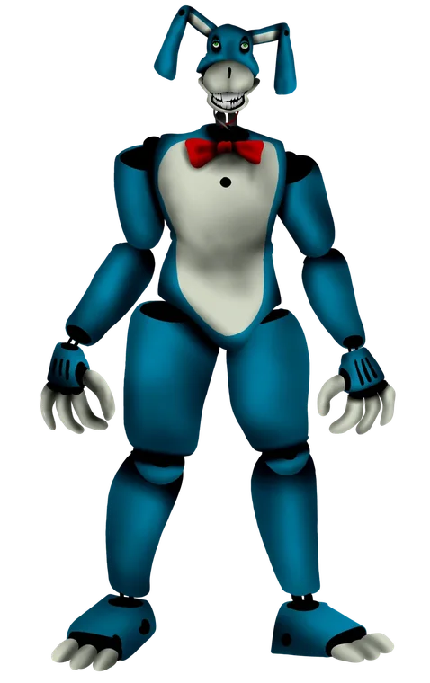

2020年4月26日初公開、2023年2月19日に一部新規演出を加えて再アップロードされたシリーズ第1話（尺：11分5秒）。すでに消滅した企業「バニースマイルズ社（BSI）」のテープ3本を、「アンソニー（Anthony）」という人物が入手・編集して公開したアーカイブ映像という体裁をとる。動画概要欄によれば、前半は1974〜1979年頃に新入社員へ配布されていた社内テープ、最後は1982年に新任の「施設管理人（Facility Caretaker）」が記録した映像と説明されている。

**小目次（ジャンプ）**

- [テープ1 — BSI新入社員向け紹介ビデオ（1974年）](#f1-t1)
- [テープ2 — 子ども向けアニメ「リトルボンのご近所」（1979年）](#f1-t2)
- [テープ3 — ブライアン・ステルズの施設調査録画（1982年10月10日）](#f1-t3)
- [ファイル1の考察](#f1-thoughts)

### テープ1 — BSI新入社員向け紹介ビデオ（1974年） {#f1-t1}

冒頭、「A CYBERFUN TECH - BUNNY SMILES INC. Restaurant 1974」と記されたロゴカードに続き、技術サポート・保守部門（役割名：施設管理人／Facility Caretaker）の新入社員に向けた明るい研修ビデオが始まる。数週間後に開店を控えたレストラン「ボンズバーガーズ（Bon's Burgers）」で子どもたちを楽しませるアニマトロニクスバンド「ショーストッパーズ（Showstoppers）」（ボン、シャ、ブーズー、バニー）の歌唱映像として、『The Sun Has Got His Hat On』『How Much is that Doggie in the Window』『Old MacDonald Had a Farm』の3曲が紹介される（3曲目の豚の鳴き声パートで、ボンが不自然に甲高い生々しい悲鳴のような音を上げる）。

続いて日常業務として「清掃プロトコル」「ロボットのメンテナンスと修理」「BSI技術の習得」が案内され、共同創業者ジャック・ウォルテンとフェリックス・クランケンが握手する写真と共に、「BSIにとって最も大切なのはお金や評価ではなく、皆さんが素晴らしい体験をすること」という歓迎メッセージが読み上げられる。しかし「数週間後の開店に向けて夢を叶えよう」と締めくくられる直前、背景が赤く染まってボンのイラストが異様に引き伸ばされ、映像が激しくグリッチする。直後、時系列を超えて「1974年の店舗内で起きた『一連の事件』を受け、永久閉店（Closed for Good）となったボンズバーガーズの全資産・アニマトロニクス・筐体をセントジョアナの森の奥深くにある地下バンカー『K-9保管施設』へ移送・隔離する（Save, Restore, Secure!）」という不穏な案内テキストが割り込む。

**重要な点：** テープ開始直前、激しいノイズと共に森の中の白黒のウサギ映像が一瞬挿入される（2023年再アップロード版での追加演出）。また、ナレーターが「ロボットのメンテナンスと修理（robot maintenance and repair）」と口にする瞬間だけ、リトルボンがボンの腕パーツを持つイラストと共に声が不気味に低く歪む。テープ末尾には暗闇に灰色のウサギ人形（Rocket）が現れ、逆再生音声で「You finally start to remember. That old day. They will be back for you soon, Sophie.（やっと記憶が戻り始めたね。あの遠い日のことを。もうすぐ彼らが迎えに来るよ、ソフィー）」と語りかける。

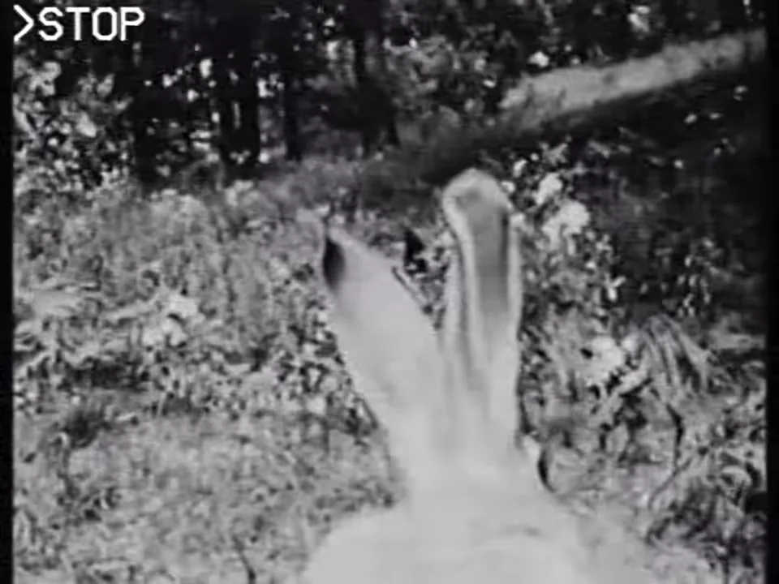

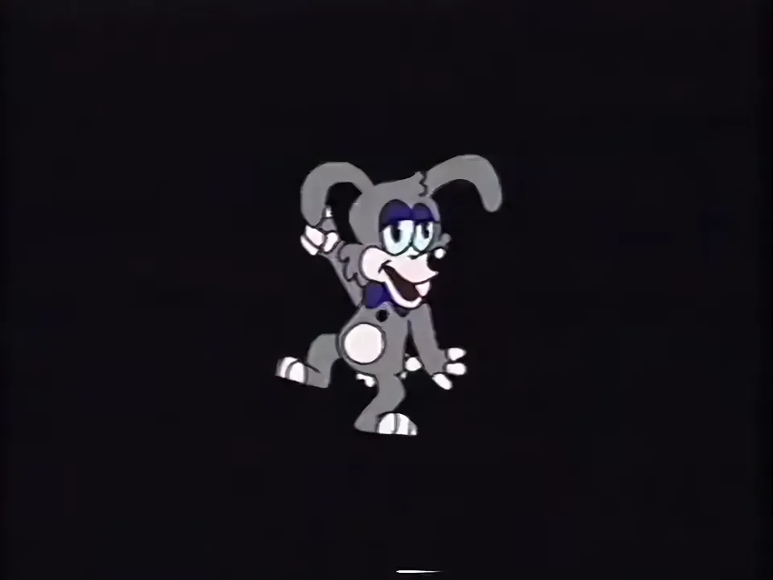

### テープ2 — 子ども向けアニメ「リトルボンのご近所」（1979年） {#f1-t2}

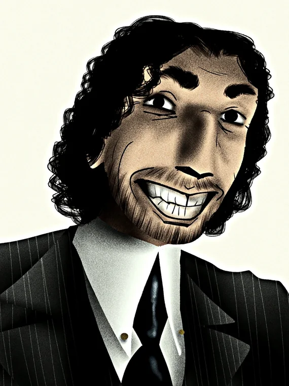

BSI傘下「サンライトアニメーション（Sunlight Animation）」制作の1979年の子ども向け番組『Little Bon's Neighbourhood』の一編「Bon's Super Sleepover」（脚本：Sarah Evelyn）。「Brighton 27」の番地プレートが掲げられた黄色い家で、リトルボンが友達を招いてお泊まり映画会を開く物語として始まる。招待客リストとしてシャ、ブーズー、ピエロのビリー（バニーは招待されていない）が紹介されるが、2回目の確認でナレーションが途切れ、リトルボンの目と背景が黒く塗り潰されて、ビリーの枠が不気味に歪んだジャック・ウォルテンの顔に差し替わる。

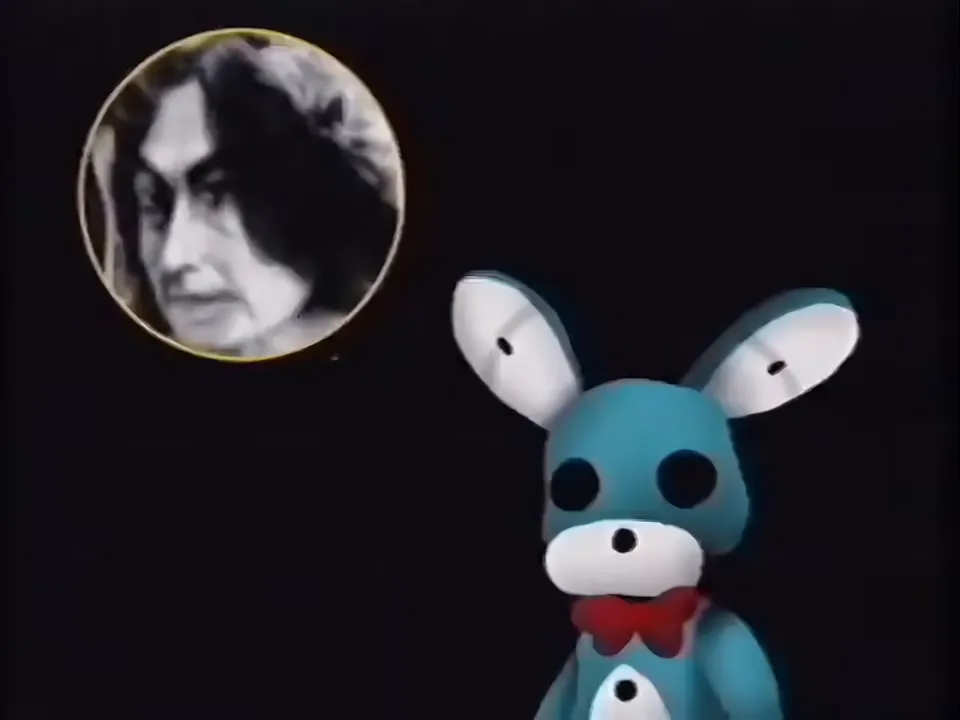

何事もなかったかのようにアニメが再開し、リトルボンが「なけなしのお金で買った面白い映画」を取り出すが、パッケージには逆さまの「Home video」という文字とジャックの顔が印刷されている。一行が視聴する「BONY™ 1978」製のテレビの横には「SOPHIE WALTEN」名義の処方薬ボトルが置かれており、画面には映画の代わりに「Let me out of here（ここから出して）」というテキストが表示されてテレビ自体が上下に引き伸ばされる。

夜になり全員が寝袋で眠りについた後（リトルボンだけ「目」が描かれたピンクのアイマスクを着用）、家の奥からの物音で起きたリトルボンが暗い室内を歩き回る。ひとりでに点いたテレビにはジャック・ウォルテンの行方不明ポスター（最終目撃：1974年6月11日）が映り、目と口が不気味に蠢きながら呻き声のようなノイズを発する。足元のタイル床でライター（「a lighter.」）を見つけたリトルボンは、3回の着火失敗ののち4回目で火を灯す。その瞬間、リトルボンの姿は「SOPHIE」の名札が付いた施設管理人制服の女性（ソフィー・ウォルテン）へと変わり、そのすぐ背後に外装が剥がれ落ちたボロボロのボンが立ち尽くしているカットで強制終了する。

### テープ3 — ブライアン・ステルズの施設調査録画（1982年10月10日） {#f1-t3}

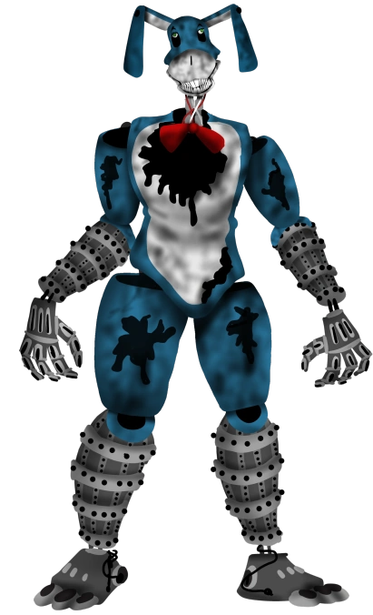

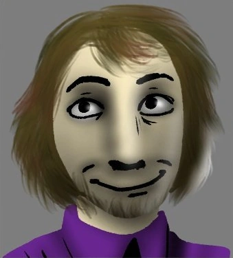

1982年、新任の施設管理人ブライアン・ステルズが業務記録用として撮影した車載・手持ちカメラ映像。森の中の道に20分迷いながらK-9保管施設に到着したブライアンは、上司のクリス（Chris）から「78〜79年頃から約4年間稼働していないため、ひどい悪臭がするはずだ」と聞かされていたことを語る。施設内部へ入ったブライアンは壁に貼られた写真群（フェリックス・クランケン、BSI関係者・家族の集合写真、エド＆モリー・ウォルテンの写真）をライトで照らしてズームし、そのたびに映像にノイズが走る。

奥へ進むと「下水道のような悪臭」が漂う部屋で、外装が剥がれ内骨格が露出したボンのアニマトロニクスを発見。「移転プロジェクト（Relocate Project）に使えるかもしれない」と診断コンソールを起動し、頭部と口、右腕の順で動作テストを行う。しかし動きの鈍い左腕を確認しようとした瞬間、逆再生の笑い声が響いて映像が遮断される。画面は真っ白な背景（Wonderland）に切り替わり、空洞だったボンの眼窩に生々しい人間の両目が浮かび上がって、どす黒い血の涙が溢れ出す。

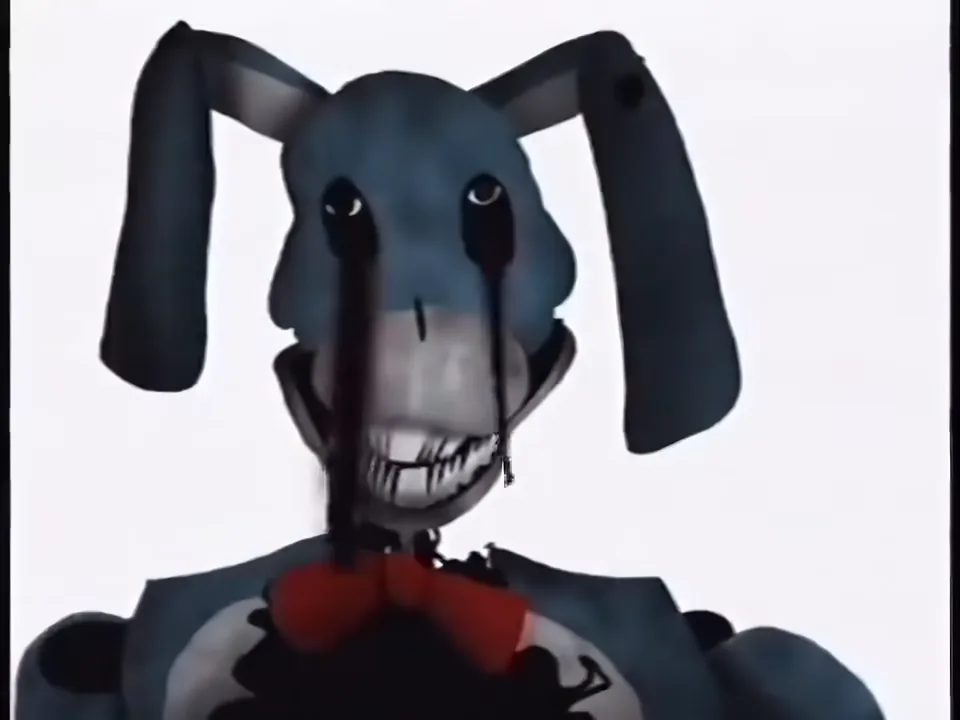

次の瞬間、カメラは夜の森を必死に逃走するブライアンの映像へ戻る。「WHAT WAS THAT THING-?（なんだあれは！？）」と叫んだ直後、鈍い破砕音と共に映像が暗転。荒い呼吸音と肉を裂くような水音の中、暗闇に2つの白い点が浮かび、ブライアンが懐中電灯を点灯すると、返り血にまみれたボンが目の前にうずくまっている。光に照らされたボンは自らの顔を隠すように右手を上げながら咆哮し、静止したフレームが歪んで「常に笑顔の歯」が反転した巨大なへの字口へと変貌する。直後、CyberFun Techコンソールの3D顔認識画面（表情を変えながら変形する白い顔モデルとサイレン音）が割り込み、無音のVCRノイズの中で顔面を損壊され腕をもがれたブライアンの遺体が映し出される。

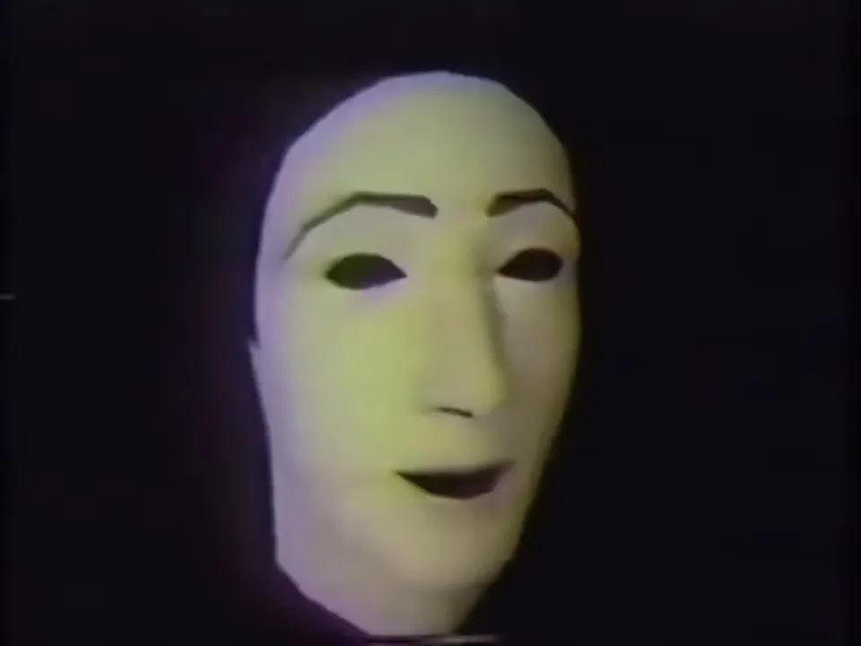

画面下部には「i cant feel anything（何も感じられない）」「he thought i was her.（彼は私を彼女だと思った）」というテキストが浮かび、暗闇からブライアンのBSI社員証がフェードインする。最後はドビュッシー『月の光（Clair de Lune）』が流れる中、不気味な笑みを浮かべるモノクロのジャック・ウォルテンの写真が現れ、背景が徐々に真っ白な光に満たされてジャックの姿が白の中へ溶け込むように消えていく。

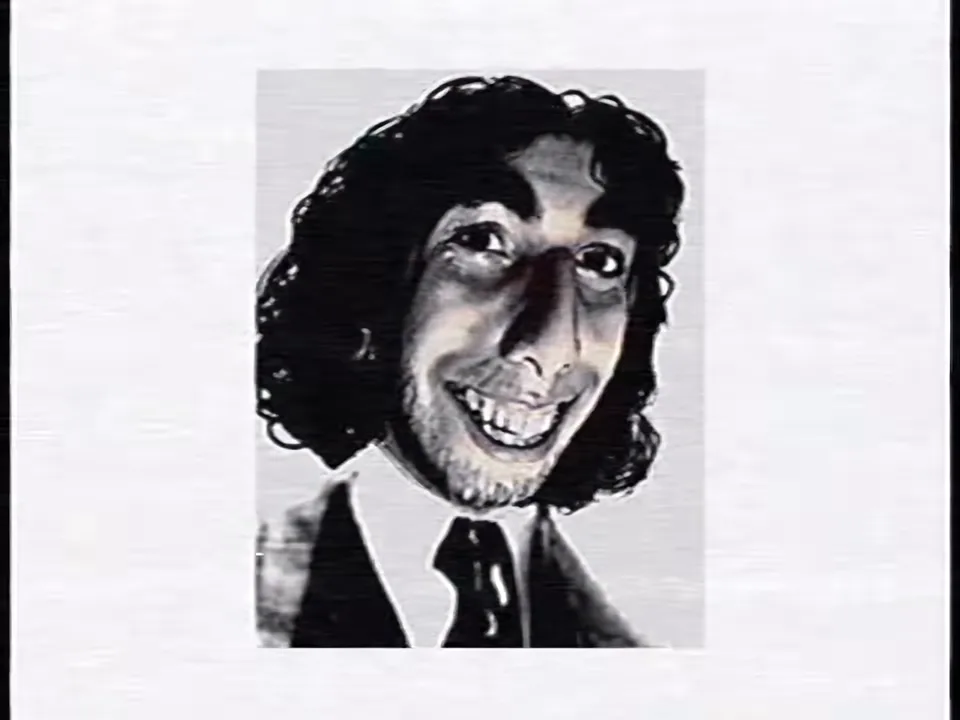

### ファイル1の考察 {#f1-thoughts}

**「3本のテープ」が作る段階的侵食構造とアンソニーの枠組み：**
=> 年代の異なる3本のテープを通じて異常が現実の殺害現場へと段階的に噴出し、ソフィーの記憶を呼び覚ます媒介となっている。
本作は「1974年の社内研修テープ」→「1979年の子ども向けアニメ」→「1982年の実録調査映像」という異なる年代・媒体の3本を繋ぐことで、最初はサブリミナル的な違和感だった異常が、徐々にテープ自体を乗っ取り、最終的に現実世界の殺害現場へと噴出する構造をとっている。また、投稿者アンソニーは単なるアーカイブ収集者として振る舞っているが、テープ1末尾の逆再生メッセージが明確に「ソフィー」個人へ宛てられていることから、テープそのものが特定の視聴者（ソフィー）の記憶を呼び覚ます媒介として汚染・干渉されていることが示唆される。

**誤認殺害のメカニズムと「赤い制服のソフィー」の意味（ソフィーとブライアンの切り分け）：**
=> 1982年に殺害された管理人はソフィーと誤認されたブライアンであり、テープ2末尾のソフィーの姿は彼女に迫るボンの殺意のメタファーである。
テープ3終盤で挿入される3D顔モデルの変形演出（1974年にユタ大学で制作された初期CGI映像の引用）と「he thought i was her.」の一文は、ボンがCyberFun Tech製の顔認識システムを介して対象を判別しており、その認識精度の狂いによってブライアンを「ソフィー・ウォルテン」と誤認して襲撃したことを示している。なお、ソフィー自身は店舗やK-9保管施設の管理人・警備員として働いたことはなく（1974年の店舗にも夜間警備員は不在）、1982年に現地へ派遣され犠牲になったのはブライアンである。テープ2末尾の「赤い制服を着てオイルライターを灯すソフィー」は、ブライアンの装備（紫の制服・懐中電灯）とは一致しないソフィー本人のカットであり、制作初期プロット（ソフィー自身が現地調査を行う構想）の名残であると同時に、現在の正史（カノン）においては「記憶を失い小さな手がかり（ライターの火）だけを頼りに暗闇に立つソフィーのすぐ背後に、常にボンの殺意が迫り続けている状況・悪夢のメタファー」として機能している。

**ボン内部の意識と「顔を隠す仕草」の異常性：**
=> 血の涙や顔を覆い隠す仕草は、ボンが単なる故障機械ではなく感情や人格を伴う人間の意識（霊的存在）を宿していることを示している。
ボンは単なるプログラム暴走を起こした機械ではなく、空洞の眼窩に浮かぶ人間の目、血の涙、診断テスト中の自律起動と嘲笑など、明確に「人間の意識（霊的存在）」を宿した振る舞いを見せる。とりわけ襲撃直後に懐中電灯で照らされた際、右手で自分の顔を覆い隠すように咆哮する仕草には、機械にはあり得ない羞恥・拒絶・あるいは自らの変貌に対する感情的な反応が滲んでおり、後のエピソードで描かれる「"Bon"（灰色の存在）」の人格性を初期段階から裏付けている。

**テープに介入する「複数の意識」の交錯：**
=> 第1話の時点で、ボン内部の凶暴な意識・ジャックの痕跡・Rocket（エド＆モリー）という少なくとも3系統の意識が別々の目的でソフィーへ干渉している。
ファイル1の時点ですでに、異常を引き起こしている主体は単一ではない。①ブライアンをソフィーと誤認して肉体を損壊させる「ボン内部の凶暴な意識」、②テレビ画面を通じて「ここから出して（Let me out of here）」と訴え、行方不明ポスターやパッケージから視線を送り続ける「ジャック・ウォルテンの痕跡」、③テープ1末尾で「あの遠い日を思い出し始めたね」とソフィーに静かに語りかける「灰色のウサギ（Rocket＝エド＆モリー）」の少なくとも3系統の干渉が混在しており、それぞれ異なる目的でソフィーへ接近していることが読み取れる。

**1982年時点での「悪臭」の意味：**
=> 1982年の現場に漂っていた悪臭と稼働停止の言及は、1978年に起きたアシュリー殺害およびビリー内部への遺体遺棄の結果と一致している。
ブライアンが到着前から聞かされていた「78〜79年以降の稼働停止」と現場の「下水道のような悪臭」は、次作『ファイル2（Relocate Project）』で描かれる1978年7月の技術者アシュリー・パークス殺害およびビリー内部への遺体遺棄と完全に符合する。第1話の何気ないセリフの中に、すでに1978年の惨劇の結果が織り込まれている。

**2023年再アップロード版で強化された「白い空間（Wonderland）」の伏線：**
=> 2023年の再投稿版で追加された真っ白な空間の演出は、第1話の結末をファイル4で明かされる霊的境界領域「Wonderland」へ直接接続している。
2020年の初版はブライアンの社員証で幕を閉じていたが、2023年の再投稿版では「冒頭の白黒ウサギ映像」「K-9施設壁面のフェリックスおよびエド＆モリーの写真」、そして「『月の光』と共にジャックの写真が真っ白な空間へ飲み込まれて消えるラスト」が追加された。この「白一色の空間」は、テープ3中盤でボンが血の涙を流す白背景と同一の位相であり、後の『ファイル4（CyberFun Tech）』で本格的に明かされる霊的境界領域「Wonderland」へ第1話の終端を直接接続する重要な改訂となっている。

---

## ファイル2 — Relocate Project（移転プロジェクト）

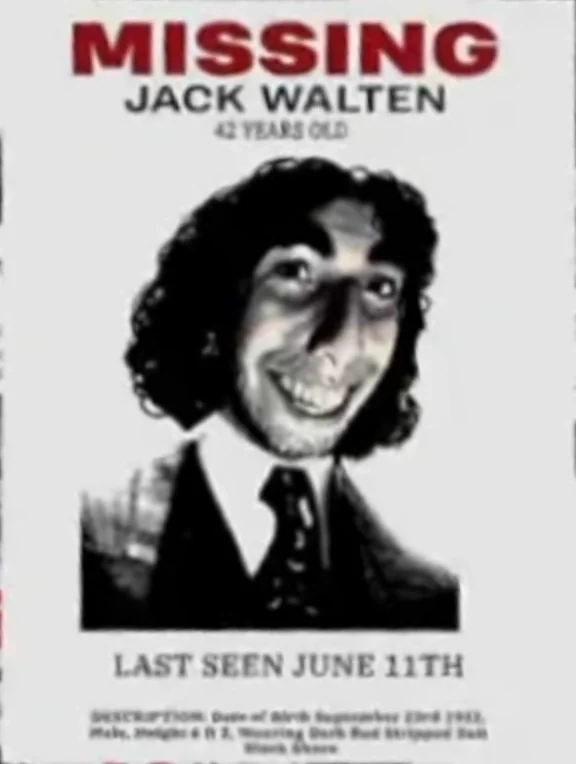

2020年5月29日公開のシリーズ第2話（尺：17分55秒）。動画概要欄によれば、投稿者アンソニーがフォーラムやスレッドを通じてBSIの情報提供者たちと接触し、入手した4本の内部テープをまとめたコンパイル映像である。元BSI社員の証言として、これらは1970年代後半（1978年）に進められていた「移転プロジェクト（Relocate Project）」に関する極秘テープでごく一部の関係者しかコピーを持たず、1980年代初頭（1983年）に会社が消滅した際に関連テープはすべて「発禁・破棄（Banned and Destroyed）」されたはずの希少資料だと説明されている。

**小目次（ジャンプ）**

- [テープ1 — 移転プロジェクト説明ビデオ（1978年7月2日）](#f2-t1)
- [テープ2 — アニマトロニクス再プログラム映像（1978年8月13日）](#f2-t2)
- [テープ3 — K-9保管施設ツアーガイド（1978年7月9日）](#f2-t3)
- [テープ4 — 技術者3名による施設録画（1978年7月12〜14日）](#f2-t4)
- [ファイル2の考察](#f2-thoughts)

### テープ1 — 移転プロジェクト説明ビデオ（1978年7月2日） {#f2-t1}

冒頭、「Tape #1 created in: 07/02/1978」の字幕と「BUNNY SMILES INC. / A COMPANY BY CYBERFUN TECH 1978」のロゴに続き、サファリ帽を被ったリトルボンが踊るBSI社員向けの社内プレゼン映像が始まる。1974年7月20日に起きたボンズバーガーズの「悲劇的な閉店（tragic closure）」から4年間にわたる「法的手続き（legal paperwork）」を終えた今、BSIが温めていたバックアップ計画——**「移転プロジェクト（The Relocate Project）」**——を正式に始動させることが宣言される。

計画の骨子は、1975年に自社配送便（Bunny Smiles Shipping Service）でセントジョアナの森の「K-9保管施設」へ移送・保管していたショーストッパーズのロボット群を最新技術で再プログラム・修復し、その間に書籍・ゲーム（『BunnyFarm』パッケージ）・コミック（『Bunny Comics #27』）・ぬいぐるみ・ホームビデオなどの関連グッズ販売で収益を確保した上で、1982年オープン予定の新店舗「**NEW BON'S BURGERS!**」を開設するというもの。終盤、本来はジャックとの共同創業であるにもかかわらず、フェリックス・クランケン単独の白黒ポートレートが「**FOUNDER（創業者）**」の肩書きで掲げられ、ナレーターが「巨大な頭脳だけでなく、巨大な心（giant heart）を持った男——」とフェリックスを称え上げる。しかし「heart」の語尾で音声とBGMがプツリと途切れ、新店舗に立つフェリックスのイラストが、暗闇の中で目を虚ろに窪ませたモノクロのジャック・ウォルテンの立ち絵（および不気味に微笑む実写風の顔）へと切り替わって闇へ溶けていく。

**重要な点：** 開始直後（0:29頃）の画面右下に隠し動画『Lucky You』のYouTube URL前半（`https://youtu`）が一瞬表示される。「法的手続き」の場面で映る書類キャビネットには、ジャック失踪（1974年6月11日）より後の日付である「`06/28/1974`」に「`Jack Walten`」の署名が入った開店書類フォルダ、フェリックス署名の「`Storage K-9`」「`Relocate`」フォルダ、ラベルが黒塗りされた4冊目のファイルが並び、引き出し下端には「`JACK IS STILL HERE`」と書かれたメモが見切れている。また1975年の8bit配送アニメでは画面が暗転してトラックの運転席にジャックの顔が浮かび上がり、グッズ紹介の中央下には「`The disappearance of Jack Walten VHS`」と題されたビデオテープが紛れ込んでいる。

### テープ2 — アニマトロニクス再プログラム映像（1978年8月13日） {#f2-t2}

「Tape #2 created in: 08/13/1978」と記された技術検証テープ。「REPROGRAMMING PHASE "facial Expressions"」と題され、1974年製の**バニー（Banny）**をテストモデルとして、旧仕様の「口（MOUTH）の開閉」と、移転プロジェクト限定の新機能「**まばたき（BLINK）**」の動作確認が行われる。ここで画面テキストは「従業員は常に眼窩（Eye Socket）を清掃しなければならない。目の汚れはBLINK機能に支障をきたす」と注意喚起しており、後のテープ4での点検シーンへの伏線となっている。続いて「HAPPY（喜び）」「SAD（悲しみ）」「ANNOYED/BORED（退屈・苛立ち）」「SURPRISED（驚き）」の感情表現テストが行われたのち、「部屋の中で友だちを見つける」実践デモへ移行するが、背景が徐々に暗転して音楽が止まり、バニーの顔の上に、顔面や首が異様に引き伸ばされ痣だらけになった女性（BSIの主任技術者**スーザン・ウッディングス**）の顔がノイズと共に3回フラッシュする。

直後、映像は4方向に黒い出入口がある市松模様の部屋を見下ろす奇妙なアニメへと切り替わる。閉じ込められた紫のウサギ（バニー＝スーザン）が出口を探して歩き回る中、合成音声が淡々と「いたずらウサギは檻から出る方法を探すが、うまくいかない。ウサギは出口を探すか、せめて飼い主（owner）の注意を引こうとし続ける……ウサギは飢えている（`The rabbit is starving.`）」と繰り返し、やがてウサギは床にうずくまって黒い涙を流す。さらに白黒の実写ウサギ狩り映像（1930年代の野ウサギ駆除記録）が挿入されたのち、モーツァルト『レクイエム』より「ラクリモーサ（涙の日）」が歪んで響く暗闇の中で、顎が外れ眼窩が空洞になったバニーへとカメラがゆっくりズームインする。最後は真っ白な背景の鳥かごに閉じ込められた紫のウサギが映し出され、スーザンの魂と肉体がバニーという「檻」の中で誰にも救われないまま餓死・衰弱死に至ったことが暗示される。

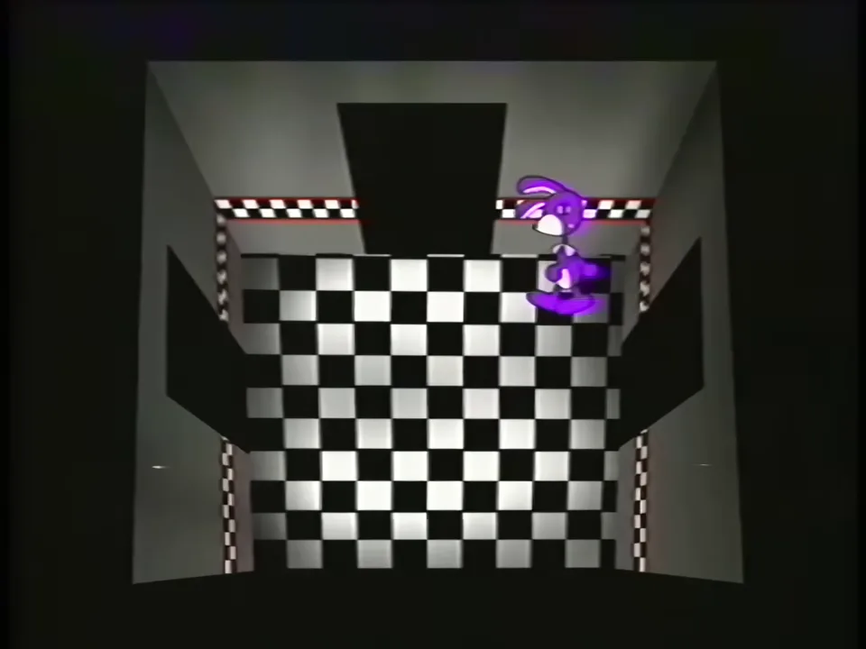

**重要な点：** パート末尾のほぼ真っ暗な画面の中に、1974年6月30日失踪と記されたスーザン・ウッディングスの行方不明ポスター（MISSING）がごくわずかな輝度で浮かび上がる（通常視聴では極めて見落としやすい）。

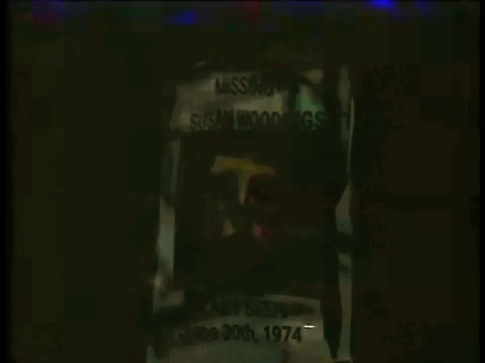

### テープ3 — K-9保管施設ツアーガイド（1978年7月9日） {#f2-t3}

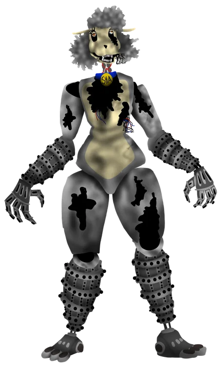

「Tape #3 created in: 07/09/1978」。額装されたショーストッパーズの写真や『BUNNYFARM』のアーケード筐体、3Dモデルのボンを映す不穏な導入に続き、羊のキャラクター**シャ（Sha）**が案内役を務める施設管理人（Facility Caretaker）向けの研修アニメ「Technical Support」が始まる。シャはK-9保管施設に入る際の必須ルールとして、BSI指定制服の着用とBSI社員証の常時携帯、および黄色いリュックに入れる4つの携行品（ランタン・軽食・鍵・カメラ）の確認を案内する。バンカー内部の見取り図ツアーへ進むと、シャは「明かりをつけて（`Turn on the light`）」と不自然なほど執拗に4回繰り返したのち、休憩室（「清潔な環境は仕事を助け、汚れた環境は仕事を困難にする」）を経てメインホールの**3つの大型保管扉**を紹介する。1つ目は清掃用具・備品、2つ目は店舗の景品やグッズ類と説明されるが、3つ目の扉について「3つ目のドアは隠すために使われ——（`The third door is used to hide—`）」と言いかけた瞬間に音声が途切れる。

画面は真っ暗になり、数週間前から行方不明になった夫（ジャック）の再会を願って毎晩閉店間際の店舗を訪れていた妻**ローズマリー・ウォルテン**が、ある夜バックステージから響く「彼の居場所を知ってるよ、ロージー（`I know where he is, Rosey`）」という声を聞いた経緯が合成音声で語られる。直後、何事もなかったかのように地下保管区画のツアーへ復帰したシャは「ロボットたちに触れたり、**絶対にライトを当てたりしないように**」と強く警告するが（ファイル1でブライアンが懐中電灯を当てて襲われる展開への伏線）、通路を進むうちに先ほど訪れたはずの部屋へループしてしまい、「待って、この部屋はもう来た覚えがあるわ」と戸惑い始める。するとシャの両目が黒い空洞へと変わり、暗闇の中で震える声で「**ソフィー、ここはどこ？（`Sophie, where am I?`）**」と娘の名を呟く。

映像は1974年7月19日夜のバックステージ再現アニメへ突入する。声を頼りに奥へ入ったローズマリーが見つけたのは夫ではなく「ウサギ（ボン）」であり、背後を振り返ると黒い人影（シャドーマン）が退路に立っている。シャとローズマリーの姿が激しく明滅して重なり合い、ボンは途切れ途切れのテキストで「ロージー、壊れてる。直してあげる。きれいになるよ（`Rose. Broken. Will fix you. You will. Beautiful.`）」と告げる。四肢と頭部を切断されたローズマリーの肉片を棒人間のボンが引きずってシャの機体内部へ詰め込む凄惨なアニメに続き、真っ白な空間の「**EMPLOYEES ONLY（関係者以外立入禁止）**」と書かれた戸口から、黒い影の男（シャドーマン）が返り血に染まったボンとシャを無言で見つめるカットが映し出される。最後は実写造形に近いシャのクローズアップとなり、「彼女が目覚めた時、彼女はとてもきれいだった。けれど内側では、体のあらゆる部分から血が流れ出ているように感じた」というモノローグと共に、全身血まみれで絶叫し痙攣するシャの姿がフラッシュして幕を閉じる。

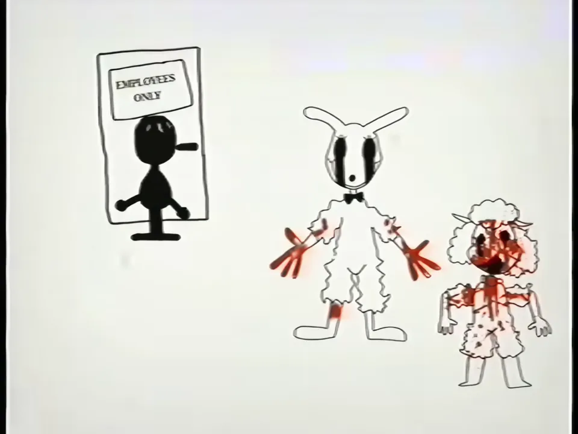

**重要な点：** 制服・社員証の確認シーンで、4年後の1982年に犠牲となる**ブライアン・ステルズ**のBSI社員証が一瞬表示される（ファイル1テープ3への接続）。携行品チェック直後の暗闇では、リトルボンの黄色いリュックからジャック・ウォルテンがせり出してくる。またパート末尾の暗闇には、ローズマリーの行方不明ポスターがかすかに映り込む（見落としやすい）。

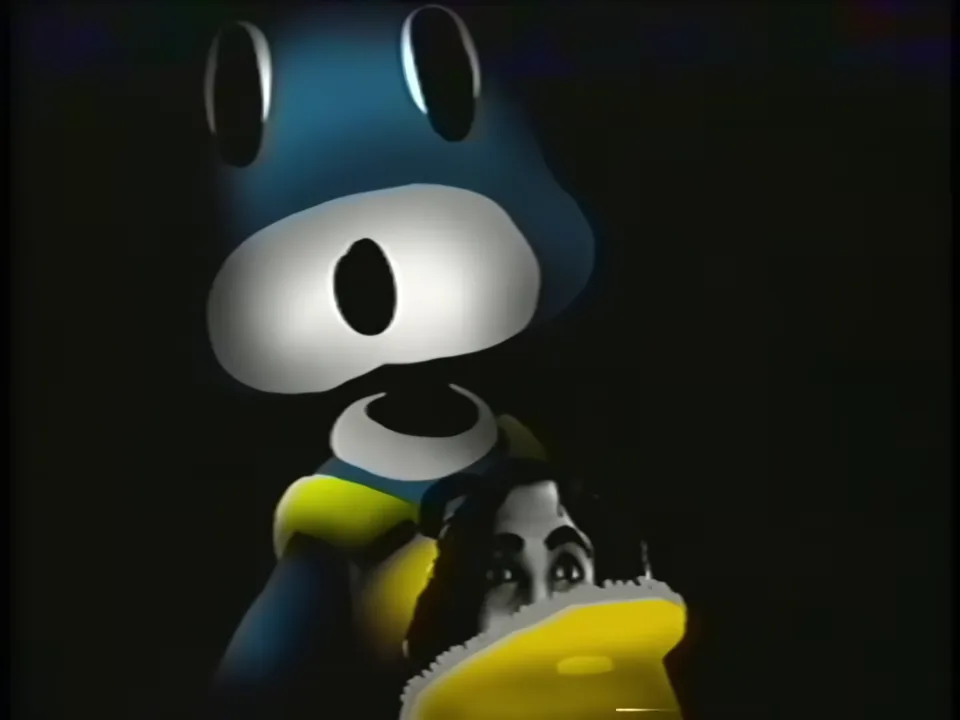

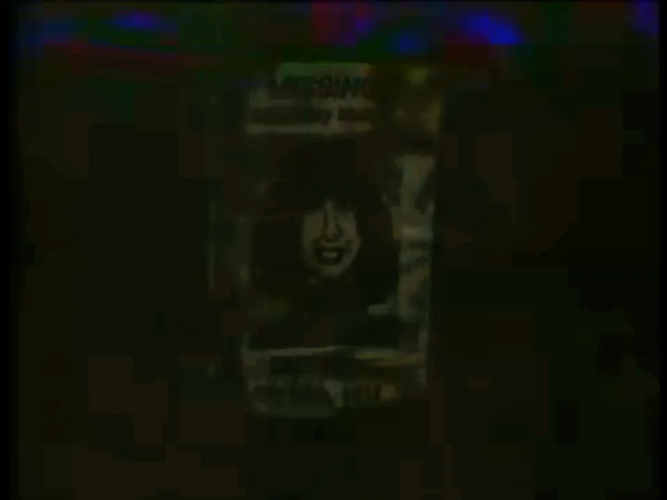

### テープ4 — 技術者3名による施設録画（1978年7月12〜14日） {#f2-t4}

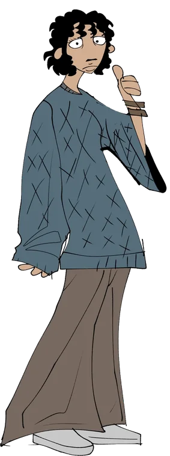

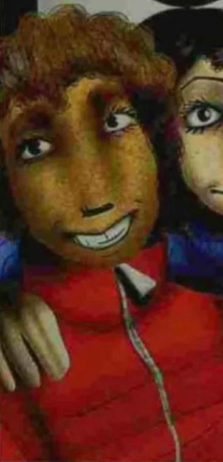

「Tape #4 created in: Unknown Date」。冒頭の説明テキストにより、1978年7月12日から14日までの3日間、移転プロジェクト用のアニマトロニクス再プログラムを行うため、BSIの技術者3名（**ヒラリー・B、アシュリー・P、ケビン・W**）が志願してK-9保管施設に泊まり込んだ際の記録映像であることが示される。初日、森の奥のバンカー入口前でヒラリーが4年前のボンズバーガーズ閉店の経緯を語る。店舗はごく短期間しか営業しておらず、当時は**夜間警備員を雇っていなかった**にもかかわらず深夜2〜3時に音楽と照明が点いているという近隣苦情が相次いだこと、そして「**店内から大人の女性の叫び声が聞こえる**」という通報（7月19日のローズマリー殺害を示唆）から数時間後に急遽閉店したことが明かされる（最終営業日には1〜2組の家族しか入れず、ステージのカーテンは閉め切られロボットたちは一体も姿を見せなかったという）。

施設内での作業が始まると、損傷の激しさと金曜日までの無謀な納期に3人は難航する。劣化したボンを点検したヒラリーは、**ボンの眼窩（アイソケット）が「まるで誰かが意図的にやったかのように」ひどく破壊されており**、新機能の「まばたき（Blink）」が実装できないことを指摘する（アシュリーは閉店後に親会社CyberFun Techが不審な点を調査・改修した際に生じた破損ではないかと推測する）。夜、極寒の施設内で寝袋に入った3人の会話で、アシュリーはBSIから「**何の説明もなく渡された小さな鍵**」の存在を気にかける。最終日（7月14日）、ケビンとヒラリーは内骨格の深刻な劣化と機材・期間不足から**再プログラム作業の失敗**をカメラに報告する。しかしその夜遅く、2人が眠る間にアシュリーは「計画を救う手がかりがあるかもしれない」と単独でカメラと懐中電灯を持ち出し、小さな鍵が「**BACKDOORS**」と記された黄色い扉に合うことを突き止めて奥へと足を踏み入れる。

予想以上に広大な迷宮状のバックドア内部には、「SCRAPPED（廃棄）」と書かれた布を被せられた機体や予備の内骨格パーツが置かれた部屋、ブーズー・バニー・シャの予備頭部が転がる「第26（または27）号室」が続き、さらにその先の暗がりでは、**青い蝶ネクタイを付けた灰色のウサギ人形（Rocket）が壁に吊るされている**異様な光景に遭遇する（アシュリーは「ロボットなのかパペットなのかも分からないけれど、なぜ壁に吊るされているの？」と困惑する）。

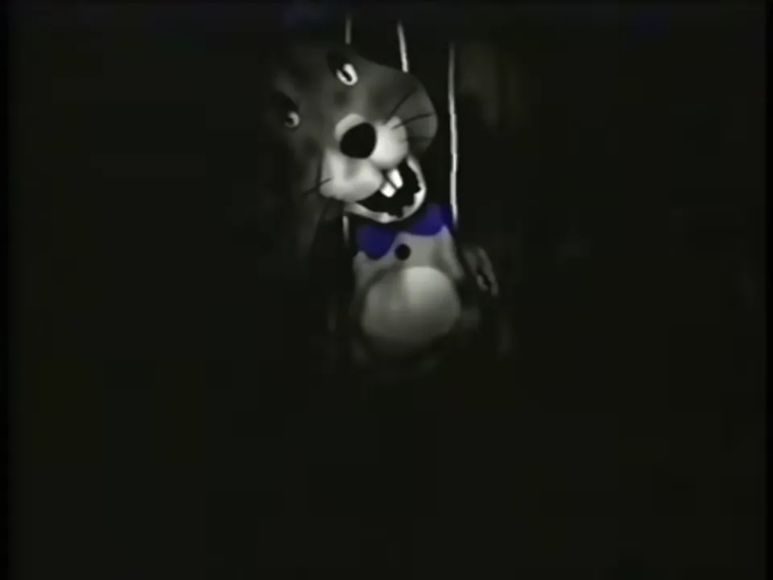

最奥の扉を開けたアシュリーは、胸部にカセットプレーヤーが組み込まれた見慣れないピエロ型アニマトロニクス——**ビリー（Billy）**——と、床に落ちていた「**`06/11/7█` / `DISCARD`（破棄）**」ラベルのカセットテープを発見する。誕生日パーティー用のカスタムテープだろうと推測したアシュリーが意を決してビリーに挿入すると、陽気なバースデーソングが流れたのち突然音声が歪み、無機質な声で失踪者たちの名前——「**Jack, Susan, Charles, Rosemary, Sophie**」——が順番に読み上げられる（最後の「Sophie」だけ異なるブザー音が鳴り、直後に逆再生で「Sophie」と繰り返される）。

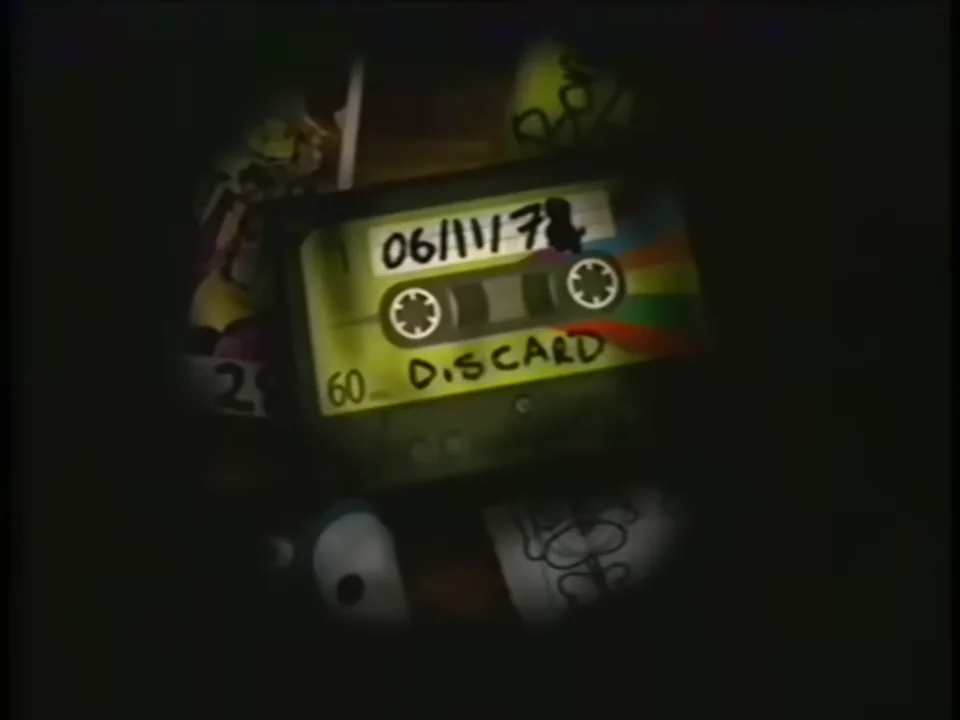

恐怖に息を呑んだアシュリーの懐中電灯が突然消え、必死に叩いて再点灯させた瞬間、目の前にボンが立ちはだかって襲いかかる。画面は技術者3人の記念写真に切り替わるが、両脇のケビンとヒラリーは黒く塗り潰され、中央に残されたアシュリーのモノクロの顔だけが上下反転した目口から大量の血を流して歪み、断末魔の絶叫が響き渡る。やがて暗闇に現れたビリーが「やあ！僕はビリー、おかしなピエロさ。歌を歌ってもいいかい？」とグリッチ混じりに自己紹介した直後、ボンの血まみれの機械の手がビリーの顔面マスクをゆっくりと剥がし、内部に詰め込まれたアシュリーの損壊した顔を露わにする。

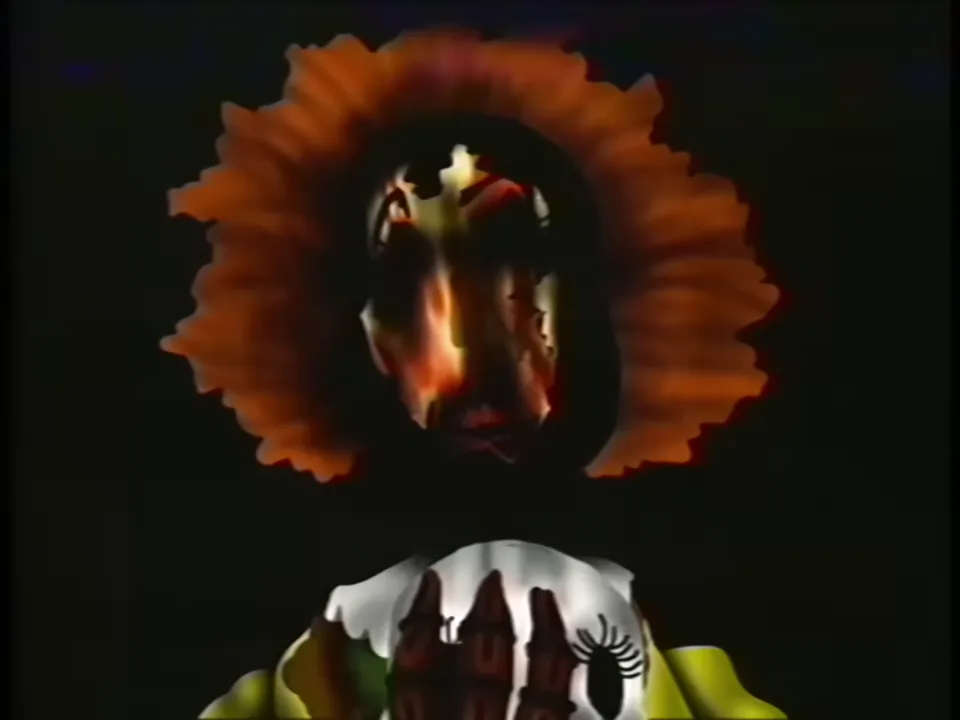

**重要な点：** ビリーが「歌を歌ってもいいかい？」と言った直後に流れる不気味な音声を逆再生すると、「`The blind fortune teller is filled with knowledge, but never with context.`（盲目の占い師は知識に満ちているが、文脈は決して持たない）」という一文になる（脚本担当Evaにより確定）。またマスクが剥がされた数秒後（17:22頃）、**わずか2フレーム（約0.07秒）だけ**画面いっぱいに白い英文テキストがサブリミナル表示され、翌朝ケビンとヒラリーはアシュリーが先に帰ったと思い込んで退去したが実際にはバックドアで誰にも届かず叫び続けていたこと、数日後に管理人たちからバックドアからの猛烈な悪臭が報告されて施設が無期限閉鎖（移転プロジェクト失敗）となったこと、そして「`Ashley is still there, but she's not screaming anymore, she saw something she wasn't supposed to see, and now she's beautiful...`（アシュリーはまだそこにいるが、もう叫んでいない。見てはいけないものを見た。そして今、彼女はきれいになった……）」という顛末が記されている。直後の砂嵐の合間に隠し動画『Lucky You』のYouTube URL後半（`.be/K07tQqEDOfQ`）が一瞬表示され、エンドクレジット後には暗闇から「`Shadow Man sees me when lights go off.`（明かりが消えた時、影の男は私を見る）」の音声が流れ、最後の8bit納屋映像の右上の木々の後ろに**Showbear**が映る。

### ファイル2の考察 {#f2-thoughts}

**動力源の切り分けと「06/11/7█」カセット（標的リスト）の真意：**
=> 機体を動かしているのは犠牲者の魂とボン内部の男性霊であり、カセットの5名は会社の暗殺リストではなく「美しくする」標的リストである。
アニマトロニクス群を動かしているのは会社側のAIやプログラム暴走ではなく、「殺害され器に閉じ込められた犠牲者の魂（バニー＝スーザン、シャ＝ローズマリー、ビリー＝アシュリー）」と、「ボンに憑依した男性霊（"Bon"）の歪んだ意志」の二層構造である。ビリーのカセット（「`06/11/7█`＝ジャック失踪日である1974年6月11日を示唆」「`DISCARD`」）で失踪順に読み上げられる「ジャック、スーザン、チャールズ、ローズマリー、ソフィー」の5名は、会社が用意した口封じの暗殺リスト（いわゆる「殺し屋Bon」説は制作陣も明確に否定）ではなく、ボン内部の存在が「美しくする（スーツという器に閉じ込めて一つにする）」対象として執着する標的リストと解釈できる（最後のソフィーだけブザー音が異なるのは、1978年時点で唯一の生存者であることを示す）。

**なぜフェリックスは危険なK-9へ人間を送り込んだのか（動機と誤算）：**
=> 物理的証拠さえ消せば再稼働できるという技術への無理解と、事業再建で過去の罪を帳消しにしたい現実逃避が、職員たちを死地へ送り込む原因となった。
- **「物理的証拠さえ消せばただの機械に戻る」という思い込み：** 1974年7月20日の閉店からK-9保管施設への移送までの間に、フェリックス自身による隠蔽・遺体処理と表面上の清掃が行われており（テープ4でヒラリーが指摘した「誰かが意図的に壊したようなボンの眼窩の損傷」や、『Lucky You』で1975年1月時点の施設に悪臭がないこととも符合）、さらに技術への無理解（ファイル4でチャールズが「彼は仕組みを全く理解していない」と記した通り）も重なった結果、フェリックスは機体内部の超常現象（憑依と殺意）を把握・制御できないまま「証拠さえ消せば再稼働できる」と高を括っていた。
- **「事業再建＝罪の上書き」という現実逃避：** 1974年5月2日の飲酒運転事故（エドとモリーの死と遺体隠蔽）や6月のジャック失踪という罪から目を背け、テープ1で単独の「FOUNDER（創業者）」として振る舞いながら「レストランを再建してすべてを元通りにすれば過去の罪も帳消しになる」という自己正当化に執着していたことが、結果として1978年の技術者3名や1982年のブライアンを死地へ送り込む引き金となった。

**アシュリー殺害の複合要因と「きれいにする」という認知の乖離：**
=> アシュリー殺害は秘密区画への侵入に対する口封じとソフィーへの誤認が重なった結果であり、人体解体を「きれいにする」と呼ぶ点に怪異の異常性が表れている。
標的リスト外のアシュリー・パークスが殺害されたのは、「`BACKDOORS`」の鍵で奥の部屋に踏み込みカセットを再生してしまったこと（`"she saw something she wasn't supposed to see"`＝見てはいけない領域への侵入による口封じ）に加え、CyberFun製コンソールの不完全な顔認識によって暗所で「ソフィー・ウォルテン」と誤認された側面が重なった惨劇と考えられる。また公式ブログによれば、ファイル3内で響くローズマリーの悲鳴は「首を掴まれたまま足をもがれている瞬間」の実際の音声とされる。アニマトロニクスの機械的な怪力で人体を意図的に解体してスーツへ詰め込む残虐極まりない行為を、ボン内部の存在は一貫して「きれいにする（make them beautiful）」と表現しており、その著しい認知の乖離が怪異の異常性を裏付けている。

**「シャドーマン（影の男）＝フェリックス・クランケン」説の根拠と「Shadow Man sees me」の解釈：**
=> 現場への立ち会いと施設管理の権限からシャドーマンはフェリックスを指し、惨状を黙認・隠蔽し続けた保身が怪異側から事実上の共犯者として認識されている。
- **立ち位置・権限の一致とソフィー説の否定：** テープ3の再現シーンの通り、1974年7月19日の閉店間際のバックステージ（「EMPLOYEES ONLY」の戸口）に立ち会い、翌日に店舗を閉鎖してK-9保管施設への隔離や人員派遣を行えた人物はフェリックスしかいない。なお、1974年当時14歳前後の少女であり標的リスト最後の生き残りであるソフィーをシャドーマンとする説は、構造的にも公式見解としても否定されている。
- **「明かりが消えた時に私を見る（`Shadow Man sees me when lights go off`）」の意味：** 海外コミュニティで一時広まった「餌を与える（`feeds me`）」は空耳であり、公式の実際のセリフは「私を見る（`sees me`）」である。フェリックスは最初からボンと結託して殺人を企てた黒幕ではなく、「自分の罪を隠したいだけの臆病な人間」に過ぎない（Bonの直接行動主体はあくまで"Bon"であり、シャドーマンが主制御者ではない）。しかし、照明が消えた暗闇で惨状を目撃・黙認し、保身のために証拠を隠蔽したり秘密裏にK-9へ職員を送り込んだりするフェリックスの利己的な行動が、結果としてボンの凶行に獲物と密室を与え続けていたため、アニマトロニクス内の魂や"Bon"の視点からは「暗闇から惨劇を見つめる影の男（事実上の傍観者・共犯者）」として認識されている。

**書類上の偽装痕跡・テープ2の日付矛盾・壁の「Rocket」が繋ぐ伏線：**
=> 署名や作成日の矛盾は記録の改ざんと霊的侵食を示唆し、バックドアのRocketは1974年の飲酒運転事故とK-9施設を繋ぐ伏線となっている。
- **改ざんされた記録と時系列の歪み：** テープ1の書類棚に映る「ジャック失踪後（`06/28/1974`）のジャック署名入り開店書類」や黒塗りファイルは、フェリックスによる書類偽造・共同創業者の抹消工作を示唆している。また、7月14日の惨劇と悪臭で施設閉鎖・計画失敗となったはずであるにもかかわらず、テープ2の作成日が1ヶ月後の「`08/13/1978`」となっている矛盾は、BSI側が対外・社内向けに計画継続を装ったか、あるいは発禁・破棄されたはずのテープ自体が霊的干渉によって時系列ごと変質している不気味さを際立たせている。
- **バックドアの壁に吊るされた「Rocket」：** テープ4でアシュリーが発見した灰色のウサギ人形は、ファイル1テープ1末尾でソフィーに語りかけていた**Rocket**そのものである。なぜ子ども用の人形がK-9保管施設の極秘区画に隔離されていたのかという謎は、後の『ファイル4（CyberFun Tech）』で明かされる1974年5月2日の飲酒運転事故——フェリックスがエドとモリーの遺体を埋めた現場からRocketを持ち帰り、後にK-9へ運び込んだ経緯——への決定的な視覚的ミッシングリンクとなっている。

**物語全体の構造（悲劇の核心）とソフィーへの収束：**
=> 罪から目を背けるフェリックスの保身と家族を器へ繋ぎ止めようとする"Bon"の狂気がK-9施設で噛み合い、すべての記録は最後の生存者ソフィーへと収束する。
本作の本質は単なる殺人機械のホラーではなく、**「自分の過失と罪を直視できない人間の弱さ・保身（フェリックス）」**と、**「失った家族や近しい人々を無理やり器へ繋ぎ止めようとする怪異の狂気（"Bon" ※その生前の正体を巡っては記憶・人格が変質したジャック説と第三者説の双方が議論されている）」**という異なる二つの執着が、K-9という密室で噛み合ってしまった結果、親友同士の家族と同僚が一人ずつ奪われていく悲劇の記録である。そしてすべてのテープと残留思念は、標的リスト最後の生き残りであるソフィー・ウォルテンへと収束していく。

---

## Lucky You（隠し動画／Relocate Projectの補足テープ）

シリーズ初の隠し動画。Relocate Project（ファイル2）の映像内に分割されたURLが隠されており、発見した視聴者のみがアクセスできる限定公開動画。2020年6月27日公開、尺は4分4秒。ソフィー・ウォルテンに向けたメッセージで構成されている。

**小目次（ジャンプ）**

- [年表パート](#ly-timeline)
- [語りパート（音声メッセージ）](#ly-voice)
- [テキストパート（二人目の語り手）](#ly-text)
- [Lucky Youの考察](#ly-thoughts)

### 年表パート {#ly-timeline}

写真付きの日付が連続表示される。06/28/1974：Bon's Burgers開店日。06/30/1974：最初の誕生日パーティー（スーザン・ウッディングスの失踪日と同日）。07/10〜07/19/1974：閉店前最後のショー。07/20/1974：閉業。10/31/1974：建物が使用禁止（ボンが窓越しに見える）。12/10/1974：K-9保管施設の外観。01/23/1975：アニマトロニクス（ボン、ブーズー、シャ、バニー）に「K-9」タグが付いた状態で保管。06/11/1974：画面は真っ暗（ジャックが最後に目撃された日）。

### 語りパート（音声メッセージ） {#ly-voice}

不明な人物がソフィーに語りかける。「見たものに混乱しないで。怖がらないで、私の小さなうさぎちゃん。答えはいずれ与えられる。でも今ある断片だけでこのパズルを解こうとしないで。これはまだ始まりに過ぎない」「壊れた人々の、美しい人々の物語を語ろう」「彼は自分がしたことをとても後悔しているが、もうどうすることもできない。それを覚えておいて」。その後「Safety in pills, Sophie（ソフィー、薬の中に安全がある）」を繰り返す。この間、ブライアン・ステルズとアシュリー・パークスの最期の映像、Showbearの画像、ソフィー名義の処方薬ボトルが表示される。

### テキストパート（二人目の語り手） {#ly-text}

Al Bowllyの「Heartaches」が激しく歪んだ状態で流れる中、画面にテキストが表示される。「彼らを美しくした／やり方はわからない／そうするつもりもなかったのに／でもやってしまった」「彼らはアナログを通じて私たちに話しかけようとしている／彼らの声は届く／これは彼らの助けを求める叫び」「彼らはあの年に何が起きたか知ってほしがっている／でも私たちは忍耐強くなければ」「見て／彼らは生命に満ちている／音楽に合わせて踊る／笑い、歌う／彼らは完璧／彼らは美しい」「彼らはもうすぐあなたに会うだろう、ソフィー」。この間、Relocate Projectの壊れたアニマトロニクス（ボン、シャ、バニー、ビリー）の映像が挿入される。

### Lucky Youの考察 {#ly-thoughts}

**語り手の正体：**
=> 動画内には音声とテキストの2人の語り手が存在し、それぞれジャック説やボン説と並んでフェリックス本人とする解釈も有力視されている。
動画内には音声とテキストの二人の語り手が存在すると考えられている。音声の語り手は「私の小さなうさぎちゃん」という親しい呼びかけからジャック・ウォルテン（父親）説が有力だが、フェリックス・クランケンが三人称で自分を語っている説もある。「彼は後悔しているが何もできない」はフェリックスが5月2日の飲酒運転事故を指している可能性が高く、ファイル4（CyberFun Tech）での発言と一致する。テキストの語り手は「彼らを美しくした」「そうするつもりはなかった」と語る点からボン説があるが、スーザン殺害の計画的な性質と矛盾するため、フェリックス本人という説もある（シリーズライターのEvaもこの説を支持）。

**ソフィーの薬：**
=> ソフィーが服用する薬は1974年の事件の記憶を消すためのものであり、「Safety in pills」は真実を思い出すなという警告を意味する。
ソフィー・ウォルテンは記憶喪失の薬を服用しており、これはフェリックスが1974年の事件（飲酒事故、一連の殺人）の記憶を消すために飲ませたものと推測される。「Safety in pills」は「薬を飲み続けろ＝真実を思い出すな」という警告。

**Showbearの役割：**
=> ここでのShowbearは薬の服用を促す文脈で現れるが、後の『BunnyFarm』での記憶喚起の役割とは矛盾しており、設定変更による別存在（Mr. Snow）の可能性も指摘されている。
Showbearは他のアニマトロニクスと異なり壊れた姿や血まみれの姿で描かれることがない。Lucky Youでは薬のボトル表示直前にShowbearの画像が現れ、目がストロボのように点滅する（催眠術的演出）。ただし、Lucky Youの語り手が薬の服用を勧めるのに対し、後のBunnyFarmではShowbearがソフィーに過去を「思い出させる」役割を果たしており、矛盾する。設定変更（リトコン）により、この語り手はMr. Snowである可能性も指摘されている。

**「Heartaches」と認知症テーマ：**
=> 認知症をテーマにした作品でも知られる楽曲「Heartaches」の使用が、薬によるソフィーの記憶喪失と過去の忘却を暗示している。
動画内で使用される「Heartaches」（Al Bowlly）は、認知症をテーマにしたアルバム「Everywhere At The End Of Time」のオープニングトラックと同曲。ソフィーの薬による記憶喪失・過去の忘却を暗示。

**日付の矛盾：**
=> 施設看板の年号ズレや失踪後の日付を持つジャック署名書類など、記憶の混乱やフェリックスによる偽造を示唆する日付の矛盾が含まれている。
K-9保管施設の写真は12/10/1974の日付だが、施設の看板には「Property of CyberFun Tech 1975」と記載。ソフィーの混乱した記憶の反映か、制作上のミスか議論が続いている。また、ジャックは6/11/1974に失踪したはずだが、前エピソードには6/28/1974付のジャック署名の書類が存在し、フェリックスが偽造した可能性がある。

**保管施設の匂い：**
=> 1975年1月時点で施設に悪臭がないことは当時の遺体除去を示唆しており、1982年の悪臭は1978年のアシュリー殺害後に生じたものと考えられる。
1975年1月23日時点でK-9保管施設に悪臭はない。アニマトロニクス内の遺体がこの時点では除去されていたことを示唆。後にブライアン・ステルズが入った時に悪臭がしたのは、アシュリー・パークスの遺体がビリーに詰め込まれた後だからと考えられる。

**シリーズ全体における位置づけ：**
=> 記憶と忘却やアナログを介した魂の訴えというシリーズの核心テーマを初めて凝縮して提示した重要エピソードである。
この短い隠し動画はシリーズの核心テーマ（記憶と忘却、罪悪感と贖罪、アニマトロニクスに閉じ込められた魂が「アナログ」を通じて真実を伝えようとする構図）を凝縮して初めて明確に提示した重要エピソード。タイトル「Lucky You」自体が皮肉めいた命名であり、真実に近づくほど「幸運」とは逆の現実が露わになることを示唆している。

---

## ファイル3 — BunnyFarm（テープ3／ゲーム記録）

BSIの業務用ゲーム筐体「BunnyFarm」を巡る記録映像。ソフィー・ウォルテン本人が初めて視点人物として本格登場するエピソード。

**小目次（ジャンプ）**

- [この動画の「外枠」構造（入れ子）](#f3-frame)
- [シーンごとの流れ（主要パート）](#f3-scenes)
- [判明した事実と人物関係（ファイル3での補強）](#f3-facts)
- [ファイル3の考察（物語上の役割）](#f3-thoughts)

### この動画の「外枠」構造（入れ子） {#f3-frame}

- **第1層：アンソニーのテープ（現実世界の語り手）**
  - アンソニーが入手した「テープ3」。BSIが1982年にブライトンへ配置した BunnyFarm ベータテスト筐体の記録映像（エントフェルント・ホテル宛）。
  - 映像は破損しており、アンソニーが友人と復元。
- **第2層：ソフィーとジェニーの実況（1982年）**
  - エントフェルント・ホテルの地下室で、ソフィー・ウォルテン（22）とジェニー・レターソン（26）がプレイ。
  - 二人の会話が「軸」になり、恐怖や違和感が現実側の反応として提示される。
- **第3層：ゲーム「BunnyFarm」の中身（1974年の出来事を反映）**
  - 児童向けの外見に反して、グリッチ／隠し演出で1974年の連続失踪・死亡事件を断片的に提示。

### シーンごとの流れ（主要パート） {#f3-scenes}

- **第1幕：導入とゲーム開始（0:44～8:45）**
  - ソフィーは名前入力を「Sop」で止めてしまう（「欠け」が最初から示される）。
  - アートワークに既視感を覚える。
  - ジェニーがBSIの不穏な噂（ブライアン失踪／アシュリー死亡の噂）を語る。
- **第2幕：一人プレイと最初のグリッチ体験（8:45～14:27）**
  - ゲームがクラッシュし、不気味な映像。
  - 翌日ジェニーが戻り、以前似た体験をしていたと明かす。
- **第3幕：破損セーブデータでの深掘り（14:27～19:45）**
  - ソフィーは「あえて」破損セーブデータをロード。
  - グリッチがランダムではなく、**対話（キャラクターとの接触）を契機に起きる**と見抜く。
  - 「何者か／誰かが、私に話しかけようとしている」感覚＝ゲームが「媒体」である示唆。
- **第4幕：スーザン・ウッディングスの音声ログ（20:03～21:14）**
  - 1974年6月30日の音声ログ。
  - 誕生日パーティー後の片付け、ジャック失踪後の開店への疑問、ローズマリー来店、ボンの異常（特に右腕）など。
  - 「一人で残り、バックステージで確認する」→その後の消息不明が示唆。
- **第5幕：ソフィーの内省と薬の告白（23:21～23:47）**
  - 服薬で10代／子ども時代の記憶が大量に消えている。
  - 薬を飲み始めた理由は「考えたくない」。
- **第6幕：リンダ・トンプソンの日記（24:14～27:31）**
  - フェリックスとの関係（1964～1974）と、飲酒問題の悪化、別れの手紙（1974/5/2）が提示。

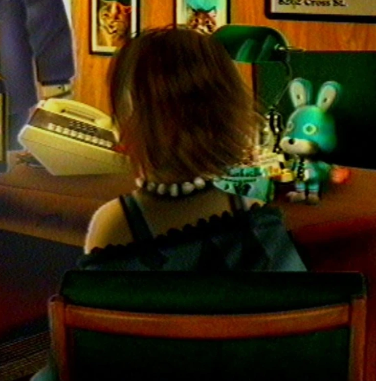

- **第7幕：失踪者たちの顔と記憶の覚醒（27:31～47:10）**
  - 行方不明表示、顔が思い出せないメッセージ。
  - ソフィーは映る「顔」が子どもの頃に知っていた人々であると認識。
  - **ローズマリー（母）の行方不明**、旧宅、学校のスプリングパーティー映像、エド＆モリーの認識へと連鎖。
  - 「この顔、全部知ってる。全員知ってる」＝**自己同定（ウォルテン家の一員）** が成立。

### 判明した事実と人物関係（ファイル3での補強） {#f3-facts}

- **ウォルテン家**
  - ジャック失踪（ボン内部の遺体の可能性示唆が強化）
  - ローズマリー失踪（母であることが明示され、ソフィーの記憶回復の核に）
  - エド＆モリー（「知っている顔」として回収される）
  - ソフィー（記憶消去＝服薬の存在が中心設定として確定）
- **BSI／周辺**
  - スーザン：音声ログで「事件直前」の状況が具体化（ボンの異常、単独確認）。
  - フェリックス：リンダの日記で人格・生活の崩壊と1974年の節目が補強。

### ファイル3の考察（物語上の役割） {#f3-thoughts}

- **ゲーム筐体は単なる作中劇ではなく、1974年の惨事を再生する「記憶喚起装置」** として機能。
- ソフィーの服薬＝記憶の封印に対して、BunnyFarmのグリッチは**外部からの介入（話しかけ）** として働く。
- ファイル1・2が「失踪／死／封印」の輪郭を作り、ファイル3がそれを**ソフィーの主観（覚醒プロセス）** へ接続することで、シリーズの中心軸が「ソフィーの回復と真相への強制接続」であることが確定する。

---

## Guilty（隠し動画／BunnyFarmの補足テープ）

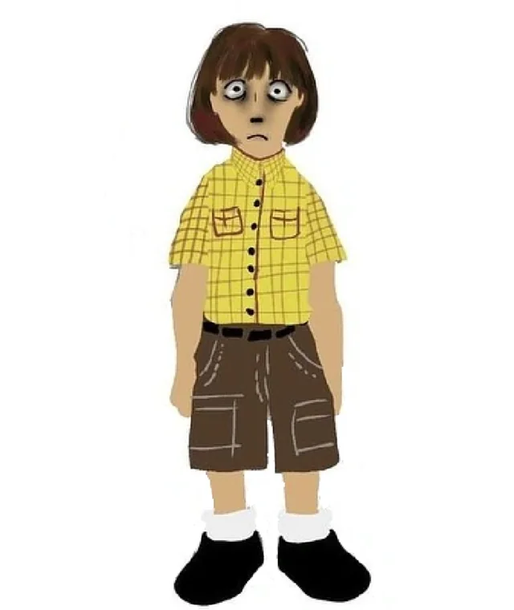

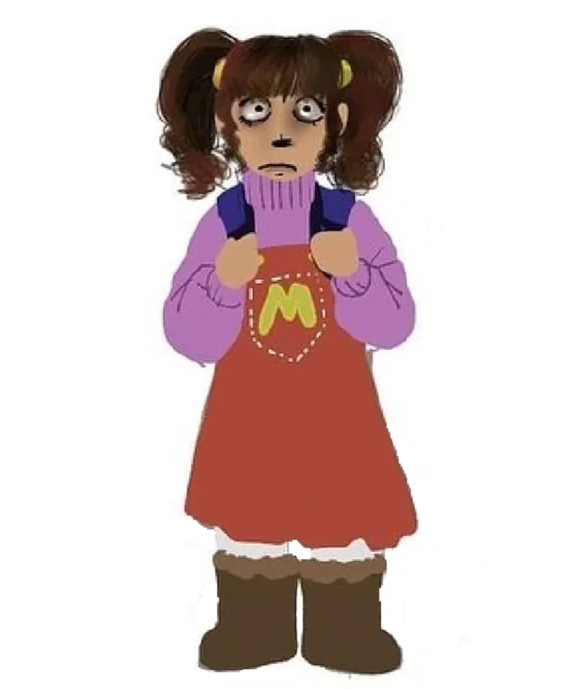

シリーズ2番目の隠し動画。BunnyFarm（ファイル3）内に隠されたリンクから発見できる限定公開動画。2020年10月16日作成、2021年3月19日一般公開。尺は7分4秒。フェリックス・クランケンの3つの異なる時期の音声録音で構成されており、彼の人格の変遷とエド・モリー・ウォルテンの死の真相が本人の口から語られる。

**小目次（ジャンプ）**

- [動画の説明文（翻訳）](#guilty-desc)
- [録音1：会社の挨拶 — 1967年4月15日](#guilty-rec1)
- [録音2：12月のメッセージ — 1972年12月10日](#guilty-rec2)
- [録音3：ギルティ（罪） — 1974年5月2日](#guilty-rec3)
- [Guiltyの考察](#guilty-thoughts)

### 動画の説明文（翻訳） {#guilty-desc}

「エドワード・ウォルテン、モリー・ウォルテンを追悼して：エド（12歳）とモリー（9歳）は1974年5月2日木曜日、致命的な自動車事故で亡くなった。春を祝う学校主催のパーティーから帰る途中だった。父親のジャック・ウォルテンは仕事のため子どもたちをパーティーに連れて行けず、ジャックの友人が代わりに連れて行った。帰路、ジャックの友人は問題のある状態（飲酒）で運転しており、セントジョアナの森の隣の道路付近で車を衝突させ、エドとモリーの命を即座に奪った。忘れないよ、私たちの小さな天使たち、私たちの小さな赤い子どもたち。」

### 録音1：会社の挨拶 — 1967年4月15日 {#guilty-rec1}

フェリックスがバニースマイルズ社の社員に向けて自己紹介と歓迎を述べる。友人ジャックと共に会社を立ち上げたこと、夢を叶えるには「希望」が大事だと語る。チームは小さく予算も少ないが、希望がある限り大丈夫だという前向きなメッセージ。フェリックスの写真と会社ロゴが表示される。

### 録音2：12月のメッセージ — 1972年12月10日 {#guilty-rec2}

フェリックスがBSI社員にクリスマスと新年の挨拶を送る。CyberFun Tech（サイバーファンテック）との契約やBon's Burgersプロジェクトの成功に誇りを持ち、「まさか私たちがここまで来られるとは」と感慨を述べる。フェリックスの写真、CyberFun Techのロゴ、Bon's Burgersのポスター、ブーズーのアニマトロニクスが表示される。

### 録音3：ギルティ（罪） — 1974年5月2日 {#guilty-rec3}

字幕に「車の衝突事故の後」と表示された後、フェリックスの告白が始まる。以下は音声の全文翻訳：

「よし、えっと……ああ、やらかした。ずいぶん久しぶりだ、こういうの使うの。前回これを使ったのは運転中だった……同じ状態で。やらかした。俺には問題がある。そしてこの問題はずっと前からあって、もう思い出せないくらいだ、初めて酔っぱらった時のこと。大抵のことは覚えていない。だからたぶんこのレコーダーをいつも持ち歩いてるんだ。だからたぶん今これを録音してるんだ。だって分かってる、明日になったら、これは全部ただの悪夢だと思うだろうって。エドとモリーは大丈夫だって。でも……大丈夫じゃない。いいか？ 大丈夫じゃないんだ。あの子たちはまだ子どもだった。それにジャック……ああ神様、ジャックに何て言えばいい？ あいつは打ちのめされるだろう。だから埋めたんだ。ジャックがあの子たちに何が起きたか見る、その想像だけで……ジャックはこれまでで最高の親友だ。あいつにそんなことは絶対にしたくない。だから事故が起きた時、俺はただ……パニックになって、森に埋めたんだ。セントジョアナ。セントジョアナの森。道路の隣の森。事故が起きた道路の。どこに埋めたかすら思い出せない。ああ神様、完全にやばい。これからどうすればいい？ レストランは来月オープンする。大丈夫。大丈夫。お前は平気だ。全部うまくいく。」

**映像要素：** フェリックスの沈んだ表情の写真、高速道路、手をつないだ2人の赤い子ども（エドとモリーの象徴）、セントジョアナの森、Bon's Burgersが表示。録音の最後にRocket（ロケット）が画面に現れ暗闇にフェードアウトし、Henry Hallの「Home (When Shadows Fall)」が流れる。録音中のBGMは「Into Each Life Some Rain Must Fall」（The Ink Spots ft. Ella Fitzgerald）でフェリックスの好きな曲とされる。

### Guiltyの考察 {#guilty-thoughts}

**フェリックスの崩壊の軌跡：**
=> 1967年から1974年までの3つの録音を通じて、希望に満ちた起業家だったフェリックスが罪を犯し崩壊していく過程が描かれている。
3つの録音は1967年→1972年→1974年と時系列順に並び、「希望に満ちた起業家」→「誇り高きリーダー」→「罪を犯し追い詰められた人間」への段階的な人格崩壊を描く。タイトル「Guilty（有罪）」はフェリックス自身の罪の告白そのもの。

**飲酒事故と隠蔽の確定：**
=> フェリックス自身の口から飲酒運転によるエドとモリーの死亡と森への遺体隠蔽が語られ、前作までの示唆が確定事実として裏付けられた。
フェリックスが酔った状態で運転し事故を起こし、エドとモリーを死なせたこと、そしてパニックからその遺体をセントジョアナの森に埋めて隠蔽したことが本人の口から直接語られる。これはファイル1〜3での断片的な示唆を決定的に裏付ける証拠。

**時系列の確認：**
=> 開店約2か月前の5月2日に起きた事故を隠蔽して現実逃避を選んだことが、その後の連続失踪・殺害事件の起点となっている。
「来月レストランがオープンする」という発言から、事故（5月2日）はBon's Burgers開店（6月28日）の約2か月前。フェリックスは事故直後から「大丈夫、全部うまくいく」と自分に言い聞かせて逃避しており、隠蔽を選んだことがジャック失踪→スーザン消息不明→ローズマリー殺害という連鎖的悲劇の起点となった。

**レコーダーの意味：**
=> 泥酔による記憶欠落を補うレコーダーは、この告白すら翌日には忘れ去られる危うさを示し、薬で記憶を封じるソフィーと対をなしている。
フェリックスは飲酒で記憶が飛ぶため常にレコーダーを携帯している。つまりこの告白録音自体も、翌日には「ただの悪夢」として忘れられる可能性がある。これは薬で記憶を封じているソフィーと対をなす、「記憶と忘却」を巡る不穏な構造として機能している。

---

## souvenir（ティーザー動画）

2023年9月17日に公開された37秒間のティーザー動画。シリーズの次回作への布石として、K-9施設の天井から吊り下げられた複数のオブジェクトが映し出される。BGMには「Days of Wine and Roses」が使用されている。

**小目次（ジャンプ）**

- [映像に登場するオブジェクトとその象徴](#souvenir-objects)
- [考察ポイント](#souvenir-points)
- [シリーズ全体における位置づけ](#souvenir-position)

### 映像に登場するオブジェクトとその象徴 {#souvenir-objects}

天井から吊るされた各オブジェクトは、シリーズの登場人物を象徴していると考えられる。

- **ボトル2本** — フェリックス・クランケンを象徴。飲酒運転事故を起こした人物であり、アルコール依存の暗示。
- **看板（「JACK」の文字が確認可能）** — ジャック・ウォルテンを象徴。BSIの共同創業者で失踪した人物。
- **工具類** — スーザン・ウッディングスを象徴。技術者であった彼女の職業的側面を反映。
- **彫像** — チャールズを象徴。詳細は不明だが、シリーズに登場する人物の一人。
- **花束** — ローズマリー・ウォルテンを象徴。名前の「Rose（バラ）」との関連が示唆される。
- **人形** — 対応する人物は不明。エドまたはモリーの可能性が指摘されている。

### 考察ポイント {#souvenir-points}

**Bonの感傷的な行動：**
=> 天井から吊るされた品々は、Bonが犠牲者の「記念品」を保管する執着や罪悪感、あるいは支配欲の表れと解釈できる。
天井からオブジェクトを吊り下げるという行為は、Bonが犠牲者の「記念品（souvenir）」を保管しているかのように見える。殺害した相手への執着や罪悪感、あるいは支配欲の表れとも解釈できる。

**「Days of Wine and Roses」の選曲意図：**
=> アルコール依存症を扱った映画主題歌の選曲が、フェリックスの飲酒問題と作品全体を貫く「酒と破滅」のモチーフを強調している。
ヘンリー・マンシーニ作曲のこの楽曲は、アルコール依存症がテーマの同名映画（1962年）の主題歌。フェリックスの飲酒問題と直接的に結びつく選曲であり、シリーズの根底にある「酒と破滅」のモチーフを強調している。

**K-9施設との関連：**
=> 舞台となるK-9保管施設が、機体の隔離場所であると同時にBonが犠牲者の記念品を飾る私的な空間となっている可能性を示している。
映像の舞台であるK-9施設は、Relocate Projectで言及される保管施設と同一と推測される。アニマトロニクスの保管場所であると同時に、Bonが「記念品」を飾る私的な空間として機能している可能性がある。

**タイトル「souvenir」の意味：**
=> 「記念品」を意味する題名は被害者の遺品を集めるトロフィー収集行動と重なり、Bonの本質的な異常性を示唆している。
フランス語で「記念品」「思い出」を意味する。被害者の遺品を記念品として保管するという行為は、連続殺人犯の「トロフィー収集」行動と重なり、Bonの本質的な異常性を示唆している。

### シリーズ全体における位置づけ {#souvenir-position}

この動画はBunnyFarm（ファイル3）以降、約2年ぶりに公開されたコンテンツであり、シリーズの継続を示す重要なティーザーとなった。37秒という短さながら、K-9施設の内部をはじめて視覚的に提示し、各キャラクターの運命を暗示するオブジェクトの配置によって、ファンの考察を大いに刺激した。後に公開される「Spectacle」への直接的な伏線と位置づけられている。

---

## Spectacle（ミニエピソード）

2023年11月11日にWaltenewsチャリティ配信のために制作された4分11秒のミニエピソード。Local 57のレポーター、クリスティン・マーシャルが閉鎖・立入禁止となったBon's Burgersの前から、レストランの歴史と一連の失踪事件について報道する形式をとる。作中設定では、アンソニーが「友人ジョシュアがデトロイトの古いテレビ倉庫から入手したニュースレポート」と説明している。

**小目次（ジャンプ）**

- [映像の内容](#spectacle-content)
- [考察ポイント](#spectacle-points)
- [シリーズ全体における位置づけ](#spectacle-position)

### 映像の内容 {#spectacle-content}

**母親のインタビュー：** ある母親が、同僚が誕生日祝いのためにBon's Burgersに行ったことを語り、レストランにまつわる超常現象の噂を信じていなかったと述べる。インタビュー中にはレストラン内部の映像やBon's Burgersコマーシャルの映像が挿入される。

**デレック・コリンズのインタビュー：** ブライトン警察署の主任刑事。1974年夏に起きた6件の失踪について語り、ジャック・ウォルテンの失踪が「転換点（breaking point）」だったと述べる。Local 57が失踪事件と超常現象を結びつけて「見世物（Spectacle）」にしていることへの不快感を表明する。

**レストランの状況報告：** 夜間に大音量の音楽が流れる、車のアラームやライトがつけっぱなしにされるなどの不審な報告。閉鎖後、建物は立入禁止となり、都市伝説のせいで買い手がつかなかったが、不法侵入や破壊行為が繰り返されている。ローズマリー・ウォルテンとスーザン・ウッディングスの行方不明ポスターが映し出される。

**結末の異変：** クリスティンが「Bon's Burgersの不気味な存在感（the disturbing presence of Bon's Burgers）」と言った瞬間に映像が一時停止し、助けを求めるくぐもった声（おそらくローズマリー）が聞こえる。ローズマリー・ウォルテンの霊体がスクリーンに近づき、歪んだ顔が一瞬映し出される。その後、Sha（アニマトロニクス）の上にローズマリーの顔が重なり、ステージ上のBonの隣に立つ。最後にローズマリーの顔が画面を埋め尽くし、「I'm still here（私はまだここにいる）」というテキストが表示される。

### 考察ポイント {#spectacle-points}

**時系列の手がかり：**
=> 「開店から4ヶ月前」という発言から、この報道は建物が使用禁止となった後の1974年11月〜12月頃に収録されたものと推定される。
クリスティンが「Bon's Burgersは4ヶ月前にオープンした」と発言しているため、このレポートは1974年11月または12月に収録されたと推定される（レストランは1974年6月28日にオープンし、7月20日に閉業、10月31日に建物使用禁止となっている）。

**「I'm still here」の顔の正体：**
=> 終盤の顔と「I'm still here」の発信主体はジャックではなく、制作陣の言及によりローズマリー・ウォルテンであることが確認されている。
前髪がないことや不気味な顔つきからジャック・ウォルテンだと誤解するファンが多かったが、制作陣（Eva）の言及によりこの説は否定されており、この顔および「I'm still here」の発信主体はローズマリー・ウォルテンであると確認されている。

**タイトル「Spectacle」の二重の意味：**
=> 事件を興味本位に扱う報道への批判であると同時に、閉鎖された店舗自体が恐怖の「見世物」と化している皮肉を表している。
作中でデレック・コリンズがLocal 57のレポートを「Spectacle（見世物）」と批判しているが、同時にBon's Burgers自体が恐怖の「見世物」と化していることへの皮肉でもある。

**ローズマリーの存在とShaとの関係：**
=> Shaに重なる顔とメッセージは店舗内に囚われたローズマリーの存在と結びつきを訴える一方、単体で即断せずシリーズ全体と合わせて読む必要がある。
結末でローズマリーの顔がShaの上に重なる演出は、ファイル2と同様に彼女とShaの強い結びつきを示唆する一方、この映像単体の演出だけで即座に「Shaに宿っている確定描写」と断定するのは慎重であるべき点も留意される。「I'm still here」というメッセージは、彼女がまだレストラン内に囚われ存在し続けていることを訴えている。

**Local 57の元ネタ：**
=> 番組名「Local 57」は、アナログホラー作品『Local 58』へのオマージュである可能性が指摘されている。
アナログホラーシリーズ「Local 58」（Kris Straub制作）へのオマージュの可能性が指摘されている。

**1974年夏の6件の失踪：**
=> 刑事の証言により、ウォルテン家の面々やスーザンを含む6件の失踪が開店前後から営業期間中に集中していたことが裏付けられる。
デレック・コリンズが言及する「6件の失踪」は、ジャック、ローズマリー、スーザン、エド、モリーなどの失踪を指すとみられ、これらがすべてBon's Burgersの開店前後〜営業期間中に集中して起きたことを裏付ける重要な証言。

> [!info] 補足：Spectacleの解釈に関する整理
> - 「I'm still here」を発している主体は **ローズマリー・ウォルテン** と解釈するのが妥当。
> - 過去のコミュニティで広がった「終盤の顔はジャックでは？」という誤解は、制作陣の言及で否定されている。
> - 終盤の「ローズマリーの顔がShaに重なる」演出は象徴的な示唆を含みつつも、このカット単体で即断せずシリーズ全体の描写と合わせて読む必要がある。

### シリーズ全体における位置づけ {#spectacle-position}

souvenirに続いて公開されたこのミニエピソードは、シリーズ本編・ファイル4（CyberFun Tech）への繋ぎとなる作品。「ニュースレポート」という外部視点からBon's Burgers事件を描くことで、事件の社会的影響や世間の認知を初めて提示した。また、ローズマリーの霊的存在がより明確に描かれ、Waltenewsチャリティ配信企画でありながら本編時系列では「1974年末のニュース報道」として重要な役割を担っている。

---

## ファイル4 — CyberFun Tech

2024年2月9日公開。シーズン1Bの第4話。CyberFun Tech Collection（3部作）のパート1。BunnyFarmに続く「発見されたテープ」形式だが、本作からはよりシネマティックな演出が主軸になる。主な時系列は1970年〜1974年7月1日、スーザン・ウッディングスの死に至るまでの経緯を中心に描く。

**小目次（ジャンプ）**

- [① オープニング（1974年5月2日 スクールダンス）](#f4-01)
- [② チャールズ・ブルックのノート（1970年10月10日）](#f4-02)
- [③ Showstoppersのパフォーマンスとコンセプトアート解説](#f4-03)
- [④ BSI Consoleに関する2枚のノート](#f4-04)
- [⑤ WALKAROUND TEST（1974年1月21日）— Banny](#f4-05)
- [⑥ FACIAL TRACING（1974年3月7日）— Sha](#f4-06)
- [⑦ 1974年5月13日テスト — Rocket事件](#f4-07)
- [⑧ THE FIRST（1974年6月30日）— スーザン殺害](#f4-08)
- [⑨ 1974年5月3日 午前0時23分 — ジャックがフェリックスの家へ](#f4-09)
- [⑩ 1974年5月3日 午前8時56分 — フェリックスの森・自殺未遂](#f4-10)
- [⑪ 1974年5月5日 — フェリックスの告白（自宅）](#f4-11)
- [⑫ 1974年7月1日 午前1時36分 — Wonderlandの会話](#f4-12)
- [Wikiから得られる補足情報・トリビア](#f4-trivia)
- [主要ポイントまとめ](#f4-summary)

> [!note] パート別記録について
> ①〜④はWiki公式トランスクリプトに基づく詳細翻訳、⑤〜⑫は各シーンの要点整理としてまとめている。

### ① オープニング（1974年5月2日 スクールダンス）

【演出】黒背景の画面を風船が落ちていく場面から始まり、巻き戻るとスクールダンスの夜だと判明。赤いプラスチックカップ、廊下、影から現れるエドとモリー、Rocketが入ったモリーのバックパックが映される。

エドワード・ウォルテン：「ほら、モリー。行こう」

【スクールジム。「Brighton Community School SPRING PARTY EVENT」の看板】

エド：「こっち！」「ほら、あそこにいるよ……」

【テーブルで酒を飲んで突っ伏しているフェリックスへと向かう。部屋の外には「ADULT ZONE No children allowed.（大人ゾーン 子供立入禁止）」の看板。場面は白くフェードし、一瞬Wonderlandが現れる】

【Bunny Smiles Incorporated Distributionロゴ→BSCロゴ→Bon's Burgers店頭→激しく踊るBon→ティッシュを口に咥えた子供→CyberFun Techロゴ。テープ巻き戻しでクリップ再現、Wonderland内にフェリックスの車、ソフィー・ウォルテンがジャック・ウォルテンの行方不明ポスターを見る瞬間も挿入。暗い部屋にShowstoppersの段ボール切り抜きと人形、「CyberFun Tech」の文字。早送りでCyberFun Techロゴへ戻り、Video menuが現れる。選択肢：bons_burgers_promo／cyberfun_programming_demo／sha_joint_movemeant／bsi_cleaning_procedure】

### ② チャールズ・ブルックのノート（1970年10月10日）

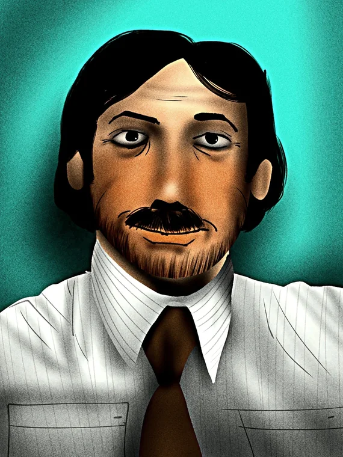

【BSI Employee Notebookが映され、以下が書かれている】

「やあ！『無名のBunny Smilesレストラン』のコンピュータ・スーパーバイザーとして正式に雇われたよ（自分でもいくつか名前を考えてるんだけどね）。彼らとはもう長い付き合いで、家族みたいなもんだ！スーザンと一緒に何年も彼らの仕事を手伝ってきた、CyberFun Tech以前からね！ウォルテンたちとクランケンたちに会えたのはすごく楽しかった！働き始めるのが楽しみだ！未来は明るい」[P. 27:12] -C.B.

※「P. 27:12」は聖書『箴言27章12節』（賢い者は災いを見て身を隠す、浅はかな者は進んで行って痛い目にあう）への暗示と考察されている。

### ③ Showstoppersのパフォーマンスとコンセプトアート解説

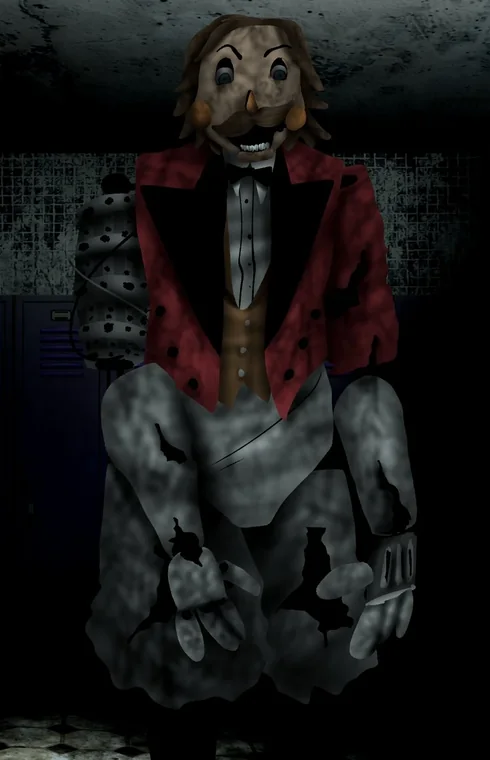

【Bon's Burgersのショー映像。「All I See is You」が流れ、ロゴ表示、観客の拍手、カーテンが開きShowstoppersが現れ「THE SHOWSTOPPERS」と表示される】

- Boozoo：「Tip Through the Tulips」（Sweet Tuesdayカバー版）／下部「BOOZOO」／庭にいる小型Boozoo
- Banny：「Drift Away」／下部「BANNY」／テーブルを囲む子供たち→カートゥーン版Bannyが花畑と目付きの太陽の中で跳ね回る
- 【グリッチ】食事エリア→Backstageドア→テープ再開
- Sha：「Sweet Music」／下部「SHA」／花を背景にしたカートゥーンSha
- Bon：「I Can't Feel Anything」／下部「BON」／森の映像とカートゥーン版が出るべき位置に赤い検閲が入る／「Bon」が一瞬映り、顔が一瞬現れる

→テープは「CBF-72」とラベルされたメカ頭部へ切り替わり、CyberTellyの声が聞こえる。

CyberTelly：「美しいだろう？これはCyberFun Techが作った最初期のメカモデルの一つだ……Bon's Burgersの魔法に命を吹き込むためのね！」

CyberTelly：「今日は、Showstoppersたちの魔法と、彼らがどのように作られたのかを巡る旅に出ます。我が社の品質について、何か新しいことを学べるかもしれませんよ」

CyberTelly：「これがShowstoppersです！Bunny Smiles Inc.の顔となる存在です。コンセプトアートは、優れたデザインに欠かせない非常に重要な工程です！素晴らしいアイデアがたくさん挙がりました」

CyberTelly：「Bunny Smiles Inc.のアート部門は、各キャラクターの複数のデザイン候補を選定し、皆さんがよく知る、愛されるデザインを生み出す役割を担っていました！」

【ローズマリー・ウォルテンの写真】

CyberTelly：「ローズマリー・ウォルテン——[ジャック・ウォルテンの部分は遮断]の愛する妻であり、詩や演劇への深い情熱を持つ、優れたアーティストです！BSIのリードアーティストになる以前から数々の作品を手掛けてきました。今のキャラクターたちの最終デザインを担当したのが、彼女なのです！」

ローズマリー・ウォルテン：「私の中では、それぞれのキャラクターがどんな見た目になるか、最初からかなり明確にイメージできていたと思います。私の中ではデザインは自然と頭の中で形になっていきました。若い世代に親しんでもらえるようにしたかったし……それでいて、覚えやすいシンプルさも大切にしたかったんです」

スーザン・ウッディングス：「Bunny Smilesは元々、アニマトロニクスの設計図を作ってもらうためにCyberFunに依頼したんです。でも、私たち全員がそのアイデアにのめり込んでしまって、結局BSIと完全に提携することになりました」

スーザン：「私はスーザン・ウッディングス、BSIのリードテクニカル・エンジニアです——！」

【テープがグリッチして、複数の肩書きが連続表示される。スーザンがCyberFun TechからBSIへ深く関与した人物であることを示唆】

スーザン：「私たちはモデルに数えきれないほどの機能を追加しました……歩行能力や、観客と交流する能力さえ持たせることに成功したんです」

【Norman Pooltrickからの手紙が逆さま反転で表示。スーザン失踪への疑義と、フェリックスへの照会が明記される】

スーザン：「ここが、オーディオ・アニマトロニクスの全情報とコードが格納されている場所です。歩いたり、歌ったり、観客と交流したり、そういった機能のすべてですね。だからこそ、観客にとってあれほど生き生きと感じられるのです。コンソールは特定の人物や場所を認識することもできます」

### ④ BSI Consoleに関する2枚のノート

【1枚目：BSI Console】

「Bunny Smiles Incorporatedのコンソールは、Bon's Burgersのロボットをより生き生きとさせ、より楽しく印象的な体験を可能にする。これは野心的で革新的なコンセプトだと思う。自分の人生でこんなものを作るとは思わなかった。スーザンは全く期待を裏切らなかった。実に見事で繊細な仕事だ。ジャックは魅了されていた、こんなものは見たことがないと！フェリックスは感動と恐怖の両方を抱いていた、彼は仕組みを全く理解していない」

【2枚目：ウォークアラウンドテスト（第1〜2週）】

- 第1週：Bannyがテーブルを倒した。部屋認識機能を再調整。Bonのテストは良好。Boozooの手品は概ね成功。
- 第2週：Banny修理完了。Bonのウォークアラウンドは予想以上に良好。マスク破損と予備パーツの記録あり。

### ⑤ WALKAROUND TEST（1974年1月21日）— Banny

スーザンとチャールズが実機テストを実施。Backstage内の障害物を避けて移動するはずのBannyはテーブルへ衝突し転倒。二人の会話から、初期段階では部屋認識がまだ不安定で、試行錯誤で調整していたことが分かる。

### ⑥ FACIAL TRACING（1974年3月7日）— Sha

顔追跡テストで、スーザンとチャールズの認識は成功。会話内ではフェリックスの飲酒問題が示唆され、ジャックとローズマリーがその深刻さを把握していない可能性が語られる。技術検証の裏で、組織内の不穏な人間関係が同時に進行していることを示す場面。

### ⑦ 1974年5月13日テスト — Rocket事件

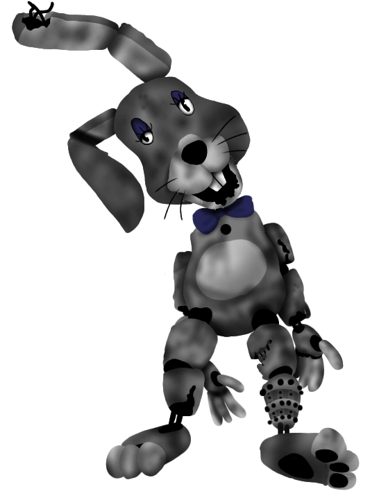

会話内で5月2日の事故と葬儀が言及される。フェリックスがRocket人形をBackstageに持ち込んでいたことが明らかになり、スーザンとチャールズは関与を避けようとする。二人が去った後、Rocketが自律的に移動。コンソールはエド/モリーに対応する顔を捉えるが、通常認識に失敗しエラー表示となる。ここで霊的干渉とシステム表示の接続が初めて視覚的に示される。

### ⑧ THE FIRST（1974年6月30日）— スーザン殺害

スーザンはBackstageで単独点検中、暗所でBonに襲撃される。頭部拘束→顔面損傷→頸部致命傷という流れで殺害され、遺体は引きずられて画面外へ運ばれる。のちの文脈でBannyへの詰め込みと接続される、タイトル通り「最初の殺人」の中核場面。

### ⑨ 1974年5月3日 午前0時23分 — ジャックがフェリックスの家へ

ジャックはフェリックス宅へ押しかけ、怒号と懇願を繰り返す。終盤で「もしお前があの子たちに何かしたなら、俺はお前を殺してやる」と明言。フェリックスが後に語る恐怖感の背景として、極めて重要な直接描写。

### ⑩ 1974年5月3日 午前8時56分 — フェリックスの森・自殺未遂

森での埋葬痕、3つ目の穴、崖際での所持品投棄、飛び降り未遂までが連続で描かれる。事故後のフェリックスが「隠蔽」と「自滅」の間で揺れ続けていたことが具体化される。

### ⑪ 1974年5月5日 — フェリックスの告白（自宅）

フェリックスの独白で、ジャックとローズマリーに事故を伝えたこと、両者に憎まれている自覚、Rocketを処分できない恐怖が語られる。窓外やノック音と合わせ、エド/モリーの干渉が心理的恐怖として持続している演出。

### ⑫ 1974年7月1日 午前1時36分 — Wonderlandの会話


BonがスーザンをBannyに詰め込む現実側描写と、Wonderland側での「Bon（灰色の存在）」の対話が並行する。ここで示される要点は次の通り。

- 「Bon（存在）」はアニマトロニクスBonとは別位相で振る舞う。
- スーザンは死後直後の状態で、器への接続を勧められる。
- エド/モリーはRocket側として介入し、スーザンを守ろうとする立場を取る。

この場面により、「魂」「器」「誘導者」という作中ルールの輪郭が一気に明確化される。

### Wikiから得られる補足情報・トリビア

- **制作背景：** 本作は当初長尺構想だったが3部作に分割。シリーズ内で特に大規模な転換点と位置づけられる。
- **オープニングの反復：** エドの「Come on, Molly. Let's go.」は冒頭と終端で対応し、循環構造を作る。
- **VHSメニュー演出：** 本来の媒体挙動として不自然なUIを意図的に挿入し、メタ的違和感を強化。
- **「Bon」の常時出現：** フレーム単位の出没で、物理映像と霊的層の混線を示唆。
- **顔認識テストの伏線：** ソフィー認識不安定の示唆が、ファイル1の誤認殺害（ブライアン誤認）と接続可能。
- **Normanの手紙：** 外部企業（CyberFun）からBSIに対して正式疑義が向けられていた証拠。
- **時系列提示：** 断片構成だが、日付キャプションにより再構成可能。

### 主要ポイントまとめ

1. **スーザン・ウッディングスの死の確定描写**：1974年6月30日、BackstageでBonに襲撃される。
2. **「Bon（灰色の存在）」の独立性**：機体Bonとは別概念として行動している。
3. **Wonderlandの法則**：魂は器との接続が重要で、誘導が行われる。
4. **エド/モリーとRocketの導線**：霊的干渉が現実系システム表示にも現れる。
5. **フェリックスの心理と行動**：隠蔽、告白、恐怖、自殺未遂が短期間に連鎖。
6. **ジャックとの対立の明文化**：5月3日の訪問場面が、失踪前夜の緊張を具体化。

---

## フェリックス・クランケンの行動整理（ファイル1〜4総括）

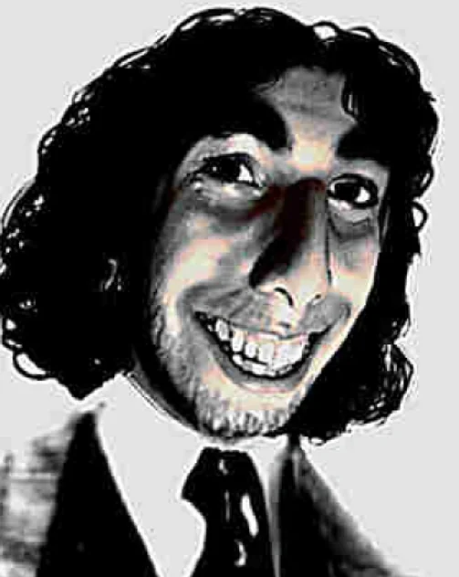

シリーズ全体を通して事件の発端となったフェリックス・クランケンの行動について、「確定事実」と「未確定の仮説」を切り分けて整理する。

**小目次（ジャンプ）**

- [確定事実（ファイル1〜3・Guilty）](#felix-facts)
- [ファイル4で判明した直後の動向](#felix-file4-update)
- [仮説（未確定）](#felix-hypothesis)

### 確定事実（ファイル1〜3・Guilty） {#felix-facts}

- フェリックスが**飲酒運転で事故**を起こし、同乗していた**エドワード・ウォルテンとモリー・ウォルテン（ジャックの子ども二人）を死なせた**（1974年5月2日）。
- その後、二人の遺体を**セントジョアナの森に隠蔽**した（K-9保管施設が後に設置される場所と同じ）。
- ジャックがエドとモリーが帰ってこないことに気づき、電話や直接訪問でフェリックスに確認を取り始めた。
- フェリックスには深刻な飲酒問題があった（リンダの日記で1964〜1974年にかけて悪化が記録）。
- リンダ・トンプソンが1974年5月2日にフェリックスのもとを去っている。
- ジャック・ウォルテンは1974年6月11日に失踪。
- スーザンがボンの異常を確認しようとした夜（1974年6月30日）、フェリックスは来なかった。
- ジャック失踪後、フェリックスがBSIを単独で掌握し、移転プロジェクト（1978年）を主導。

### ファイル4で判明した直後の動向 {#felix-file4-update}

- **1974/05/03 深夜（午前0時23分）**：ジャックはフェリックス宅に押しかけ「子どもたちに何かしたなら殺す」とまで言及。フェリックスが強い恐怖を抱く十分な根拠があったことが直接描かれた。
- **1974/05/03 朝（午前8時56分）**：フェリックスは遺体を埋めた森で自殺を試みるが未遂に終わる。
- **1974/05/05**：フェリックスはジャックとローズマリーに「事故」を告げるが、遺体隠蔽や証拠隠滅の詳細まで話したかは不明。
- **1974/05/13 以降**：Rocket（エド＆モリーが宿った人形）を処分できずBackstageへ持ち込んでおり、**霊はアニマトロニクス以外（人形）にも宿りうる**作中ルールが補強された。

### 仮説（未確定） {#felix-hypothesis}

- **ジャックがエド・モリーの遺体隠蔽の真相に辿り着いたため、フェリックスに排除された可能性** — 状況証拠的に筋は通るが、ジャックがどこまで真相を知ったかの直接描写はなく、フェリックスがジャックを殺害したという確定的証拠もない。
- **フェリックス＝シャドーマン説** — 施設へのアクセス権、BSI掌握後の立場、他の魂（シャ＝ローズマリー）の行動を妨害する動機などから有力だが、確定には至っていない。
- **飲酒事故の隠蔽が、その後の連鎖的な事件（ジャック失踪→スーザン殺害→ローズマリー殺害…）の起点になっている可能性** — 一つの罪を隠すために次の惨劇が連鎖する構造。ただしフェリックス自身の関与範囲と「Bon（灰色の存在）」の行動原理の境界は引き続き検証が必要。